## Proposed change
One sub-ticket, all in `README.md`. The diff is about 70 lines.

**A. New subsection.** Insert the text below between the existing diagram's caption (README:218-219,
ending "…and the clerk relay.*") and `### Ticket states` (README:221). Keep one blank line before
`### Ticket states`. The prose may be reworded, but every claim must stay true to part E. The
diagram's edges, the three `classDef` lines and the subgraph title `"a later ticket"` must stay as
given, because the acceptance checks them.

````markdown
### How a spec changes and feeds later tickets

A spec changes in a few set ways, and every version it passes through stays in the store. Each spec
writer output becomes the spec's next numbered version, and the critic judges the newest. At the
gate a human approves the newest version or sends it back with notes (`request-changes`). An edit
made at the gate is approved as the next version. Approval pins one version: the build works from
it, and the harness copies it into the ticket's change folder, `openspec/changes/<id>/`. Every
sub-ticket records the version it was planned from as `planned_from`. Before a sub-ticket's first
implementer run, the drift check parks it when the spec no longer matches the integration branch,
for example when a test changed there that the spec's "Tests to change" does not list. After the
gate a human changes the spec in one of two ways. `spec amend` pins the next version when the
intent is unchanged; the plan stands, and `resolve --ruling` resumes the parked sub-ticket. A
re-spec, `resolve --to spec-gate`, sends a parked parent back to the gate; the plan made from a
newer approved version supersedes every unmerged sub-ticket of an older one, and its sub-tickets
take the next free ids. When the final check fails after every sub-ticket merged,
`resolve --replan` sends the parent back to the planner. On success, `archive` folds the spec's
changes into current truth and appends its Decisions lines to the decision log, which a human can
also add to. A later ticket's triage reads an index of current truth and names the capabilities it
touches. Its spec writer and critic receive those capabilities in full and the decision log; its
planner receives the decision log only.

```mermaid
flowchart LR
  classDef human fill:#fbf0dc,stroke:#9a5b00,color:#1b2430
  classDef orch fill:#f3f5f8,stroke:#1b2430,color:#1b2430
  classDef store fill:#dcefef,stroke:#0f6e73,color:#1b2430

  SW["Spec writer"]:::orch -- "each output is the next version" --> V[("spec versions<br/>v1 · v2 · … · vN")]:::store
  V --> SC["Spec critic"]:::orch
  SC -. "revise · once" .-> SW
  SC -- approve --> G{"Spec gate"}:::human
  G -. "request-changes · notes" .-> SW
  G -- "approve-spec pins vN · --edit F pins F as vN+1" --> CF[("change folder<br/>the pinned version")]:::store
  CF --> PL["Planner, or the whole spec<br/>as one sub-ticket"]:::orch
  PL -- "planned_from = the pinned version<br/>supersedes unmerged sub-tickets of an older one" --> SB[("sub-tickets")]:::store
  SB --> DR["drift check<br/>before a first implementer run"]:::store
  DR -- "no drift" --> BL["implementer · checks · merge"]:::orch
  BL -- "every sub-ticket merged" --> PC["Verifier<br/>whole spec"]:::orch
  PK{"parked ticket"}:::human
  DR -. "BLOCKED: spec drift" .-> PK
  PC -. "fails" .-> PK
  PK -- "spec amend · intent unchanged" --> AM[("next version pinned<br/>plan kept")]:::store
  AM -- "resolve --ruling F" --> BL
  PK -- "resolve --to spec-gate · re-spec" --> G
  PK -- "resolve --replan F · every sub-ticket merged" --> PL
  PC -- verified --> AR["archive"]:::store
  AR -- "folds the changes" --> CT[("current truth<br/>one spec per capability")]:::store
  AR -- "appends the Decisions lines" --> DL[("decision log<br/>decisions.md")]:::store
  HD["a human<br/>decision add · resolve --decision"]:::human -- "appends a line" --> DL

  subgraph L["a later ticket"]
    direction LR
    TR2["Triage"]:::orch -- "Capabilities: line" --> SW2["Spec writer · critic"]:::orch
    PL2["Planner"]:::orch
  end
  CT -- "index of every capability" --> TR2
  CT -- "named capabilities in full · index of the rest" --> SW2
  DL -- "the whole log" --> SW2
  DL -- "the whole log · no current truth" --> PL2
```



*A spec's life, from its first version to the current truth later tickets read. Colours as above;
dashed edges are the bounded loops and the routes to a human.*
````

**B. Clerk node.** Replace README:209 with this line, and change nothing else in that diagram:

```
  CL["clerk agent · Workflow-script path only<br/>runs one bin/factory command per record, all but<br/>the settings the launch copy carries; factory drive needs none"]:::orch
```

**C. Regeneration table.** In "Regenerating this page from scratch", replace the `| How a ticket
moves |` row (README:1096) with:

```
| How a ticket moves | `factory/workflows/intake.js`, `build.js` (the `phase(...)` blocks and the `STATUS` routes); `factory/gates.py` `ticket_join`, `merge_cmd`, `archive_cmd`; for the spec's life, `factory/human.py` (`approve_spec`, `request_changes`, `spec_amend`, `resolve`), `factory/subtickets.py` `split_plan`, `factory/drift.py` `_check_drift`, `factory/specstore.py` `archive` and `factory/compose.py` `compose` (each role's inputs) | read the code; confirm against the last closed ticket's run log in `.factory/store/log/` |
```

**D. Status date.** Set the date in README's **Status** row to the day of the change, as "Maintaining
this page" asks.

**E. PR description.** Copy this table into the PR description. It is the request's own check that
each labelled edge cites a code route. Re-check each line number against the branch's base.

| Edge in the new diagram | Route in the code at `81482fe` |
|---|---|
| Spec writer → spec versions, "each output is the next version" | `factory/drive.py:287-294`, `factory/workflows/intake.js:184,188` (`spec add --from-run`); `factory/cli.py:407-410` `spec_add`; `factory/common.py:29-39` `_add_spec_version` |
| spec versions → Spec critic | `factory/compose.py:297-298` (the critic reads `specs/<id>/v<version>.md`) |
| Spec critic → Spec writer, "revise · once" | `factory/drive.py:315-322` (REVISE, below the round limit); `factory/workflows/intake.js:203-204` |
| Spec critic → Spec gate, "approve" | `factory/drive.py:307-308`; `factory/workflows/intake.js:197-198` |
| Spec gate → Spec writer, "request-changes · notes" | `factory/human.py:164-177`; `factory/cli.py:790`; the notes reach the writer at `factory/compose.py:293-294` |
| Spec gate → change folder, "approve-spec pins vN · --edit F pins F as vN+1" | `factory/human.py:130-160` (`--edit` at 146, `specstore.pin` at 148); `factory/cli.py:788` |
| change folder → Planner, or the whole spec as one sub-ticket | `factory/drive.py:336-354`; `factory/cli.py:499-515` `_planner_needed`, 518-546 `plan_whole_spec` |
| Planner → sub-tickets, "planned_from … supersedes …" | `factory/cli.py:487` (in `_create_subtickets`, used by both); `factory/cli.py:461-473`; `factory/subtickets.py:159-175` `split_plan`, `superseded_by_plan`; the next free ids at `factory/compose.py:329-330` |
| sub-tickets → drift check | `factory/cli.py:195-197` (`run start` for an implementer); `factory/drift.py:42-50` |
| drift check → implementer · checks · merge, "no drift" | `factory/drift.py:56` (no findings, no refusal) |
| drift check → parked ticket, "BLOCKED: spec drift" | `factory/drift.py:57-58`; parked as given by `factory/drive.py:190-196` |
| implementer · checks · merge → Verifier, "every sub-ticket merged" | `factory/drive.py:403-418` |
| Verifier → parked ticket, "fails" | `factory/drive.py:417-418` |
| parked ticket → next version pinned, "spec amend · intent unchanged" | `factory/human.py:31-98` (plan kept at 76-79); `factory/cli.py:717` |
| next version pinned → implementer, "resolve --ruling F" | `factory/human.py:236-237`; with a ruling on file the drift check is skipped, `factory/drift.py:50` |
| parked ticket → Spec gate, "resolve --to spec-gate · re-spec" | `factory/human.py:265-270`; `factory/cli.py:799` |
| parked ticket → Planner, "resolve --replan F · every sub-ticket merged" | `factory/human.py:278-290`; `factory/cli.py:803` |
| Verifier → archive, "verified" | `factory/drive.py:421`; `factory/gates.py:291-303` `archive_cmd` |
| archive → current truth, "folds the changes" | `factory/specstore.py:405-414` |
| archive → decision log, "appends the Decisions lines" | `factory/specstore.py:415-417` |
| a human → decision log, "appends a line" | `factory/human.py:330-334` (`decision add`), 190-196 (`resolve --decision`); `factory/specstore.py:6-7` |
| Triage → Spec writer · critic, "Capabilities: line" | `factory/compose.py:28-43` `triage_capabilities`, 210-218 `selected` |
| current truth → Triage, "index of every capability" | `factory/compose.py:265-270` |
| current truth → Spec writer · critic, "named capabilities in full · index of the rest" | `factory/compose.py:220-229`, 280-281, 299-300 |
| decision log → Spec writer · critic, "the whole log" | `factory/compose.py:231-237`, 282, 301 |
| decision log → Planner, "the whole log · no current truth" | `factory/compose.py:325` |
| clerk node (part B) | `factory/workflows/build.js:18-20` (the launch copy carries the settings), 45-50 `clerk()`; `factory/drive.py:1-5` (no clerk) |

## Tests to change
none. No test reads README's text (Evidence). The three `harness-docs` requirements that hard-code
1,110 are restated under MODIFIED in the capability spec.
