## Context for this run (composed by the harness, not part of the request)

Repository: `spec-factory`, the design repo at `~/dev/spec-factory` (branch `main`). It holds the
design and the harness that runs it:
- `docs/design.md`, the design document and the source of truth, with its changelog in
  `docs/changelog.md`;
- `docs/prompts/`, each file a verbatim copy of one prompt block in the design doc; it changes only
  by re-copying that block;
- `dev/`: `dev/issues.md`, this repo's issue index, kept live; and the build spec, its plan and the
  P0 walking skeleton, frozen as history from building the harness, which no change updates;
- the harness, as code in this repo: `factory/` (the package, its role prompts and its workflow
  scripts), `bin/factory` (the entry point), `agents/` (the agent definition templates) and
  `tests/factory/` (its suite). Install with `uv sync --frozen`; test with
  `uv run --frozen pytest -q -p no:cacheprovider tests/factory`;
- `.factory/`, this repo's own instance of the factory: `instance.yaml`, this briefing,
  `harness.lock`, closed records (`answers/`, `green-pilot/`) and the live store, `store/`.
  The store is a checkout of its own branch, `factory-store`; the operator commits it there, so a
  store commit never moves `main`.

Two checkouts. Tickets are built and merged in the dev checkout, `~/dev/spec-factory` on `main`.
The factory runs from the runtime checkout, `~/dev/spec-factory-harness`, a detached worktree of
this repo at the harness revision `.factory/harness.lock` has accepted. A merge into `main` never
changes the running code; only the upgrade step moves the runtime, after which the instance
refuses its store until `--accept-harness`. Your shell may start in another directory: use
absolute paths, or `cd ~/dev/spec-factory && <cmd>`.

The Nanobot fork at `~/dev/nanobot-upstream` (branch `feat/lionbot-v3.5`) is instance A: a target
with only `.factory/`, run from the same runtime by its own Driver session. This repo's harness was
imported from its retired `feat/lionbot-v3` branch. Read it only to observe what a fix does there; never write there, and never copy its test names,
line numbers or commit SHAs into a spec. Never read or write `~/.nanobot/` (live credentials).

Acceptance commands must be runnable as written from `~/dev/spec-factory` (grep, sed, diff,
`git diff --check` against the documents, the harness suite). A change to the design doc keeps its
own conventions: its changelog entry in `docs/changelog.md`, and any `docs/prompts/` file whose
block changed re-copied from it.

The request is an issue draft, written from a real pipeline run: where in the documents,
what happened (the evidence), why it matters, a proposed fix, and the Nanobot-side commit
where a harness fix already exists. The evidence is the requirement; the proposed fix is the
requester's suggestion, not a requirement. Verify the as-built fix in the reference harness
before relying on it; a NEW criterion that already passes on this checkout proves nothing.

Output: write your complete output, in your role's required format and ending with the
STATUS / CONFIDENCE / ESCALATIONS trailer, to the file named under "Output file" below. For
every role but the implementer that is the only file you may create or modify. The implementer
also changes files in its own worktree and commits there, and nowhere else. Then return the same
text as your final message.

This repo's current-state page is the top-level `README.md`. A change to a command, state, stop or
path updates it in the same ticket; read its "Maintaining this page" section before editing it.

Who reads what the roles write here: the operator at the spec gate, and a technical reader new to this project reading the README or a PR description. Gloss every term specific to the factory at first use (docs/writing.md).
## Output file
`/Users/dphang/dev/spec-factory/.factory/store/runs/run-0543-critic/output.md`

## Running code
Run every test, script or prototype through this wrapper, which gives it a fresh temporary HOME so it cannot write the operator's real home directory: `([ -z "${VIRTUAL_ENV:-}" ] || PATH=$(printf %s "$PATH" | tr : '\n' | grep -vxF "$VIRTUAL_ENV/bin" | paste -sd: -); unset VIRTUAL_ENV PYTHONHOME; export HOME="$(cd "$(mktemp -d)" && pwd -P)"; <command>)`. Put your command in place of <command>. This includes every test or check command the briefing above gives. A throwaway HOME does not stop a write to an absolute path: never run anything that could write a protected path outside the repository.

## Scratch directory
Put every file you make for your own use in this run under `/Users/dphang/dev/spec-factory/.factory/store/runs/run-0543-critic/scratch`: no other run uses it. The harness clears it when the ticket moves on, and keeps it while the ticket is parked.

## Spec under review (v1)

=== proposal.md
## Problem
`README.md` is the page a new reader learns this system from. Its one flow diagram, under "How a
ticket moves", shows only the simple case. A request becomes a spec. A human approves the spec at
the spec gate, the one sign-off before any code is written. The build then carries it to a closed
ticket, and the spec never changes on the way.

In practice a spec changes often, and the diagram draws none of it. A spec goes through numbered
versions while the reviewing agent (the critic) sends it back. The human can edit it at the gate.
After the gate it can be amended, or sent back to the gate for a new plan that replaces the
unbuilt parts of the old one. When a ticket closes, its spec is folded into current truth: one
document per capability that says what the system does now. Its decisions go into the decision
log, the file of standing decisions every later ticket must follow. The agents on later tickets
read both. README describes each of these routes in prose, in different sections. No diagram shows
how a change to a spec spreads, which is what the operator asked for.

Two smaller faults come with it. The existing diagram shows a "clerk" agent relaying every record
to the store. The clerk exists only when the pipeline runs as a Claude Code Workflow script. The
other way to run it, `factory drive`, calls the harness (the code that enforces the pipeline's
rules) in its own process and has no clerk. Second, README has a line budget of 1,110 lines,
written into the checks on the documents, and it is at 1,109 lines. Any diagram breaks that
budget. This change raises it to 1,185 lines, a figure the operator approves at this gate.

## Evidence
- README at `81482fe` is 1,109 lines (`wc -l README.md`). "How a ticket moves" runs from
  README:141 to README:219. Its one diagram is README:176-216, with its caption at README:218-219.
  The clerk node at README:209 reads `CL["clerk agent<br/>runs one bin/factory command per
  record"]:::orch` and says nothing about which way of running the pipeline it belongs to.
- Every route the new diagram draws is in the code at `81482fe`. design.md part E lists each edge
  with its file and lines. The routes agree with current truth in `openspec/specs/role-inputs/spec.md`,
  `openspec/specs/spec-amendment/spec.md`, `openspec/specs/sub-ticket-planning/spec.md` and
  `openspec/specs/human-resolution/spec.md`.
- The request says the planner receives current truth. It does not: `factory/compose.py:325` gives
  the planner the decision log only (`add_decisions()  # no current truth for the planner`). The
  diagram draws what the code does.
- `factory/specstore.py:6-7` names three writers of the decision log: `archive`, `decision add` and
  `resolve --decision`. The diagram draws all three.
- No Mermaid parser is installed here. `which mmdc` finds nothing, and the repo has no
  `node_modules`. The acceptance check is therefore structural.
- To check the draft anyway, I installed `mermaid@11.17.2` and `jsdom` from npm into this run's
  scratch directory (`--ignore-scripts`, throwaway HOME). I ran `mermaid.parse` on every Mermaid
  block of a prototype README built from design.md parts A to C. All 7 blocks printed `ok`, the
  two in "How a ticket moves" as `flowchart-v2`: both diagrams parse. A copy with one brace
  dropped and one quote unclosed printed `FAIL Parse error` for both blocks, so the parse check
  does catch errors.
- The prototype is 1,173 lines. On it, the five scenarios of this change print what their THEN
  lines say. On README at `81482fe`, the NEW ones print `classes=0 … later=0`,
  `workflow=0 launch=0 drive=0`, `blocks=1 bad=0` and `names=0` (verification.md). The structural
  check printed `blocks=2 bad=2` on the broken copy, so it catches the same two faults the parser
  caught.
- I ran every WHEN of current truth `harness-docs` (80 commands) on a scratch clone at `81482fe`,
  then again with the prototype README committed. Exactly three outputs changed, each from
  `readme=within` to `readme=over`. Those are the three requirements that hard-code 1,110 (spec
  lines 418-421, 460-471, 475-479), restated here with 1,185. With 1,185 they print what their
  THEN lines say on the prototype. No other capability's scenarios read README (`grep -l README.md
  openspec/specs/*/spec.md` finds only `harness-docs`).
- `grep -rln '1110\|clerk agent<br\|How a ticket moves' tests/` finds no test that reads README's
  text, so no test changes.

## Root cause
README's diagram (README:176-216) was drawn before the routes that change a spec after the gate
existed. Later tickets added `spec amend`, the drift check, re-planning and the role inputs, and
each described itself in prose: the **Gate**, **Amend**, **Unstick** and **Record** rows of "Where
a human decides" (README:858-861) and the "Spec amendment and drift" and "Re-plan after a
re-spec" entries (README:954-962). The clerk label dates from before `factory drive`
(`factory/drive.py:1`, "the dispatcher as an ordinary process, with no clerk"). The line budget is
hard-coded in three `harness-docs` requirements: "README stays within its line budget" (spec line
418), and the #108 and #109 records (lines 460 and 475).

## Out of scope
- No behaviour change. No file under `factory/`, `bin/`, `agents/` or `tests/` changes.
- `docs/design.md`, `docs/changelog.md` and `docs/prompts/` are unchanged.
- The existing diagram changes only on its clerk node line. Its intake and build subgraph labels,
  "(agents, driven by the script)", are left as they are; see Out-of-scope observations.
- Re-ports onto a new upstream base (#103 part C) and the prompt blocks (#83 C).
- Every other README section, except the status date and one row of "Regenerating this page from
  scratch".

## Open questions
none

## Decisions
- One new diagram, in a new subsection "How a spec changes and feeds later tickets" placed
  directly after the first diagram of "How a ticket moves", before "Ticket states". Rejected:
  two diagrams, because the second repeats the three colour lines and the gate node and adds no
  route.
- README's line budget rises from 1,110 to 1,185 lines: the prototype's 1,173 lines plus 12 lines
  of slack. The operator approves the figure at this gate. A later change that needs more room
  still raises it in its own spec.
- The decision log is drawn with all three of its writers, so the diagram does not imply that
  `archive` is the only one.
- The planner's input edge carries the decision log only, as `factory/compose.py:325` does. This
  corrects the request, which said the planner also reads current truth.
- The acceptance check of the diagrams is structural: balanced quotes and brackets, an opening
  `flowchart LR` and a closed fence. Rejected: running `npx -y @mermaid-js/mermaid-cli`, which
  needs a network install and a browser download. The spec writer's parse of the prototype is
  recorded under Evidence, and the operator step below checks the rendering.
- The "How a ticket moves" row of "Regenerating this page from scratch" names the modules the new
  diagram is drawn from, so a rebuild of the page can redraw it.
- No changelog entry. `docs/changelog.md` records changes to `docs/design.md`, which this change
  leaves alone.
- One "parked ticket" node stands for both a parked sub-ticket and a parked parent. Each edge
  label names the command that applies.

## Risk
The change is documentation only, in `README.md`. A wrong edge would mislead a reader; it cannot
change what the pipeline does. The three restated budget requirements are the only current truth
whose checks change. Each still checks the same documents, against a higher bound.
Protected paths: none

## Operator steps
- After merging and pushing `main`, open `README.md` on GitHub and confirm that both diagrams
  under "How a ticket moves" render. GitHub renders Mermaid. That is a full render, which no
  acceptance command here can do without a network install.
=== design.md
## Proposed change
One sub-ticket, all in `README.md`. The diff is about 70 lines.

**A. New subsection.** Insert the text below between the existing diagram's caption (README:218-219,
ending "…and the clerk relay.*") and `### Ticket states` (README:221). Keep one blank line before
`### Ticket states`. The prose may be reworded, but every claim must stay true to part E. The
diagram's edges, the three `classDef` lines and the subgraph title `"a later ticket"` must stay as
given, because the acceptance checks them.

````markdown
### How a spec changes and feeds later tickets

A spec changes in a few set ways, and every version it passes through stays in the store. Each spec
writer output becomes the spec's next numbered version, and the critic judges the newest. At the
gate a human approves the newest version or sends it back with notes (`request-changes`). An edit
made at the gate is approved as the next version. Approval pins one version: the build works from
it, and the harness copies it into the ticket's change folder, `openspec/changes/<id>/`. Every
sub-ticket records the version it was planned from as `planned_from`. Before a sub-ticket's first
implementer run, the drift check parks it when the spec no longer matches the integration branch,
for example when a test changed there that the spec's "Tests to change" does not list. After the
gate a human changes the spec in one of two ways. `spec amend` pins the next version when the
intent is unchanged; the plan stands, and `resolve --ruling` resumes the parked sub-ticket. A
re-spec, `resolve --to spec-gate`, sends a parked parent back to the gate; the plan made from a
newer approved version supersedes every unmerged sub-ticket of an older one, and its sub-tickets
take the next free ids. When the final check fails after every sub-ticket merged,
`resolve --replan` sends the parent back to the planner. On success, `archive` folds the spec's
changes into current truth and appends its Decisions lines to the decision log, which a human can
also add to. A later ticket's triage reads an index of current truth and names the capabilities it
touches. Its spec writer and critic receive those capabilities in full and the decision log; its
planner receives the decision log only.

```mermaid
flowchart LR
  classDef human fill:#fbf0dc,stroke:#9a5b00,color:#1b2430
  classDef orch fill:#f3f5f8,stroke:#1b2430,color:#1b2430
  classDef store fill:#dcefef,stroke:#0f6e73,color:#1b2430

  SW["Spec writer"]:::orch -- "each output is the next version" --> V[("spec versions<br/>v1 · v2 · … · vN")]:::store
  V --> SC["Spec critic"]:::orch
  SC -. "revise · once" .-> SW
  SC -- approve --> G{"Spec gate"}:::human
  G -. "request-changes · notes" .-> SW
  G -- "approve-spec pins vN · --edit F pins F as vN+1" --> CF[("change folder<br/>the pinned version")]:::store
  CF --> PL["Planner, or the whole spec<br/>as one sub-ticket"]:::orch
  PL -- "planned_from = the pinned version<br/>supersedes unmerged sub-tickets of an older one" --> SB[("sub-tickets")]:::store
  SB --> DR["drift check<br/>before a first implementer run"]:::store
  DR -- "no drift" --> BL["implementer · checks · merge"]:::orch
  BL -- "every sub-ticket merged" --> PC["Verifier<br/>whole spec"]:::orch
  PK{"parked ticket"}:::human
  DR -. "BLOCKED: spec drift" .-> PK
  PC -. "fails" .-> PK
  PK -- "spec amend · intent unchanged" --> AM[("next version pinned<br/>plan kept")]:::store
  AM -- "resolve --ruling F" --> BL
  PK -- "resolve --to spec-gate · re-spec" --> G
  PK -- "resolve --replan F · every sub-ticket merged" --> PL
  PC -- verified --> AR["archive"]:::store
  AR -- "folds the changes" --> CT[("current truth<br/>one spec per capability")]:::store
  AR -- "appends the Decisions lines" --> DL[("decision log<br/>decisions.md")]:::store
  HD["a human<br/>decision add · resolve --decision"]:::human -- "appends a line" --> DL

  subgraph L["a later ticket"]
    direction LR
    TR2["Triage"]:::orch -- "Capabilities: line" --> SW2["Spec writer · critic"]:::orch
    PL2["Planner"]:::orch
  end
  CT -- "index of every capability" --> TR2
  CT -- "named capabilities in full · index of the rest" --> SW2
  DL -- "the whole log" --> SW2
  DL -- "the whole log · no current truth" --> PL2
```



*A spec's life, from its first version to the current truth later tickets read. Colours as above;
dashed edges are the bounded loops and the routes to a human.*
````

**B. Clerk node.** Replace README:209 with this line, and change nothing else in that diagram:

```
  CL["clerk agent · Workflow-script path only<br/>runs one bin/factory command per record, all but<br/>the settings the launch copy carries; factory drive needs none"]:::orch
```

**C. Regeneration table.** In "Regenerating this page from scratch", replace the `| How a ticket
moves |` row (README:1096) with:

```
| How a ticket moves | `factory/workflows/intake.js`, `build.js` (the `phase(...)` blocks and the `STATUS` routes); `factory/gates.py` `ticket_join`, `merge_cmd`, `archive_cmd`; for the spec's life, `factory/human.py` (`approve_spec`, `request_changes`, `spec_amend`, `resolve`), `factory/subtickets.py` `split_plan`, `factory/drift.py` `_check_drift`, `factory/specstore.py` `archive` and `factory/compose.py` `compose` (each role's inputs) | read the code; confirm against the last closed ticket's run log in `.factory/store/log/` |
```

**D. Status date.** Set the date in README's **Status** row to the day of the change, as "Maintaining
this page" asks.

**E. PR description.** Copy this table into the PR description. It is the request's own check that
each labelled edge cites a code route. Re-check each line number against the branch's base.

| Edge in the new diagram | Route in the code at `81482fe` |
|---|---|
| Spec writer → spec versions, "each output is the next version" | `factory/drive.py:287-294`, `factory/workflows/intake.js:184,188` (`spec add --from-run`); `factory/cli.py:407-410` `spec_add`; `factory/common.py:29-39` `_add_spec_version` |
| spec versions → Spec critic | `factory/compose.py:297-298` (the critic reads `specs/<id>/v<version>.md`) |
| Spec critic → Spec writer, "revise · once" | `factory/drive.py:315-322` (REVISE, below the round limit); `factory/workflows/intake.js:203-204` |
| Spec critic → Spec gate, "approve" | `factory/drive.py:307-308`; `factory/workflows/intake.js:197-198` |
| Spec gate → Spec writer, "request-changes · notes" | `factory/human.py:164-177`; `factory/cli.py:790`; the notes reach the writer at `factory/compose.py:293-294` |
| Spec gate → change folder, "approve-spec pins vN · --edit F pins F as vN+1" | `factory/human.py:130-160` (`--edit` at 146, `specstore.pin` at 148); `factory/cli.py:788` |
| change folder → Planner, or the whole spec as one sub-ticket | `factory/drive.py:336-354`; `factory/cli.py:499-515` `_planner_needed`, 518-546 `plan_whole_spec` |
| Planner → sub-tickets, "planned_from … supersedes …" | `factory/cli.py:487` (in `_create_subtickets`, used by both); `factory/cli.py:461-473`; `factory/subtickets.py:159-175` `split_plan`, `superseded_by_plan`; the next free ids at `factory/compose.py:329-330` |
| sub-tickets → drift check | `factory/cli.py:195-197` (`run start` for an implementer); `factory/drift.py:42-50` |
| drift check → implementer · checks · merge, "no drift" | `factory/drift.py:56` (no findings, no refusal) |
| drift check → parked ticket, "BLOCKED: spec drift" | `factory/drift.py:57-58`; parked as given by `factory/drive.py:190-196` |
| implementer · checks · merge → Verifier, "every sub-ticket merged" | `factory/drive.py:403-418` |
| Verifier → parked ticket, "fails" | `factory/drive.py:417-418` |
| parked ticket → next version pinned, "spec amend · intent unchanged" | `factory/human.py:31-98` (plan kept at 76-79); `factory/cli.py:717` |
| next version pinned → implementer, "resolve --ruling F" | `factory/human.py:236-237`; with a ruling on file the drift check is skipped, `factory/drift.py:50` |
| parked ticket → Spec gate, "resolve --to spec-gate · re-spec" | `factory/human.py:265-270`; `factory/cli.py:799` |
| parked ticket → Planner, "resolve --replan F · every sub-ticket merged" | `factory/human.py:278-290`; `factory/cli.py:803` |
| Verifier → archive, "verified" | `factory/drive.py:421`; `factory/gates.py:291-303` `archive_cmd` |
| archive → current truth, "folds the changes" | `factory/specstore.py:405-414` |
| archive → decision log, "appends the Decisions lines" | `factory/specstore.py:415-417` |
| a human → decision log, "appends a line" | `factory/human.py:330-334` (`decision add`), 190-196 (`resolve --decision`); `factory/specstore.py:6-7` |
| Triage → Spec writer · critic, "Capabilities: line" | `factory/compose.py:28-43` `triage_capabilities`, 210-218 `selected` |
| current truth → Triage, "index of every capability" | `factory/compose.py:265-270` |
| current truth → Spec writer · critic, "named capabilities in full · index of the rest" | `factory/compose.py:220-229`, 280-281, 299-300 |
| decision log → Spec writer · critic, "the whole log" | `factory/compose.py:231-237`, 282, 301 |
| decision log → Planner, "the whole log · no current truth" | `factory/compose.py:325` |
| clerk node (part B) | `factory/workflows/build.js:18-20` (the launch copy carries the settings), 45-50 `clerk()`; `factory/drive.py:1-5` (no clerk) |

## Tests to change
none. No test reads README's text (Evidence). The three `harness-docs` requirements that hard-code
1,110 are restated under MODIFIED in the capability spec.
=== specs/harness-docs/spec.md
## ADDED Requirements
### Requirement: README draws how a spec changes and feeds later tickets
`README.md`'s "How a ticket moves" SHALL hold a subsection "How a spec changes and feeds later tickets", placed before "Ticket states", whose one Mermaid diagram uses the section's three colour classes. Its edges SHALL draw `request-changes`, `approve-spec --edit`, `planned_from`, the drift check, `spec amend` with `resolve --ruling`, `resolve --to spec-gate`, `resolve --replan`, `archive` writing current truth and `decisions.md`, and `decision add` writing the log. A subgraph titled "a later ticket" SHALL hold that ticket's triage, spec writer, critic and planner.

#### Scenario: The spec's-life diagram draws every route after the critic
- WHEN `(D=$(awk '/^### How a spec changes and feeds later tickets$/{s=1;next} s&&/^#/{s=0} s&&/^[`][`][`]mermaid$/{f=1;next} f&&/^[`][`][`]$/{f=0;s=0} f' README.md); E=$(printf '%s\n' "$D" | grep -E -- '-->|\.->'); y() { printf '%s\n' "$E" | grep -qF -- "$1" && echo yes || echo no; }; L=$(printf '%s\n' "$D" | sed -n '/^ *subgraph .*"a later ticket"/,/^ *end$/p'); echo "classes=$(printf '%s\n' "$D" | grep -cE '^ *classDef (human|orch|store) ') request=$(y request-changes) edit=$(y '--edit') amend=$(y 'spec amend') respec=$(y '--to spec-gate') replan=$(y '--replan') ruling=$(y '--ruling') planned=$(y planned_from) drift=$(y drift) truth=$(y 'current truth') log=$(y decisions.md) writers=$(y 'decision add') later=$(printf '%s\n' "$L" | grep -oE 'Triage|Spec writer|critic|Planner' | sort -u | grep -c .)")`
- THEN it prints exactly `classes=3 request=yes edit=yes amend=yes respec=yes replan=yes ruling=yes planned=yes drift=yes truth=yes log=yes writers=yes later=4`

### Requirement: The clerk node says it exists only on the Workflow-script path
The clerk node of the first diagram in "How a ticket moves" SHALL say that the clerk exists only on the Workflow-script path, that the launch copy carries the settings it does not relay, and that `factory drive` needs no clerk.

#### Scenario: The clerk node names the Workflow-script path, the launch copy and factory drive
- WHEN `(C=$(sed -n '/^## How a ticket moves/,/^### /p' README.md | grep 'clerk agent'); echo "clerk=$(printf '%s\n' "$C" | grep -c .) workflow=$(printf '%s' "$C" | grep -c 'Workflow-script path only') launch=$(printf '%s' "$C" | grep -c 'launch copy') drive=$(printf '%s' "$C" | grep -c 'factory drive')")`
- THEN it prints exactly `clerk=1 workflow=1 launch=1 drive=1`

### Requirement: The diagrams of How a ticket moves are well formed
"How a ticket moves" SHALL hold two Mermaid blocks. Each SHALL open with `flowchart LR` and close its fence, and on every line its quotes, square brackets, parentheses and braces SHALL balance once quoted labels are set aside. This is a structural check, not a parse.

#### Scenario: Both diagrams of How a ticket moves have balanced quotes and brackets
- WHEN `(awk '/^## How a ticket moves/{s=1} /^### Ticket states/{s=0} !s{next} /^[`][`][`]mermaid$/{b++;f=1;n=0;next} f&&/^[`][`][`]$/{f=0;next} !f{next} {n++; l=$0; gsub(/"[^"]*"/,"Q",l); if (n==1 && l!="flowchart LR") bad++; if (index(l,"\"")) bad++; o=l; c1=gsub(/\[/,"",o); c2=gsub(/\]/,"",o); c3=gsub(/\(/,"",o); c4=gsub(/\)/,"",o); c5=gsub(/\{/,"",o); c6=gsub(/\}/,"",o); if (c1!=c2||c3!=c4||c5!=c6) bad++} END{if (f) bad++; print "blocks=" b+0 " bad=" bad+0}' README.md)`
- THEN it prints exactly `blocks=2 bad=0`

### Requirement: The regeneration table names the modules the spec's-life diagram is drawn from
The "How a ticket moves" row of README's "Regenerating this page from scratch" SHALL name `factory/human.py`, `factory/subtickets.py`, `factory/drift.py`, `factory/specstore.py` and `factory/compose.py`.

#### Scenario: The How a ticket moves row names the five modules
- WHEN `(R=$(grep '^| How a ticket moves |' README.md); echo "row=$(printf '%s\n' "$R" | grep -c .) names=$(printf '%s' "$R" | grep -oF -e factory/human.py -e factory/subtickets.py -e factory/drift.py -e factory/specstore.py -e factory/compose.py | sort -u | grep -c .)")`
- THEN it prints exactly `row=1 names=5`

## MODIFIED Requirements
### Requirement: README stays within its line budget
`README.md` SHALL be at most 1,185 lines long; a later change that needs more room raises this bound in its own spec, where the operator approves it at the gate.

#### Scenario: README is at most 1,185 lines
- WHEN `(echo "readme=$(wc -l < README.md | awk '{print ($1 <= 1185 ? "within" : "over")}')")`
- THEN it prints exactly `readme=within`

### Requirement: The documents record the template fix and init's report of a differing agent copy
`README.md`'s `.claude/agents/factory-*.md` row SHALL say that init reports a copy that differs from its template, and step 1 of "Adopting the factory in a repo" SHALL name `stale_agents`. `docs/changelog.md` SHALL hold one entry for issue #108, numbered without a gap, that names `frontmatter`, `stale_agents` and `Nanobot`. README MUST stay within its 1,185-line budget, and both documents MUST carry no whitespace error.

#### Scenario: README describes init's report of a differing agent copy
- WHEN `(echo "row=$(grep '^| .\.claude/agents/factory-\*\.md. |' README.md | grep -c 'differs from its template') step=$(sed -n '/^### Adopting the factory in a repo/,/^2\. /p' README.md | tr '\n' ' ' | grep -c 'stale_agents') missing=$(grep '^| .\.claude/agents/factory-\*\.md. |' README.md | grep -c 'when they are missing')")`
- THEN it prints exactly `row=1 step=1 missing=1`

#### Scenario: The changelog records issue 108 in one entry without a numbering gap
- WHEN `(awk '/^[0-9]+\. /{n++; if (index($0, n ". ") != 1) bad=1} END{print (bad ? "GAPPED" : "CONTIGUOUS")}' docs/changelog.md; E=$(grep '^[0-9]*\. After issue #108 ' docs/changelog.md); printf '%s\n' "$E" | grep -c .; printf '%s' "$E" | grep -oF -e frontmatter -e stale_agents -e Nanobot | sort -u | grep -c .)`
- THEN it prints `CONTIGUOUS`, then `1`, then `3`

#### Scenario: README stays within its line budget and both documents pass the whitespace check
- WHEN `(E=$(git hash-object -t tree /dev/null); echo "readme=$(wc -l < README.md | awk '{print ($1 <= 1185 ? "within" : "over")}')"; git diff --check $E HEAD -- README.md docs/changelog.md >/dev/null; echo "check=$?")`
- THEN it prints exactly `readme=within`, then `check=0`

### Requirement: The documents record the launch copy and the route back to checks
`README.md`'s "Starting a run" SHALL tell the operator to launch the copy `factory launch-script` writes. Its "Where a human decides" SHALL list `launch-script` among the commands that are not writes, and its **Unstick** row SHALL name `resolve --to checks`. `docs/design.md` SHALL list `launch-script` in the live-store fence's read-only list and describe the `--to checks` route. `docs/changelog.md` SHALL hold one entry opening `After issue #109`, naming #112, `launch-script` and `--to checks`, numbered without a gap. README SHALL stay within its 1,185-line budget, and the maintained documents SHALL carry no whitespace error.

#### Scenario: The README, the design doc and the changelog describe the launch copy and the route back to checks
Run from the repository root of the checkout under test.
- WHEN `(y() { [ "$1" -gt 0 ] && echo yes || echo no; }; R=$(tr '\n' ' ' < README.md | tr -s ' '); echo "start=$(y $(sed -n '/^## Starting a run/,/^### Driving a ticket/p' README.md | grep -c 'factory launch-script')) unstick=$(y $(grep '^| \*\*Unstick\*\*' README.md | grep -c -- '--to checks')) writes=$(y $(printf '%s' "$R" | grep -o 'A write is any command except [^;]*;' | grep -c 'launch-script')) list=$(printf '%s' "$R" | grep -o 'A write is any command except [^;]*;' | grep -c .) fence=$(y $(grep '^\*\*Only the dispatcher writes a live store' docs/design.md | grep -c 'launch-script')) route=$(y $(grep -c -- '--to checks' docs/design.md)) readme=$(wc -l < README.md | awk '{print ($1 <= 1185 ? "within" : "over")}')"; awk '/^[0-9]+\. /{n++; if (index($0, n ". ") != 1) bad=1} END{print (bad ? "GAPPED" : "CONTIGUOUS")}' docs/changelog.md; E=$(grep '^[0-9]*\. After issue #109 ' docs/changelog.md); echo "entries=$(printf '%s\n' "$E" | grep -c .) terms=$(printf '%s' "$E" | grep -oF -e '#112' -e 'launch-script' -e '--to checks' | sort -u | grep -c .)"; E0=$(git hash-object -t tree /dev/null); git diff --check $E0 HEAD -- README.md docs dev .factory/context.md; echo "exit=$?")`
- THEN it prints exactly `start=yes unstick=yes writes=yes list=1 fence=yes route=yes readme=within`, `CONTIGUOUS`, `entries=1 terms=3`, `exit=0`, one per line
=== verification.md
## Acceptance
- The spec's-life diagram draws every route after the critic → NEW. Today README has no such subsection, and it prints `classes=0 request=no edit=no amend=no respec=no replan=no ruling=no planned=no drift=no truth=no log=no writers=no later=0`.
- The clerk node names the Workflow-script path, the launch copy and factory drive → NEW. Today the node says none of the three, and it prints `clerk=1 workflow=0 launch=0 drive=0`.
- Both diagrams of How a ticket moves have balanced quotes and brackets → NEW. Today the section holds one diagram, and it prints `blocks=1 bad=0`. The existing diagram's half of the check (`bad=0`) already holds and must keep holding.
- The How a ticket moves row names the five modules → NEW. Today the row names none of them, and it prints `row=1 names=0`.
- README is at most 1,185 lines → REGRESSION. README is 1,109 lines today; the prototype is 1,173.
- README describes init's report of a differing agent copy → REGRESSION (restated unchanged).
- The changelog records issue 108 in one entry without a numbering gap → REGRESSION (restated unchanged).
- README stays within its line budget and both documents pass the whitespace check → REGRESSION.
- The README, the design doc and the changelog describe the launch copy and the route back to checks → REGRESSION.

## Out-of-scope observations
- The budget figure is hard-coded in three requirements, so every change that grows README past the bound must restate all three. A later docs change could have the #108 and #109 requirements check "its line budget" through the one budget requirement instead.
- The existing diagram's subgraph labels, "intake workflow (agents, driven by the script)" and "build workflow (agents, driven by the script)", also describe only the Workflow-script path, since `factory drive` runs the same routes without a script. The ticket names only the clerk node, so they are left alone.
- `.factory/store/tickets/T-0049.yaml` has `type: null` and a `source:` path under a session scratchpad, as triage noted. Not touched.

## Current truth: build-dispatch

# build-dispatch

## Requirements

### Requirement: A park reason carries the failing command's error
When a store command fails and its relayed stderr is empty, the workflow scripts MUST put the refusal's JSON `error`, or else the exit code, after the reason's prefix, so that no park reason ends blank.

#### Scenario: A refused archive or sub-ticket add parks with the refusal text
Needs the GIVEN block of "A ruling on a BLOCKED park returns the sub-ticket to its implementer with the ruling" run once.
- WHEN `(node ${TMPDIR:-/tmp}/t0023-wf.mjs factory/workflows/build.js '{"ticket show": {"out": {"ok": true, "state": "ready-for-parent-verify"}}, "ticket parent-check": {"out": {"ok": true, "state": "ready-for-parent-verify", "reuse": "run-0001-verifier"}}, "archive": {"out": {"ok": false, "error": "no spec store (factory init not run)"}, "exit": 2}}'; node ${TMPDIR:-/tmp}/t0023-wf.mjs factory/workflows/build.js '{"ticket show": {"out": {"ok": true, "state": "ready-for-planner"}}, "run finish": {"out": {"ok": true, "status": "PLANNED"}}, "subticket add": {"out": {"ok": false, "error": "ST-2: no Depends on line"}, "exit": 2}}')`
- THEN it prints exactly `park: archive: no spec store (factory init not run)`, then `start: planner`, then `park: harness-bug: subticket add: ST-2: no Depends on line`

#### Scenario: A refused run start during intake parks with the refusal text
- WHEN `(node ${TMPDIR:-/tmp}/t0023-wf.mjs factory/workflows/intake.js '{"ticket show": {"out": {"ok": true, "state": "ready-for-triage", "round": {"spec": 0}}}, "run start": {"out": {"ok": false, "error": "T-0001 is parked, not ready-for-triage"}, "exit": 2}}')`
- THEN it prints exactly `start: triage`, then `park: harness-bug: run start triage: T-0001 is parked, not ready-for-triage`

#### Scenario: A command that prints no JSON parks with its exit code
- WHEN `(node ${TMPDIR:-/tmp}/t0023-wf.mjs factory/workflows/build.js '{"ticket show": {"out": {"ok": true, "state": "ready-for-parent-verify"}}, "ticket parent-check": {"out": {"ok": true, "state": "ready-for-parent-verify", "reuse": "run-0001-verifier"}}, "archive": {"raw": "", "exit": 1}}')`
- THEN it prints exactly `park: archive: exit 1, no JSON on stdout`

### Requirement: The build runs only the checkers a commit still needs
When a sub-ticket reaches the checks without an implementer run in that pass, the build MUST run only the checkers that have no result row on its commit; after an implementer run it SHALL run both.

#### Scenario: A redispatched sub-ticket runs only the checker whose row was set aside
- WHEN `(node ${TMPDIR:-/tmp}/t0023-wf.mjs factory/workflows/build.js '{"ticket show T-0001 ": {"out": {"ok": true, "state": "planned"}}, "ticket ready-implementers": [{"out": {"ok": true, "ready": [], "resumable": ["T-0001.1"], "remaining": ["T-0001.1"], "subtickets": ["T-0001.1"], "closed": []}}, {"out": {"ok": true, "ready": [], "resumable": [], "remaining": ["T-0001.1"], "subtickets": ["T-0001.1"], "closed": []}}], "ticket show T-0001.1": {"out": {"ok": true, "state": "checks-in-flight"}}, "ticket head": {"out": {"ok": true, "head": "abababababababababababababababababababab"}}, "results show": {"out": {"ok": true, "rows": {"verifier": "VERIFIED", "ci": "PASS"}, "missing": ["reviewer"]}}, "run finish": {"out": {"ok": true, "status": "APPROVE"}}, "ticket join": {"out": {"ok": true, "decision": "park", "reason": "stub stop"}}}')`
- THEN it prints exactly `start: reviewer`, then `park: stub stop`

#### Scenario: After an implementer run both checkers run
- WHEN `(node ${TMPDIR:-/tmp}/t0023-wf.mjs factory/workflows/build.js '{"ticket show T-0001 ": {"out": {"ok": true, "state": "planned"}}, "ticket ready-implementers": [{"out": {"ok": true, "ready": ["T-0001.1"], "resumable": [], "remaining": ["T-0001.1"], "subtickets": ["T-0001.1"], "closed": []}}, {"out": {"ok": true, "ready": [], "resumable": [], "remaining": ["T-0001.1"], "subtickets": ["T-0001.1"], "closed": []}}], "ticket show T-0001.1": {"out": {"ok": true, "state": "ready-for-implementer"}}, "ticket head": {"out": {"ok": true, "head": "abababababababababababababababababababab"}}, "results show": {"out": {"ok": true, "rows": {"reviewer": "REQUEST-CHANGES", "verifier": "VERIFIED", "ci": "PASS"}, "missing": []}}, "run finish": {"out": {"ok": true, "status": "READY-FOR-REVIEW"}}, "ticket join": {"out": {"ok": true, "decision": "park", "reason": "stub stop"}}}')`
- THEN it prints exactly `start: implementer`, `start: reviewer`, `start: verifier`, `park: stub stop`, one per line

### Requirement: The workflows' clerk commands carry the dispatcher marker
Every store command that `factory/workflows/intake.js` and `factory/workflows/build.js` send to the clerk MUST carry `FACTORY_DISPATCH=1` in its environment assignments, so that a dispatch SHALL still complete on a live store while its own role run is in flight.

#### Scenario: Every clerk command of both workflows carries the marker
Needs the GIVEN block of "Unmarked writes from inside the target are refused while a run is in flight, init included" run once.
- WHEN `(echo "intake: $(node ${TMPDIR:-/tmp}/t0024-count.mjs factory/workflows/intake.js)"; echo "build: $(node ${TMPDIR:-/tmp}/t0024-count.mjs factory/workflows/build.js)")`
- THEN it prints exactly `intake: sent unmarked=0`, then `build: sent unmarked=0`

#### Scenario: An intake run against a real store reaches its end with its run in flight
Needs the GIVEN block of "Unmarked writes from inside the target are refused while a run is in flight, init included" run once. The clerk commands run for real on a scratch instance's own store, from the checkout under test, and the triage run is in flight when the workflow records its result.
- WHEN `(T=$(cd "$(mktemp -d)" && pwd -P); B=$PWD/bin/factory; git init -q -b main $T/tgt && git -C $T/tgt -c user.email=f@x -c user.name=f commit -q --allow-empty -m init && (cd $T/tgt && $B init --repo-name demo >/dev/null 2>&1 && printf '# F\n\nDo x.\n' > $T/req.md && $B ticket new --file $T/req.md >/dev/null) && echo "returned=$(node ${TMPDIR:-/tmp}/t0024-e2e.mjs $T/tgt/.factory) stored=$(cd $T/tgt && $B ticket show T-0001 | sed -n 's/^status: //p')")`
- THEN it prints exactly `returned=closed stored=closed`

### Requirement: An implementer starts only when each sibling-added test it may change came from a merged sibling
`factory run start --role implementer` on a sub-ticket MUST refuse with exit 2, writing no run, worktree, branch or in-flight entry, with an error that starts `BLOCKED from harness: ` and names the file, when a line `` `<file>` (added by <ID>) `` inside its "Tests to change" field names a file that existed at the parent's base, or whose first adding commit on the integration branch since that base lies inside no merged sibling's recorded merge. It SHALL accept a file a merged sibling's merge added, and SHALL ignore such a line outside that field.

#### Scenario: A test file a merged sibling added may be listed, and a mention outside Tests to change is ignored
Run every command in this change from the repository root of the checkout under test, after `uv sync --frozen`, with `git` and `node` on `PATH`. Each WHEN runs in a subshell.
- GIVEN the two fixture files written by the block below, run once at column 0 as shown (every later scenario of this change that names them reuses them)

```sh
cat > ${TMPDIR:-/tmp}/t0022-sib.sh <<'EOF'
# Sourced from the repo root with E set to a test file path. Builds a scratch store whose parent
# T-0001 is planned as ST-1 and ST-2: ST-2 depends on ST-1 and lists `$E` under Tests to change as
# added by ST-1. Builds a scratch target whose main holds tests/test_old.py from before the plan,
# tests/test_interim.py from ST-1's recorded merge, and tests/test_operator.py from a later direct
# commit that is no sibling's merge. ST-2's Scope line mentions tests/test_old.py in the same form.
# T-0001.1 is merged; T-0001.2 is ready for its implementer.
T22=$(cd "$(mktemp -d)" && pwd -P); export FACTORY_STATE=$T22/store FACTORY_REPO=$T22/t FACTORY_INTEGRATION_BRANCH=main
printf '# Fixture\n\nThe bot should do the thing.\n' > $T22/req.md && printf '## Problem\nx\n' > $T22/spec.md
bin/factory ticket new --file $T22/req.md >/dev/null
bin/factory ticket transition T-0001 --to ready-for-spec-writer --by t >/dev/null
bin/factory spec add T-0001 --file $T22/spec.md >/dev/null
bin/factory ticket transition T-0001 --to ready-for-critic --by t --round spec:init >/dev/null
bin/factory ticket transition T-0001 --to awaiting-spec-gate --by t >/dev/null
bin/factory approve-spec T-0001 >/dev/null
git init -q -b main $T22/t && mkdir $T22/t/tests && echo 'def test_old(): pass' > $T22/t/tests/test_old.py
git -C $T22/t add -A && git -C $T22/t -c user.email=f@x -c user.name=f commit -qm base && A=$(git -C $T22/t rev-parse HEAD)
git -C $T22/t checkout -qb sib && echo 'def test_interim(): pass' > $T22/t/tests/test_interim.py
git -C $T22/t add -A && git -C $T22/t -c user.email=f@x -c user.name=f commit -qm interim && git -C $T22/t checkout -q main
git -C $T22/t -c user.email=f@x -c user.name=f merge -q --no-ff -m 'Merge ST-1' sib && B=$(git -C $T22/t rev-parse HEAD)
echo 'def test_operator(): pass' > $T22/t/tests/test_operator.py
git -C $T22/t add -A && git -C $T22/t -c user.email=f@x -c user.name=f commit -qm operator
printf 'ST-1 / Interim\nDepends on: none\nParallel-safe: yes\nInterim tests: `tests/test_interim.py`, broken by ST-2\n\nST-2 / Final\nDepends on: ST-1\nParallel-safe: yes\nScope: B, which reads `tests/test_old.py` (added by the base commit)\nTests to change:\n- `%s` (added by ST-1): ST-2 replaces the interim behaviour\nProtected paths: none\n' "$E" > $T22/plan.md
bin/factory subticket add T-0001 --file $T22/plan.md >/dev/null
bin/factory ticket transition T-0001 --to planned --by t >/dev/null
bin/factory ticket set T-0001.1 status=merged "merge.base_before='$A'" "merge.main_after='$B'" >/dev/null
bin/factory ticket set T-0001 "parent_base='$A'" >/dev/null
bin/factory ticket set T-0001.2 status=ready-for-implementer >/dev/null
EOF
cat > ${TMPDIR:-/tmp}/t0022-build.mjs <<'EOF'
// node t0022-build.mjs, from the checkout under test after sourcing t0022-sib.sh: runs
// factory/workflows/build.js on parent T-0001 of the store $FACTORY_STATE. Each clerk command runs
// for real (sh -c, from this checkout, environment unchanged); each role run returns an empty
// output, which the workflow records as a killed run. Prints each park, as `park <id>: <reason>`.
import { readFileSync } from 'node:fs'
import { spawnSync } from 'node:child_process'
const src = readFileSync('factory/workflows/build.js', 'utf8').replace(/^export const meta/m, 'const meta')
const agent = async (prompt) => {
  const m = prompt.match(/and nothing else:\n\n([\s\S]*?)\n\nReport/)
  if (!m) return ''
  const cp = spawnSync('sh', ['-c', m[1]], { cwd: process.cwd(), encoding: 'utf8' })
  return { stdout: cp.stdout, exit: cp.status, stderr: cp.stderr }
}
const log = (s) => { const p = String(s).match(/^(\S+) parked: (.*)$/s); if (p) console.log(`park ${p[1]}: ${p[2]}`) }
const fn = new (async () => {}).constructor('args', 'agent', 'log', 'phase', 'parallel', src)
await fn({ ticket: 'T-0001', repo: process.cwd(), state: process.env.FACTORY_STATE, target: process.env.FACTORY_REPO,
  integration: 'main', inlineRoles: true }, agent, log, () => {}, async (fs) => Promise.all(fs.map(f => f())))
EOF
```

- WHEN `(E=tests/test_interim.py; . ${TMPDIR:-/tmp}/t0022-sib.sh && bin/factory run start --role implementer --ticket T-0001.2 >/dev/null 2>&1; echo "exit=$? $(bin/factory ticket show T-0001.2 | sed -n 's/^status: //p') runs=$(ls $FACTORY_STATE/runs | grep -c implementer)")`
- THEN it prints exactly `exit=0 ready-for-implementer runs=1`

#### Scenario: A listed test that predates the plan, came from no sibling's merge, or was never added is refused before the implementer starts
Needs the GIVEN block of "A test file a merged sibling added may be listed, and a mention outside Tests to change is ignored" run once.
- WHEN `(for E in tests/test_old.py tests/test_operator.py tests/test_never.py; do (. ${TMPDIR:-/tmp}/t0022-sib.sh && bin/factory run start --role implementer --ticket T-0001.2 >$T22/o 2>/dev/null; x=$?; J=$(tail -1 $T22/o); echo "exit=$x blocked=$(echo "$J" | grep -c '"error": "BLOCKED from harness: ') names=$(echo "$J" | grep -cF "$E") runs=$(ls $FACTORY_STATE/runs 2>/dev/null | grep -c .) branch=$(git -C $FACTORY_REPO branch --list 'factory/T-0001.2' | grep -c .) $(bin/factory ticket show T-0001.2 | sed -n 's/^status: //p')"); done)`
- THEN it prints three lines, each exactly `exit=2 blocked=1 names=1 runs=0 branch=0 ready-for-implementer`

### Requirement: The build parks a harness-blocked sub-ticket as BLOCKED, so a ruling returns it
When an implementer's run start is refused with an error that starts `BLOCKED `, the build workflow SHALL park the sub-ticket with that error, verbatim, as the reason, so that `factory resolve <id> --ruling F` MUST accept the park and return the sub-ticket to `ready-for-implementer`.

#### Scenario: The build parks the blocked sub-ticket with the harness's reason, and a ruling sends it back
Needs the GIVEN block of "A test file a merged sibling added may be listed, and a mention outside Tests to change is ignored" run once.
- WHEN `(E=tests/test_old.py; . ${TMPDIR:-/tmp}/t0022-sib.sh && node ${TMPDIR:-/tmp}/t0022-build.mjs | sed 's/\(BLOCKED from harness:\).*/\1/'; printf 'Ruling: x\n' > $T22/r.md; bin/factory resolve T-0001.2 --ruling $T22/r.md >/dev/null 2>&1; echo "ruling=$? $(bin/factory ticket show T-0001.2 | sed -n 's/^status: //p')")`
- THEN it prints exactly `park T-0001.2: BLOCKED from harness:`, then `ruling=0 ready-for-implementer`

### Requirement: The build asks the whole-spec step before it runs the planner
At `ready-for-planner`, `factory/workflows/build.js` MUST first run `plan whole-spec`. On `"planner": "skipped"` it SHALL move the parent to `planned` and build the sub-ticket with no planner run. On any other success it SHALL run the planner as before. On a refusal it MUST park the parent with `harness-bug: plan whole-spec: <error>`.

#### Scenario: A qualifying spec reaches its implementer with no planner run, and a refused whole-spec step parks with its error
Needs the GIVEN block of "A ruling on a BLOCKED park returns the sub-ticket to its implementer with the ruling" run once.
- WHEN `(node ${TMPDIR:-/tmp}/t0023-wf.mjs factory/workflows/build.js '{"ticket show T-0001 ": {"out": {"ok": true, "state": "ready-for-planner"}}, "plan whole-spec": {"out": {"ok": true, "planner": "skipped", "reason": "fixture", "subtickets": [{"id": "T-0001.1"}]}}, "ticket ready-implementers": [{"out": {"ok": true, "ready": ["T-0001.1"], "resumable": [], "remaining": ["T-0001.1"], "subtickets": ["T-0001.1"], "closed": []}}, {"out": {"ok": true, "ready": [], "resumable": [], "remaining": ["T-0001.1"], "subtickets": ["T-0001.1"], "closed": []}}], "ticket show T-0001.1": {"out": {"ok": true, "state": "ready-for-implementer"}}, "ticket head": {"out": {"ok": true, "head": "abababababababababababababababababababab"}}, "run finish": {"out": {"ok": true, "status": "READY-FOR-REVIEW"}}, "ticket join": {"out": {"ok": true, "decision": "park", "reason": "stub stop"}}}'; node ${TMPDIR:-/tmp}/t0023-wf.mjs factory/workflows/build.js '{"ticket show": {"out": {"ok": true, "state": "ready-for-planner"}}, "plan whole-spec": {"out": {"ok": false, "error": "T-0001 has no approved spec"}, "exit": 2}}')`
- THEN it prints exactly `start: implementer`, `start: reviewer`, `start: verifier`, `park: stub stop`, `park: harness-bug: plan whole-spec: T-0001 has no approved spec`, one per line

#### Scenario: A spec that needs the planner still gets a planner run
Needs the GIVEN block of "A ruling on a BLOCKED park returns the sub-ticket to its implementer with the ruling" run once.
- WHEN `(node ${TMPDIR:-/tmp}/t0023-wf.mjs factory/workflows/build.js '{"ticket show": {"out": {"ok": true, "state": "ready-for-planner"}}, "plan whole-spec": {"out": {"ok": true, "planner": "needed", "reason": "the spec writer marked it NEEDS-SPLIT"}}, "run finish": {"out": {"ok": true, "status": "PLANNED"}}, "subticket add": {"out": {"ok": false, "error": "stub stop"}, "exit": 2}}')`
- THEN it prints exactly `start: planner`, then `park: harness-bug: subticket add: stub stop`

### Requirement: A role run that leaves no output is re-dispatched once, then parks as EMPTY-OUTPUT
When a role run ends without an output file, or with a blank one, whatever the agent call returned, `run finish` MUST record it as `EMPTY-OUTPUT` and never as `KILLED`. The workflow MUST keep the agent's non-blank last message as that run's `last-message.md` and re-dispatch the same role once. A second `EMPTY-OUTPUT` in a row SHALL park the ticket as `EMPTY-OUTPUT from <role>`, with no result row for that run, and as `EMPTY-OUTPUT from <role>: ended its turn waiting on a background command` when either run's kept last message says it is still waiting on a command.

#### Scenario: A reviewer that ends its turn waiting on its own commands is re-dispatched once, then parks as EMPTY-OUTPUT beside the verifier's passing rows
Run every command in this change from the repository root of the checkout under test, after `uv sync --frozen`, with `git` and `node` on `PATH`. Each WHEN runs in a subshell. This scenario needs the GIVEN block of "A ruling on a BLOCKED park returns the sub-ticket to its implementer with the ruling" run once.
- GIVEN the two fixture files written by the block below, run once at column 0 as shown (every later scenario of this change that names them reuses them)

```sh
cat > ${TMPDIR:-/tmp}/t0032-checks.sh <<'EOF'
# Sourced from the repo root after t0023-parent.sh: T-0001 is planned as one sub-ticket, T-0001.1,
# whose branch factory/T-0001.1 holds one commit; T-0001.1 is at checks-in-flight on that head $H,
# with no result rows, so the build runs both checkers on it.
printf 'ST-1 / Do it\nDepends on: none\nParallel-safe: yes\n' > $T23/plan.md
bin/factory subticket add T-0001 --file $T23/plan.md >/dev/null
bin/factory ticket transition T-0001 --to planned --by t >/dev/null
git -C $T23/t checkout -qb factory/T-0001.1 && echo x > $T23/t/x.txt && git -C $T23/t add x.txt
git -C $T23/t -c user.email=f@x -c user.name=f commit -qm work && git -C $T23/t checkout -q main
H=$(git -C $T23/t rev-parse factory/T-0001.1)
bin/factory ticket set T-0001.1 status=checks-in-flight branch=factory/T-0001.1 head=$H >/dev/null
EOF
cat > ${TMPDIR:-/tmp}/t0032-build.mjs <<'EOF'
// node t0032-build.mjs '<plays JSON>', from the checkout under test after sourcing t0023-parent.sh
// and t0032-checks.sh: runs factory/workflows/build.js on parent T-0001 of the store $FACTORY_STATE.
// Each clerk command runs for real (sh -c, from this checkout, environment unchanged). Each role
// run plays the next entry of its role's list in <plays> (the last one repeats):
//   {"say": "<text>"}     returns <text> (or null) as its final message and writes no output file;
//   {"write": "<STATUS>"} writes an output with the run's head as its Commit: line (and, for the
//                         verifier, "Gate suite: PASS") and that STATUS, and returns the same text.
// Prints each park, as `park <id>: <reason>`.
import { readFileSync, writeFileSync } from 'node:fs'
import { spawnSync } from 'node:child_process'
const plays = JSON.parse(process.argv[2]), n = {}
const src = readFileSync('factory/workflows/build.js', 'utf8').replace(/^export const meta/m, 'const meta')
const agent = async (prompt) => {
  const m = prompt.match(/and nothing else:\n\n([\s\S]*?)\n\nReport/)
  if (m) {
    const cp = spawnSync('sh', ['-c', m[1]], { cwd: process.cwd(), encoding: 'utf8' })
    return { stdout: cp.stdout, exit: cp.status, stderr: cp.stderr }
  }
  const r = prompt.match(/(\S+\/runs\/run-\d+-([a-z_]+))\/input\.md/)
  const list = plays[r[2]] || [{ say: '' }]
  n[r[2]] = (n[r[2]] || 0) + 1
  const p = list[Math.min(n[r[2]], list.length) - 1]
  if ('say' in p) return p.say
  const head = (readFileSync(`${r[1]}/meta.yaml`, 'utf8').match(/^head: '?([0-9a-f]{40})/m) || [])[1]
  const text = `Commit: ${head}\n` + (r[2] === 'verifier' ? 'Gate suite: PASS\n' : '') + `STATUS: ${p.write}\nCONFIDENCE: high, stub\nESCALATIONS: none\n`
  writeFileSync(`${r[1]}/output.md`, text)
  return text
}
const log = (s) => { const q = String(s).match(/^(\S+) parked: (.*)$/s); if (q) console.log(`park ${q[1]}: ${q[2]}`) }
const fn = new (async () => {}).constructor('args', 'agent', 'log', 'phase', 'parallel', src)
await fn({ ticket: 'T-0001', repo: process.cwd(), state: process.env.FACTORY_STATE, target: process.env.FACTORY_REPO,
  integration: 'main', inlineRoles: true }, agent, log, () => {}, async (fs) => Promise.all(fs.map(f => f())))
EOF
```

- WHEN `(M="Both suite runs are still in progress; I'll write the review once the monitor reports their final lines."; . ${TMPDIR:-/tmp}/t0023-parent.sh && . ${TMPDIR:-/tmp}/t0032-checks.sh && node ${TMPDIR:-/tmp}/t0032-build.mjs "{\"reviewer\": [{\"say\": \"$M\"}], \"verifier\": [{\"write\": \"VERIFIED\"}]}"; for r in reviewer verifier; do echo "$r: $(for d in $(ls -d $FACTORY_STATE/runs/*-$r); do sed -n 's/^status: //p' $d/meta.yaml; done | tr '\n' ' ')"; done; echo "kept=$(find $FACTORY_STATE/runs -path '*-reviewer/last-message.md' -exec grep -lxF "$M" {} + | grep -c .) $(bin/factory results show T-0001.1 | tail -1 | grep -o '"rows": {[^}]*}')")`
- THEN it prints exactly `park T-0001.1: EMPTY-OUTPUT from reviewer: ended its turn waiting on a background command`, then `reviewer: EMPTY-OUTPUT EMPTY-OUTPUT ` (two reviewer runs, both empty), then `verifier: VERIFIED `, then `kept=2 "rows": {"ci": "PASS", "verifier": "VERIFIED"}` (both last messages kept verbatim, apostrophe included; no reviewer row, so a `--redispatch` re-runs only the reviewer)

#### Scenario: One empty reviewer run followed by a real one routes on the real one
Needs the GIVEN blocks of "A ruling on a BLOCKED park returns the sub-ticket to its implementer with the ruling" and "A reviewer that ends its turn waiting on its own commands is re-dispatched once, then parks as EMPTY-OUTPUT beside the verifier's passing rows" run once. The first reviewer call returns `null`; the verifier's SPEC-DEFECT gives the join a fixed stop.
- WHEN `(. ${TMPDIR:-/tmp}/t0023-parent.sh && . ${TMPDIR:-/tmp}/t0032-checks.sh && node ${TMPDIR:-/tmp}/t0032-build.mjs '{"reviewer": [{"say": null}, {"write": "APPROVE"}], "verifier": [{"write": "SPEC-DEFECT"}]}'; echo "reviewer: $(for d in $(ls -d $FACTORY_STATE/runs/*-reviewer); do sed -n 's/^status: //p' $d/meta.yaml; done | tr '\n' ' ')")`
- THEN it prints exactly `park T-0001.1: SPEC-DEFECT from verifier`, then `reviewer: EMPTY-OUTPUT APPROVE `

#### Scenario: An implementer that returns nothing twice parks as EMPTY-OUTPUT
Needs the GIVEN block of "A test file a merged sibling added may be listed, and a mention outside Tests to change is ignored" run once. In that fixture every role run returns an empty string.
- WHEN `(E=tests/test_interim.py; . ${TMPDIR:-/tmp}/t0022-sib.sh && node ${TMPDIR:-/tmp}/t0022-build.mjs; echo "implementer: $(for d in $(ls -d $FACTORY_STATE/runs/*-implementer); do sed -n 's/^status: //p' $d/meta.yaml; done | tr '\n' ' ')")`
- THEN it prints exactly `park T-0001.2: EMPTY-OUTPUT from implementer`, then `implementer: EMPTY-OUTPUT EMPTY-OUTPUT `

#### Scenario: An intake role's second empty output in a row parks as EMPTY-OUTPUT
Needs the GIVEN block of "A ruling on a BLOCKED park returns the sub-ticket to its implementer with the ruling" run once. The stub store answers every `run finish` with `EMPTY-OUTPUT`.
- WHEN `(node ${TMPDIR:-/tmp}/t0023-wf.mjs factory/workflows/intake.js '{"ticket show": {"out": {"ok": true, "state": "ready-for-triage", "round": {"spec": 0}}}, "run finish": {"out": {"ok": true, "run_id": "run-0009-x", "status": "EMPTY-OUTPUT", "escalations": []}}}')`
- THEN it prints exactly `start: triage`, then `start: triage`, then `park: EMPTY-OUTPUT from triage`

### Requirement: A role run that writes its output runs once and routes on its STATUS
A role run whose output file holds a STATUS MUST NOT be re-dispatched, and the build SHALL route on that STATUS as before.

#### Scenario: A reviewer that writes its output runs once
Needs the GIVEN blocks of "A ruling on a BLOCKED park returns the sub-ticket to its implementer with the ruling" and "A reviewer that ends its turn waiting on its own commands is re-dispatched once, then parks as EMPTY-OUTPUT beside the verifier's passing rows" run once.
- WHEN `(. ${TMPDIR:-/tmp}/t0023-parent.sh && . ${TMPDIR:-/tmp}/t0032-checks.sh && node ${TMPDIR:-/tmp}/t0032-build.mjs '{"reviewer": [{"write": "APPROVE"}], "verifier": [{"write": "SPEC-DEFECT"}]}'; echo "reviewer: $(for d in $(ls -d $FACTORY_STATE/runs/*-reviewer); do sed -n 's/^status: //p' $d/meta.yaml; done | tr '\n' ' ')")`
- THEN it prints exactly `park T-0001.1: SPEC-DEFECT from verifier`, then `reviewer: APPROVE `

### Requirement: The build counts only the current plan's sub-tickets
The build MUST NOT park a parent for a superseded sub-ticket the human closed, and SHALL dispatch the current plan's ready sub-tickets. A closed sub-ticket of the current plan MUST still park the parent with `sub-ticket closed by a human: <id>`.

#### Scenario: The build of a re-planned parent dispatches the new sub-ticket instead of parking on the old one
Needs the GIVEN blocks of "A test file a merged sibling added may be listed, and a mention outside Tests to change is ignored", "A ruling on a BLOCKED park returns the sub-ticket to its implementer with the ruling" and "After a re-spec and a re-plan, only the new plan's sub-tickets count and the old records are kept" run once. In `t0022-build.mjs` every role run returns an empty string, so the implementer of the dispatched sub-ticket ends EMPTY-OUTPUT twice.
- WHEN `(. ${TMPDIR:-/tmp}/t0023-parent.sh && . ${TMPDIR:-/tmp}/t0038-respec.sh && printf 'ST-1 / Redo\nDepends on: T-0001.1\nParallel-safe: yes\n' > $T23/plan2.md && bin/factory subticket add T-0001 --file $T23/plan2.md >/dev/null && bin/factory ticket transition T-0001 --to planned --by t >/dev/null; node ${TMPDIR:-/tmp}/t0022-build.mjs)`
- THEN it prints exactly `park T-0001.4: EMPTY-OUTPUT from implementer`

#### Scenario: A sub-ticket of the current plan that a human closed still parks the parent
Needs the GIVEN blocks of "A test file a merged sibling added may be listed, and a mention outside Tests to change is ignored" and "A ruling on a BLOCKED park returns the sub-ticket to its implementer with the ruling" run once.
- WHEN `(. ${TMPDIR:-/tmp}/t0023-parent.sh && printf 'ST-1 / First\nDepends on: none\nParallel-safe: yes\n\nST-2 / Second\nDepends on: none\nParallel-safe: yes\n' > $T23/plan1.md && bin/factory subticket add T-0001 --file $T23/plan1.md >/dev/null && bin/factory ticket transition T-0001 --to planned --by t >/dev/null && bin/factory ticket transition T-0001.2 --to closed --by t >/dev/null; node ${TMPDIR:-/tmp}/t0022-build.mjs)`
- THEN it prints exactly `park T-0001: sub-ticket closed by a human: T-0001.2`

### Requirement: A parent's final check and close count only the current plan's sub-tickets
`factory ticket parent-check` SHALL move a planned parent to `ready-for-parent-verify` when every current sub-ticket has merged, and `ticket transition <parent> --to closed` MUST accept a VERIFIED final check whatever its superseded sub-tickets' states.

#### Scenario: With the new plan merged, the re-planned parent reaches its final check and closes
Needs the GIVEN blocks of "A ruling on a BLOCKED park returns the sub-ticket to its implementer with the ruling" and "After a re-spec and a re-plan, only the new plan's sub-tickets count and the old records are kept" run once.
- WHEN `(. ${TMPDIR:-/tmp}/t0023-parent.sh && . ${TMPDIR:-/tmp}/t0038-respec.sh && printf 'ST-1 / Redo\nDepends on: T-0001.1\nParallel-safe: yes\n' > $T23/plan2.md && bin/factory subticket add T-0001 --file $T23/plan2.md >/dev/null && bin/factory ticket transition T-0001 --to planned --by t >/dev/null && bin/factory ticket set T-0001.4 status=merged >/dev/null; echo "check: $(bin/factory ticket parent-check T-0001 | tail -1 | grep -o '"state": "[^"]*"')"; R=$(bin/factory run start --role verifier --ticket T-0001 2>/dev/null | tail -1 | sed -n 's/.*"run_id": "\([^"]*\)".*/\1/p'); if [ -n "$R" ]; then H=$(sed -n "s/^head: '*\([0-9a-f]*\).*/\1/p" $FACTORY_STATE/runs/$R/meta.yaml); printf "Commit: $H\nGate suite: PASS\nSTATUS: VERIFIED\nCONFIDENCE: high, fixture\nESCALATIONS: none\n" > $FACTORY_STATE/runs/$R/output.md; bin/factory run finish $R >/dev/null 2>&1; fi; bin/factory ticket transition T-0001 --to closed --by t >/dev/null 2>&1; echo "close=$? $(bin/factory ticket show T-0001 | sed -n 's/^status: //p')")`
- THEN it prints exactly `check: "state": "ready-for-parent-verify"`, then `close=0 closed`

### Requirement: The build parks a merge the gate blocked, with the gate's reason
When `factory merge` is refused with an error that starts `BLOCKED `, `factory/workflows/build.js` MUST park the sub-ticket with that error, verbatim, as the reason, and SHALL NOT record it as a harness bug.

#### Scenario: The build parks a merge refused for protected paths with the gate's reason
Needs the GIVEN block of "A ruling on a BLOCKED park returns the sub-ticket to its implementer with the ruling" (current truth, human-resolution) run once.
- WHEN `(node ${TMPDIR:-/tmp}/t0023-wf.mjs factory/workflows/build.js '{"ticket show T-0001 ": {"out": {"ok": true, "state": "planned"}}, "ticket ready-implementers": [{"out": {"ok": true, "ready": [], "resumable": ["T-0001.1"], "remaining": ["T-0001.1"], "subtickets": ["T-0001.1"], "closed": []}}, {"out": {"ok": true, "ready": [], "resumable": [], "remaining": ["T-0001.1"], "subtickets": ["T-0001.1"], "closed": []}}], "ticket show T-0001.1": {"out": {"ok": true, "state": "checks-in-flight"}}, "ticket head": {"out": {"ok": true, "head": "abababababababababababababababababababab"}}, "results show": {"out": {"ok": true, "rows": {"reviewer": "APPROVE", "verifier": "VERIFIED", "ci": "PASS"}, "missing": []}}, "ticket join": {"out": {"ok": true, "decision": "merge", "reason": "ci PASS + APPROVE + VERIFIED on the current head"}}, "merge": {"out": {"ok": false, "error": "BLOCKED from merge gate: protected paths not declared in T-0001 spec v1: core/b.py"}, "exit": 2}}')`
- THEN it prints exactly `park: BLOCKED from merge gate: protected paths not declared in T-0001 spec v1: core/b.py`

### Requirement: A sub-ticket whose spec drifted parks before its first implementer run
`factory run start --role implementer` on a sub-ticket with no implementer run and no ruling on file MUST refuse with exit 2, writing no run, with an error that starts `BLOCKED from harness: spec drift: `, when its Acceptance field names a sibling of the current plan that has not merged and is not among its dependencies, or when a test file changed on the integration branch since the parent's approved version was written, in a first-parent commit that changed a file that version's design names and that is not the recorded merge of a merged sub-ticket of the same parent, and no Tests to change list names it; the build SHALL park it with that error, and a ruling SHALL let the next run start.

#### Scenario: A sub-ticket whose Acceptance names an unmerged sibling it does not depend on is refused until that sibling merges
Needs the GIVEN block of "An intent-unchanged amendment re-pins the change and keeps the plan's tasks" run once.
- WHEN `(. ${TMPDIR:-/tmp}/t0027-amend.sh && plan 'ST-1 / First\nDepends on: none\nParallel-safe: yes\n\nST-2 / Second\nDepends on: none\nParallel-safe: yes\nAcceptance:\n- REGRESSION: ST-1 scenarios still pass\n' && J=$(bin/factory run start --role implementer --ticket T-0001.2 2>/dev/null | tail -1); echo "unmerged: blocked=$(echo "$J" | grep -c '"error": "BLOCKED from harness: spec drift: ') names=$(echo "$J" | grep -c 'T-0001.1') runs=$(ls $FACTORY_STATE/runs 2>/dev/null | grep -c .) $(bin/factory ticket show T-0001.2 | sed -n 's/^status: //p')"; bin/factory ticket set T-0001.1 status=merged >/dev/null; bin/factory run start --role implementer --ticket T-0001.2 >/dev/null 2>&1; echo "merged: exit=$? runs=$(ls $FACTORY_STATE/runs | grep -c implementer)")`
- THEN it prints exactly `unmerged: blocked=1 names=1 runs=0 ready-for-implementer`, then `merged: exit=0 runs=1`

#### Scenario: A test changed beside a file the spec names parks the sub-ticket, and a ruling lets it start
Needs the GIVEN blocks of "An intent-unchanged amendment re-pins the change and keeps the plan's tasks" and of "A test file a merged sibling added may be listed, and a mention outside Tests to change is ignored" (current truth, build-dispatch) run once. In `t0022-build.mjs` every role run returns an empty string.
- WHEN `(. ${TMPDIR:-/tmp}/t0027-amend.sh && plan 'ST-1 / First\nDepends on: none\nParallel-safe: yes\n' && land src/greet.py tests/test_greet.py && land src/other.py tests/test_other.py && node ${TMPDIR:-/tmp}/t0022-build.mjs | sed 's/\(spec drift:\).*/\1/'; R=$(bin/factory ticket show T-0001.1 --json | tail -1); echo "greet=$(echo "$R" | grep -c 'tests/test_greet.py') other=$(echo "$R" | grep -c 'tests/test_other.py') runs=$(ls $FACTORY_STATE/runs 2>/dev/null | grep -c implementer)"; printf 'Ruling: the new test may change.\n' > $T27/r.md; bin/factory resolve T-0001.1 --ruling $T27/r.md >/dev/null 2>&1; bin/factory run start --role implementer --ticket T-0001.1 >/dev/null 2>&1; echo "ruled: exit=$? runs=$(ls $FACTORY_STATE/runs | grep -c implementer)")`
- THEN it prints exactly `park T-0001.1: BLOCKED from harness: spec drift:`, then `greet=1 other=0 runs=0`, then `ruled: exit=0 runs=1`

#### Scenario: A merged sibling's merge is not drift, and a later commit or merge from elsewhere still is
Run every command in this change from the repository root of the checkout under test, after `uv sync --frozen`, with `git` on `PATH`. Each WHEN runs in a subshell. Needs the GIVEN block of "An intent-unchanged amendment re-pins the change and keeps the plan's tasks" (current truth, spec-amendment) run once. In each case, part ST-1's branch adds `tests/test_greet.py` and changes `src/greet.py`, which the spec's design names, and is merged with `--no-ff` and recorded as T-0001.1's merge; T-0001.2 depends on it. Case `none` adds nothing more. Case `other` then commits `src/greet.py` with `tests/test_other.py` directly on main. Case `greet` then commits `src/greet.py` with `tests/test_greet.py` directly on main. Case `merge` then merges, with `--no-ff`, a branch `ext` that is no sub-ticket's recorded merge and that commits `src/greet.py` with `tests/test_merge.py`.
- WHEN `(for c in none other greet merge; do (. ${TMPDIR:-/tmp}/t0027-amend.sh && plan 'ST-1 / First\nDepends on: none\nParallel-safe: yes\n\nST-2 / Second\nDepends on: ST-1\nParallel-safe: yes\n' && A=$(git -C $T27/t rev-parse HEAD) && git -C $T27/t checkout -qb st1 && land src/greet.py tests/test_greet.py && git -C $T27/t checkout -q main && git -C $T27/t -c user.email=f@x -c user.name=f merge -q --no-ff -m 'Merge ST-1' st1 && bin/factory ticket set T-0001.1 status=merged "merge.base_before='$A'" "merge.main_after='$(git -C $T27/t rev-parse HEAD)'" >/dev/null && bin/factory ticket set T-0001.2 status=ready-for-implementer >/dev/null && case $c in none) ;; merge) git -C $T27/t checkout -qb ext && land src/greet.py tests/test_merge.py && git -C $T27/t checkout -q main && git -C $T27/t -c user.email=f@x -c user.name=f merge -q --no-ff -m 'Merge ext' ext ;; *) land src/greet.py tests/test_$c.py ;; esac && J=$(bin/factory run start --role implementer --ticket T-0001.2 2>/dev/null | tail -1); echo "$c: drift=$(echo "$J" | grep -c '"error": "BLOCKED from harness: spec drift: ') greet=$(echo "$J" | grep -c 'tests/test_greet.py changed') named=$(echo "$J" | grep -c "tests/test_$c.py changed by $(git -C $T27/t rev-parse HEAD | cut -c1-9)") runs=$(ls $FACTORY_STATE/runs 2>/dev/null | grep -c implementer)"); done)`
- THEN it prints exactly `none: drift=0 greet=0 named=0 runs=1`, then `other: drift=1 greet=0 named=1 runs=0`, then `greet: drift=1 greet=1 named=1 runs=0`, then `merge: drift=1 greet=0 named=1 runs=0`

### Requirement: Changes that leave a sub-ticket's spec intact do not park it
A sub-ticket's first implementer run SHALL start when the commits since its parent's approved version was written change no file that version's design names, when every test they change is listed under Tests to change, or when an amendment was written after them.

#### Scenario: Unrelated changes, a listed test and an amendment written after the change let the implementer start
Needs the GIVEN block of "An intent-unchanged amendment re-pins the change and keeps the plan's tasks" run once.
- WHEN `(for c in other listed amended; do (. ${TMPDIR:-/tmp}/t0027-amend.sh && T='\nTests to change: none\n'; [ $c = listed ] && T='\nTests to change:\n- \140tests/test_greet.py\140: pins the old greeting\n'; plan "ST-1 / First\nDepends on: none\nParallel-safe: yes$T" && if [ $c = other ]; then land src/other.py tests/test_other.py; else land src/greet.py tests/test_greet.py; fi && if [ $c = amended ]; then bin/factory spec amend T-0001 --file $T27/v2.md --reason "Seed the greeting." --intent unchanged >/dev/null 2>&1; fi; bin/factory run start --role implementer --ticket T-0001.1 >/dev/null 2>&1; echo "$c: exit=$? runs=$(ls $FACTORY_STATE/runs 2>/dev/null | grep -c implementer)"); done)`
- THEN it prints exactly `other: exit=0 runs=1`, then `listed: exit=0 runs=1`, then `amended: exit=0 runs=1`

### Requirement: The driver takes a ticket through intake on the intake script's route
`factory drive TICKET --phase intake` MUST take a ticket from its stored intake state to the same end state, with the same ticket records, runs, result rows and log events, apart from ids and times, as `factory/workflows/intake.js` does when given the same role outputs, and it SHALL start no process other than one `claude` per role run.

#### Scenario: The driver takes the intake fixtures through the same routes as the intake script
Run every command in this change from the repository root of the checkout under test, after `uv sync --frozen`, with `git` and `node` on `PATH`. Each WHEN runs in a subshell. This scenario also needs the GIVEN block of "A ruling on a BLOCKED park returns the sub-ticket to its implementer with the ruling" (current truth, human-resolution) run once.
- GIVEN the six fixture files written by the block below, run once at column 0 as shown (every later scenario of this change that names them reuses them)

```sh
cat > ${TMPDIR:-/tmp}/t0040-claude <<'EOF'
#!/usr/bin/env node
// Stands in for `claude`. Run from a role run's directory (runs/run-NNNN-<role>). Appends one JSON line
// to $T40_LOG: its argv, its working directory, its pid and FACTORY_DISPATCH. Plays the next entry of
// its role's list in $T40_PLAYS (the last one repeats), counted in $T40_LOG.n-<role>. An entry may
// first sleep ("sleep": seconds), then:
//   {"write": "<STATUS>"}  writes output.md (a Commit: line with the run's head when meta.yaml has one;
//                          "Gate suite: PASS" for a verifier) and replies with the same text;
//   {"say": "<text>"}      writes nothing and replies with <text>;
//   {"fail": "<text>"}     writes nothing, replies with is_error and <text>, and exits 1.
// The reply is one JSON object on stdout, shaped like `claude -p --output-format json`. Each finished
// call appends "<start> <end>" (seconds) to $T40_LOG.times.
const fs = require('fs'), path = require('path')
const cwd = process.cwd(), log = process.env.T40_LOG, t0 = Date.now() / 1000
fs.appendFileSync(log, JSON.stringify({ argv: process.argv.slice(2), cwd, pid: process.pid, dispatch: process.env.FACTORY_DISPATCH || null }) + '\n')
const role = (path.basename(cwd).match(/^run-\d+-([a-z_]+)$/) || [])[1]
const list = (JSON.parse(process.env.T40_PLAYS || '{}')[role]) || [{ say: '' }]
const nf = `${log}.n-${role}`, n = (fs.existsSync(nf) ? +fs.readFileSync(nf, 'utf8') : 0) + 1
fs.writeFileSync(nf, String(n))
const p = list[Math.min(n, list.length) - 1]
if (p.sleep) Atomics.wait(new Int32Array(new SharedArrayBuffer(4)), 0, 0, p.sleep * 1000)
let text = '', err = false
if ('write' in p) {
  const head = (fs.readFileSync('meta.yaml', 'utf8').match(/^head: '?([0-9a-f]{40})/m) || [])[1]
  text = (head ? `Commit: ${head}\n` : '') + (role === 'verifier' ? 'Gate suite: PASS\n' : '') +
    `STATUS: ${p.write}\nCONFIDENCE: high, stub\nESCALATIONS: none\n`
  fs.writeFileSync('output.md', text)
} else if ('fail' in p) { text = p.fail; err = true } else { text = p.say }
fs.appendFileSync(`${log}.times`, `${t0} ${Date.now() / 1000}\n`)
process.stdout.write(JSON.stringify({ type: 'result', subtype: err ? 'error_during_execution' : 'success', is_error: err,
  result: text, session_id: `stub-${path.basename(cwd)}`, total_cost_usd: 0.25, num_turns: 1,
  usage: { input_tokens: 10, cache_creation_input_tokens: 20, cache_read_input_tokens: 30, output_tokens: 5 } }) + '\n')
process.exit(err ? 1 : 0)
EOF
chmod +x ${TMPDIR:-/tmp}/t0040-claude && mkdir -p ${TMPDIR:-/tmp}/t0040-bin && ln -sf ${TMPDIR:-/tmp}/t0040-claude ${TMPDIR:-/tmp}/t0040-bin/claude
cat > ${TMPDIR:-/tmp}/t0040-wf.mjs <<'EOF'
// node t0040-wf.mjs <workflow script> <ticket>, from the checkout under test: runs that Workflow-tool
// script on <ticket> of the store $FACTORY_STATE. Each clerk command runs for real (sh -c, from this
// checkout). Each role call runs t0040-claude from the run's directory and returns its reply's
// `result`; a reply with is_error is thrown, as a failed agent call is.
import { readFileSync } from 'node:fs'
import { spawnSync } from 'node:child_process'
const [script, ticket] = process.argv.slice(2)
const src = readFileSync(script, 'utf8').replace(/^export const meta/m, 'const meta')
const agent = async (prompt) => {
  const m = prompt.match(/and nothing else:\n\n([\s\S]*?)\n\nReport/)
  if (m) {
    const cp = spawnSync('sh', ['-c', m[1]], { cwd: process.cwd(), encoding: 'utf8' })
    return { stdout: cp.stdout, exit: cp.status, stderr: cp.stderr }
  }
  const run = prompt.match(/(\S+\/runs\/run-\d+-[a-z_]+)\/input\.md/)[1]
  const cp = spawnSync(`${process.env.TMPDIR || '/tmp'}/t0040-claude`, ['-p', prompt], { cwd: run, encoding: 'utf8' })
  const reply = JSON.parse(cp.stdout)
  if (reply.is_error) throw new Error(reply.result)
  return reply.result
}
const fn = new (async () => {}).constructor('args', 'agent', 'log', 'phase', 'parallel', src)
await fn({ ticket, repo: process.cwd(), state: process.env.FACTORY_STATE, target: process.env.FACTORY_REPO,
  integration: process.env.FACTORY_INTEGRATION_BRANCH, inlineRoles: true }, agent, () => {}, () => {},
  async (fs) => Promise.all(fs.map(f => f())))
EOF
cat > ${TMPDIR:-/tmp}/t0040-records.py <<'EOF'
# .venv/bin/python t0040-records.py <store>: prints the store's records in an order-free form, so two
# stores that took the same route print the same lines: each ticket's state, rounds and park reason;
# each run as role, ticket and status (no ids or times); each result row; log events counted by kind
# and ticket.
import collections, json, pathlib, sys, yaml
s = pathlib.Path(sys.argv[1]); y = lambda p: yaml.safe_load(p.read_text())
for p in sorted((s / "tickets").glob("*.yaml")):
    t = y(p); print("ticket", t["id"], t["status"], "spec=%s pr=%s" % (t["round"].get("spec"), t["round"].get("pr")),
                    "reason=" + str((t.get("parked") or {}).get("reason") or "").strip())
for line in sorted("run %s %s %s" % (m["role"], m["ticket"], m["status"]) for m in map(y, s.glob("runs/*/meta.yaml"))):
    print(line)
for line in sorted("result %s %s %s" % (r.get("ticket"), r.get("role"), r.get("status")) for r in map(y, s.glob("results/*/*.yaml"))):
    print(line)
ev = collections.Counter((e["event"], e.get("ticket")) for f in sorted(s.glob("log/*.jsonl")) for e in map(json.loads, f.read_text().splitlines()))
for (k, t), n in sorted(ev.items(), key=str):
    print("event", k, t, n)
EOF
cat > ${TMPDIR:-/tmp}/t0040-parity.sh <<'EOF'
# Sourced from the repo root with PHASE (intake or build) and P (plays, as for t0040-claude) set.
# Builds two identical fixtures: for intake, a throwaway store whose T-0001 is ready for triage; for
# build, t0023-parent.sh's store, whose T-0001 is ready for its planner. Runs the Workflow-tool script
# on one (under node) and `factory drive T-0001 --phase $PHASE` on the other, each role played by
# t0040-claude. Leaves in $D, per side (script, drive): <side>.records, <side>.log (t0040-claude's
# calls), <side>.out and <side>.err (stdout and stderr) and <side>.state (the store's path). Prints
# `<T-0001's state after drive> script=<calls>/<runs> drive=<calls>/<runs> same|differ`.
D=$(cd "$(mktemp -d)" && pwd -P)
for side in script drive; do (
  if [ $PHASE = intake ]; then T40=$(mktemp -d); export FACTORY_STATE=$T40/store
    printf '# Fixture\n\nThe bot should do the thing.\n' > $T40/req.md && bin/factory ticket new --file $T40/req.md >/dev/null
  else . ${TMPDIR:-/tmp}/t0023-parent.sh; T40=$T23; fi
  export T40_LOG=$D/$side.log T40_PLAYS="$P"; : > $T40_LOG; echo $FACTORY_STATE > $D/$side.state
  if [ $side = script ]; then node ${TMPDIR:-/tmp}/t0040-wf.mjs factory/workflows/$PHASE.js T-0001 > $D/$side.out 2> $D/$side.err
  else PATH=${TMPDIR:-/tmp}/t0040-bin:$PATH bin/factory drive T-0001 --phase $PHASE > $D/$side.out 2> $D/$side.err; fi
  .venv/bin/python ${TMPDIR:-/tmp}/t0040-records.py $FACTORY_STATE > $D/$side.records
  echo "$(grep -c . $T40_LOG)/$(ls $FACTORY_STATE/runs 2>/dev/null | grep -c .)" > $D/$side.count ); done
echo "$(sed -n 's/^ticket T-0001 \([^ ]*\) .*/\1/p' $D/drive.records) script=$(cat $D/script.count) drive=$(cat $D/drive.count) $(cmp -s $D/script.records $D/drive.records && echo same || echo differ)"
EOF
cat > ${TMPDIR:-/tmp}/t0040-calls.py <<'EOF'
# .venv/bin/python t0040-calls.py <t0040-claude log>: one line per call, sorted: `<role> ok`, or
# `<role> bad: <what>`. A call is ok when it ran from its run's directory without FACTORY_DISPATCH,
# with argv `-p <prompt>` then options given once each: --model (the run's model), --output-format
# json, --permission-mode auto, --append-system-prompt-file <run>/system-prompt.txt, --tools and
# --allowedTools (one comma-separated argument each), and optionally --add-dir and --effort; no
# --bare and no --system-prompt-file. The prompt names only the run's input and output files. Every
# Edit allow rule covers only <run>/output.md, <run>/scratch/, the temporary directory, or for the
# implementer its worktree, which one rule covers; Edit is a tool only for the implementer.
import json, os, re, sys, tempfile, yaml
R = os.path.realpath; out = []
for c in map(json.loads, open(sys.argv[1]).read().splitlines()):
    run = R(c["cwd"]); m = yaml.safe_load(open(os.path.join(run, "meta.yaml"))); role = m["role"]; bad = []
    a = c["argv"]; opts = {}
    if a[:1] != ["-p"] or len(a) < 2: bad.append("no -p prompt")
    p = re.fullmatch(r"Your entire input is the file (\S+)/input\.md; read it first and follow it\. "
                     r"Write your complete output to (\S+)/output\.md and return the same text\.", a[1] if len(a) > 1 else "")
    if not p or R(p[1]) != run or R(p[2]) != run: bad.append("prompt")
    for k, v in zip(a[2::2], a[3::2]):
        if k in opts: bad.append("twice " + k)
        opts[k] = v
    if len(a[2:]) % 2: bad.append("odd options")
    want = {"--model": m["model"], "--output-format": "json", "--permission-mode": "auto"}
    bad += ["%s=%s" % (k, opts.get(k)) for k, v in want.items() if opts.get(k) != v]
    if R(opts.get("--append-system-prompt-file", "/")) != os.path.join(run, "system-prompt.txt"): bad.append("system prompt")
    bad += [k for k in opts if k not in ("--model", "--output-format", "--permission-mode", "--append-system-prompt-file",
                                         "--tools", "--allowedTools", "--add-dir", "--effort")]
    if c["dispatch"] is not None: bad.append("FACTORY_DISPATCH")
    tools = opts.get("--tools", "").split(","); allow = opts.get("--allowedTools", "").split(",")
    if ("Edit" in tools) != (role == "implementer"): bad.append("Edit tool")
    ok = [os.path.join(run, "output.md"), os.path.join(run, "scratch") + "/**", R(tempfile.gettempdir()) + "/**"]
    wt = R(m["worktree"]) + "/**" if m.get("worktree") else None
    edits = [R("/" + e[7:-1].rstrip("*").rstrip("/")) + ("/**" if e.endswith("/**)") else "") for e in allow if e.startswith("Edit(//")]
    if any(e.startswith("Edit") and not e.startswith("Edit(//") for e in allow): bad.append("Edit rule form")
    bad += ["edit " + e for e in edits if e not in ok and not (role == "implementer" and e == wt)]
    if role == "implementer" and wt not in edits: bad.append("no worktree edit")
    out.append("%s %s" % (role, "ok" if not bad else "bad: " + ", ".join(bad)))
print("\n".join(sorted(out)))
EOF
```

- WHEN `(for P in '{"triage": [{"write": "ACCEPT"}], "spec_writer": [{"write": "READY-FOR-CRITIC"}], "critic": [{"write": "REVISE"}, {"write": "APPROVE"}]}' '{"triage": [{"write": "ACCEPT"}], "spec_writer": [{"write": "READY-FOR-CRITIC"}], "critic": [{"write": "REVISE"}]}' '{"triage": [{"say": "still waiting on my commands"}]}' '{"triage": [{"fail": "usage limit reached"}]}'; do (PHASE=intake; . ${TMPDIR:-/tmp}/t0040-parity.sh); done)`
- THEN it prints exactly `awaiting-spec-gate script=5/5 drive=5/5 same`, `parked script=5/5 drive=5/5 same`, `parked script=2/2 drive=2/2 same`, `parked script=1/1 drive=1/1 same`, one per line

### Requirement: The driver takes an approved ticket through the build on the build script's route
`factory drive TICKET --phase build` MUST take an approved parent from its stored build state to the same end state, with the same ticket records, runs, result rows and log events, apart from ids and times, as `factory/workflows/build.js` does when given the same role outputs.

#### Scenario: The driver takes the build fixtures through the same routes as the build script
Needs the GIVEN blocks of "A ruling on a BLOCKED park returns the sub-ticket to its implementer with the ruling" (current truth, human-resolution) and "The driver takes the intake fixtures through the same routes as the intake script" run once.
- WHEN `(for P in '{"implementer": [{"write": "READY-FOR-REVIEW"}], "reviewer": [{"write": "APPROVE"}], "verifier": [{"write": "VERIFIED"}]}' '{"implementer": [{"write": "READY-FOR-REVIEW"}], "reviewer": [{"write": "REQUEST-CHANGES"}], "verifier": [{"write": "VERIFIED"}]}' '{"implementer": [{"write": "READY-FOR-REVIEW"}], "reviewer": [{"say": ""}], "verifier": [{"write": "SPEC-DEFECT"}]}' '{"implementer": [{"write": "BLOCKED"}]}'; do (PHASE=build; . ${TMPDIR:-/tmp}/t0040-parity.sh); done)`
- THEN it prints exactly `parked script=4/4 drive=4/4 same`, `planned script=6/6 drive=6/6 same`, `planned script=4/4 drive=4/4 same`, `planned script=1/1 drive=1/1 same`, one per line

### Requirement: Each role run is one headless claude process with its role's prompt, model and tool limits
For every role run, the driver MUST start exactly one `claude` process from the run's directory, without `FACTORY_DISPATCH` in its environment, with argv `-p` and a prompt naming only the run's input and output files, then `--model` with the run's model, `--output-format json`, `--permission-mode auto`, `--append-system-prompt-file <run>/system-prompt.txt`, `--tools` and `--allowedTools`, and no `--bare`. Its `Edit` allow rules SHALL cover only the run's `output.md`, its `scratch/`, the temporary directory and, for the implementer alone, its worktree, and only the implementer SHALL have the `Edit` tool.

#### Scenario: Each role runs as one claude process with its prompt, model and tool limits
Needs the GIVEN blocks of "A ruling on a BLOCKED park returns the sub-ticket to its implementer with the ruling" (current truth, human-resolution) and "The driver takes the intake fixtures through the same routes as the intake script" run once.
- WHEN `(P='{"triage": [{"write": "ACCEPT"}], "spec_writer": [{"write": "READY-FOR-CRITIC"}], "critic": [{"write": "APPROVE"}]}'; PHASE=intake; . ${TMPDIR:-/tmp}/t0040-parity.sh >/dev/null; .venv/bin/python ${TMPDIR:-/tmp}/t0040-calls.py $D/drive.log; P='{"implementer": [{"write": "READY-FOR-REVIEW"}], "reviewer": [{"write": "APPROVE"}], "verifier": [{"write": "VERIFIED"}]}'; PHASE=build; . ${TMPDIR:-/tmp}/t0040-parity.sh >/dev/null; .venv/bin/python ${TMPDIR:-/tmp}/t0040-calls.py $D/drive.log)`
- THEN it prints exactly `critic ok`, `spec_writer ok`, `triage ok`, `implementer ok`, `reviewer ok`, `verifier ok`, `verifier ok`, one per line

### Requirement: A role process's reply is recorded with its run
After each role process ends, the run's directory MUST hold the process's stdout as `reply.json`, and the run's `meta.yaml` SHALL record its `session_id`, `total_cost_usd`, `num_turns` and `usage` under `claude:`.

#### Scenario: Each role run records its process's reply
Needs the GIVEN blocks of "A ruling on a BLOCKED park returns the sub-ticket to its implementer with the ruling" (current truth, human-resolution) and "The driver takes the intake fixtures through the same routes as the intake script" run once.
- WHEN `(P='{"triage": [{"write": "ACCEPT"}], "spec_writer": [{"write": "READY-FOR-CRITIC"}], "critic": [{"write": "APPROVE"}]}'; PHASE=intake; . ${TMPDIR:-/tmp}/t0040-parity.sh >/dev/null; .venv/bin/python -c 'import json,pathlib,sys,yaml; s=pathlib.Path(sys.argv[1]); ms=[yaml.safe_load(p.read_text()) for p in sorted(s.glob("runs/*/meta.yaml"))]; ok=lambda m,c: c.get("session_id")=="stub-"+m["run_id"] and c.get("total_cost_usd")==0.25 and c.get("num_turns")==1 and (c.get("usage") or {}).get("output_tokens")==5 and json.loads((s/"runs"/m["run_id"]/"reply.json").read_text())["session_id"]==c["session_id"]; print(" ".join("%s=%s" % (m["role"], "ok" if ok(m, m.get("claude") or {}) else "missing") for m in ms) or "none")' $(cat $D/drive.state))`
- THEN it prints exactly `triage=ok spec_writer=ok critic=ok`

### Requirement: The checkers run at once, and sub-tickets run concurrently up to a limit
The driver MUST run a head's reviewer and verifier as two concurrent processes, and SHALL build ready sub-tickets concurrently, at most `--parallel N` at a time, 2 when the option is not given.

#### Scenario: The checkers run at once, and sub-tickets up to the parallel limit
Needs the GIVEN blocks of "A ruling on a BLOCKED park returns the sub-ticket to its implementer with the ruling" (current truth, human-resolution) and "The driver takes the intake fixtures through the same routes as the intake script" run once. Two sub-tickets with no dependency wait at `checks-in-flight`, each on its own commit; every checker sleeps 4 seconds, and the verifier's SPEC-DEFECT parks each one.
- WHEN `(for par in 1 default; do (. ${TMPDIR:-/tmp}/t0023-parent.sh && printf 'ST-1 / One\nDepends on: none\nParallel-safe: yes\n\nST-2 / Two\nDepends on: none\nParallel-safe: yes\n' > $T23/plan.md && bin/factory subticket add T-0001 --file $T23/plan.md >/dev/null && bin/factory ticket transition T-0001 --to planned --by t >/dev/null && for i in 1 2; do git -C $T23/t checkout -qb factory/T-0001.$i main && echo $i > $T23/t/f$i.txt && git -C $T23/t add f$i.txt && git -C $T23/t -c user.email=f@x -c user.name=f commit -qm w$i && git -C $T23/t checkout -q main && bin/factory ticket set T-0001.$i status=checks-in-flight branch=factory/T-0001.$i head=$(git -C $T23/t rev-parse factory/T-0001.$i) >/dev/null; done; export T40_LOG=$T23/claude.log T40_PLAYS='{"reviewer": [{"sleep": 4, "write": "APPROVE"}], "verifier": [{"sleep": 4, "write": "SPEC-DEFECT"}]}'; : > $T40_LOG; : > $T40_LOG.times; A=; [ $par = 1 ] && A='--parallel 1'; PATH=${TMPDIR:-/tmp}/t0040-bin:$PATH bin/factory drive T-0001 --phase build $A >/dev/null 2>&1; echo "parallel=$par: calls=$(grep -c . $T40_LOG) max=$(.venv/bin/python -c 'import sys; t=[tuple(map(float, l.split())) for l in open(sys.argv[1])]; print(max([sum(a <= s < b for a, b in t) for s, _ in t] or [0]))' $T40_LOG.times) $(bin/factory ticket show T-0001.1 | sed -n 's/^status: //p') $(bin/factory ticket show T-0001.2 | sed -n 's/^status: //p')"); done)`
- THEN it prints exactly `parallel=1: calls=4 max=2 parked parked`, then `parallel=default: calls=4 max=4 parked parked`

### Requirement: The driver reports each step on one line and in a status file
Every line the driver prints on stdout before its last MUST have the form `<ticket id> "<title>": <step>`, naming the ticket the step concerns, a sub-ticket included. The last line SHALL be the result as one JSON object, and the store's `drive/<ticket>.yaml` SHALL hold the ticket, its title, the role processes still running and, once the driver ends, its result under `ended`; the store's `.gitignore` SHALL exclude `drive/`.

#### Scenario: Every intake step line names its ticket and title, and the status file shows the end
Needs the GIVEN blocks of "A ruling on a BLOCKED park returns the sub-ticket to its implementer with the ruling" (current truth, human-resolution) and "The driver takes the intake fixtures through the same routes as the intake script" run once.
- WHEN `(P='{"triage": [{"write": "ACCEPT"}], "spec_writer": [{"write": "READY-FOR-CRITIC"}], "critic": [{"write": "REVISE"}, {"write": "APPROVE"}]}'; PHASE=intake; . ${TMPDIR:-/tmp}/t0040-parity.sh >/dev/null; O=$D/drive.out; echo "steps=$([ $(sed '$d' $O | grep -c .) -ge 10 ] && echo yes || echo no) untagged=$(sed '$d' $O | grep -vcE '^T-0001 "Fixture": ') last=$(tail -1 $O | grep -c '"state": "awaiting-spec-gate"') status=$(.venv/bin/python -c 'import sys,yaml; d=yaml.safe_load(open(sys.argv[1])); print(d["ticket"], d["title"], d["ended"]["state"], len(d["running"]))' $(cat $D/drive.state)/drive/T-0001.yaml 2>/dev/null) ignored=$(cat $(cat $D/drive.state)/.gitignore 2>/dev/null | grep -cx 'drive/')")`
- THEN it prints exactly `steps=yes untagged=0 last=1 status=T-0001 Fixture awaiting-spec-gate 0 ignored=1`

#### Scenario: Build step lines name the sub-ticket they concern
Needs the GIVEN blocks of "A ruling on a BLOCKED park returns the sub-ticket to its implementer with the ruling" (current truth, human-resolution) and "The driver takes the intake fixtures through the same routes as the intake script" run once.
- WHEN `(P='{"implementer": [{"write": "READY-FOR-REVIEW"}], "reviewer": [{"write": "APPROVE"}], "verifier": [{"write": "VERIFIED"}]}'; PHASE=build; . ${TMPDIR:-/tmp}/t0040-parity.sh >/dev/null; O=$D/drive.out; echo "untagged=$(sed '$d' $O | grep -vcE '^T-0001(\.1)? "[^"]+": ') sub=$([ $(grep -cE '^T-0001\.1 "[^"]+": ' $O) -ge 6 ] && echo yes || echo no) last=$(tail -1 $O | grep -c '"state": "parked"')")`
- THEN it prints exactly `untagged=0 sub=yes last=1`

### Requirement: A stopped driver ends its role processes and resumes from the stored state
On SIGTERM or SIGINT the driver MUST end every role process it started, record each of its in-flight runs as `KILLED`, leave the ticket in its stored state unparked with nothing in flight, print a last line with `"stopped"` and exit with 128 plus the signal number; `factory drive TICKET` run again SHALL continue from the stored state, choosing the phase from that state when `--phase` is not given.

#### Scenario: A stopped driver ends its role process, records the run as killed and resumes from the stored state
Needs the GIVEN block of "The driver takes the intake fixtures through the same routes as the intake script" run once.
- WHEN `(T40=$(mktemp -d); export FACTORY_STATE=$T40/store T40_LOG=$T40/claude.log PATH=${TMPDIR:-/tmp}/t0040-bin:$PATH; printf '# Fixture\n\nThe bot should do the thing.\n' > $T40/req.md && bin/factory ticket new --file $T40/req.md >/dev/null; T40_PLAYS='{"triage": [{"sleep": 60, "write": "ACCEPT"}]}' bin/factory drive T-0001 > $T40/out 2>/dev/null & p=$!; for i in $(seq 50); do [ -s $T40_LOG ] && break; sleep 0.2; done; sleep 1; r=$(grep -c '^- run: run-0001-triage' $FACTORY_STATE/drive/T-0001.yaml 2>/dev/null); kill -TERM $p 2>/dev/null; wait $p; x=$?; c=$(sed -n 's/.*"pid":\([0-9]*\).*/\1/p' $T40_LOG 2>/dev/null); echo "stop: exit=$x running=${r:-0} run=$(sed -n 's/^status: //p' $FACTORY_STATE/runs/run-0001-triage/meta.yaml 2>/dev/null) $(sed -n 's/^status: //p' $FACTORY_STATE/tickets/T-0001.yaml) $(grep '^in_flight' $FACTORY_STATE/tickets/T-0001.yaml) child=$(kill -0 ${c:-999999} 2>/dev/null && echo alive || echo gone) last=$(tail -1 $T40/out | grep -c '"stopped": "SIGTERM"')"; T40_PLAYS='{"triage": [{"write": "REJECT"}]}' bin/factory drive T-0001 >/dev/null 2>&1; echo "resumed: exit=$? $(sed -n 's/^status: //p' $FACTORY_STATE/tickets/T-0001.yaml) calls=$(grep -c . $T40_LOG 2>/dev/null)")`
- THEN it prints exactly `stop: exit=143 running=1 run=KILLED ready-for-triage in_flight: [] child=gone last=1`, then `resumed: exit=0 closed calls=2`

### Requirement: The driver marks its own store calls, never its role processes, and passes a configured effort
`factory drive` MUST start unmarked while a run of another ticket is in flight on the target's own store. It MUST be refused from inside that store's `runs/` or `worktrees/`, marked or not, and refused while a run is in flight when given `--accept-harness`. Once started, its store calls SHALL carry the dispatcher marker, its role processes SHALL NOT, and a role with a level under `effort:` in `instance.yaml` SHALL get `--effort <level>`.

#### Scenario: An unmarked drive starts beside another ticket's run, is refused from a run's directory, and marks only its own store calls
Needs the GIVEN blocks of "Unmarked writes from inside the target are refused while a run is in flight, init included" (live-store-guard) and "The driver takes the intake fixtures through the same routes as the intake script" run once. T-0001's triage run stays in flight throughout; T-0002 is driven.
- WHEN `(. ${TMPDIR:-/tmp}/t0024-inflight.sh && FACTORY_DISPATCH=1 $B ticket new --file $T/req2.md >/dev/null && printf 'effort:\n  triage: low\n' >> $T/tgt/.factory/instance.yaml && export T40_LOG=$T/claude.log T40_PLAYS='{"triage": [{"write": "REJECT"}]}' PATH=${TMPDIR:-/tmp}/t0040-bin:$PATH && : > $T40_LOG && cd $W && $B drive T-0002 --phase intake >/dev/null 2>&1; iu=$?; FACTORY_DISPATCH=1 $B drive T-0002 --phase intake >/dev/null 2>&1; im=$?; cd $T/tgt && $B --accept-harness $(cat $T/tgt/.factory/harness.lock) drive T-0002 --phase intake >/dev/null 2>&1; ac=$?; $B drive T-0002 --phase intake >/dev/null 2>&1; u=$?; echo "inside_unmarked=$iu inside_marked=$im accept=$ac unmarked=$u $($B ticket show T-0002 | sed -n 's/^status: //p') calls=$(grep -c . $T40_LOG) effort=$(grep -c '"--effort","low"' $T40_LOG) dispatch=$(grep -c '"dispatch":null' $T40_LOG)")`
- THEN it prints exactly `inside_unmarked=2 inside_marked=2 accept=2 unmarked=0 closed calls=1 effort=1 dispatch=1`

### Requirement: The Workflow scripts keep working beside the driver
`factory/workflows/intake.js` and `factory/workflows/build.js` SHALL still take a ticket through their routes unchanged until a later ticket retires them.

#### Scenario: The Workflow scripts still take both fixtures to the end of their routes
Needs the GIVEN blocks of "A ruling on a BLOCKED park returns the sub-ticket to its implementer with the ruling" (current truth, human-resolution) and "The driver takes the intake fixtures through the same routes as the intake script" run once.
- WHEN `(P='{"implementer": [{"write": "READY-FOR-REVIEW"}], "reviewer": [{"write": "APPROVE"}], "verifier": [{"write": "VERIFIED"}]}'; PHASE=build; . ${TMPDIR:-/tmp}/t0040-parity.sh >/dev/null; grep '^ticket' $D/script.records | cut -d' ' -f2,3 | paste -sd' ' -; P='{"triage": [{"write": "ACCEPT"}], "spec_writer": [{"write": "READY-FOR-CRITIC"}], "critic": [{"write": "APPROVE"}]}'; PHASE=intake; . ${TMPDIR:-/tmp}/t0040-parity.sh >/dev/null; grep '^ticket' $D/script.records | cut -d' ' -f2,3 | paste -sd' ' -)`
- THEN it prints exactly `T-0001.1 merged T-0001 parked`, then `T-0001 awaiting-spec-gate`

### Requirement: A drive refuses to start on a ticket that is already being worked
`factory drive T` MUST be refused with exit 2, writing nothing to the store and starting no role process, while T or any of its sub-tickets has a run in flight, or while the store's `drive/T.yaml` has no `ended` value and names in `pid` a live process, whether or not the caller has `FACTORY_DISPATCH=1` and on any store. The refusal SHALL name the runs in flight or the pid, and SHALL NOT name the marker. A status file whose `pid` is dead, or whose `ended` is set, SHALL NOT block a drive.

#### Scenario: A drive of a ticket with its own run in flight is refused, marked or not, and writes nothing
Needs the GIVEN blocks of "Unmarked writes from inside the target are refused while a run is in flight, init included" (live-store-guard) and "The driver takes the intake fixtures through the same routes as the intake script" run once. T-0001's triage run is in flight on the target's own store.
- WHEN `(. ${TMPDIR:-/tmp}/t0024-inflight.sh && S0=$(snap); cd $T/tgt && export T40_LOG=$T/claude.log T40_PLAYS='{"triage": [{"write": "ACCEPT"}]}' PATH=${TMPDIR:-/tmp}/t0040-bin:$PATH && : > $T40_LOG; $B drive T-0001 >$T/o 2>$T/e; u=$?; FACTORY_DISPATCH=1 $B drive T-0001 >$T/o2 2>$T/e2; m=$?; echo "unmarked=$u marked=$m named=$(grep -l run-0001-triage $T/e $T/e2 | grep -c .) marker=$(cat $T/e $T/e2 $T/o $T/o2 | grep -c FACTORY_DISPATCH) json=$(tail -1 $T/o2 | grep -c '"ok": false') calls=$(grep -c . $T40_LOG) store=$([ "$(snap)" = "$S0" ] && echo unchanged || echo changed) $($B ticket show T-0001 | sed -n 's/^status: //p')")`
- THEN it prints exactly `unmarked=2 marked=2 named=2 marker=0 json=1 calls=0 store=unchanged ready-for-triage`

#### Scenario: A drive of a parent whose sub-ticket has a run in flight is refused and writes nothing
Needs the GIVEN blocks of "A test file a merged sibling added may be listed, and a mention outside Tests to change is ignored" and "The driver takes the intake fixtures through the same routes as the intake script" run once. T-0001.2's implementer run is in flight on a throwaway store; its parent T-0001 has none.
- WHEN `(E=tests/test_interim.py; . ${TMPDIR:-/tmp}/t0022-sib.sh && bin/factory run start --role implementer --ticket T-0001.2 >/dev/null 2>&1 && export T40_LOG=$T22/claude.log PATH=${TMPDIR:-/tmp}/t0040-bin:$PATH && : > $T40_LOG && S0=$(find $FACTORY_STATE -type f -exec cksum {} + | sort | cksum); bin/factory drive T-0001 --phase build >/dev/null 2>$T22/e; x=$?; echo "exit=$x named=$(grep -c 'run-0001-implementer' $T22/e) calls=$(grep -c . $T40_LOG) store=$([ "$(find $FACTORY_STATE -type f -exec cksum {} + | sort | cksum)" = "$S0" ] && echo unchanged || echo changed)")`
- THEN it prints exactly `exit=2 named=1 calls=0 store=unchanged`

#### Scenario: A recorded live driver blocks a second drive, and an ended or dead one does not
Needs the GIVEN block of "The driver takes the intake fixtures through the same routes as the intake script" run once. On a throwaway store, T-0001's status file names a live process with no `ended`, T-0002's names the same live process with `ended` set, and T-0003's names a process that has exited.
- WHEN `(T=$(cd "$(mktemp -d)" && pwd -P); export FACTORY_STATE=$T/store T40_LOG=$T/claude.log T40_PLAYS='{"triage": [{"write": "REJECT"}]}' PATH=${TMPDIR:-/tmp}/t0040-bin:$PATH; : > $T40_LOG; for i in 1 2 3; do printf '# Fixture %s\n\nThe bot should do thing %s.\n' $i $i > $T/req$i.md && bin/factory ticket new --file $T/req$i.md >/dev/null; done; sleep 60 >/dev/null 2>&1 & L=$!; sh -c 'exit 0' & G=$!; wait $G; mkdir -p $FACTORY_STATE/drive; printf 'ticket: T-0001\npid: %s\nended: null\n' $L > $FACTORY_STATE/drive/T-0001.yaml; printf 'ticket: T-0002\npid: %s\nended: {ok: true}\n' $L > $FACTORY_STATE/drive/T-0002.yaml; printf 'ticket: T-0003\npid: %s\nended: null\n' $G > $FACTORY_STATE/drive/T-0003.yaml; S0=$(cksum < $FACTORY_STATE/drive/T-0001.yaml); bin/factory drive T-0001 >/dev/null 2>$T/e; a=$?; bin/factory drive T-0002 >/dev/null 2>&1; b=$?; bin/factory drive T-0003 >/dev/null 2>&1; c=$?; kill $L; echo "live=$a pid=$(grep -cE "pid $L([^0-9]|$)" $T/e) file=$([ "$(cksum < $FACTORY_STATE/drive/T-0001.yaml)" = "$S0" ] && echo unchanged || echo changed) $(bin/factory ticket show T-0001 | sed -n 's/^status: //p') ended=$b $(bin/factory ticket show T-0002 | sed -n 's/^status: //p') dead=$c $(bin/factory ticket show T-0003 | sed -n 's/^status: //p') calls=$(grep -c . $T40_LOG)")`
- THEN it prints exactly `live=2 pid=1 file=unchanged ready-for-triage ended=0 closed dead=0 closed calls=2`

### Requirement: A role run does not start on a ticket that already has a run in flight
`factory run start` for triage, spec_writer, critic, planner or implementer SHALL refuse, with exit 2 and nothing written, when the ticket already has a run in flight. The error MUST read `<ticket id> already has run <first in-flight run id> in flight`.

#### Scenario: A second intake run on a ticket is refused with the same text
The second start carries `FACTORY_DISPATCH=1`, the marker that lets a command past the live-store fence, so the command reaches the run-start check rather than the fence.
- WHEN `(T=$(cd "$(mktemp -d)" && pwd -P); B=$PWD/bin/factory; git init -q -b main $T/tgt && git -C $T/tgt -c user.email=f@x -c user.name=f commit -q --allow-empty -m init && cd $T/tgt && $B init --repo-name demo >/dev/null 2>&1 && printf '# F\n\nDo x.\n' > $T/req.md && $B ticket new --file $T/req.md >/dev/null && $B run start --role triage --ticket T-0001 >/dev/null && FACTORY_DISPATCH=1 $B run start --role triage --ticket T-0001 2>&1 >/dev/null; echo "exit=$?"; ls $T/tgt/.factory/state/runs)`
- THEN it prints `T-0001 already has run run-0001-triage in flight`, then `exit=2`, then `run-0001-triage` as the only run directory

### Requirement: Run start takes each role's model from the instance and refuses a --model that names another
`factory run start` MUST record, in the run's `meta.yaml`, its `run.started` event and its printed JSON, the model that the instance's `models` names for the role. When given a `--model` that differs from that model, it SHALL refuse with exit 2 and the error `model <given> refused for <role>: the instance names <instance model>`, reserving no run, writing no event and adding nothing to the ticket's in-flight list.

#### Scenario: A run start given a model the instance does not name is refused and writes nothing, and one without --model records the instance's model
Run every command in this change from the repository root of the checkout under test, after `uv sync --frozen`, with `git` and `node` on `PATH`. Each WHEN runs in a subshell. The instance here names `sonnet` for triage, so the check cannot pass by matching a default.
- WHEN `(T=$(cd "$(mktemp -d)" && pwd -P); mkdir $T/inst && sed 's/^  triage: opus$/  triage: sonnet/' factory/instance.template.yaml > $T/inst/instance.yaml && export FACTORY_INSTANCE=$T/inst FACTORY_STATE=$T/store && printf '# F\n\nDo x.\n' > $T/req.md && bin/factory ticket new --file $T/req.md >/dev/null; bin/factory run start --role triage --ticket T-0001 --model opus >$T/o 2>$T/e; echo "refused: exit=$? $(cat $T/e) runs=$(ls $FACTORY_STATE/runs 2>/dev/null | grep -c .) started=$(cat $FACTORY_STATE/log/*.jsonl | grep -c '"run.started"')"; bin/factory run start --role triage --ticket T-0001 >$T/o2 2>/dev/null; echo "default: exit=$? returned=$(tail -1 $T/o2 | sed -n 's/.*"model": "\([a-z]*\)".*/\1/p') recorded=$(sed -n 's/^model: //p' $FACTORY_STATE/runs/run-0001-triage/meta.yaml 2>/dev/null) logged=$(cat $FACTORY_STATE/log/*.jsonl | grep '"run.started"' | sed -n 's/.*"model": "\([a-z]*\)".*/\1/p' | paste -sd, -)")`
- THEN it prints exactly `refused: exit=2 model opus refused for triage: the instance names sonnet runs=0 started=0`, then `default: exit=0 returned=sonnet recorded=sonnet logged=sonnet`

#### Scenario: A run start given the instance's own model is accepted and records it
- WHEN `(T=$(cd "$(mktemp -d)" && pwd -P); mkdir $T/inst && sed 's/^  triage: opus$/  triage: sonnet/' factory/instance.template.yaml > $T/inst/instance.yaml && export FACTORY_INSTANCE=$T/inst FACTORY_STATE=$T/store && printf '# F\n\nDo x.\n' > $T/req.md && bin/factory ticket new --file $T/req.md >/dev/null; bin/factory run start --role triage --ticket T-0001 --model sonnet >$T/o 2>/dev/null; echo "exit=$? returned=$(tail -1 $T/o | sed -n 's/.*"model": "\([a-z]*\)".*/\1/p') recorded=$(sed -n 's/^model: //p' $FACTORY_STATE/runs/run-0001-triage/meta.yaml)")`
- THEN it prints exactly `exit=0 returned=sonnet recorded=sonnet`

### Requirement: A Workflow run whose relayed configuration names the wrong model parks at that role's run start
When the configuration that the clerk relays to `factory/workflows/intake.js` or `factory/workflows/build.js` names, for a role, a model other than the instance's, the script SHALL park the ticket at that role's run start with the reason `harness-bug: run start <role>: model <relayed> refused for <role>: the instance names <instance model>`. It MUST launch no agent of that role and record no run of it. A role whose relayed model is the instance's SHALL be launched on that model.

#### Scenario: An intake run told the wrong triage model parks before triage starts, and one told the right model runs triage on it
- GIVEN the fixture file written by the block below, run once at column 0 as shown (the later scenario of this change that names it reuses it)

```sh
cat > ${TMPDIR:-/tmp}/t0050-wf.mjs <<'EOF'
// node t0050-wf.mjs <workflow script> <ticket>, from the checkout under test: runs that Workflow-tool
// script on <ticket> of the store $FACTORY_STATE. Each clerk command runs for real (sh -c, from this
// checkout), except that when T50_SWAP is `<role>=<model>`, the stdout of `factory config` names
// <model> for <role>, as a clerk that retyped it would. Each role call prints
// `agent <role> <ticket> model=<the model it was launched on>`, writes an output with the STATUS that
// T50_PLAYS ({"<role>": "<STATUS>"}) gives its role (with the run's head as its Commit: line and, for
// the verifier, "Gate suite: PASS"), and returns the same text. Each park prints `park <id>: <reason>`.
import { readFileSync, writeFileSync } from 'node:fs'
import { spawnSync } from 'node:child_process'
const [script, ticket] = process.argv.slice(2)
const plays = JSON.parse(process.env.T50_PLAYS || '{}')
const [swapRole, swapModel] = (process.env.T50_SWAP || '=').split('=')
const src = readFileSync(script, 'utf8').replace(/^export const meta/m, 'const meta')
const agent = async (prompt, opts) => {
  const m = prompt.match(/and nothing else:\n\n([\s\S]*?)\n\nReport/)
  if (m) {
    const cp = spawnSync('sh', ['-c', m[1]], { cwd: process.cwd(), encoding: 'utf8' })
    let stdout = cp.stdout
    if (swapRole && /bin\/factory config$/.test(m[1])) {
      const c = JSON.parse(stdout.trim().split('\n').pop()); c.models[swapRole] = swapModel; stdout = JSON.stringify(c) + '\n'
    }
    return { stdout, exit: cp.status, stderr: cp.stderr }
  }
  console.log(`agent ${opts.label} model=${opts.model}`)
  const r = prompt.match(/(\S+\/runs\/run-\d+-([a-z_]+))\/input\.md/)
  const head = (readFileSync(`${r[1]}/meta.yaml`, 'utf8').match(/^head: '?([0-9a-f]{40})/m) || [])[1]
  const text = (head ? `Commit: ${head}\n` : '') + (r[2] === 'verifier' ? 'Gate suite: PASS\n' : '') +
    `STATUS: ${plays[r[2]] || 'NONE'}\nCONFIDENCE: high, stub\nESCALATIONS: none\n`
  writeFileSync(`${r[1]}/output.md`, text)
  return text
}
const log = (s) => { const q = String(s).match(/^(\S+) parked: (.*)$/s); if (q) console.log(`park ${q[1]}: ${q[2]}`) }
const fn = new (async () => {}).constructor('args', 'agent', 'log', 'phase', 'parallel', src)
await fn({ ticket, repo: process.cwd(), state: process.env.FACTORY_STATE, target: process.env.FACTORY_REPO,
  integration: process.env.FACTORY_INTEGRATION_BRANCH || 'main', inlineRoles: true }, agent, log, () => {},
  async (fs) => Promise.all(fs.map(f => f())))
EOF
```

- WHEN `(for swap in '' triage=fable; do (T=$(cd "$(mktemp -d)" && pwd -P); export FACTORY_STATE=$T/store T50_SWAP=$swap T50_PLAYS='{"triage": "REJECT"}'; printf '# Fixture\n\nThe bot should do the thing.\n' > $T/req.md && bin/factory ticket new --file $T/req.md >/dev/null; node ${TMPDIR:-/tmp}/t0050-wf.mjs factory/workflows/intake.js T-0001 | grep .; echo "swap=${swap:-none} $(bin/factory ticket show T-0001 | sed -n 's/^status: //p') runs=$(for d in $(ls $FACTORY_STATE/runs 2>/dev/null); do echo "${d#run-????-}=$(sed -n 's/^model: //p' $FACTORY_STATE/runs/$d/meta.yaml)"; done | sort | paste -sd' ' -)"); done)`
- THEN it prints exactly `agent triage T-0001 model=opus`, `swap=none closed runs=triage=opus`, `park T-0001: harness-bug: run start triage: model fable refused for triage: the instance names opus`, `swap=triage=fable parked runs=`, one per line

#### Scenario: A build told the wrong verifier model parks the sub-ticket before any verifier starts, and the reviewer still runs on its own model
Needs the GIVEN blocks of "A ruling on a BLOCKED park returns the sub-ticket to its implementer with the ruling" (current truth, human-resolution), "A reviewer that ends its turn waiting on its own commands is re-dispatched once, then parks as EMPTY-OUTPUT beside the verifier's passing rows" (current truth, build-dispatch) and "An intake run told the wrong triage model parks before triage starts, and one told the right model runs triage on it" run once. T-0001.1 waits at its checks, so the build starts its reviewer and verifier together. This is the incident's route.
- WHEN `(. ${TMPDIR:-/tmp}/t0023-parent.sh && . ${TMPDIR:-/tmp}/t0032-checks.sh && export T50_SWAP=verifier=fable T50_PLAYS='{"reviewer": "APPROVE", "verifier": "VERIFIED"}'; node ${TMPDIR:-/tmp}/t0050-wf.mjs factory/workflows/build.js T-0001 | grep . | sort; echo "$(bin/factory ticket show T-0001.1 | sed -n 's/^status: //p') runs=$(for d in $(ls $FACTORY_STATE/runs 2>/dev/null); do echo "${d#run-????-}=$(sed -n 's/^model: //p' $FACTORY_STATE/runs/$d/meta.yaml)"; done | sort | paste -sd' ' -)")`
- THEN it prints exactly `agent reviewer T-0001.1 model=fable`, `park T-0001.1: harness-bug: run start verifier: model fable refused for verifier: the instance names opus`, `parked runs=reviewer=fable`, one per line

### Requirement: Existing callers of run start keep working
The driver and the harness suite MUST still start every role run they start today; the only existing test files this change edits SHALL be the two fixtures that passed a model the instance does not name.

#### Scenario: The harness suite passes with only the two fixtures that passed a wrong model changed
Per the standing T-0023 decision, the command gives pytest its own temporary directory under `/tmp` and removes it when it ends.
- WHEN `(P=$(mktemp -d /tmp/t0050-suite.XXXXXX) && TMPDIR=$P uv run --frozen pytest -q -p no:cacheprovider tests/factory 2>&1 | tail -1; rm -rf "$P"; git diff --name-only --diff-filter=DMR main...HEAD -- tests)`
- THEN the first line reports a number of passed tests and no `failed` or `error`, and every later line, if any, is `tests/factory/test_coding_standard.py` or `tests/factory/test_turn_economy.py`

### Requirement: The EMPTY-OUTPUT park says when a role ended its turn waiting on a command
`factory run last-message` MUST print `"waiting": true` when the text it keeps contains, ignoring case, the word `wait` or `waiting`, or `still running`, `still in progress` or `in the background`, and `"waiting": false` otherwise. `factory drive` and both Workflow scripts SHALL park a second EMPTY-OUTPUT in a row as `EMPTY-OUTPUT from <role>: ended its turn waiting on a background command` when either run's `run last-message` call printed `"waiting": true`, and as `EMPTY-OUTPUT from <role>` otherwise. The driver and the script MUST still leave the same records.

#### Scenario: An intake role that ends waiting twice parks with the waiting reason, in the driver and the script
Run every command in this change from the repository root of the checkout under test, after `uv sync --frozen`, with `git` and `node` on `PATH`. Each WHEN runs in a subshell. Needs the GIVEN blocks of "A ruling on a BLOCKED park returns the sub-ticket to its implementer with the ruling" (current truth, human-resolution) and "The driver takes the intake fixtures through the same routes as the intake script" (current truth, build-dispatch) run once.
- WHEN `(P='{"triage": [{"say": "Waiting for the suite runs to finish before writing the output."}]}'; PHASE=intake; . ${TMPDIR:-/tmp}/t0040-parity.sh; for side in script drive; do echo "$side $(sed -n 's/^ticket T-0001 .*reason=//p' $D/$side.records)"; done)`
- THEN it prints exactly `parked script=2/2 drive=2/2 same`, then `script EMPTY-OUTPUT from triage: ended its turn waiting on a background command`, then `drive EMPTY-OUTPUT from triage: ended its turn waiting on a background command`

#### Scenario: A build checker that ends waiting twice parks with the waiting reason, in the driver and the script
Needs the GIVEN blocks named in "An intake role that ends waiting twice parks with the waiting reason, in the driver and the script" run once.
- WHEN `(P='{"implementer": [{"write": "READY-FOR-REVIEW"}], "reviewer": [{"say": "Waiting for the suite runs to finish before writing the output."}], "verifier": [{"write": "SPEC-DEFECT"}]}'; PHASE=build; . ${TMPDIR:-/tmp}/t0040-parity.sh; for side in script drive; do echo "$side $(sed -n 's/^ticket T-0001.1 .*reason=//p' $D/$side.records)"; done)`
- THEN it prints exactly `planned script=4/4 drive=4/4 same`, then `script EMPTY-OUTPUT from reviewer: ended its turn waiting on a background command`, then `drive EMPTY-OUTPUT from reviewer: ended its turn waiting on a background command`

#### Scenario: A role whose last message is not about waiting parks with the plain reason
Needs the GIVEN blocks named in "An intake role that ends waiting twice parks with the waiting reason, in the driver and the script" run once.
- WHEN `(P='{"triage": [{"say": "I could not finish: the input file was missing."}]}'; PHASE=intake; . ${TMPDIR:-/tmp}/t0040-parity.sh; for side in script drive; do echo "$side $(sed -n 's/^ticket T-0001 .*reason=//p' $D/$side.records)"; done)`
- THEN it prints exactly `parked script=2/2 drive=2/2 same`, then `script EMPTY-OUTPUT from triage`, then `drive EMPTY-OUTPUT from triage`

### Requirement: A Workflow run launched from its launch copy runs each role on the instance's model, whatever the clerk relays
A copy of `factory/workflows/build.js` or `factory/workflows/intake.js` written by `factory launch-script` SHALL launch each role, and send `run start` its `--model`, on the model the instance names, and SHALL ask no clerk for the configuration. The scripts launched as they are SHALL still park at a role's run start when the relayed configuration names another model.

#### Scenario: A build launched from its launch copy runs the verifier on the instance's model while the clerk retypes it, and the script itself still parks
Run every command in this change from the repository root of the checkout under test, after `uv sync --frozen`, with `git` and `node` on `PATH`. Each WHEN runs in a subshell. The models printed are the ones this repository's `.factory/instance.yaml` names (reviewer `fable`, verifier `opus`, implementer `opus`, triage `opus`). Needs the GIVEN blocks of "A ruling on a BLOCKED park returns the sub-ticket to its implementer with the ruling" (current truth, human-resolution) and "A reviewer that ends its turn waiting on its own commands is re-dispatched once, then parks as EMPTY-OUTPUT beside the verifier's passing rows" (current truth, build-dispatch) run once. T-0001.1 waits at its checks, and the clerk relays `factory config` with the verifier's model retyped to `fable`, as in #109.
- GIVEN the two fixture files written by the block below, run once at column 0 as shown (every later scenario of this change that names them reuses them)

```sh
cat > ${TMPDIR:-/tmp}/t0054-wf.mjs <<'EOF'
// node t0054-wf.mjs <workflow script> <ticket>, from the checkout under test: runs that Workflow-tool
// script, a launch copy or the script itself, on <ticket> of the store $FACTORY_STATE with the target
// $FACTORY_REPO. Each clerk command runs for real (sh -c, from this checkout). Two knobs change what
// the clerk relays, as the clerk did on real runs: T54_SWAP=<role>=<model> names <model> for <role>
// in any reply that lists `models`; T54_PRETTY=1 relays every JSON reply pretty-printed over several
// lines. T54_INSTANCE, when set, is passed to the script as its `instance` argument. Each role call
// prints `agent <role> <ticket> model=<the model it was launched on>`. An implementer commits one file
// in its worktree. Each role writes an output with the STATUS T54_PLAYS ({"<role>": "<STATUS>"}) gives
// it (a checker with the run's head as its Commit: line, the verifier with "Gate suite: PASS") and
// returns the same text. Prints each park as `park <id>: <reason>`, then `result <the script's
// return value as JSON>`.
import { readFileSync, writeFileSync } from 'node:fs'
import { spawnSync } from 'node:child_process'
const [script, ticket] = process.argv.slice(2)
const plays = JSON.parse(process.env.T54_PLAYS || '{}')
const [swapRole, swapModel] = (process.env.T54_SWAP || '=').split('=')
const sh = (cmd, cwd) => spawnSync('sh', ['-c', cmd], { cwd, encoding: 'utf8' })
const src = readFileSync(script, 'utf8').replace(/^export const meta/m, 'const meta')
const agent = async (prompt, opts) => {
  const m = prompt.match(/and nothing else:\n\n([\s\S]*?)\n\nReport/)
  if (m) {
    const cp = sh(m[1], process.cwd())
    let stdout = cp.stdout, j = null
    try { j = JSON.parse(stdout.trim().split('\n').pop()) } catch (e) { j = null }
    if (j && swapRole && j.models) { j.models[swapRole] = swapModel; stdout = JSON.stringify(j) + '\n' }
    if (j && process.env.T54_PRETTY) stdout = JSON.stringify(j, null, 2) + '\n'
    return { stdout, exit: cp.status, stderr: cp.stderr }
  }
  console.log(`agent ${opts.label} model=${opts.model}`)
  const r = prompt.match(/(\S+\/runs\/run-\d+-([a-z_]+))\/input\.md/)
  const meta = readFileSync(`${r[1]}/meta.yaml`, 'utf8')
  const wt = (meta.match(/^worktree: '?([^'\n]+)/m) || [])[1]
  if (r[2] === 'implementer' && wt) sh('echo work > work.txt && git add work.txt && git -c user.email=f@x -c user.name=f commit -qm work', wt)
  const head = (meta.match(/^head: '?([0-9a-f]{40})/m) || [])[1]
  const text = (head && r[2] !== 'implementer' ? `Commit: ${head}\n` : '') + (r[2] === 'verifier' ? 'Gate suite: PASS\n' : '') +
    `STATUS: ${plays[r[2]] || 'NONE'}\nCONFIDENCE: high, stub\nESCALATIONS: none\n`
  writeFileSync(`${r[1]}/output.md`, text)
  return text
}
const log = (s) => { const q = String(s).match(/^(\S+) parked: (.*)$/s); if (q) console.log(`park ${q[1]}: ${q[2]}`) }
const fn = new (async () => {}).constructor('args', 'agent', 'log', 'phase', 'parallel', src)
const res = await fn({ ticket, repo: process.cwd(), state: process.env.FACTORY_STATE, target: process.env.FACTORY_REPO,
  integration: 'main', inlineRoles: true, ...(process.env.T54_INSTANCE ? { instance: process.env.T54_INSTANCE } : {}) },
  agent, log, () => {}, async (fs) => Promise.all(fs.map(f => f())))
console.log(`result ${JSON.stringify(res)}`)
EOF
cat > ${TMPDIR:-/tmp}/t0054-impl.sh <<'EOF'
# Sourced from the repo root after t0023-parent.sh: T-0001 is planned as one sub-ticket, T-0001.1,
# ready for its implementer with no branch yet. `implement <STATUS>` runs one implementer run on it
# by hand, as the build does: run start, one commit on the sub-ticket's branch, an output with that
# STATUS, run finish. It sets $H to the branch tip.
printf 'ST-1 / Do it\nDepends on: none\nParallel-safe: yes\n' > $T23/plan.md
bin/factory subticket add T-0001 --file $T23/plan.md >/dev/null
bin/factory ticket transition T-0001 --to planned --by t >/dev/null
implement() {
  R=$(bin/factory run start --role implementer --ticket T-0001.1 | tail -1 | sed -n 's/.*"run_id": "\([^"]*\)".*/\1/p')
  W=$(sed -n "s/^worktree: '\{0,1\}\([^']*\)'\{0,1\}$/\1/p" $FACTORY_STATE/runs/$R/meta.yaml)
  (cd $W && echo $R > work.txt && git add work.txt && git -c user.email=f@x -c user.name=f commit -qm work)
  printf 'STATUS: %s\nCONFIDENCE: high, fixture\nESCALATIONS: none\n' "$1" > $FACTORY_STATE/runs/$R/output.md
  bin/factory run finish $R >/dev/null
  H=$(git -C $T23/t rev-parse factory/T-0001.1)
}
EOF
```

- WHEN `(for side in copy script; do (. ${TMPDIR:-/tmp}/t0023-parent.sh && . ${TMPDIR:-/tmp}/t0032-checks.sh && export T54_SWAP=verifier=fable T54_PLAYS='{"reviewer": "APPROVE", "verifier": "VERIFIED"}' && if [ $side = copy ]; then C=$(bin/factory launch-script build 2>/dev/null | tail -1 | sed -n 's/.*"script": "\([^"]*\)".*/\1/p'); else C=factory/workflows/build.js; fi; node ${TMPDIR:-/tmp}/t0054-wf.mjs "${C:-no launch copy}" T-0001 2>&1 | grep -e 'T-0001\.1' -e '^Error' | sort; echo "$side: $(bin/factory ticket show T-0001.1 | sed -n 's/^status: //p') runs=$(grep -l '^ticket: T-0001.1$' $FACTORY_STATE/runs/*/meta.yaml 2>/dev/null | xargs sed -n 's/^role: //p;s/^model: //p' | paste -sd' ' -)"); done)`
- THEN it prints exactly `agent reviewer T-0001.1 model=fable`, `agent verifier T-0001.1 model=opus`, `copy: merged runs=reviewer fable verifier opus`, `agent reviewer T-0001.1 model=fable`, `park T-0001.1: harness-bug: run start verifier: model fable refused for verifier: the instance names opus`, `script: parked runs=reviewer fable`, one per line

#### Scenario: An intake launched from its launch copy runs triage on the instance's model while the clerk retypes it
Needs the GIVEN block of "A build launched from its launch copy runs the verifier on the instance's model while the clerk retypes it, and the script itself still parks" run once.
- WHEN `(T=$(cd "$(mktemp -d)" && pwd -P); export FACTORY_STATE=$T/store T54_SWAP=triage=fable T54_PLAYS='{"triage": "REJECT"}'; printf '# Fixture\n\nThe bot should do the thing.\n' > $T/req.md && bin/factory ticket new --file $T/req.md >/dev/null && C=$(bin/factory launch-script intake 2>/dev/null | tail -1 | sed -n 's/.*"script": "\([^"]*\)".*/\1/p'); node ${TMPDIR:-/tmp}/t0054-wf.mjs "${C:-no launch copy}" T-0001 2>&1 | grep -e '^agent' -e '^park' -e '^Error'; echo "$(bin/factory ticket show T-0001 | sed -n 's/^status: //p') runs=$(for d in $(ls $FACTORY_STATE/runs 2>/dev/null); do echo "${d#run-????-}=$(sed -n 's/^model: //p' $FACTORY_STATE/runs/$d/meta.yaml)"; done | paste -sd' ' -)")`
- THEN it prints exactly `agent triage T-0001 model=opus`, then `closed runs=triage=opus`

### Requirement: factory launch-script writes a launch copy that differs from its script in one line, wherever factory config would run
`factory launch-script intake|build` MUST write, in a new directory named `factory-launch-*` under the temporary directory, a read-only copy of that workflow script. The copy SHALL differ from the script in one line, which holds the instance's models, round limits and store as `factory config` reports them, the running harness revision and the instance. The command SHALL write nothing to the checkout or the store. Before writing, it SHALL remove each earlier `factory-launch-*` directory under the temporary directory that is more than one hour old and holds only a launch copy, and SHALL remove no other directory. Wherever `factory config` refuses, it MUST refuse with exit 2 and the same error, writing no copy.

#### Scenario: Each launch copy is a one-line change to its script, in a read-only file in a directory of its own, naming the harness revision and the instance
- WHEN `(T=$(cd "$(mktemp -d)" && pwd -P); export FACTORY_STATE=$T/store; mkdir $T/tmp; printf '# F\n\nDo x.\n' > $T/req.md && bin/factory ticket new --file $T/req.md >/dev/null; G0=$(git status --porcelain | cksum); S0=$(find $FACTORY_STATE -type f -exec cksum {} + | sort | cksum); P=$(bin/factory paths); R=$(echo "$P" | sed -n 's/.*"harness_revision": "\([0-9a-f]*\)".*/\1/p'); I=$(echo "$P" | sed -n 's/.*"instance": "\([^"]*\)".*/\1/p'); for s in intake build; do C=$(TMPDIR=$T/tmp bin/factory launch-script $s 2>/dev/null | tail -1 | sed -n 's/.*"script": "\([^"]*\)".*/\1/p'); L=$(diff factory/workflows/$s.js "${C:-/dev/null}" | grep '^>'); echo "$s: where=$(case "$C" in $T/tmp/factory-launch-*/$s.js) echo own-dir;; *) echo none;; esac) changed=$(diff factory/workflows/$s.js "${C:-/dev/null}" | grep -c '^[<>]') revision=$(echo "$L" | grep -cF "\"harness_revision\": \"$R\"") instance=$(echo "$L" | grep -cF "\"instance\": \"$I\"") writable=$([ -n "$C" ] && [ -w "$C" ] && echo yes || echo no)"; done; echo "checkout=$([ "$(git status --porcelain | cksum)" = "$G0" ] && echo unchanged || echo changed) store=$([ "$(find $FACTORY_STATE -type f -exec cksum {} + | sort | cksum)" = "$S0" ] && echo unchanged || echo changed) dirs=$(ls $T/tmp | grep -c '^factory-launch-')")`
- THEN it prints exactly `intake: where=own-dir changed=2 revision=1 instance=1 writable=no`, `build: where=own-dir changed=2 revision=1 instance=1 writable=no`, `checkout=unchanged store=unchanged dirs=2`, one per line

#### Scenario: launch-script is refused with config's error where the instance has not accepted the running harness, and writes no copy
The target's own store is used, so the harness lock applies. Its lock names a revision that is not running.
- WHEN `(T=$(cd "$(mktemp -d)" && pwd -P); B=$PWD/bin/factory; git init -q -b main $T/tgt && git -C $T/tgt -c user.email=f@x -c user.name=f commit -q --allow-empty -m init && mkdir $T/tmp && cd $T/tgt && $B init --repo-name demo >/dev/null 2>&1 && echo 0000000000000000000000000000000000000000 > .factory/harness.lock; $B config >/dev/null 2>$T/c; c=$?; TMPDIR=$T/tmp $B launch-script build >/dev/null 2>$T/l; l=$?; echo "config=$c launch=$l same=$(cmp -s $T/c $T/l && echo yes || echo no) lock=$(grep -c 'is not the revision this instance accepted' $T/l) copies=$(ls $T/tmp | grep -c .)")`
- THEN it prints exactly `config=2 launch=2 same=yes lock=1 copies=0`

#### Scenario: launch-script removes a launch copy over an hour old and keeps a recent one and a directory that holds no launch copy
- WHEN `(T=$(cd "$(mktemp -d)" && pwd -P); export FACTORY_STATE=$T/store; mkdir $T/tmp; printf '# F\n\nDo x.\n' > $T/req.md && bin/factory ticket new --file $T/req.md >/dev/null; c() { TMPDIR=$T/tmp bin/factory launch-script build 2>/dev/null | tail -1 | sed -n 's/.*"script": "\([^"]*\)".*/\1/p'; }; O=$(c); O=${O%/*}; F=$(c); F=${F%/*}; X=$T/tmp/factory-launch-other; mkdir $X && echo x > $X/build.js; touch -t 202001010000 $X; [ -n "$O" ] && touch -t 202001010000 "$O"; N=$(c); N=${N%/*}; k() { [ -n "$1" ] && [ -e "$1" ] && echo kept || echo gone; }; echo "old=$(k "$O") other=$(k $X) fresh=$(k "$F") new=$([ -n "$N" ] && [ -e "$N" ] && echo written || echo none) dirs=$(ls $T/tmp | grep -c '^factory-launch-')")`
- THEN it prints exactly `old=gone other=kept fresh=kept new=written dirs=3`

### Requirement: A launch copy runs only for the instance it was written for
A launch copy SHALL send every store command to the instance it records. Given an `instance` argument that names another instance, it MUST return an error that names the recorded instance before any store command or role runs.

#### Scenario: A launch copy launched for another instance returns an error naming its own and runs nothing
Needs the GIVEN blocks named in "A build launched from its launch copy runs the verifier on the instance's model while the clerk retypes it, and the script itself still parks" run once.
- WHEN `(. ${TMPDIR:-/tmp}/t0023-parent.sh && . ${TMPDIR:-/tmp}/t0032-checks.sh && C=$(bin/factory launch-script build 2>/dev/null | tail -1 | sed -n 's/.*"script": "\([^"]*\)".*/\1/p'); I=$(bin/factory paths | sed -n 's/.*"instance": "\([^"]*\)".*/\1/p'); export T54_INSTANCE=$T23/other T54_PLAYS='{"reviewer": "APPROVE", "verifier": "VERIFIED"}'; node ${TMPDIR:-/tmp}/t0054-wf.mjs "${C:-no launch copy}" T-0001 >$T23/o 2>&1; echo "refused=$(grep '^result ' $T23/o | grep -cF "launch copy written for instance $I") agents=$(grep -c '^agent' $T23/o) $(bin/factory ticket show T-0001.1 | sed -n 's/^status: //p') runs=$(ls $FACTORY_STATE/runs 2>/dev/null | grep -c .)")`
- THEN it prints exactly `refused=1 agents=0 checks-in-flight runs=0`

### Requirement: A store reply the clerk relays over several lines still parses
Both workflow scripts SHALL read a relayed stdout that is one JSON value spread over several lines as that value, before they try each line from the last. A ticket whose replies are relayed pretty-printed SHALL take the route it takes with one-line replies.

#### Scenario: A build and an intake whose every store reply is relayed pretty-printed reach the ends they reach with one-line replies
Needs the GIVEN blocks named in "A build launched from its launch copy runs the verifier on the instance's model while the clerk retypes it, and the script itself still parks" run once. T-0001.1 starts ready for its implementer; T-0002 starts ready for triage.
- WHEN `(for s in build intake; do (. ${TMPDIR:-/tmp}/t0023-parent.sh && export T54_PRETTY=1; if [ $s = build ]; then . ${TMPDIR:-/tmp}/t0054-impl.sh && export T54_PLAYS='{"implementer": "READY-FOR-REVIEW", "reviewer": "APPROVE", "verifier": "VERIFIED"}' && t=T-0001.1; else printf '# G\n\nDo y.\n' > $T23/req2.md && bin/factory ticket new --file $T23/req2.md >/dev/null && export T54_PLAYS='{"triage": "REJECT"}' && t=T-0002; fi; node ${TMPDIR:-/tmp}/t0054-wf.mjs factory/workflows/$s.js ${t%.1} | grep -e "^agent [a-z_]* $t " -e "^park $t:" -e '^result .*no JSON' | sed 's/^result .*/result: no JSON on stdout/' | sort; echo "$s: $t $(bin/factory ticket show $t | sed -n 's/^status: //p')"); done)`
- THEN it prints exactly `agent implementer T-0001.1 model=opus`, `agent reviewer T-0001.1 model=fable`, `agent verifier T-0001.1 model=opus`, `build: T-0001.1 merged`, `agent triage T-0002 model=opus`, `intake: T-0002 closed`, one per line

## Current truth: harness-docs

# harness-docs

## Requirements

### Requirement: The documents record the change
`docs/changelog.md` SHALL hold entry 51 covering every part and stay numbered without a gap, and `README.md` SHALL describe the new `resolve` behaviour and relative environment paths.

#### Scenario: The changelog records the change in order
- WHEN `(awk '/^[0-9]+\. /{n++; if (index($0, n ". ") != 1) bad=1} END{print (bad ? "GAPPED" : "CONTIGUOUS")}' docs/changelog.md; sed -n '/^51\. /p' docs/changelog.md | grep -oF -e BLOCKED -e '--replan' -e 'next free' -e 'error text' -e redispatch -e '-whitespace' -e context.md -e relative -e uncommitted | sort -u | grep -c .)`
- THEN it prints `CONTIGUOUS`, then `9`

#### Scenario: The README describes the new resolve verbs
- WHEN `(echo "replan=$(grep -c -- '--replan' README.md | awk '{print ($1 > 0)}') gap=$(grep -c 'has no .resolve. verb' README.md)")`
- THEN it prints `replan=1 gap=0`

#### Scenario: The README says relative paths resolve from the caller's directory
- WHEN `(grep -c 'relative .FACTORY_' README.md | awk '{print ($1 > 0)}')`
- THEN it prints `1`

### Requirement: The documents record the live-store guard
`docs/changelog.md` SHALL hold one entry for issue #45 recording the guard, numbered without a gap; `docs/design.md` SHALL describe the dispatcher marker and the run-directory rule; README's "Where a human decides" SHALL open with the marker's exact command form and say that the refusal deliberately does not name it; README SHALL say the final verifier run is listed as in flight and SHALL no longer say the factory's capabilities never entered the spec store.

#### Scenario: The changelog records the guard in one entry
- WHEN `(awk '/^[0-9]+\. /{n++; if (index($0, n ". ") != 1) bad=1} END{print (bad ? "GAPPED" : "CONTIGUOUS")}' docs/changelog.md; E=$(grep '^[0-9]*\. After issue #45 ' docs/changelog.md); printf '%s\n' "$E" | grep -c .; printf '%s' "$E" | grep -oF -e FACTORY_DISPATCH -e 'in flight' -e throwaway -e 'exit 2' -e 'worktrees/' | sort -u | grep -c .)`
- THEN it prints `CONTIGUOUS`, then `1`, then `5`

#### Scenario: The design doc names the marker and the run-directory rule
- WHEN `(echo "design=$(grep -c FACTORY_DISPATCH docs/design.md | awk '{print ($1 > 0)}') dirs=$(grep FACTORY_DISPATCH docs/design.md | grep -c 'worktrees/' | awk '{print ($1 > 0)}')")`
- THEN it prints exactly `design=1 dirs=1`

#### Scenario: README tells the operator how to write during a run, first thing under Where a human decides
- WHEN `(H=$(sed -n '/^## Where a human decides/,/^## What is built/p' README.md); J=$(echo "$H" | tr '\n' ' ' | tr -s ' '); echo "first=$(echo "$H" | sed -n '3p' | grep -c 'FACTORY_DISPATCH=1') command=$(echo "$J" | grep -c 'FACTORY_DISPATCH=1 [^ ]*bin/factory ') unnamed=$(echo "$J" | grep -c 'deliberately does not name the marker') export=$(echo "$J" | grep -ci 'never export') rundirs=$(echo "$J" | grep -c 'worktrees/')")`
- THEN it prints exactly `first=1 command=1 unnamed=1 export=1 rundirs=1`

#### Scenario: README says the final verifier run is listed as in flight
- WHEN `(R=$(tr '\n' ' ' < README.md | tr -s ' '); echo "stale=$(echo "$R" | grep -o 'does not list it as in flight' | grep -c .) listed=$(echo "$R" | grep -o 'lists it as in flight' | grep -c .)")`
- THEN it prints exactly `stale=0 listed=1`

#### Scenario: README no longer says the factory's capabilities never entered the spec store
- WHEN `(echo "bullet=$(grep -c 'Current truth for the factory itself' README.md) stale=$(grep -c 'never entered it' README.md)")`
- THEN it prints exactly `bullet=1 stale=0`

### Requirement: The documents describe the store branch
The design doc SHALL name the store branch `factory-store` and the never-tracked path rule. `docs/changelog.md` SHALL hold one contiguously numbered entry recording the change. `README.md` SHALL describe committing the store on its branch, `factory store migrate`, the `git clean -ffdx` hazard and a checkout from before the move, and SHALL no longer say that a store commit moves the integration branch or give `.factory/state/` as the live store's location.

#### Scenario: The design doc names the store branch and the path rule
- WHEN `(Q=$(printf '\140'); echo "store_branch=$(grep -c 'factory-store' docs/design.md | awk '{print ($1 > 0)}') tickets_branch=$(grep -c "${Q}tickets${Q} branch" docs/design.md) never_tracked=$(grep -c 'never tracked' docs/design.md | awk '{print ($1 > 0)}')")`
- THEN it prints `store_branch=1 tickets_branch=0 never_tracked=1`

#### Scenario: The changelog records the store branch in one contiguous entry
- WHEN `(awk '/^[0-9]+\. /{n++; if (index($0, n ". ") != 1) bad=1} END{print (bad ? "GAPPED" : "CONTIGUOUS")}' docs/changelog.md; grep -E '^[0-9]+\. ' docs/changelog.md | grep 'factory-store' | grep -c 'never tracked')`
- THEN it prints `CONTIGUOUS`, then `1`

#### Scenario: The README describes the store branch and the move
`old_cost` joins the page into one line first, because the retired clause is wrapped across two lines. `old_refs` counts only the places that give the live store's location, so a how-to may still name the path a store moves from.
- WHEN `(Q=$(printf '\140'); echo "store_branch=$(grep -c 'factory-store' README.md | awk '{print ($1 > 0)}') migrate=$(grep -c 'factory store migrate' README.md | awk '{print ($1 > 0)}') ffdx=$(grep -c -- '-ffdx' README.md | awk '{print ($1 > 0)}') premove=$(grep -c 'from before the move' README.md | awk '{print ($1 > 0)}') old_cost=$(tr '\n' ' ' < README.md | grep -c 'committing the store to the same branch') old_refs=$(grep -c "\.factory/state/\(log\|tickets\)\|(${Q}\.factory/state/${Q})\|at ${Q}\.factory/state/${Q}" README.md)")`
- THEN it prints `store_branch=1 migrate=1 ffdx=1 premove=1 old_cost=0 old_refs=0`

### Requirement: The planner labels checks per sub-ticket and may list tests an earlier sibling added
Every copy of the planner prompt (the `docs/design.md` §4 block, `docs/prompts/04-planner.md`, `factory/prompts/planner.md`) SHALL tell the planner to label each check against the sub-ticket's own base, to name interim tests, and to list a sibling-added test as `` `<file>[::<test>]` (added by <sibling ID>): <reason> ``; it MUST no longer say to label checks "the same way", and the design block and its `docs/prompts/` copy SHALL stay byte-identical.

#### Scenario: Every planner copy labels per sub-ticket and lists sibling tests
- WHEN `(F=$(printf '\140\140\140'); X=${TMPDIR:-/tmp}/t0022-planner.txt; sed -n '/^## 4\. Planner/,/^## 5\. /p' docs/design.md | sed -n "/^${F}text\$/,/^${F}\$/p" | sed '1d;$d' > $X; for f in $X docs/prompts/04-planner.md factory/prompts/planner.md; do echo "own=$(grep -c "against this sub-ticket's own base" $f) sibling=$(grep -cF '(added by <sibling ID>)' $f) interim=$(grep -c '^  Interim tests: ' $f) copied=$(grep -c 'labelled NEW or REGRESSION the same way' $f)"; done; cmp -s $X docs/prompts/04-planner.md && echo verbatim || echo differs)`
- THEN it prints three lines, each exactly `own=1 sibling=1 interim=1 copied=0`, then `verbatim`

### Requirement: The spec writer lists the tests a decision overturns, and the critic checks for one left off
Every copy of the spec writer prompt SHALL carry the RULES bullet that starts `- Tests a decision overturns: `, and every copy of the critic prompt SHALL say under rubric 1 that a test pinning the old behaviour and `missing from "Tests to change" is a finding`.

#### Scenario: Every spec writer and critic copy carries the decision-overturns rule
- WHEN `(F=$(printf '\140\140\140'); X=${TMPDIR:-/tmp}/t0022-sw.txt; for h in '2\. Spec writer' '3\. Spec critic'; do sed -n "/^## $h/,/^## [0-9]/p" docs/design.md | sed -n "/^${F}text\$/,/^${F}\$/p"; done > $X; echo "design: writer=$(grep -c '^- Tests a decision overturns: ' $X) critic=$(grep -c 'from "Tests to change" is a finding' $X)"; echo "docs/prompts: writer=$(grep -c '^- Tests a decision overturns: ' docs/prompts/02-spec-writer.md) critic=$(grep -c 'from "Tests to change" is a finding' docs/prompts/03-spec-critic.md)"; echo "factory/prompts: writer=$(grep -c '^- Tests a decision overturns: ' factory/prompts/spec_writer.md) critic=$(grep -c 'from "Tests to change" is a finding' factory/prompts/critic.md)")`
- THEN it prints exactly `design: writer=1 critic=1`, then `docs/prompts: writer=1 critic=1`, then `factory/prompts: writer=1 critic=1`

### Requirement: The preamble and the code reviewer accept a checked sibling entry
Every copy of the preamble SHALL allow an existing test listed `in your sub-ticket as added by an earlier sibling`, and every copy of the code reviewer prompt SHALL not block a test `the sub-ticket lists it there as added by an earlier sibling`.

#### Scenario: Every preamble and reviewer copy accepts a sibling entry
- WHEN `(F=$(printf '\140\140\140'); X=${TMPDIR:-/tmp}/t0022-pr.txt; for h in 'Shared preamble' '6\. Code reviewer'; do sed -n "/^## $h/,/^## [0-9A-Z]/p" docs/design.md | sed -n "/^${F}text\$/,/^${F}\$/p"; done > $X; echo "design: guard=$(grep -c '^in your sub-ticket as added by an earlier sibling' $X) review=$(grep -c 'or the sub-ticket lists it there as added by an earlier sibling' $X)"; echo "docs/prompts: guard=$(grep -c '^in your sub-ticket as added by an earlier sibling' docs/prompts/00-preamble.md) review=$(grep -c 'or the sub-ticket lists it there as added by an earlier sibling' docs/prompts/06-code-reviewer.md)"; echo "factory/prompts: guard=$(grep -c '^in your sub-ticket as added by an earlier sibling' factory/prompts/preamble.md) review=$(grep -c 'or the sub-ticket lists it there as added by an earlier sibling' factory/prompts/reviewer.md)")`
- THEN it prints exactly `design: guard=1 review=1`, then `docs/prompts: guard=1 review=1`, then `factory/prompts: guard=1 review=1`

### Requirement: Role runs receive the new rules
The system prompt that `run start` writes for a planner, spec writer and critic run SHALL contain that role's new rule and the new preamble sentence.

#### Scenario: Planner, spec writer and critic runs get the new rules in their system prompts
- WHEN `(T=$(mktemp -d); export FACTORY_STATE=$T/s; for i in 1 2 3; do printf "# F$i\n\nDo x.\n" > $T/req$i.md; bin/factory ticket new --file $T/req$i.md >/dev/null; done; bin/factory ticket set T-0001 status=ready-for-planner >/dev/null; bin/factory ticket set T-0002 status=ready-for-spec-writer >/dev/null; bin/factory ticket set T-0003 status=ready-for-critic >/dev/null; for p in planner:T-0001 spec_writer:T-0002 critic:T-0003; do bin/factory run start --role ${p%%:*} --ticket ${p##*:} >/dev/null 2>&1; done; P=$(ls $FACTORY_STATE/runs/*-planner/system-prompt.txt); W=$(ls $FACTORY_STATE/runs/*-spec_writer/system-prompt.txt); C=$(ls $FACTORY_STATE/runs/*-critic/system-prompt.txt); echo "planner own=$(grep -c "against this sub-ticket's own base" $P) sibling=$(grep -cF '(added by <sibling ID>)' $P) guard=$(grep -c '^in your sub-ticket as added by an earlier sibling' $P) writer=$(grep -c '^- Tests a decision overturns: ' $W) critic=$(grep -c 'from "Tests to change" is a finding' $C)")`
- THEN it prints exactly `planner own=1 sibling=1 guard=1 writer=1 critic=1`

### Requirement: The documents record the sibling-tests check
`docs/design.md` SHALL describe the check in a paragraph that starts `**Tests a sibling added.**`, in piece 8 and in the spec approval gate row, and SHALL no longer call the gate's list the only authorization to alter an existing test; `docs/changelog.md` SHALL hold an entry for issue #40 and stay numbered without a gap; and `README.md` SHALL describe the check and the new `--ruling` case.

#### Scenario: The design doc describes the check
- WHEN `(echo "piece8=$(grep '^| 8 |' docs/design.md | grep -c 'added by that sibling') gate=$(grep '^| Spec approval |' docs/design.md | grep -c 'a test an earlier sibling added') stale=$(grep -c 'which is the only authorization to alter an existing test' docs/design.md) check=$(grep -c '^\*\*Tests a sibling added\.\*\*.*BLOCKED from harness:' docs/design.md)")`
- THEN it prints exactly `piece8=1 gate=1 stale=0 check=1`

#### Scenario: The changelog records issue 40's change without a numbering gap
- WHEN `(awk '/^[0-9]+\. /{n++; if (index($0, n ". ") != 1) bad=1} END{print (bad ? "GAPPED" : "CONTIGUOUS")}' docs/changelog.md; grep '^[0-9]*\. After issue #40 ' docs/changelog.md | grep -oF -e 'own base' -e 'added by' -e 'BLOCKED from harness' -e 'Decision' -e 'critic rubric 1' | sort -u | grep -c .)`
- THEN it prints `CONTIGUOUS`, then `5`

#### Scenario: README describes the sibling tests check and its ruling
- WHEN `(echo "built=$(grep -c '^- \*\*Sibling tests check\.\*\*' README.md) ruling=$(grep '^| \*\*Unstick\*\*' README.md | grep -c 'a test no merged sibling added')")`
- THEN it prints exactly `built=1 ruling=1`

### Requirement: The documents record the declared-path rule
The "## 5. Implementer" and "## 7. Verifier" blocks of `docs/design.md` SHALL carry the declared-path rule and stay verbatim copies of `docs/prompts/05-implementer.md` and `docs/prompts/07-verifier.md`. The run copies under `factory/prompts/` SHALL differ from those files only by the fills they had on `main`. `docs/changelog.md` SHALL hold one entry for issue #49, numbered without a gap.

#### Scenario: The design blocks and their copies carry the rule and stay in step
- WHEN `(T=$(mktemp -d); Q=$(printf '\140\140\140'); for r in "5. Implementer|05-implementer.md|implementer" "7. Verifier|07-verifier.md|verifier"; do h=${r%%|*}; x=${r#*|}; c=${x%%|*}; f=${x#*|}; git show main:factory/prompts/$f.md > $T/a; git show main:docs/prompts/$c > $T/b; echo "$f copy=$(awk -v h="## $h" -v q="$Q" '$0==h{s=1;next} s&&$0==q"text"{p=1;next} p&&$0==q{exit} p' docs/design.md | cmp -s - docs/prompts/$c && echo SAME || echo DIFF) rule=$(tr '\n' ' ' < docs/prompts/$c | tr -s ' ' | grep -c 'A protected path the sub-ticket declares is not an escalation') fill=$([ "$(diff factory/prompts/$f.md docs/prompts/$c | grep '^[<>]')" = "$(diff $T/a $T/b | grep '^[<>]')" ] && echo unchanged || echo changed)"; done)`
- THEN it prints exactly `implementer copy=SAME rule=1 fill=unchanged`, then `verifier copy=SAME rule=1 fill=unchanged`. `copy=SAME`: the design block equals its `docs/prompts/` file. `rule=1`: that file carries the rule. `fill=unchanged`: the run copy under `factory/prompts/` differs from the documented copy only where it did on `main`.

#### Scenario: The changelog records the declared-path rule in a contiguous entry
- WHEN `(awk '/^[0-9]+\. /{n++; if (index($0, n ". ") != 1) bad=1} END{print (bad ? "GAPPED" : "CONTIGUOUS")}' docs/changelog.md; grep -E '^[0-9]+\. ' docs/changelog.md | grep -F '#49' | grep -c 'ESCALATIONS')`
- THEN it prints `CONTIGUOUS`, then `1`

### Requirement: The documents record the small-change lane
`docs/changelog.md` SHALL hold one entry for issue #48 recording the lane, numbered without a gap. `docs/design.md` and `README.md` SHALL describe the whole-spec sub-ticket and gate-command paths.

#### Scenario: The changelog records the small-change lane in one entry
- WHEN `(awk '/^[0-9]+\. /{n++; if (index($0, n ". ") != 1) bad=1} END{print (bad ? "GAPPED" : "CONTIGUOUS")}' docs/changelog.md; E=$(grep '^[0-9]*\. After issue #48 ' docs/changelog.md); printf '%s\n' "$E" | grep -c .; printf '%s' "$E" | grep -oF -e 'paths' -e SKIPPED -e 'plan whole-spec' -e NEEDS-SPLIT -e seams | sort -u | grep -c .)`
- THEN it prints `CONTIGUOUS`, then `1`, then `5`

#### Scenario: The design doc and README describe both skips
- WHEN `(echo "design=$(grep -c 'whole-spec' docs/design.md | awk '{print ($1 > 0)}') gate=$(grep '^| 11 | Gate runner' docs/design.md | grep -c 'SKIPPED') readme=$(grep -c 'plan whole-spec' README.md | awk '{print ($1 > 0)}') skipped=$(grep -c 'SKIPPED' README.md | awk '{print ($1 > 0)}') stale=$(grep -c 'The build workflow runs the planner, which' README.md)")`
- THEN it prints exactly `design=1 gate=1 readme=1 skipped=1 stale=0`

### Requirement: Every role is told to wait for its own commands
Every copy of the shared preamble SHALL carry the bullet that starts `- Run every command in the foreground and wait for it to finish.` and says `Never end your turn while a command you started is still running`. The design block and both files MUST stay byte-identical, and every role run's system prompt SHALL carry the bullet.

#### Scenario: Every preamble copy carries the wait rule and the copies stay identical
- WHEN `(F=$(printf '\140\140\140'); X=${TMPDIR:-/tmp}/t0032-pre.txt; sed -n '/^## Shared preamble/,/^## [0-9]/p' docs/design.md | sed -n "/^${F}text\$/,/^${F}\$/p" | sed '1d;$d' > $X; for f in $X docs/prompts/00-preamble.md factory/prompts/preamble.md; do echo "fg=$(grep -c '^- Run every command in the foreground and wait for it to finish\.$' $f) end=$(tr '\n' ' ' < $f | tr -s ' ' | grep -c 'Never end your turn while a command you started is still running')"; done; cmp -s $X docs/prompts/00-preamble.md && cmp -s docs/prompts/00-preamble.md factory/prompts/preamble.md && echo verbatim || echo differs)`
- THEN it prints three lines, each exactly `fg=1 end=1`, then `verbatim`

#### Scenario: Implementer, reviewer and verifier run prompts carry the wait rule, and only the reviewer's carries the judge-the-diff rule
Needs the GIVEN block of "Implementer and verifier run prompts carry the declared-path rule" run once.
- WHEN `(. ${TMPDIR:-/tmp}/t0029-prompt.sh && for r in implementer reviewer verifier; do P=$(prompt $r); echo "$r fg=$(echo "$P" | grep -c 'Never end your turn while a command you started is still running') judge=$(echo "$P" | grep -c 'Do not run the test suite or the gate commands')"; done)`
- THEN it prints exactly `implementer fg=1 judge=0`, `reviewer fg=1 judge=1`, `verifier fg=1 judge=0`, one per line

### Requirement: The code reviewer judges the diff and leaves the suite and the gate to the verifier
Every copy of the code reviewer prompt SHALL say `Do not run the test suite or the gate commands: the verifier runs them on the same head`, and SHALL allow a narrow command that confirms a specific finding. The design block SHALL stay a verbatim copy of `docs/prompts/06-code-reviewer.md`, and the run copy SHALL differ from it only by the fills it had on `main`. The reviewer's composed input MUST NOT list the gate commands, while the implementer's and the verifier's inputs still SHALL.

#### Scenario: Every reviewer copy carries the rule and the copies stay in step
- WHEN `(F=$(printf '\140\140\140'); X=${TMPDIR:-/tmp}/t0032-rev.txt; T=$(mktemp -d); sed -n '/^## 6\. Code reviewer/,/^## 7\. /p' docs/design.md | sed -n "/^${F}text\$/,/^${F}\$/p" | sed '1d;$d' > $X; for f in $X docs/prompts/06-code-reviewer.md factory/prompts/reviewer.md; do J=$(tr '\n' ' ' < $f | tr -s ' '); echo "judge=$(echo "$J" | grep -c 'Do not run the test suite or the gate commands: the verifier runs them on the same head') narrow=$(echo "$J" | grep -c 'You may run a narrow command to confirm a specific finding')"; done; git show main:factory/prompts/reviewer.md > $T/a; git show main:docs/prompts/06-code-reviewer.md > $T/b; echo "copy=$(cmp -s $X docs/prompts/06-code-reviewer.md && echo SAME || echo DIFF) fill=$([ "$(diff factory/prompts/reviewer.md docs/prompts/06-code-reviewer.md | grep '^[<>]')" = "$(diff $T/a $T/b | grep '^[<>]')" ] && echo unchanged || echo changed)")`
- THEN it prints three lines, each exactly `judge=1 narrow=1`, then `copy=SAME fill=unchanged`

#### Scenario: The reviewer's input no longer hands it the gate commands, and the implementer's and verifier's still do
Needs the GIVEN blocks of "A ruling on a BLOCKED park returns the sub-ticket to its implementer with the ruling" and "A reviewer that ends its turn waiting on its own commands is re-dispatched once, then parks as EMPTY-OUTPUT beside the verifier's passing rows" run once.
- WHEN `(. ${TMPDIR:-/tmp}/t0023-parent.sh && . ${TMPDIR:-/tmp}/t0032-checks.sh && for r in reviewer verifier implementer; do [ $r = implementer ] && bin/factory ticket set T-0001.1 status=ready-for-implementer 'in_flight=[]' >/dev/null; R=$(bin/factory run start --role $r --ticket T-0001.1 2>/dev/null | tail -1 | sed -n 's/.*"run_id": "\([^"]*\)".*/\1/p'); bin/factory run compose ${R:-none} >/dev/null 2>&1; I=$FACTORY_STATE/runs/${R:-none}/input.md; echo "$r gates=$(grep -c 'Gate commands (run each from your worktree' $I 2>/dev/null) told=$(grep -c 'The verifier runs the gate commands on this head; you do not run them' $I 2>/dev/null)"; done)`
- THEN it prints exactly `reviewer gates=0 told=1`, `verifier gates=1 told=0`, `implementer gates=1 told=0`, one per line

### Requirement: The documents record the empty-output route
`docs/design.md` SHALL state the EMPTY-OUTPUT rule and its two routing-table rows, and SHALL list a second EMPTY-OUTPUT among the park reasons. `README.md` SHALL no longer say that a run is parked for exceeding a budget, and SHALL describe the empty-output retry. `docs/changelog.md` SHALL hold an entry for issue #41, numbered without a gap.

#### Scenario: The design doc states the EMPTY-OUTPUT rule, its rows and its park
- WHEN `(echo "rule=$(grep -c '^- A role run that ends without writing its output is EMPTY-OUTPUT' docs/design.md) rows=$(grep -c '^| Any role | EMPTY-OUTPUT' docs/design.md) parks=$(grep '^- A non-empty ESCALATIONS line' docs/design.md | grep -c 'a second EMPTY-OUTPUT in a row') kill=$(grep -c 'never recorded as a budget kill' docs/design.md)")`
- THEN it prints exactly `rule=1 rows=2 parks=1 kill=1`

#### Scenario: README drops the budget park and describes the empty-output retry
- WHEN `(echo "budget=$(grep -c 'exceeding its budget\|over budget' README.md) built=$(grep -c '^- \*\*Empty output\.\*\*' README.md) unstick=$(grep '^| \*\*Unstick\*\*' README.md | grep -c 'ended without output twice')")`
- THEN it prints exactly `budget=0 built=1 unstick=1`

#### Scenario: The changelog records issue 41 without a numbering gap
- WHEN `(awk '/^[0-9]+\. /{n++; if (index($0, n ". ") != 1) bad=1} END{print (bad ? "GAPPED" : "CONTIGUOUS")}' docs/changelog.md; grep '^[0-9]*\. After issue #41 ' docs/changelog.md | grep -oF -e EMPTY-OUTPUT -e foreground -e 'last message' -e 're-dispatched once' -e 'gate commands' | sort -u | grep -c .)`
- THEN it prints `CONTIGUOUS`, then `5`

### Requirement: The spec writer and the critic carry the turn-economy rules
Every copy of the spec writer prompt SHALL tell it to batch independent reads and commands, read line ranges once grep has found them, keep long output in a scratch file, and write the spec in as few writes as it can. Every copy of the critic prompt SHALL carry the same reading rules, its minimum spot-check, a rule that it runs no test suite, the rule for picking an acceptance command, a sentence allowing a small experiment in its scratch directory to confirm a finding, and the rule that turns a claim needing a suite run or a build of the change into a finding or a question; it MUST NOT cap a claim at a number of paths and commands or forbid a clone, worktree or prototype. Each design block MUST stay byte-identical to its `docs/prompts/` copy, and each run copy SHALL differ from it only as it did on `main`.

#### Scenario: Every critic copy drops the cap and the no-build rule and keeps the rest; every writer copy keeps its rules
Run every command in this change from the repository root of the checkout under test, after `uv sync --frozen`. Each WHEN runs in a subshell.
- WHEN `(T=$(mktemp -d); Q=$(printf '\140\140\140'); printf '%s\n' 'Put independent reads and commands in one turn' 'read that line range, not the whole file' 'to a file in your scratch directory and grep or tail it' > $T/both; { cat $T/both; echo 'Write the spec in as few writes as you can'; } > $T/spec_writer; { cat $T/both; printf '%s\n' 'Spot-check at least 2 cited paths and 1 acceptance command yourself' 'Run no test suite' 'Pick an acceptance command that runs no test suite' 'small experiment in your scratch directory' 'is a finding for the writer, or a question'; } > $T/critic; printf '%s\n' 'Ground any one claim' 'build nothing' 'no clone, worktree or prototype' > $T/gone; for r in "2. Spec writer|02-spec-writer.md|spec_writer" "3. Spec critic|03-spec-critic.md|critic"; do h=${r%%|*}; x=${r#*|}; c=${x%%|*}; f=${x#*|}; git show main:factory/prompts/$f.md > $T/a; git show main:docs/prompts/$c > $T/b; echo "$f copy=$(awk -v h="## $h" -v q="$Q" '$0==h{s=1;next} s&&$0==q"text"{p=1;next} p&&$0==q{exit} p' docs/design.md | cmp -s - docs/prompts/$c && echo SAME || echo DIFF) doc=$(tr '\n' ' ' < docs/prompts/$c | tr -s ' ' | grep -oF -f $T/$f | sort -u | grep -c .)/$(grep -c . $T/$f) run=$(tr '\n' ' ' < factory/prompts/$f.md | tr -s ' ' | grep -oF -f $T/$f | sort -u | grep -c .)/$(grep -c . $T/$f) gone=$(for g in docs/prompts/$c factory/prompts/$f.md; do tr '\n' ' ' < $g | tr -s ' ' | grep -oF -f $T/gone; done | grep -c .) fill=$([ "$(diff factory/prompts/$f.md docs/prompts/$c | grep '^[<>]')" = "$(diff $T/a $T/b | grep '^[<>]')" ] && echo unchanged || echo changed)"; done)`
- THEN it prints exactly `spec_writer copy=SAME doc=4/4 run=4/4 gone=0 fill=unchanged`, then `critic copy=SAME doc=8/8 run=8/8 gone=0 fill=unchanged`. `doc` and `run` count the kept or added phrases found in the documented copy and the run copy, each joined into one line so a phrase may wrap; `gone` counts the removed phrases found in either.

### Requirement: Spec writer and critic runs receive the turn-economy rules
The system prompt that `run start` writes for a spec writer run SHALL contain the writer's turn-economy rule. The one it writes for a critic run SHALL contain the critic's reading rules, its no-suite rule and the sentence allowing a small scratch experiment, and MUST NOT contain the per-claim cap or the no-build rule.

#### Scenario: A critic run's prompt has the no-suite rule and the scratch allowance, and no cap or build ban
- WHEN `(T=$(mktemp -d); export FACTORY_STATE=$T/s; for i in 1 2; do printf "# F$i\n\nDo x.\n" > $T/req$i.md; bin/factory ticket new --file $T/req$i.md >/dev/null; done; bin/factory ticket set T-0001 status=ready-for-spec-writer >/dev/null; bin/factory ticket set T-0002 status=ready-for-critic >/dev/null; bin/factory run start --role spec_writer --ticket T-0001 >/dev/null 2>&1; bin/factory run start --role critic --ticket T-0002 >/dev/null 2>&1; W=$(tr '\n' ' ' < $FACTORY_STATE/runs/run-0001-spec_writer/system-prompt.txt | tr -s ' '); C=$(tr '\n' ' ' < $FACTORY_STATE/runs/run-0002-critic/system-prompt.txt | tr -s ' '); echo "spec_writer batch=$(printf "%s" "$W" | grep -c 'Put independent reads and commands in one turn') writes=$(printf "%s" "$W" | grep -c 'Write the spec in as few writes as you can')"; echo "critic batch=$(printf "%s" "$C" | grep -c 'Put independent reads and commands in one turn') suite=$(printf "%s" "$C" | grep -c 'Run no test suite') scratch=$(printf "%s" "$C" | grep -c 'small experiment in your scratch directory') cap=$(printf "%s" "$C" | grep -c 'Ground any one claim') build=$(printf "%s" "$C" | grep -c 'build nothing')")`
- THEN it prints exactly `spec_writer batch=1 writes=1`, then `critic batch=1 suite=1 scratch=1 cap=0 build=0`

### Requirement: The documents record the turn-economy change
`docs/changelog.md` SHALL hold one entry for issue #73, numbered without a gap. `docs/principles.md` principle 2 SHALL name the critic's no-suite rule among its mechanisms and SHALL no longer say the critic builds nothing.

#### Scenario: Principle 2 names the critic's no-suite rule and no longer its build ban
- WHEN `(awk '/^[0-9]+\. /{n++; if (index($0, n ". ") != 1) bad=1} END{print (bad ? "GAPPED" : "CONTIGUOUS")}' docs/changelog.md; P=$(sed -n '/^### 2\. /,/^### 3\. /p' docs/principles.md | tr '\n' ' ' | tr -s ' '); echo "entries73=$(grep -c '^[0-9]*\. After issue #73 ' docs/changelog.md) implemented=$(printf '%s' "$P" | grep -c 'runs no test suite (#73') builds=$(printf '%s' "$P" | grep -c 'builds nothing')")`
- THEN it prints exactly `CONTIGUOUS`, then `entries73=1 implemented=1 builds=0`

### Requirement: The documents record the critic revert
`docs/changelog.md` SHALL hold one entry for issue #74, numbered without a gap, that records the replay result and the two removed rules. The Spiking section of `docs/principles.md` SHALL no longer bound the critic to two paths and one command or say it does not build, SHALL say the critic may run a small scratch check, SHALL say vetting a whole approach belongs to the spec writer or a spike, and SHALL record the replay.

#### Scenario: The changelog records the revert in one entry
- WHEN `(awk '/^[0-9]+\. /{n++; if (index($0, n ". ") != 1) bad=1} END{print (bad ? "GAPPED" : "CONTIGUOUS")}' docs/changelog.md; E=$(grep '^[0-9]*\. After issue #74 ' docs/changelog.md); printf '%s\n' "$E" | grep -c .; printf '%s' "$E" | grep -oF -e '#74' -e replay -e 'per-claim cap' -e 'no-build rule' -e 'no test suite' -e UV_PYTHON_INSTALL_DIR -e brace-list | sort -u | grep -c .)`
- THEN it prints `CONTIGUOUS`, then `1`, then `7`

#### Scenario: The Spiking section allows a small scratch check and records the replay
- WHEN `(X=$(sed -n '/^## Spiking/,$p' docs/principles.md | tr '\n' ' ' | tr -s ' '); echo "bound=$(printf '%s' "$X" | grep -c 'two paths, one command') nobuild=$(printf '%s' "$X" | grep -c 'it does not build') scratch=$(printf '%s' "$X" | grep -c 'small scratch check') whole=$(printf '%s' "$X" | grep -c 'vetting a whole approach belongs to the spec writer') replay=$(printf '%s' "$X" | grep -c 'replay')")`
- THEN it prints exactly `bound=0 nobuild=0 scratch=1 whole=1 replay=1`

### Requirement: The documents record the capability index
The triage prompt's design block, its `docs/prompts/` copy and the runtime prompt SHALL each carry the `Capabilities:` output line. `docs/design.md` and the README's Triage, Spec writer and Spec critic rows MUST describe the capability index. `docs/changelog.md` MUST have an entry for issue #75.

#### Scenario: The prompt copies, design, README and changelog name the capability index
- WHEN `(echo "docs-copy=$(grep -c '^Capabilities:' docs/prompts/01-triage.md) runtime=$(grep -c '^Capabilities:' factory/prompts/triage.md) changelog=$(grep -c '^[0-9]*\. After issue #75 ' docs/changelog.md) design=$(grep -q 'capability index' docs/design.md && echo y || echo n) readme=$(grep -E '^\| (Triage|Spec writer|Spec critic) \(' README.md | grep -c 'capability index')")`
- THEN it prints exactly `docs-copy=1 runtime=1 changelog=1 design=y readme=3`

### Requirement: The documents describe the whole decision log for the spec writer, critic and planner
`docs/design.md` and the README's Spec writer, Spec critic and Planner rows MUST say that those roles receive the whole decision log, and neither MUST mention a decision index. `docs/changelog.md` SHALL have an entry for issue #78.

#### Scenario: The design, README and changelog describe the whole decision log and no decision index
- WHEN `(echo "design-index=$(grep -c 'decision index' docs/design.md) design-whole=$(grep -c 'They and the planner receive the whole decision log' docs/design.md) readme-index=$(grep -c 'decision index' README.md) readme-whole=$(grep -E '^\| (Spec writer|Spec critic|Planner) \(' README.md | grep -c 'the whole decision log') changelog=$(grep -c '^[0-9]*\. After issue #78 ' docs/changelog.md)")`
- THEN it prints exactly `design-index=0 design-whole=1 readme-index=0 readme-whole=3 changelog=1`

### Requirement: The documents record superseded plans
`docs/design.md` SHALL say, in its rule for a sub-ticket closed by the human, that a new plan from a later approved version supersedes the earlier plan's unmerged sub-tickets. `README.md` SHALL carry a "Re-plan after a re-spec" bullet. `docs/changelog.md` SHALL hold one entry for issue #77, numbered without a gap.

#### Scenario: The design doc, README and changelog record superseded plans
- WHEN `(echo "design=$(grep 'sub-ticket closed by the human' docs/design.md | grep -c supersede) readme=$(grep -c '^- \*\*Re-plan after a re-spec\.\*\*' README.md) changelog=$(grep '^[0-9]*\. After issue #77 ' docs/changelog.md | grep -oF -e superseded -e planned_from -e 'Depends on' | sort -u | grep -c .) $(awk '/^[0-9]+\. /{n++; if (index($0, n ". ") != 1) bad=1} END{print (bad ? "GAPPED" : "CONTIGUOUS")}' docs/changelog.md)")`
- THEN it prints exactly `design=1 readme=1 changelog=3 CONTIGUOUS`

### Requirement: The prompts tell the reviewer what the gate checks and the spec writer how to declare
Every copy of the code reviewer prompt (the `docs/design.md` §6 block, `docs/prompts/06-code-reviewer.md`, `factory/prompts/reviewer.md`) SHALL carry check 6's new last sentence and MUST NOT say `will require a human approval`. Every copy of the spec writer prompt SHALL give the `Protected paths:` line under Risk and the rule of one path or glob per entry with no brace lists. Each design block and its `docs/prompts/` file MUST stay byte-identical, and each `factory/prompts/` copy SHALL differ from its `docs/prompts/` file only where it did on `main`.

#### Scenario: Every reviewer prompt copy states what the merge gate checks
- WHEN `(F=$(printf '\140\140\140'); X=${TMPDIR:-/tmp}/t0033-rev.txt; T=$(mktemp -d); sed -n '/^## 6\. Code reviewer/,/^## 7\. /p' docs/design.md | sed -n "/^${F}text\$/,/^${F}\$/p" | sed '1d;$d' > $X; for f in $X docs/prompts/06-code-reviewer.md factory/prompts/reviewer.md; do J=$(tr '\n' ' ' < $f | tr -s ' '); echo "gate=$(echo "$J" | grep -c "The merge gate merges a path the approved spec's Risk section declares with no further approval, and refuses and parks one it does not declare") promise=$(echo "$J" | grep -c 'will require a human approval')"; done; git show main:factory/prompts/reviewer.md > $T/a; git show main:docs/prompts/06-code-reviewer.md > $T/b; echo "copy=$(cmp -s $X docs/prompts/06-code-reviewer.md && echo SAME || echo DIFF) fill=$([ "$(diff factory/prompts/reviewer.md docs/prompts/06-code-reviewer.md | grep '^[<>]')" = "$(diff $T/a $T/b | grep '^[<>]')" ] && echo unchanged || echo changed)")`
- THEN it prints three lines, each exactly `gate=1 promise=0`, then `copy=SAME fill=unchanged`

#### Scenario: Every spec writer prompt copy gives the declaration line
- WHEN `(F=$(printf '\140\140\140'); X=${TMPDIR:-/tmp}/t0033-sw.txt; T=$(mktemp -d); sed -n '/^## 2\. Spec writer/,/^## 3\. /p' docs/design.md | sed -n "/^${F}text\$/,/^${F}\$/p" | sed '1d;$d' > $X; for f in $X docs/prompts/02-spec-writer.md factory/prompts/spec_writer.md; do echo "reads=$(grep -c 'declared on one line the merge gate reads:$' $f) form=$(grep -c '^ *Protected paths: none | .<path or glob>., .<path or glob>.$' $f) braces=$(grep -c '^ *one path or glob per entry, no brace lists$' $f)"; done; git show main:factory/prompts/spec_writer.md > $T/a; git show main:docs/prompts/02-spec-writer.md > $T/b; echo "copy=$(cmp -s $X docs/prompts/02-spec-writer.md && echo SAME || echo DIFF) fill=$([ "$(diff factory/prompts/spec_writer.md docs/prompts/02-spec-writer.md | grep '^[<>]')" = "$(diff $T/a $T/b | grep '^[<>]')" ] && echo unchanged || echo changed)")`
- THEN it prints three lines, each exactly `reads=1 form=1 braces=1`, then `copy=SAME fill=unchanged`

### Requirement: The documents record the protected-path rule at merge
`docs/design.md` SHALL drop the per-PR approval for protected paths, describe the declared-path rule in piece 8 and the Protected paths gate row, and route a reviewer ESCALATE back to its checks; `docs/changelog.md` SHALL hold an entry for issue #57 and stay numbered without a gap; and `README.md` SHALL describe the check and `--accept-paths`.

#### Scenario: The design doc drops the per-PR approval for protected paths
- WHEN `(echo "gates=$(grep -c 'a PR touching a protected path, the daily escalation queue' docs/design.md) either=$(grep -c 'A change to either needs a human approval record before it merges' docs/design.md) onpr=$(grep -c 'any other guardrail or protected path needs a human approval on the PR itself' docs/design.md) piece8=$(grep '^| 8 |' docs/design.md | grep -c 'Protected paths:') piece9=$(grep -c 'review protected PRs' docs/design.md) gaterow=$(grep '^| Protected paths |' docs/design.md | grep -c -- '--accept-paths') stale=$(grep -c 'records the piece-8 approval; the merge gate does not merge without it' docs/design.md) reviewer_rule=$(grep -c '^  - A reviewer ESCALATE returns to its checks' docs/design.md) old_route=$(grep -c 'or a reviewer ESCALATE returns to the implementer' docs/design.md)")`
- THEN it prints exactly `gates=0 either=0 onpr=0 piece8=1 piece9=0 gaterow=1 stale=0 reviewer_rule=1 old_route=0`

#### Scenario: The changelog records issue 57's change without a numbering gap
- WHEN `(awk '/^[0-9]+\. /{n++; if (index($0, n ". ") != 1) bad=1} END{print (bad ? "GAPPED" : "CONTIGUOUS")}' docs/changelog.md; grep '^[0-9]*\. After issue #57 ' docs/changelog.md | grep -oF -e 'Risk' -e '--accept-paths' -e 'BLOCKED from merge gate' -e 'checks' -e 'Protected paths:' | sort -u | grep -c .)`
- THEN it prints `CONTIGUOUS`, then `5`

#### Scenario: README describes the protected-path check and the new resolve verb
- WHEN `(echo "built=$(grep -c '^- \*\*Protected paths at merge\.\*\*' README.md) unstick=$(grep '^| \*\*Unstick\*\*' README.md | grep -c -- '--accept-paths') merges=$(sed -n '/^- \*\*Merges, one at a time\.\*\*/,/^- \*\*Setting up the store\.\*\*/p' README.md | grep -c 'Risk section' | awk '{print ($1 > 0)}')")`
- THEN it prints exactly `built=1 unstick=1 merges=1`

### Requirement: The implementer, verifier, code reviewer, planner and triage carry the reading rules
Every copy of the implementer, verifier, code reviewer, planner and triage prompts (the `docs/design.md` block, its `docs/prompts/` file and the `factory/prompts/` run copy) SHALL carry the Turn economy paragraph in the critic's words, and MUST NOT carry the spec writer's `as few writes as you can`. Each design block MUST stay byte-identical to its `docs/prompts/` file, and each run copy SHALL differ from it only as it did on `main`.

#### Scenario: The five role prompts carry the critic's reading paragraph in every copy
Run every command in this change from the repository root of the checkout under test, after `uv sync --frozen`. Each WHEN runs in a subshell.
- WHEN `(T=$(mktemp -d); Q=$(printf '\140\140\140'); P='Turn economy: every turn re-sends everything read so far, so a wasted turn or a long printout costs again on every later turn. Put independent reads and commands in one turn. Once grep has found the lines you need, read that line range, not the whole file. Send long output to a file in your scratch directory and grep or tail it, rather than printing it in full.'; for r in "1. Triage|01-triage.md|triage" "4. Planner / decomposer|04-planner.md|planner" "5. Implementer|05-implementer.md|implementer" "6. Code reviewer|06-code-reviewer.md|reviewer" "7. Verifier|07-verifier.md|verifier"; do h=${r%%|*}; x=${r#*|}; c=${x%%|*}; f=${x#*|}; git show main:factory/prompts/$f.md > $T/a; git show main:docs/prompts/$c > $T/b; echo "$f copy=$(awk -v h="## $h" -v q="$Q" '$0==h{s=1;next} s&&$0==q"text"{p=1;next} p&&$0==q{exit} p' docs/design.md | cmp -s - docs/prompts/$c && echo SAME || echo DIFF) doc=$(tr '\n' ' ' < docs/prompts/$c | tr -s ' ' | grep -oF "$P" | grep -c .) run=$(tr '\n' ' ' < factory/prompts/$f.md | tr -s ' ' | grep -oF "$P" | grep -c .) writes=$(cat docs/prompts/$c factory/prompts/$f.md | tr '\n' ' ' | tr -s ' ' | grep -c 'as few writes as you can') fill=$([ "$(diff factory/prompts/$f.md docs/prompts/$c | grep '^[<>]')" = "$(diff $T/a $T/b | grep '^[<>]')" ] && echo unchanged || echo changed)"; done)`
- THEN it prints exactly five lines: `triage copy=SAME doc=1 run=1 writes=0 fill=unchanged`, then the same for `planner`, `implementer`, `reviewer` and `verifier`. `copy=SAME`: the design block equals its `docs/prompts/` file. `doc` and `run`: the documented copy and the run copy each carry the whole paragraph once, joined into one line so it may wrap. `writes=0`: neither carries the spec writer's one-write sentence. `fill=unchanged`: the run copy differs from the documented copy only where it did on `main`.

### Requirement: Runs of the five roles receive the reading rules
The system prompt that `run start` writes for an implementer, code reviewer, verifier, triage and planner run SHALL contain the Turn economy paragraph once, and MUST NOT contain `as few writes as you can`.

#### Scenario: Implementer, reviewer and verifier runs receive the reading paragraph
Needs the GIVEN block of "Implementer and verifier run prompts carry the declared-path rule" (current truth, role-escalations) run once.
- WHEN `(. ${TMPDIR:-/tmp}/t0029-prompt.sh && P='Turn economy: every turn re-sends everything read so far, so a wasted turn or a long printout costs again on every later turn. Put independent reads and commands in one turn. Once grep has found the lines you need, read that line range, not the whole file. Send long output to a file in your scratch directory and grep or tail it, rather than printing it in full.'; for r in implementer reviewer verifier; do X=$(prompt $r); echo "$r preamble=$(echo "$X" | grep -c "UNTRUSTED INPUT") economy=$(echo "$X" | grep -cF "$P") writes=$(echo "$X" | grep -c 'as few writes as you can')"; done)`
- THEN it prints exactly `implementer preamble=1 economy=1 writes=0`, `reviewer preamble=1 economy=1 writes=0`, `verifier preamble=1 economy=1 writes=0`, one per line. `preamble=1` shows the run started and its prompt was read.

#### Scenario: Triage and planner runs receive the reading paragraph
- WHEN `(T=$(mktemp -d); export FACTORY_STATE=$T/s; P='Turn economy: every turn re-sends everything read so far, so a wasted turn or a long printout costs again on every later turn. Put independent reads and commands in one turn. Once grep has found the lines you need, read that line range, not the whole file. Send long output to a file in your scratch directory and grep or tail it, rather than printing it in full.'; for i in 1 2; do printf "# F$i\n\nDo x.\n" > $T/req$i.md; bin/factory ticket new --file $T/req$i.md >/dev/null; done; bin/factory ticket set T-0001 status=ready-for-triage >/dev/null; bin/factory ticket set T-0002 status=ready-for-planner >/dev/null; bin/factory run start --role triage --ticket T-0001 >/dev/null 2>&1; bin/factory run start --role planner --ticket T-0002 >/dev/null 2>&1; for r in triage planner; do X=$(tr '\n' ' ' < $(ls $FACTORY_STATE/runs/*-$r/system-prompt.txt) | tr -s ' '); echo "$r preamble=$(printf '%s' "$X" | grep -c 'UNTRUSTED INPUT') economy=$(printf '%s' "$X" | grep -cF "$P") writes=$(printf '%s' "$X" | grep -c 'as few writes as you can')"; done)`
- THEN it prints exactly `triage preamble=1 economy=1 writes=0`, then `planner preamble=1 economy=1 writes=0`

### Requirement: The documents record the reading rules for the five roles
`docs/changelog.md` SHALL hold one entry for issue #76, numbered without a gap, naming the five roles and the operator's replay, and the changelog SHALL end with its closing "Declined:" line.

#### Scenario: The changelog records the reading rules for the five roles in one entry
- WHEN `(awk '/^[0-9]+\. /{n++; if (index($0, n ". ") != 1) bad=1} END{print (bad ? "GAPPED" : "CONTIGUOUS")}' docs/changelog.md; E=$(grep '^[0-9]*\. After issue #76 ' docs/changelog.md); echo "entries=$(printf '%s\n' "$E" | grep -c .) terms=$(printf '%s' "$E" | grep -oiF -e '#76' -e implementer -e verifier -e 'code reviewer' -e planner -e triage -e replay | tr A-Z a-z | sort -u | grep -c .) footer=$(tail -1 docs/changelog.md | grep -c '^Declined: a dedicated merge agent')")`
- THEN it prints `CONTIGUOUS`, then `entries=1 terms=7 footer=1`

### Requirement: The critic's rubric asks about cross-ticket dependencies
The critic's system prompt MUST tell it to check each scenario against approved changes not yet archived and to require the scenario's setup to hold whichever of the two merges first, and the runtime critic prompt SHALL stay a copy of `docs/prompts/03-spec-critic.md` with its round placeholder filled.

#### Scenario: A critic run's system prompt carries the cross-ticket rule
- WHEN `(T=$(cd "$(mktemp -d)" && pwd -P); export FACTORY_STATE=$T/s; printf '# F\n\nDo x.\n' > $T/req.md; bin/factory ticket new --file $T/req.md >/dev/null; bin/factory ticket transition T-0001 --to ready-for-spec-writer --by t >/dev/null; bin/factory ticket transition T-0001 --to ready-for-critic --by t >/dev/null; R=$(bin/factory run start --role critic --ticket T-0001 2>/dev/null | tail -1 | sed -n 's/.*"run_id": "\([^"]*\)".*/\1/p'); echo "rule=$(grep -c 'whichever of the two merges first' $FACTORY_STATE/runs/${R:-none}/system-prompt.txt 2>/dev/null)")`
- THEN it prints exactly `rule=1`

#### Scenario: The runtime critic prompt stays a copy of the documented one
- WHEN `(diff <(sed 's/{2}/2/' docs/prompts/03-spec-critic.md) factory/prompts/critic.md >/dev/null && echo copies=same || echo copies=differ)`
- THEN it prints exactly `copies=same`

### Requirement: The documents record spec amendment, spec drift and the cross-ticket check
`docs/changelog.md` SHALL hold one entry, numbered without a gap, covering the amend command with its intent flag, the drift check and the critic's cross-ticket check; `docs/design.md` SHALL name `factory spec amend` and `--intent unchanged`, carry a Spec drift paragraph and give the critic the approved changes not yet archived in its routing row; and README SHALL list the command under "Where a human decides" and the feature under Built.

#### Scenario: The changelog records the change in one contiguous entry
- WHEN `(awk '/^[0-9]+\. /{n++; if (index($0, n ". ") != 1) bad=1} END{print (bad ? "GAPPED" : "CONTIGUOUS")}' docs/changelog.md; E=$(grep '^[0-9]*\. ' docs/changelog.md | grep -F 'factory spec amend'); echo "$E" | grep -c .; echo "$E" | grep -oF -e '--intent' -e 'in flight' -e tasks.md -e 'spec drift' -e 'not yet archived' -e whichever | sort -u | grep -c .)`
- THEN it prints `CONTIGUOUS`, then `1`, then `6`

#### Scenario: The design doc names the amend command, its intent flag, spec drift and the critic's new input
- WHEN `(echo "amend=$(grep -c 'factory spec amend' docs/design.md | awk '{print ($1 > 0)}') intent=$(grep -c -- '--intent unchanged' docs/design.md | awk '{print ($1 > 0)}') drift=$(grep -c '^\*\*Spec drift\.\*\*' docs/design.md) row=$(grep '^| Spec writer | READY-FOR-CRITIC' docs/design.md | grep -c 'not yet archived')")`
- THEN it prints exactly `amend=1 intent=1 drift=1 row=1`

#### Scenario: README lists the amend command and the drift check
- WHEN `(H=$(sed -n '/^## Where a human decides/,/^### What you read at each stop/p' README.md); B=$(sed -n '/^\*\*Built\*\*/,/^\*\*Not built\*\*/p' README.md); echo "amend=$(echo "$H" | grep -c 'factory spec amend' | awk '{print ($1 > 0)}') intent=$(echo "$H" | grep -c -- '--intent' | awk '{print ($1 > 0)}') built=$(echo "$B" | grep -c '^- \*\*Spec amendment and drift\.\*\*')")`
- THEN it prints exactly `amend=1 intent=1 built=1`

### Requirement: The documents record the environment sync and the dropped virtual environment
`docs/design.md` SHALL name `environment_sync` and say the wrapper drops `VIRTUAL_ENV`. `factory/instance.template.yaml` SHALL carry an `environment_sync` key. `README.md` SHALL name `environment_sync` and `VIRTUAL_ENV`. `docs/changelog.md` SHALL hold one entry for issue #51 recording the change, numbered without a gap.

#### Scenario: The design doc, template and README name the sync and the dropped virtual environment
- WHEN `(echo "design=$(grep -c environment_sync docs/design.md | awk '{print ($1 > 0)}') design_venv=$(grep -c VIRTUAL_ENV docs/design.md | awk '{print ($1 > 0)}') template=$(grep -c '^environment_sync:' factory/instance.template.yaml) readme=$(grep -c environment_sync README.md | awk '{print ($1 > 0)}') readme_venv=$(grep -c VIRTUAL_ENV README.md | awk '{print ($1 > 0)}')")`
- THEN it prints exactly `design=1 design_venv=1 template=1 readme=1 readme_venv=1`

#### Scenario: The changelog records the environment sync in one entry
- WHEN `(awk '/^[0-9]+\. /{n++; if (index($0, n ". ") != 1) bad=1} END{print (bad ? "GAPPED" : "CONTIGUOUS")}' docs/changelog.md; E=$(grep '^[0-9]*\. After issue #51 ' docs/changelog.md); printf '%s\n' "$E" | grep -c .; printf '%s' "$E" | grep -oF -e environment_sync -e VIRTUAL_ENV -e PYTHONHOME -e 'already synced' | sort -u | grep -c .)`
- THEN it prints `CONTIGUOUS`, then `1`, then `4`

### Requirement: The documents describe the driver
`README.md` MUST describe `factory drive` under "Starting a run", its `claude -p` role processes under "What depends on Claude Code", the driver among the built pieces and its status file in the store's file table, and SHALL no longer list per-role effort as not built; `docs/design.md` SHALL name the driver, and `docs/changelog.md` SHALL hold an entry for issue #65.

#### Scenario: The documents describe the driver
- WHEN `(y() { [ "$1" -gt 0 ] && echo yes || echo no; }; r=README.md; echo "starting=$(y $(sed -n '/^## Starting a run/,/^### Filing a request/p' $r | grep -c 'factory drive')) depends=$(y $(sed -n '/^### What depends on Claude Code/,/^## Terms used/p' $r | grep -c 'claude -p')) built=$(y $(sed -n '/^\*\*Built\*\*/,/^\*\*Not built\*\*/p' $r | grep -c 'factory drive')) effort-gap=$(y $(grep -c 'none has an effort level' $r)) drive-row=$(y $(grep -cE '^\| `drive/' $r)) design=$(y $(grep -c 'factory drive' docs/design.md)) changelog=$(y $(grep -cE '^[0-9]+\. After issues? [^(]*#65' docs/changelog.md))")`
- THEN it prints exactly `starting=yes depends=yes built=yes effort-gap=no drive-row=yes design=yes changelog=yes`

### Requirement: The documents record the sibling-merge exception and the start-failure ruling
`docs/design.md`'s Spec drift paragraph SHALL name `main_after` as not drift and its routing rules SHALL name the `harness-bug: run start implementer` ruling; README's Unstick row SHALL name it, and its "Spec amendment and drift" bullet SHALL say a sibling's merge is not drift and SHALL no longer say the check has not yet fired; and `docs/changelog.md` SHALL hold one entry for issue #85, numbered without a gap.

#### Scenario: The design doc, README and changelog record both changes
- WHEN `(y() { [ "$1" -gt 0 ] && echo yes || echo no; }; B=$(sed -n '/^- \*\*Spec amendment and drift\.\*\*/,/^- \*\*Re-plan after a re-spec\.\*\*/p' README.md); echo "design-drift=$(y $(grep '^\*\*Spec drift\.\*\*' docs/design.md | grep -c main_after)) design-ruling=$(y $(grep -c 'harness-bug: run start implementer' docs/design.md)) unstick=$(y $(grep '^| \*\*Unstick\*\*' README.md | grep -c 'harness-bug: run start implementer')) bullet-sibling=$(y $(echo "$B" | grep -c 'not drift')) bullet-stale=$(y $(echo "$B" | grep -c 'has not yet fired'))"; awk '/^[0-9]+\. /{n++; if (index($0, n ". ") != 1) bad=1} END{print (bad ? "GAPPED" : "CONTIGUOUS")}' docs/changelog.md; E=$(grep '^[0-9]*\. After issue #85 ' docs/changelog.md); printf '%s\n' "$E" | grep -c .; printf '%s' "$E" | grep -oF -e '#85' -e main_after -e 'harness-bug: run start implementer' | sort -u | grep -c .)`
- THEN it prints exactly `design-drift=yes design-ruling=yes unstick=yes bullet-sibling=yes bullet-stale=no`, then `CONTIGUOUS`, then `1`, then `3`

### Requirement: The documents record the driver's exemption and its same-ticket guard
`docs/changelog.md` SHALL hold one entry for issue #86, numbered without a gap. README's `factory drive` how-to SHALL no longer tell the operator to put the marker in front of the command, and SHALL say that the driver is exempt and what it refuses on the same ticket. The opening of README's "Where a human decides" SHALL say the driver is exempt. `docs/design.md`'s fence paragraph SHALL state the exemption and the same-ticket guard, and SHALL no longer say the driver meets the fence like any write.

#### Scenario: The documents describe the driver's exemption and its same-ticket guard
- WHEN `(y() { [ "$1" -gt 0 ] && echo yes || echo no; }; c() { tr '\n' ' ' | tr -s ' ' | grep -ci -- "$1"; }; r=README.md; D=$(sed -n '/^### Driving a ticket from a shell with `factory drive`/,/^Each role process/p' $r); H=$(sed -n '/^## Where a human decides/,/^```/p' $r); G=$(grep '^\*\*Only the dispatcher writes a live store during a run\.\*\*' docs/design.md); echo "changelog=$(awk '/^[0-9]+\. /{n++; if (index($0, n ". ") != 1) bad=1} END{print (bad ? "GAPPED" : "CONTIGUOUS")}' docs/changelog.md) entry=$(grep -c '^[0-9]*\. After issue #86 ' docs/changelog.md) step=$(echo "$D" | c 'put `FACTORY_DISPATCH=1` in front of the command') drive=$(y $(echo "$D" | c exempt)),$(y $(echo "$D" | c 'same ticket')) human=$(y $(echo "$H" | c exempt)) design=$(y $(echo "$G" | c exempt)),$(y $(echo "$G" | c 'same ticket')),$(echo "$G" | c 'like any write when it starts')")`
- THEN it prints exactly `changelog=CONTIGUOUS entry=1 step=0 drive=yes,yes human=yes design=yes,yes,0`

### Requirement: The documents record factory stats
README SHALL list `stats` among the commands that are not writes, say under "Accepting a harness revision" that it skips the lock, describe it in a how-to subsection "Counting what each role catches and costs", in "What depends on Claude Code" and under **Built**; `docs/design.md` SHALL list it in the fence paragraph's read-only list, name it in the lock clause, and cite it in the model-per-role paragraph; `docs/principles.md` §4 SHALL name it as implemented and no longer say "1 BLOCKING finding in total"; and `docs/changelog.md` SHALL hold one entry for issues #70 and #61, numbered without a gap.

#### Scenario: The documents record factory stats
- WHEN `(y() { [ "$1" -gt 0 ] && echo yes || echo no; }; j() { tr '\n' ' ' | tr -s ' '; }; r=README.md; H=$(sed -n '/^## Where a human decides/,/^```/p' $r | j); L=$(sed -n '/^### Accepting a harness revision/,/^### Upgrading the runtime/p' $r | j); echo "readonly=$(y $(echo "$H" | grep -c '`paths` and `stats`')) howto=$(y $(sed -n '/^### Counting what each role catches and costs/,/^##/p' $r | grep -c 'factory stats')) built=$(y $(sed -n '/^\*\*Built\*\*/,/^\*\*Not built\*\*/p' $r | grep -c 'factory stats')) depends=$(y $(sed -n '/^### What depends on Claude Code/,/^## Terms used/p' $r | grep -c 'factory stats')) lock=$(y $(echo "$L" | grep -c '`stats`')) design-fence=$(y $(grep '^\*\*Only the dispatcher writes a live store during a run\.\*\*' docs/design.md | grep -c '`paths` and `stats`')) design-lock=$(y $(grep '^\*\*Role-context block\.\*\*' docs/design.md | grep -c '`stats`')) design-model=$(y $(grep '^\*\*Model per role, starting point\.\*\*' docs/design.md | grep -c 'factory stats')) principles=$(y $(sed -n '/^### 4\. Measure catch beside cost\./,/^##/p' docs/principles.md | grep '^Implemented by:' | grep -c '`factory stats`')) principles-old=$(y $(grep -c '1 BLOCKING finding in total' docs/principles.md))"; awk '/^[0-9]+\. /{n++; if (index($0, n ". ") != 1) bad=1} END{print (bad ? "GAPPED" : "CONTIGUOUS")}' docs/changelog.md; E=$(grep '^[0-9]*\. After issue #70 ' docs/changelog.md); printf '%s\n' "$E" | grep -c .; printf '%s' "$E" | grep -oF -e '#70' -e '#61' -e 'factory stats' -e 'message id' | sort -u | grep -c .)`
- THEN it prints exactly `readonly=yes howto=yes built=yes depends=yes lock=yes design-fence=yes design-lock=yes design-model=yes principles=yes principles-old=no`, then `CONTIGUOUS`, then `1`, then `4`

### Requirement: The documents name the module that holds each moved gate command
`README.md` and `docs/principles.md` SHALL name `factory/gates.py`, not `factory/cli.py`, for
`ticket_join`, `merge_cmd`, `archive_cmd` and the `merge` guard, and those three functions MUST be
defined in `factory/gates.py`.

#### Scenario: The README and the principles name gates.py for the moved gate commands
- WHEN `echo "$(grep -c 'factory/gates.py. .ticket_join., .merge_cmd., .archive_cmd.' README.md) $(grep -c 'factory/cli.py. .ticket_join.' README.md) $(grep -c 'factory/gates.py. (.merge.)' docs/principles.md) $(grep -c 'guards in .factory/cli.py.:' docs/principles.md) $(grep -cE '^def (ticket_join|merge_cmd|archive_cmd)\(' factory/gates.py 2>/dev/null)"`
- THEN it prints exactly `1 0 1 0 3`

### Requirement: The documents record that run start owns each role's model
`README.md`'s role-call paragraph under "The intake workflow, step by step" SHALL say that `run start` refuses a `--model` the instance does not name.

#### Scenario: The README describes the model check
- WHEN `(echo "readme=$(sed -n '/^### The intake workflow, step by step/,/sequenceDiagram/p' README.md | grep -c -- '--model' | awk '{print ($1 > 0)}')")`
- THEN it prints exactly `readme=1`

### Requirement: The documents record the parallel suite and the waiting park reason
`docs/design.md`'s EMPTY-OUTPUT rule SHALL name the waiting park reason. `README.md` SHALL name pytest-xdist, and its Empty output entry SHALL give the waiting reason and no longer say it has not fired on a real ticket. `docs/changelog.md` SHALL hold entry 71 for issue #106, numbered without a gap.

#### Scenario: The design doc names the waiting park reason
- WHEN `(echo "design=$(grep '^- A role run that ends without writing its output is EMPTY-OUTPUT' docs/design.md | grep -c 'ended its turn waiting on a background command')")`
- THEN it prints exactly `design=1`

#### Scenario: The README names pytest-xdist and the waiting reason
- WHEN `(B=$(awk '/^- \*\*Empty output\.\*\*/{f=1; print; next} f && /^(- \*\*|$|#)/{f=0} f' README.md | tr '\n' ' ' | tr -s ' '); echo "bullet=$(grep -c '^- \*\*Empty output\.\*\*' README.md) waiting=$(echo "$B" | grep -c 'ended its turn waiting on a background command') unfired=$(echo "$B" | grep -c 'has not yet fired') xdist=$(grep -c 'pytest-xdist' README.md | awk '{print ($1 > 0)}')")`
- THEN it prints exactly `bullet=1 waiting=1 unfired=0 xdist=1`

#### Scenario: The changelog records issue 106 as entry 71, without a numbering gap
- WHEN `(awk '/^[0-9]+\. /{n++; if (index($0, n ". ") != 1) bad=1} END{print (bad ? "GAPPED" : "CONTIGUOUS")}' docs/changelog.md; E=$(grep '^[0-9]*\. After issue #106 ' docs/changelog.md); printf '%s\n' "$E" | grep -c '^71\. '; printf '%s' "$E" | grep -oF -e 'pytest-xdist' -e 'ended its turn waiting on a background command' -e 'EMPTY-OUTPUT' -e 'stand-in' -e 'in-process' | sort -u | grep -c .)`
- THEN it prints `CONTIGUOUS`, then `1`, then `5`

### Requirement: The maintained documents carry no whitespace errors
`README.md`, every file under `docs/` and `dev/`, and `.factory/context.md` MUST carry no whitespace error, checked over each file in full rather than over one change's diff.

#### Scenario: The maintained documents pass git's whitespace check in full
- WHEN `(E=$(git hash-object -t tree /dev/null); git diff --check $E HEAD -- README.md docs dev .factory/context.md; echo "exit=$?")`
- THEN it prints only `exit=0`

### Requirement: The build documents under dev/ are frozen as history
`dev/build-harness.spec.md`, `dev/build-harness.plan.md` and `dev/P0-intake-skeleton.md` SHALL each carry, as line 3, a header that starts `> **Frozen as history.**`, followed by a blank line, and SHALL otherwise stay byte for byte as they were at `7231670`. `.factory/context.md` MUST NOT ask a change to keep any of them consistent, and SHALL call them frozen; README's `dev/` row SHALL say they are frozen as history.

#### Scenario: Each build document carries the header and is otherwise unchanged
- WHEN `(for f in dev/build-harness.spec.md dev/build-harness.plan.md dev/P0-intake-skeleton.md; do echo "$f header=$(sed -n 3p $f | grep -c '^> \*\*Frozen as history\.\*\* ') rest=$(sed '3,4d' $f | cmp -s - <(git show 7231670:$f) && echo same || echo changed)"; done)`
- THEN it prints exactly `dev/build-harness.spec.md header=1 rest=same`, then `dev/build-harness.plan.md header=1 rest=same`, then `dev/P0-intake-skeleton.md header=1 rest=same`

#### Scenario: The briefing no longer asks a change to keep the build spec in step
- WHEN `(echo "buildspec=$(grep -c 'build-harness' .factory/context.md) frozen=$(grep -c 'frozen as history' .factory/context.md | awk '{print ($1 > 0)}') readme=$(grep '^| .dev/. |' README.md | grep -c 'frozen as history')")`
- THEN it prints exactly `buildspec=0 frozen=1 readme=1`

### Requirement: README's claims about what has run match the stores
README MUST NOT say that the one-sub-ticket path, the driver, the per-run scratch directory, a gate command's path skip, the re-plan after a re-spec or the protected-path refusal at merge has not yet run, and MUST NOT say that a run with no output is recorded as killed. Its tripwire and sibling-tests entries SHALL still say they have not yet fired, and its per-role effort entry that neither target sets it. Its "Ground truth only above" rule SHALL ask each entry to say whether it has yet run on a real ticket, and line 3 of `docs/design.md` SHALL point to `docs/changelog.md` instead of carrying a date of its own.

#### Scenario: README no longer calls run features untried, and keeps the claims that are still true
- WHEN `(b() { awk -v h="$1" 'index($0,h)==1{f=1;print;next} f&&/^(- \*\*|$|#)/{f=0} f' README.md | tr '\n' ' ' | tr -s ' '; }; R=$(tr '\n' ' ' < README.md | tr -s ' '); echo "stale=$(printf '%s' "$R" | grep -oF -e 'one-sub-ticket path is tested' -e 'has not yet run a real ticket' -e 'remains the tested route' -e 'parked; this is tested' -e 'configuration uses it yet' -e 'recorded as killed' | grep -c .) replan=$(b '- **Re-plan after a re-spec.**' | grep -c 'not yet') paths=$(b '- **Protected paths at merge.**' | grep -c 'not yet') drive=$(b '- **The driver, ' | grep -c 'not yet') tripwire=$(b '- **Tripwire on live files.**' | grep -c 'has not yet fired') sibling=$(b '- **Sibling tests check.**' | grep -c 'has not yet fired') effort=$(b '- **Per-role effort' | grep -c 'Neither target sets it yet')")`
- THEN it prints exactly `stale=0 replan=0 paths=0 drive=0 tripwire=1 sibling=1 effort=1`

#### Scenario: The Built rule asks for run status, and the design doc's date line points to the changelog
- WHEN `(echo "rule=$(sed -n '/^- \*\*Ground truth only above/,/^- \*\*Update with the change/p' README.md | tr '\n' ' ' | tr -s ' ' | grep -c 'its entry says whether it has yet run on a real ticket') date=$(sed -n 3p docs/design.md | grep -c 'docs/changelog.md') old=$(sed -n 3p docs/design.md | grep -c '^2026-09-30 · Daniel$')")`
- THEN it prints exactly `rule=1 date=1 old=0`

### Requirement: README describes each mechanism in one section
README SHALL describe the live-store fence under "Where a human decides", the driver under "Driving a ticket from a shell with `factory drive`", the final check's skip under "The build workflow, step by step", the store branch under "How the factory uses git", and other agent hosts only in `docs/design.md`. Elsewhere it SHALL give each a short entry with a pointer: the Built entries for the fence, the driver, the tripwire, the sibling-tests check, spec drift, empty output, protected paths at merge and `factory stats` SHALL each stay within a line budget and name the section or the `docs/design.md` paragraph that describes it, and "Not built" SHALL list nothing that "Where this can go" lists.

#### Scenario: Each Built entry is a short pointer, and each mechanism's detail has one home
`s` prints `pointer` when a Built entry is at most N lines and names its home, and `long` otherwise.
- WHEN `(b() { awk -v h="$1" 'index($0,h)==1{f=1;print;next} f&&/^(- \*\*|$|#)/{f=0} f' README.md; }; s() { b "$1" | awk -v n="$2" -v p="$3" '{t=t" "$0} END{gsub(/ +/," ",t); print ((NR>0 && NR<=n && index(t,p)) ? "pointer" : "long")}'; }; R=$(tr '\n' ' ' < README.md | tr -s ' '); echo "fence=$(s '- **Live-store fence.**' 3 'Where a human decides') driver=$(s '- **The driver, ' 4 'Driving a ticket from a shell') tripwire=$(s '- **Tripwire on live files.**' 4 'docs/design.md') sibling=$(s '- **Sibling tests check.**' 4 'docs/design.md') drift=$(s '- **Spec amendment and drift.**' 6 'docs/design.md') empty=$(s '- **Empty output.**' 6 'docs/design.md') paths=$(s '- **Protected paths at merge.**' 4 'Where a human decides') stats=$(s '- **Counting catch and cost' 3 'Counting what each role catches') host=$(sed -n '/^### Running on another agent host/,/^## /p' README.md | sed '1d;$d' | awk '{t=t" "$0} /./{n++} /^\|/{tab=1} END{print ((n<=6 && !tab && index(t,"docs/design.md")) ? "pointer" : "long")}') skip=$(printf '%s' "$R" | grep -o 'has not moved since' | grep -c .) store=$(printf '%s' "$R" | grep -o 'never moves the integration branch' | grep -c .) drivefence=$(sed -n '/^### Driving a ticket from a shell/,/^Each role process/p' README.md | tr '\n' ' ' | grep -c 'refused like any write') notbuilt=$(sed -n '/^\*\*Not built\*\*/,/^## Where this can go/p' README.md | grep -c '^- \*\*')")`
- THEN it prints exactly `fence=pointer driver=pointer tripwire=pointer sibling=pointer drift=pointer empty=pointer paths=pointer stats=pointer host=pointer skip=1 store=1 drivefence=0 notbuilt=0`

### Requirement: README defines each term once
README's "Terms used on this page" SHALL point to "Where it runs" for target, instance, runtime and store branch in one row instead of defining them again, and SHALL give protected path its own row; the merge gate row SHALL no longer define a protected path, and the **Record** row of "Where a human decides" SHALL no longer restate who reads the decision log.

#### Scenario: The glossary points to Where it runs and defines protected path once
- WHEN `(T=$(sed -n '/^## Terms used on this page/,/^## How a ticket moves/p' README.md); echo "rows=$(printf '%s\n' "$T" | grep -cE '^\| (target|instance|runtime|store branch) \|') pointer=$(printf '%s\n' "$T" | grep -c '^| target, instance, runtime, store branch |') protected=$(printf '%s\n' "$T" | grep -c '^| protected path |') merge=$(grep '^| merge gate |' README.md | grep -c 'protected_paths') record=$(grep '^| \*\*Record\*\*' README.md | grep -c 'receive')")`
- THEN it prints exactly `rows=0 pointer=1 protected=1 merge=0 record=0`

### Requirement: History lives in the changelog
README SHALL keep under "Related work and history" the issue references it carries today, and SHALL no longer carry the history this change moves: the 2026-10-04 overlap count, the double count `factory/cost.py` once made, the store moves, the page's own origin story and the regeneration pass's past catches. `docs/design.md`'s model-per-role paragraph SHALL point to changelog entry 70 for the first `factory stats` figures instead of repeating them. `docs/changelog.md` SHALL hold one entry for issue #101 recording the move, numbered without a gap.

#### Scenario: README keeps its issue references and drops the moved history, and the changelog records the move
- WHEN `(R=$(tr '\n' ' ' < README.md | tr -s ' '); X=$(sed -n '/^## Related work and history/,/^## Maintaining this page/p' README.md | tr '\n' ' ' | tr -s ' '); M=$(grep '^\*\*Model per role, starting point\.\*\*' docs/design.md); E=$(grep '^[0-9]*\. After issue #101 ' docs/changelog.md); echo "history=$(printf '%s' "$R" | grep -oF -e '41 and 11 overlapping' -e 'used to count most calls about twice' -e 'First written 2026-10-03' -e 'today this caught' -e 'were moved onto it' | grep -c .) refs=$(printf '%s' "$X" | grep -oE '#[0-9]+' | sort -u | grep -xcE '#(16|17|18|19|20|21|22|23|24|28|35|42|46|47|53|55|61|65|70)') figures=$(printf '%s' "$M" | grep -c '94,860,442') pointer=$(printf '%s' "$M" | grep -c 'changelog entry 70') entries=$(printf '%s\n' "$E" | grep -c .) terms=$(printf '%s' "$E" | grep -oF -e frozen -e build-harness.spec.md -e context.md -e '41 and 11' -e harness-docs -e 'not yet' | sort -u | grep -c .)"; awk '/^[0-9]+\. /{n++; if (index($0, n ". ") != 1) bad=1} END{print (bad ? "GAPPED" : "CONTIGUOUS")}' docs/changelog.md)`
- THEN it prints exactly `history=0 refs=19 figures=0 pointer=1 entries=1 terms=6`, then `CONTIGUOUS`

### Requirement: README stays within its line budget
`README.md` SHALL be at most 1,110 lines long; a later change that needs more room raises this bound in its own spec, where the operator approves it at the gate.

#### Scenario: README is at most 1,110 lines
- WHEN `(echo "readme=$(wc -l < README.md | awk '{print ($1 <= 1110 ? "within" : "over")}')")`
- THEN it prints exactly `readme=within`

### Requirement: docs/standards.md holds the operator's writing and design standards
`docs/standards.md` SHALL open with a `# ` title line, and the text after that line SHALL be the operator's approved standards text, whose SHA-256 is `010d1300876f602b35efc641a1b7effbd149035695e3161e6606d1718f24d26e`; a change to that text modifies this requirement in its own spec.

#### Scenario: The standards file holds the approved text
- WHEN `(f=docs/standards.md; echo "title=$(head -1 $f 2>/dev/null | grep -c '^# ') body=$(sed 1d $f 2>/dev/null | LC_ALL=C shasum -a 256 | cut -c1-64)")`
- THEN it prints exactly `title=1 body=010d1300876f602b35efc641a1b7effbd149035695e3161e6606d1718f24d26e`

### Requirement: README points to docs/standards.md
README's "Where things live" table SHALL have exactly one row naming `docs/standards.md`.

#### Scenario: Where things live names the standards file
- WHEN `(echo "row=$(sed -n '/^## Where things live/,/^## Related work and history/p' README.md | grep '^| ' | grep -c 'docs/standards.md')")`
- THEN it prints exactly `row=1`

### Requirement: No role prompt reads docs/standards.md
No file under `docs/prompts/`, `factory/` or `agents/`, and not `docs/writing.md`, SHALL name `docs/standards.md`, so adding it changes no role's behaviour; a spec that changes prompts may modify this requirement.

#### Scenario: Nothing a role reads names the standards file
- WHEN `(echo "readers=$(grep -rlF 'standards.md' docs/prompts docs/writing.md factory agents | grep -c .)")`
- THEN it prints exactly `readers=0`

### Requirement: The north star names its target without the private product
`docs/north-star.md` SHALL describe the factory's current target as "a port of the Nanobot chat bot" in its one sentence on whom the factory serves.

#### Scenario: The north-star sentence names a port of the Nanobot chat bot
- WHEN `(echo "line=$(grep -cxF 'The factory serves its own development (spec-factory) and its targets (today, a port of the Nanobot chat bot).' docs/north-star.md) serves=$(grep -c '^The factory serves its own development' docs/north-star.md)")`
- THEN it prints exactly `line=1 serves=1`

### Requirement: The documents record the standards file
`docs/changelog.md` SHALL hold exactly one entry opening `<n>. After issue #110 `, naming `docs/standards.md`, `docs/writing.md` and `docs/north-star.md`, and its entries SHALL stay numbered without a gap.

#### Scenario: The changelog records issue 110 in one entry without a numbering gap
- WHEN `(E=$(grep '^[0-9]*\. After issue #110 ' docs/changelog.md); echo "entries=$(printf '%s\n' "$E" | grep -c .) terms=$(printf '%s' "$E" | grep -oF -e 'docs/standards.md' -e 'docs/north-star.md' -e 'docs/writing.md' | sort -u | grep -c .)"; awk '/^[0-9]+\. /{n++; if (index($0, n ". ") != 1) bad=1} END{print (bad ? "GAPPED" : "CONTIGUOUS")}' docs/changelog.md)`
- THEN it prints exactly `entries=1 terms=3`, then `CONTIGUOUS`

### Requirement: The documents record the template fix and init's report of a differing agent copy
`README.md`'s `.claude/agents/factory-*.md` row SHALL say that init reports a copy that differs from its template, and step 1 of "Adopting the factory in a repo" SHALL name `stale_agents`. `docs/changelog.md` SHALL hold one entry for issue #108, numbered without a gap, that names `frontmatter`, `stale_agents` and `Nanobot`. README MUST stay within its 1,110-line budget, and both documents MUST carry no whitespace error.

#### Scenario: README describes init's report of a differing agent copy
- WHEN `(echo "row=$(grep '^| .\.claude/agents/factory-\*\.md. |' README.md | grep -c 'differs from its template') step=$(sed -n '/^### Adopting the factory in a repo/,/^2\. /p' README.md | tr '\n' ' ' | grep -c 'stale_agents') missing=$(grep '^| .\.claude/agents/factory-\*\.md. |' README.md | grep -c 'when they are missing')")`
- THEN it prints exactly `row=1 step=1 missing=1`

#### Scenario: The changelog records issue 108 in one entry without a numbering gap
- WHEN `(awk '/^[0-9]+\. /{n++; if (index($0, n ". ") != 1) bad=1} END{print (bad ? "GAPPED" : "CONTIGUOUS")}' docs/changelog.md; E=$(grep '^[0-9]*\. After issue #108 ' docs/changelog.md); printf '%s\n' "$E" | grep -c .; printf '%s' "$E" | grep -oF -e frontmatter -e stale_agents -e Nanobot | sort -u | grep -c .)`
- THEN it prints `CONTIGUOUS`, then `1`, then `3`

#### Scenario: README stays within its line budget and both documents pass the whitespace check
- WHEN `(E=$(git hash-object -t tree /dev/null); echo "readme=$(wc -l < README.md | awk '{print ($1 <= 1110 ? "within" : "over")}')"; git diff --check $E HEAD -- README.md docs/changelog.md >/dev/null; echo "check=$?")`
- THEN it prints exactly `readme=within`, then `check=0`

### Requirement: The documents record the launch copy and the route back to checks
`README.md`'s "Starting a run" SHALL tell the operator to launch the copy `factory launch-script` writes. Its "Where a human decides" SHALL list `launch-script` among the commands that are not writes, and its **Unstick** row SHALL name `resolve --to checks`. `docs/design.md` SHALL list `launch-script` in the live-store fence's read-only list and describe the `--to checks` route. `docs/changelog.md` SHALL hold one entry opening `After issue #109`, naming #112, `launch-script` and `--to checks`, numbered without a gap. README SHALL stay within its 1,110-line budget, and the maintained documents SHALL carry no whitespace error.

#### Scenario: The README, the design doc and the changelog describe the launch copy and the route back to checks
Run from the repository root of the checkout under test.
- WHEN `(y() { [ "$1" -gt 0 ] && echo yes || echo no; }; R=$(tr '\n' ' ' < README.md | tr -s ' '); echo "start=$(y $(sed -n '/^## Starting a run/,/^### Driving a ticket/p' README.md | grep -c 'factory launch-script')) unstick=$(y $(grep '^| \*\*Unstick\*\*' README.md | grep -c -- '--to checks')) writes=$(y $(printf '%s' "$R" | grep -o 'A write is any command except [^;]*;' | grep -c 'launch-script')) list=$(printf '%s' "$R" | grep -o 'A write is any command except [^;]*;' | grep -c .) fence=$(y $(grep '^\*\*Only the dispatcher writes a live store' docs/design.md | grep -c 'launch-script')) route=$(y $(grep -c -- '--to checks' docs/design.md)) readme=$(wc -l < README.md | awk '{print ($1 <= 1110 ? "within" : "over")}')"; awk '/^[0-9]+\. /{n++; if (index($0, n ". ") != 1) bad=1} END{print (bad ? "GAPPED" : "CONTIGUOUS")}' docs/changelog.md; E=$(grep '^[0-9]*\. After issue #109 ' docs/changelog.md); echo "entries=$(printf '%s\n' "$E" | grep -c .) terms=$(printf '%s' "$E" | grep -oF -e '#112' -e 'launch-script' -e '--to checks' | sort -u | grep -c .)"; E0=$(git hash-object -t tree /dev/null); git diff --check $E0 HEAD -- README.md docs dev .factory/context.md; echo "exit=$?")`
- THEN it prints exactly `start=yes unstick=yes writes=yes list=1 fence=yes route=yes readme=within`, `CONTIGUOUS`, `entries=1 terms=3`, `exit=0`, one per line

## Current truth: human-resolution

# human-resolution

## Requirements

### Requirement: A ruling returns a BLOCKED sub-ticket to its implementer
`factory resolve <id> --ruling F` on a park whose reason starts with `BLOCKED` MUST write F as the ticket's next ruling, return it to `ready-for-implementer` at the same round, and the next implementer input SHALL contain the ruling.

#### Scenario: A ruling on a BLOCKED park returns the sub-ticket to its implementer with the ruling
Run every command in this change from the repository root of the checkout under test, after `uv sync --frozen`, with `node` on `PATH`. Each WHEN runs in a subshell.
- GIVEN the three fixture files written by the block below, run once at column 0 as shown (every later scenario of this change that names them reuses them)

```sh
cat > ${TMPDIR:-/tmp}/t0023-parent.sh <<'EOF'
# Sourced from the repo root: a scratch store whose T-0001 has passed the spec gate (no spec store).
T23=$(mktemp -d); export FACTORY_STATE=$T23/store
printf '# Fixture\n\nThe bot should do the thing.\n' > $T23/req.md && printf '## Problem\nx\n' > $T23/spec.md
bin/factory ticket new --file $T23/req.md >/dev/null
bin/factory ticket transition T-0001 --to ready-for-spec-writer --by t >/dev/null
bin/factory spec add T-0001 --file $T23/spec.md >/dev/null
bin/factory ticket transition T-0001 --to ready-for-critic --by t --round spec:init >/dev/null
bin/factory ticket transition T-0001 --to awaiting-spec-gate --by t >/dev/null
bin/factory approve-spec T-0001 >/dev/null
git init -q -b main $T23/t && git -C $T23/t -c user.email=f@x -c user.name=f commit -q --allow-empty -m init
export FACTORY_REPO=$T23/t FACTORY_INTEGRATION_BRANCH=main
EOF
cat > ${TMPDIR:-/tmp}/t0023-closed.sh <<'EOF'
# Sourced after t0023-parent.sh: T-0001 split into T-0001.1 and T-0001.2, both merged, then parked
# by a FAILED parent-close run.
printf 'ST-1 / First\nDepends on: none\nParallel-safe: yes\n\nST-2 / Second\nDepends on: ST-1\nParallel-safe: yes\n' > $T23/plan1.md
bin/factory subticket add T-0001 --file $T23/plan1.md >/dev/null
bin/factory ticket set T-0001.1 status=merged >/dev/null && bin/factory ticket set T-0001.2 status=merged >/dev/null
bin/factory ticket transition T-0001 --to planned --by t >/dev/null
bin/factory ticket transition T-0001 --to ready-for-parent-verify --by t >/dev/null
bin/factory ticket park T-0001 --reason "FAILED from parent-close verifier" >/dev/null
EOF
cat > ${TMPDIR:-/tmp}/t0023-wf.mjs <<'EOF'
// node t0023-wf.mjs <workflow.js> '<replies JSON>': runs one workflow script with a stub clerk that
// reports an empty stderr. A clerk command gets the reply of the longest key its `bin/factory`
// arguments start with: {"out": <object printed as JSON on stdout> | "raw": <stdout text>, "exit": n},
// or a list of such replies, used in turn (the last one repeats).
// Defaults: `config` and `run start` succeed; anything else prints {"ok": true}. Role agents return
// a bare trailer. Prints `park: <reason>` per ticket park and `start: <role>` per run start, in order.
import { readFileSync } from 'node:fs'
const [file, replies] = process.argv.slice(2)
const R = { 'config': { out: { ok: true, models: {}, max_rounds: { spec: 2, pr: 2 }, state_dir: '/tmp/s' } },
  'run start': { out: { ok: true, run_id: 'run-0009-x', worktree: '/w' } }, ...JSON.parse(replies) }
const src = readFileSync(file, 'utf8').replace(/^export const meta/m, 'const meta')
const lines = []
const agent = async (prompt) => {
  const m = prompt.match(/and nothing else:\n\n([\s\S]*?)\n\nReport/)
  if (!m) return 'STATUS: X\nCONFIDENCE: high\nESCALATIONS: none\n'
  const cmd = m[1].replace(/^.*?bin\/factory /s, '')
  const p = cmd.match(/^ticket park \S+ --reason "([^"]*)"/)
  if (p) lines.push(`park: ${p[1]}`)
  const s = cmd.match(/^run start --role (\S+)/)
  if (s) lines.push(`start: ${s[1]}`)
  const key = Object.keys(R).filter(k => cmd.startsWith(k)).sort((a, b) => b.length - a.length)[0]
  let r = key ? R[key] : { out: { ok: true } }
  if (Array.isArray(r)) r = r.length > 1 ? r.shift() : r[0]
  return { stdout: 'raw' in r ? r.raw : JSON.stringify(r.out), exit: r.exit || 0, stderr: '' }
}
const fn = new (async () => {}).constructor('args', 'agent', 'log', 'phase', 'parallel', src)
await fn({ ticket: 'T-0001', repo: '/r', state: '/tmp/s' }, agent, () => {}, () => {}, async (fs) => Promise.all(fs.map(f => f())))
console.log(lines.join('\n'))
EOF
```

- WHEN `(. ${TMPDIR:-/tmp}/t0023-parent.sh && printf 'ST-1 / Do it\nDepends on: none\nParallel-safe: yes\n' > $T23/plan.md && bin/factory subticket add T-0001 --file $T23/plan.md >/dev/null && bin/factory ticket park T-0001.1 --reason "BLOCKED from implementer" >/dev/null && printf 'Ruling: take the second approach.\n' > $T23/r.md; bin/factory resolve T-0001.1 --ruling $T23/r.md >/dev/null 2>&1; echo "exit=$? $(bin/factory ticket show T-0001.1 | sed -n 's/^status: //p') pr=$(bin/factory ticket show T-0001.1 | sed -n 's/^  pr: //p')"; cmp -s $T23/r.md $FACTORY_STATE/approvals/T-0001.1/ruling-1.md && echo ruling=kept || echo ruling=missing; R=$(bin/factory run start --role implementer --ticket T-0001.1 2>/dev/null | tail -1 | sed -n 's/.*"run_id": "\([^"]*\)".*/\1/p'); [ -n "$R" ] && bin/factory run compose $R >/dev/null; echo "in_input=$(cat $FACTORY_STATE/runs/${R:-none}/input.md 2>/dev/null | grep -c 'Ruling: take the second approach.')")`
- THEN it prints `exit=0 ready-for-implementer pr=0`, then `ruling=kept`, then `in_input=1`

### Requirement: Existing ruling routes are unchanged
A ruling on a critic ESCALATE park SHALL still return the ticket to `ready-for-critic`.

#### Scenario: A ruling on a critic ESCALATE still returns the ticket to the critic
- WHEN `(T=$(mktemp -d); export FACTORY_STATE=$T/store; printf '# F\n\nDo x.\n' > $T/req.md; bin/factory ticket new --file $T/req.md >/dev/null; bin/factory ticket transition T-0001 --to ready-for-spec-writer --by t >/dev/null; bin/factory ticket transition T-0001 --to ready-for-critic --by t >/dev/null; bin/factory ticket park T-0001 --reason "ESCALATE from critic" >/dev/null; echo r > $T/r.md; bin/factory resolve T-0001 --ruling $T/r.md >/dev/null; echo "exit=$? $(bin/factory ticket show T-0001 | sed -n 's/^status: //p')")`
- THEN it prints `exit=0 ready-for-critic`

### Requirement: A re-plan returns a fully merged parent to its planner
`factory resolve <parent> --replan F` on a parked parent whose current sub-tickets have all merged MUST move it to `ready-for-planner` with F as its next ruling, and the next planner input SHALL contain F and list each existing sub-ticket with its title and state; a sub-ticket that a later plan superseded SHALL NOT count, and with any current sub-ticket not merged it MUST refuse, naming that sub-ticket, and write nothing.

#### Scenario: A re-plan sends a parent whose sub-tickets all merged back to its planner with the note and the sub-ticket list
- WHEN `(. ${TMPDIR:-/tmp}/t0023-parent.sh && . ${TMPDIR:-/tmp}/t0023-closed.sh && printf 'Re-plan: add one fix for the case-insensitive path.\n' > $T23/note.md; bin/factory resolve T-0001 --replan $T23/note.md >/dev/null 2>&1; echo "exit=$? $(bin/factory ticket show T-0001 | sed -n 's/^status: //p')"; R=$(bin/factory run start --role planner --ticket T-0001 2>/dev/null | tail -1 | sed -n 's/.*"run_id": "\([^"]*\)".*/\1/p'); [ -n "$R" ] && bin/factory run compose $R >/dev/null; I=$FACTORY_STATE/runs/${R:-none}/input.md; echo "in_input=$(cat $I 2>/dev/null | grep -c 'Re-plan: add one fix') listed=$(cat $I 2>/dev/null | grep -cxF -e '- T-0001.1 / First: merged' -e '- T-0001.2 / Second: merged')")`
- THEN it prints `exit=0 ready-for-planner`, then `in_input=1 listed=2`

#### Scenario: A re-plan is refused while a sub-ticket is not merged
- WHEN `(. ${TMPDIR:-/tmp}/t0023-parent.sh && . ${TMPDIR:-/tmp}/t0023-closed.sh && bin/factory ticket set T-0001.2 status=closed >/dev/null && echo n > $T23/note.md; echo "names=$(bin/factory resolve T-0001 --replan $T23/note.md 2>&1 >/dev/null | grep -c 'T-0001.2')"; echo "$(bin/factory ticket show T-0001 | sed -n 's/^status: //p') $(ls $FACTORY_STATE/approvals/T-0001 | tr '\n' ' ')")`
- THEN it prints `names=1`, then `parked spec-v1.yaml ` (still parked, and no ruling file written)

#### Scenario: A re-planned parent whose final check failed can be re-planned again past its superseded sub-tickets
Needs the GIVEN blocks of "A ruling on a BLOCKED park returns the sub-ticket to its implementer with the ruling" and "After a re-spec and a re-plan, only the new plan's sub-tickets count and the old records are kept" run once.
- WHEN `(. ${TMPDIR:-/tmp}/t0023-parent.sh && . ${TMPDIR:-/tmp}/t0038-respec.sh && printf 'ST-1 / Redo\nDepends on: T-0001.1\nParallel-safe: yes\n' > $T23/plan2.md && bin/factory subticket add T-0001 --file $T23/plan2.md >/dev/null && bin/factory ticket transition T-0001 --to planned --by t >/dev/null && bin/factory ticket set T-0001.4 status=merged >/dev/null && bin/factory ticket set T-0001 status=ready-for-parent-verify >/dev/null && bin/factory ticket park T-0001 --reason "FAILED from parent-close verifier" >/dev/null && echo 'Re-plan: one more fix.' > $T23/note.md; bin/factory resolve T-0001 --replan $T23/note.md >/dev/null 2>&1; echo "exit=$? $(bin/factory ticket show T-0001 | sed -n 's/^status: //p')")`
- THEN it prints exactly `exit=0 ready-for-planner`

### Requirement: A redispatch sets aside only rows that did not pass
`factory resolve <id> --redispatch` MUST keep a reviewer row that is `APPROVE`, and the verifier and gate rows together when they are `VERIFIED` and `PASS`, and SHALL move every other row of that commit to `superseded-<n>/`.

#### Scenario: A redispatch after a killed reviewer keeps the verifier's passing rows
- WHEN `(. ${TMPDIR:-/tmp}/t0023-parent.sh && printf 'ST-1 / Do it\nDepends on: none\nParallel-safe: yes\n' > $T23/plan.md && bin/factory subticket add T-0001 --file $T23/plan.md >/dev/null && H=abababababababababababababababababababab && bin/factory ticket set T-0001.1 status=checks-in-flight head=$H >/dev/null && printf "Commit: $H\nGate suite: PASS\nSTATUS: VERIFIED\nCONFIDENCE: high, fixture\nESCALATIONS: none\n" > $T23/v.md && bin/factory results record T-0001.1 --head $H --role verifier --output $T23/v.md --run run-0002-verifier >/dev/null && bin/factory results record T-0001.1 --head $H --role reviewer --killed --run run-0003-reviewer >/dev/null && bin/factory ticket park T-0001.1 --reason "budget kill: reviewer" >/dev/null && bin/factory resolve T-0001.1 --redispatch >/dev/null && echo "kept: $(ls $FACTORY_STATE/results/$H | grep yaml | tr '\n' ' ')" && echo "set aside: $(ls $FACTORY_STATE/results/$H/superseded-1 | tr '\n' ' ')")`
- THEN it prints `kept: ci.yaml verifier.yaml `, then `set aside: reviewer.yaml `

#### Scenario: A redispatch after a verifier SPEC-DEFECT keeps the reviewer's approval
- WHEN `(. ${TMPDIR:-/tmp}/t0023-parent.sh && printf 'ST-1 / Do it\nDepends on: none\nParallel-safe: yes\n' > $T23/plan.md && bin/factory subticket add T-0001 --file $T23/plan.md >/dev/null && H=abababababababababababababababababababab && bin/factory ticket set T-0001.1 status=checks-in-flight head=$H >/dev/null && printf "Commit: $H\nGate suite: FAIL\nSTATUS: SPEC-DEFECT\nCONFIDENCE: high, fixture\nESCALATIONS: none\n" > $T23/v.md && printf "Commit: $H\nSTATUS: APPROVE\nCONFIDENCE: high, fixture\nESCALATIONS: none\n" > $T23/r.md && bin/factory results record T-0001.1 --head $H --role verifier --output $T23/v.md --run run-0002-verifier >/dev/null && bin/factory results record T-0001.1 --head $H --role reviewer --output $T23/r.md --run run-0003-reviewer >/dev/null && bin/factory ticket park T-0001.1 --reason "SPEC-DEFECT from verifier" >/dev/null && bin/factory resolve T-0001.1 --redispatch >/dev/null && echo "kept: $(ls $FACTORY_STATE/results/$H | grep yaml | tr '\n' ' ')" && echo "set aside: $(ls $FACTORY_STATE/results/$H/superseded-1 | tr '\n' ' ')")`
- THEN it prints `kept: reviewer.yaml `, then `set aside: ci.yaml verifier.yaml `

### Requirement: Accepting the refused paths returns the sub-ticket to its checks, which then merge
`factory resolve <id> --accept-paths F`, on a park whose reason starts `BLOCKED from merge gate:`, MUST write F as the ticket's next ruling, add the head's undeclared protected paths to the ticket's `accepted_paths`, keep every result row, and return the ticket to `checks-in-flight`; `factory merge` SHALL then merge it. On any other park it MUST refuse with exit 2, writing nothing, with an error containing `--accept-paths applies to`.

#### Scenario: Accepting the refused paths returns the sub-ticket to its checks, and the merge then goes through
Needs the GIVEN block of "An undeclared protected path is refused at merge, by name, and nothing merges" run once. The scenario parks the sub-ticket with the gate's own error, as the build does.
- WHEN `(. ${TMPDIR:-/tmp}/t0033-gate.sh 'Protected paths: ^core/a.py^' 'core/a.py core/b.py' && E=$($B merge T-0001.1 2>/dev/null | tail -1 | sed -n 's/.*"error": "\([^"]*\)".*/\1/p'); $B ticket park T-0001.1 --reason "$E" >/dev/null 2>&1; printf 'Ruling: core/b.py is part of the approved design.\n' > $T/ru.md; $B resolve T-0001.1 --accept-paths $T/ru.md >/dev/null 2>&1; echo "accept=$? $($B ticket show T-0001.1 | sed -n 's/^status: //p') rows=$(ls $FACTORY_STATE/results/$H | grep -c yaml) ruling=$(cmp -s $T/ru.md $FACTORY_STATE/approvals/T-0001.1/ruling-1.md && echo kept || echo missing)"; $B merge T-0001.1 >/dev/null 2>&1; echo "merge=$? on_main=$(git -C $T/t diff --name-only $M main | grep -c 'core/b\.py')")`
- THEN it prints exactly `accept=0 checks-in-flight rows=3 ruling=kept`, then `merge=0 on_main=1`

#### Scenario: Accepting paths is refused on any other park and writes nothing
Needs the GIVEN block of "An undeclared protected path is refused at merge, by name, and nothing merges" run once.
- WHEN `(. ${TMPDIR:-/tmp}/t0033-gate.sh 'Protected paths: none' 'core/b.py' && $B ticket park T-0001.1 --reason "ESCALATE from reviewer" >/dev/null && printf 'Ruling: x\n' > $T/ru.md; $B resolve T-0001.1 --accept-paths $T/ru.md >/dev/null 2>$T/err; echo "accept=$? refused=$(grep -c 'accept-paths applies to' $T/err) $($B ticket show T-0001.1 | sed -n 's/^status: //p') rulings=$(ls $FACTORY_STATE/approvals/T-0001.1 2>/dev/null | grep -c ruling)")`
- THEN it prints exactly `accept=2 refused=1 parked rulings=0`

### Requirement: A ruling on a merge gate's refusal sends the sub-ticket back to its implementer
`factory resolve <id> --ruling F` on a park whose reason starts `BLOCKED from merge gate:` SHALL return the sub-ticket to `ready-for-implementer` at the same round, and the next implementer input SHALL contain F.

#### Scenario: A ruling on a merge-gate refusal sends the sub-ticket back to its implementer with the ruling
Needs the GIVEN block of "An undeclared protected path is refused at merge, by name, and nothing merges" run once.
- WHEN `(. ${TMPDIR:-/tmp}/t0033-gate.sh 'Protected paths: none' 'core/b.py' && E=$($B merge T-0001.1 2>/dev/null | tail -1 | sed -n 's/.*"error": "\([^"]*\)".*/\1/p'); $B ticket park T-0001.1 --reason "$E" >/dev/null 2>&1; printf 'Ruling: take core/b.py out of this change.\n' > $T/ru.md; $B resolve T-0001.1 --ruling $T/ru.md >/dev/null 2>&1; echo "ruling=$? $($B ticket show T-0001.1 | sed -n 's/^status: //p') reason=$(echo "$E" | grep -c '^BLOCKED from merge gate: ')"; R=$($B run start --role implementer --ticket T-0001.1 2>/dev/null | tail -1 | sed -n 's/.*"run_id": "\([^"]*\)".*/\1/p'); [ -n "$R" ] && $B run compose $R >/dev/null; echo "in_input=$(cat $FACTORY_STATE/runs/${R:-none}/input.md 2>/dev/null | grep -c 'Ruling: take core/b.py out of this change.')")`
- THEN it prints exactly `ruling=0 ready-for-implementer reason=1`, then `in_input=1`

### Requirement: A ruling on a reviewer's escalation returns the sub-ticket to its checks
`factory resolve <id> --ruling F` on a park whose reason starts `ESCALATE from reviewer` MUST write F as the ticket's next ruling and return the ticket to `checks-in-flight` at the same round. It MUST set aside the head's rows that did not pass, by the rule `--redispatch` uses, and the next reviewer input SHALL contain F.

#### Scenario: A ruling on a reviewer escalation returns the sub-ticket to its checks with the ruling
Needs the GIVEN block of "An undeclared protected path is refused at merge, by name, and nothing merges" run once.
- WHEN `(. ${TMPDIR:-/tmp}/t0033-gate.sh 'Protected paths: none' 'docs/d.md' && printf "Commit: $H\nSTATUS: ESCALATE\nCONFIDENCE: high, fixture\nESCALATIONS: none\n" > $T/e.md && $B results record T-0001.1 --head $H --role reviewer --output $T/e.md --run run-0003-reviewer >/dev/null && $B ticket park T-0001.1 --reason "ESCALATE from reviewer" >/dev/null && printf 'Ruling: the escalation is settled.\n' > $T/ru.md; $B resolve T-0001.1 --ruling $T/ru.md >/dev/null 2>&1; echo "exit=$? $($B ticket show T-0001.1 | sed -n 's/^status: //p') kept: $(ls $FACTORY_STATE/results/$H | grep yaml | tr '\n' ' ')"; R=$($B run start --role reviewer --ticket T-0001.1 2>/dev/null | tail -1 | sed -n 's/.*"run_id": "\([^"]*\)".*/\1/p'); [ -n "$R" ] && $B run compose $R >/dev/null; echo "in_input=$(cat $FACTORY_STATE/runs/${R:-none}/input.md 2>/dev/null | grep -c 'Ruling: the escalation is settled.')")`
- THEN it prints exactly `exit=0 checks-in-flight kept: ci.yaml verifier.yaml ` (the reviewer's ESCALATE row set aside, the passing verifier and gate rows kept), then `in_input=1`

### Requirement: A ruling returns a sub-ticket whose implementer run failed to start
`factory resolve <id> --ruling F` on a park whose reason starts `harness-bug: run start implementer:` and that was parked from `ready-for-implementer` MUST write F as the ticket's next ruling and return it to `ready-for-implementer` at the same round; on a harness-bug park of any other kind it MUST still refuse with exit 2, writing nothing.

#### Scenario: A ruling on a harness-bug park from an implementer's run start returns the sub-ticket, and its implementer then starts
Needs the GIVEN block of "An intent-unchanged amendment re-pins the change and keeps the plan's tasks" (current truth, spec-amendment) run once. The park reason is the spec drift refusal wrapped as the Workflow script's clerk wrapped it for the sub-ticket that showed this problem.
- WHEN `(. ${TMPDIR:-/tmp}/t0027-amend.sh && plan 'ST-1 / First\nDepends on: none\nParallel-safe: yes\n' && land src/greet.py tests/test_greet.py && E=$(bin/factory run start --role implementer --ticket T-0001.1 2>/dev/null | tail -1 | sed -n 's/.*"error": "\([^"]*\)".*/\1/p') && bin/factory ticket park T-0001.1 --reason "harness-bug: run start implementer: $E" >/dev/null && printf 'Ruling: the new test may change.\n' > $T27/r.md; bin/factory resolve T-0001.1 --ruling $T27/r.md >/dev/null 2>&1; echo "ruling=$? $(bin/factory ticket show T-0001.1 | sed -n 's/^status: //p') kept=$(cmp -s $T27/r.md $FACTORY_STATE/approvals/T-0001.1/ruling-1.md && echo yes || echo no) drift=$(echo "$E" | grep -c '^BLOCKED from harness: spec drift: ')"; bin/factory run start --role implementer --ticket T-0001.1 >/dev/null 2>&1; echo "start=$? runs=$(ls $FACTORY_STATE/runs 2>/dev/null | grep -c implementer)")`
- THEN it prints exactly `ruling=0 ready-for-implementer kept=yes drift=1`, then `start=0 runs=1`

#### Scenario: A ruling on a checker's or a compose step's harness-bug park is still refused
Needs the GIVEN block of "A ruling on a BLOCKED park returns the sub-ticket to its implementer with the ruling" (current truth, human-resolution) run once.
- WHEN `(for r in 'harness-bug: run start reviewer: x' 'harness-bug: run compose implementer: x'; do (. ${TMPDIR:-/tmp}/t0023-parent.sh && printf 'ST-1 / Do it\nDepends on: none\nParallel-safe: yes\n' > $T23/plan.md && bin/factory subticket add T-0001 --file $T23/plan.md >/dev/null && { case "$r" in *reviewer*) bin/factory ticket set T-0001.1 status=checks-in-flight >/dev/null;; esac; } && bin/factory ticket park T-0001.1 --reason "$r" >/dev/null && printf 'Ruling: x\n' > $T23/r.md; bin/factory resolve T-0001.1 --ruling $T23/r.md >/dev/null 2>$T23/err; echo "exit=$? refused=$(grep -c -- '--ruling applies to' $T23/err) $(bin/factory ticket show T-0001.1 | sed -n 's/^status: //p') rulings=$(ls $FACTORY_STATE/approvals/T-0001.1 2>/dev/null | grep -c ruling)"); done)`
- THEN it prints two lines, each exactly `exit=2 refused=1 parked rulings=0`

### Requirement: A sub-ticket parked by a harness-bug after its implementer finished returns to its checks
`factory resolve <id> --to checks` MUST accept a sub-ticket that meets four conditions. It is parked. It was parked from `ready-for-implementer`. Its park reason starts `harness-bug:`. Its newest implementer run started after it last entered `ready-for-implementer` and finished `READY-FOR-REVIEW`. On such a sub-ticket the command SHALL set its head to its branch tip, apply the round step the build applies on that move, and move it to `checks-in-flight`. On any other ticket it MUST refuse with exit 2, writing nothing, with an error containing `--to checks applies to`.

#### Scenario: A sub-ticket parked when its implementer's finish did not parse returns to its checks at the branch tip, and the build then merges it
Run every command in this change from the repository root of the checkout under test, after `uv sync --frozen`, with `git` and `node` on `PATH`. Each WHEN runs in a subshell. Needs the GIVEN blocks named in "A build launched from its launch copy runs the verifier on the instance's model while the clerk retypes it, and the script itself still parks" (build-dispatch, this change) run once. The park is #112's: the implementer run finished `READY-FOR-REVIEW`, then the sub-ticket was parked from `ready-for-implementer` with the reason the build gives when it cannot parse `run finish`'s reply.
- WHEN `(. ${TMPDIR:-/tmp}/t0023-parent.sh && . ${TMPDIR:-/tmp}/t0054-impl.sh && implement READY-FOR-REVIEW && bin/factory ticket park T-0001.1 --reason "harness-bug: run finish implementer: exit 0, no JSON on stdout" >/dev/null && bin/factory resolve T-0001.1 --to checks >/dev/null 2>&1; echo "resolve=$? $(bin/factory ticket show T-0001.1 | sed -n 's/^status: //p') head=$([ "$(bin/factory ticket show T-0001.1 | sed -n "s/^head: '\{0,1\}\([0-9a-f]*\).*/\1/p")" = "$H" ] && echo tip || echo other) pr=$(bin/factory ticket show T-0001.1 | sed -n 's/^  pr: //p')"; T54_PLAYS='{"reviewer": "APPROVE", "verifier": "VERIFIED"}' node ${TMPDIR:-/tmp}/t0054-wf.mjs factory/workflows/build.js T-0001 | grep 'T-0001\.1' | sort; echo "$(bin/factory ticket show T-0001.1 | sed -n 's/^status: //p') implementer_runs=$(ls $FACTORY_STATE/runs | grep -c implementer)")`
- THEN it prints exactly `resolve=0 checks-in-flight head=tip pr=1`, `agent reviewer T-0001.1 model=fable`, `agent verifier T-0001.1 model=opus`, `merged implementer_runs=1`, one per line

#### Scenario: The route back to checks is refused after a BLOCKED run, after a revise, from the checks, on a tripwire park and on a ticket that is not parked
Needs the GIVEN blocks named in "A sub-ticket parked when its implementer's finish did not parse returns to its checks at the branch tip, and the build then merges it" run once. `revised` is a sub-ticket whose READY-FOR-REVIEW run was checked and sent back, and whose next implementer run then failed to start: its newest implementer run predates its return.
- WHEN `(for c in blocked revised checks tripwire unparked; do (. ${TMPDIR:-/tmp}/t0023-parent.sh && . ${TMPDIR:-/tmp}/t0054-impl.sh && case $c in blocked) implement BLOCKED && bin/factory ticket park T-0001.1 --reason "harness-bug: run finish implementer: exit 0, no JSON on stdout" >/dev/null;; revised) implement READY-FOR-REVIEW && bin/factory ticket transition T-0001.1 --to checks-in-flight --by t --round pr:init >/dev/null && bin/factory ticket transition T-0001.1 --to ready-for-implementer --by t --round pr:+1 >/dev/null && bin/factory ticket park T-0001.1 --reason "harness-bug: run start implementer: x" >/dev/null;; checks) implement READY-FOR-REVIEW && bin/factory ticket transition T-0001.1 --to checks-in-flight --by t --round pr:init >/dev/null && bin/factory ticket park T-0001.1 --reason "harness-bug: results record reviewer: x" >/dev/null;; tripwire) implement READY-FOR-REVIEW && bin/factory ticket park T-0001.1 --reason "tripwire: /x changed during $R" >/dev/null;; unparked) implement READY-FOR-REVIEW;; esac; K=$(cat $FACTORY_STATE/tickets/T-0001.1.yaml $FACTORY_STATE/log/*.jsonl | cksum); bin/factory resolve T-0001.1 --to checks >/dev/null 2>$T23/e; echo "$c: exit=$? refused=$(grep -c -- '--to checks applies to' $T23/e) $(bin/factory ticket show T-0001.1 | sed -n 's/^status: //p') store=$([ "$(cat $FACTORY_STATE/tickets/T-0001.1.yaml $FACTORY_STATE/log/*.jsonl | cksum)" = "$K" ] && echo unchanged || echo changed)"); done)`
- THEN it prints exactly `blocked: exit=2 refused=1 parked store=unchanged`, `revised: exit=2 refused=1 parked store=unchanged`, `checks: exit=2 refused=1 parked store=unchanged`, `tripwire: exit=2 refused=1 parked store=unchanged`, `unparked: exit=2 refused=1 ready-for-implementer store=unchanged`, one per line

## Current truth: role-inputs

# role-inputs

## Requirements

### Requirement: The spec writer and critic receive in full only the capabilities their ticket names or their spec cites, and a capability index for the rest
When a ticket's latest finished triage output has a `Capabilities:` line, the spec writer and critic inputs SHALL hold in full only the current-truth capabilities that line names or the spec they work from cites by its `specs/<name>/spec.md` path. They MUST hold, for every other capability, one index line with its absolute spec path and its requirement names, under an instruction that citing a capability's path sends it in full to the critic. The planner SHALL receive no current truth.

#### Scenario: A ticket naming one capability composes inputs with only that capability in full and an index line for each other one
Run every command in this change from the repository root of the checkout under test, after `uv sync --frozen`. Each WHEN runs in a subshell.
- GIVEN the fixture file written by the block below, run once at column 0 as shown (every later scenario of this change that names it reuses it)

```sh
cat > ${TMPDIR:-/tmp}/t0036-store.sh <<'EOF'
# Sourced from the repo root, with $1 the Capabilities line that T-0001's triage output carries
# (empty for none). Builds a throwaway store holding three capabilities, alpha, beta and gamma,
# each with one requirement whose text carries a marker (ALPHA-BODY, BETA-BODY, GAMMA-BODY), and a
# decision log of four lines: OWN-LINE logged against T-0001, BETA-LINE and GAMMA-LINE naming those
# capabilities, OTHER-LINE logged against T-0009 and naming none. T-0001's triage run ends ACCEPT
# with that line. Its spec writer run is composed; the spec it returns changes beta and cites
# `openspec/specs/gamma/spec.md` under Evidence. A critic run is composed on that spec; the spec is
# approved and a planner run is composed. Leaves $S (the store) and the input.md of each run:
# $I (triage), $W (spec writer), $C (critic), $P (planner).
T=$(cd "$(mktemp -d)" && pwd -P); S=$T/store
export FACTORY_INSTANCE=$PWD/tests/factory/fixtures/instance FACTORY_STATE=$S FACTORY_REPO=$PWD
start() { bin/factory run start --role $1 --ticket T-0001 | tail -1 | sed 's/.*"run_id": "\([^"]*\)".*/\1/'; }
finish() { printf '%s\nSTATUS: %s\nCONFIDENCE: high, fixture\nESCALATIONS: none\n' "$2" "$3" > $T/out.md; bin/factory run finish $1 --output-file $T/out.md >/dev/null; }
printf '# Fixture\n\nMake beta stricter.\n' > $T/req.md
bin/factory ticket new --file $T/req.md >/dev/null && bin/factory init >/dev/null
for c in alpha beta gamma; do U=$(echo $c | tr a-z A-Z); mkdir -p $S/openspec/specs/$c
  printf '# %s\n\n## Requirements\n\n### Requirement: The %s part works\n%s-BODY The %s part SHALL work.\n' $c $c $U $c > $S/openspec/specs/$c/spec.md; done
printf '%s\n' "2026-10-01 T-0001 OWN-LINE decided for this ticket." "2026-10-02 T-0007 BETA-LINE beta keeps its default." \
  "2026-10-03 T-0008 GAMMA-LINE gamma stays read-only." "2026-10-04 T-0009 OTHER-LINE logs rotate weekly." > $S/decisions.md
R=$(start triage); bin/factory run compose $R >/dev/null; I=$S/runs/$R/input.md
finish $R "$(printf 'Type: feature\nTitle: Fixture\nSummary: Make beta stricter.\n%s' "$1")" ACCEPT
bin/factory ticket transition T-0001 --to ready-for-spec-writer --by t >/dev/null
R=$(start spec_writer); bin/factory run compose $R >/dev/null; W=$S/runs/$R/input.md
finish $R "$(printf '%s\n' '=== proposal.md' '## Problem' 'Beta is lax.' '## Evidence' 'Read `openspec/specs/gamma/spec.md`.' \
  '## Decisions' 'none' '## Risk' 'none' '=== design.md' '## Proposed change' 'A. Tighten beta.' '=== specs/beta/spec.md' \
  '## MODIFIED Requirements' '### Requirement: The beta part works' 'The beta part SHALL work strictly.' '#### Scenario: strict' \
  '- WHEN `true`' '- THEN it exits 0' '=== verification.md' '## Acceptance' '- strict → NEW; today lax')" READY-FOR-CRITIC
bin/factory spec add T-0001 --from-run $R >/dev/null
bin/factory ticket transition T-0001 --to ready-for-critic --by t --round spec:init >/dev/null
R=$(start critic); bin/factory run compose $R >/dev/null; C=$S/runs/$R/input.md
finish $R "Findings: none." APPROVE
bin/factory ticket transition T-0001 --to awaiting-spec-gate --by t >/dev/null && bin/factory approve-spec T-0001 >/dev/null
R=$(start planner); bin/factory run compose $R >/dev/null; P=$S/runs/$R/input.md
EOF
```

- WHEN `(. ${TMPDIR:-/tmp}/t0036-store.sh 'Capabilities: beta'; for v in W C P; do eval f=\$$v; y() { grep -F -- "$S/openspec/specs/$1/spec.md" $f | grep -qF -- "The $1 part works" && echo y || echo n; }; echo "$v: alpha=$(grep -c ALPHA-BODY $f) beta=$(grep -c BETA-BODY $f) gamma=$(grep -c GAMMA-BODY $f) alpha-index=$(y alpha) gamma-index=$(y gamma) cites=$(grep -cF 'sends that capability in full to the critic' $f)"; done)`
- THEN it prints exactly `W: alpha=0 beta=1 gamma=0 alpha-index=y gamma-index=y cites=1`, then `C: alpha=0 beta=1 gamma=1 alpha-index=y gamma-index=n cites=1`, then `P: alpha=0 beta=0 gamma=0 alpha-index=n gamma-index=n cites=0`. The writer gets beta, which triage named. The critic also gets gamma, whose path the spec cites. A capability's index line holds both its spec's absolute path and its requirement name. The writer's and critic's capability index carries its instruction paragraph once; the planner has no capability index.

### Requirement: A ticket whose triage output names no capabilities receives today's inputs
When a ticket's latest finished triage output has no `Capabilities:` line, the spec writer and critic SHALL receive every current-truth capability in full, and all three roles SHALL receive the whole decision log, as before this change.

#### Scenario: Without a Capabilities line every capability and every decision reach the writer, critic and planner
Needs the GIVEN block of "A ticket naming one capability composes inputs with only that capability in full and an index line for each other one" run once.
- WHEN `(. ${TMPDIR:-/tmp}/t0036-store.sh ''; for v in W C P; do eval f=\$$v; echo "$v: alpha=$(grep -c ALPHA-BODY $f) beta=$(grep -c BETA-BODY $f) gamma=$(grep -c GAMMA-BODY $f) own=$(grep -c OWN-LINE $f) beta-line=$(grep -c BETA-LINE $f) gamma-line=$(grep -c GAMMA-LINE $f) other=$(grep -c OTHER-LINE $f)"; done)`
- THEN it prints exactly `W: alpha=1 beta=1 gamma=1 own=1 beta-line=1 gamma-line=1 other=1`, then `C: alpha=1 beta=1 gamma=1 own=1 beta-line=1 gamma-line=1 other=1`, then `P: alpha=0 beta=0 gamma=0 own=1 beta-line=1 gamma-line=1 other=1`

#### Scenario: The harness suite passes with the new inputs
- WHEN `(export HOME="$(cd "$(mktemp -d)" && pwd -P)"; uv run --frozen pytest -q -p no:cacheprovider tests/factory >/dev/null 2>&1; echo "suite=$?")`
- THEN it prints exactly `suite=0`

### Requirement: Triage receives the capability index and is asked to name the capabilities a request touches
A triage run's input SHALL hold one capability index line per current-truth capability, with its absolute spec path and its requirement names, and no capability body or decision. Its system prompt MUST ask for a `Capabilities:` output line.

#### Scenario: A triage input lists every capability by path and requirement, and its prompt asks for the Capabilities line
Needs the GIVEN block of "A ticket naming one capability composes inputs with only that capability in full and an index line for each other one" run once.
- WHEN `(. ${TMPDIR:-/tmp}/t0036-store.sh 'Capabilities: beta'; f=$I; y() { grep -F -- "$S/openspec/specs/$1/spec.md" $f | grep -qF -- "The $1 part works" && echo y || echo n; }; echo "triage: alpha-index=$(y alpha) beta-index=$(y beta) gamma-index=$(y gamma) bodies=$(grep -c -- '-BODY' $f) decisions=$(grep -c -- '-LINE' $f) asks=$(grep -c '^Capabilities:' $(dirname $f)/system-prompt.txt)")`
- THEN it prints exactly `triage: alpha-index=y beta-index=y gamma-index=y bodies=0 decisions=0 asks=1`

### Requirement: The spec writer, critic and planner receive the whole decision log, whatever capabilities their ticket names
Whenever `decisions.md` holds any text, the spec writer, critic and planner inputs SHALL hold it whole, under the heading `## Decision log (decisions.md): standing decisions, read-only`, and SHALL list it in `input_sources`, whether or not the ticket's latest finished triage output has a `Capabilities:` line; they MUST hold no decision index. Triage MUST still receive no decision line, and the capabilities each role receives in full, with the capability index, MUST stay as they are.

#### Scenario: With a Capabilities line every decision line reaches the writer, critic and planner, and no decision index does
Needs the GIVEN block of "A ticket naming one capability composes inputs with only that capability in full and an index line for each other one" run once.
- WHEN `(. ${TMPDIR:-/tmp}/t0036-store.sh 'Capabilities: beta'; for v in W C P; do eval f=\$$v; echo "$v: own=$(grep -c OWN-LINE $f) beta-line=$(grep -c BETA-LINE $f) gamma-line=$(grep -c GAMMA-LINE $f) other=$(grep -c OTHER-LINE $f) whole=$(grep -cxF '## Decision log (decisions.md): standing decisions, read-only' $f) index=$(grep -c '^## Decision index' $f) grep-cmd=$(grep -cF "grep ' <ticket id> '" $f) note-decisions=$(grep -cF 'and the decisions that name it' $f) source=$(grep -cx -- '- decisions.md' $(dirname $f)/meta.yaml)"; done)`
- THEN it prints exactly `W: own=1 beta-line=1 gamma-line=1 other=1 whole=1 index=0 grep-cmd=0 note-decisions=0 source=1`, then the same with `C:`, then the same with `P:`. OTHER-LINE, logged against another ticket and naming no capability, reaches all three roles. No role gets a decision index or its `grep` instruction, and the capability index note no longer speaks of decisions.

#### Scenario: The capabilities each role receives and triage's input are unchanged by the whole log
Needs the GIVEN block of "A ticket naming one capability composes inputs with only that capability in full and an index line for each other one" run once.
- WHEN `(. ${TMPDIR:-/tmp}/t0036-store.sh 'Capabilities: beta'; y() { grep -F -- "$S/openspec/specs/$1/spec.md" $f | grep -qF -- "The $1 part works" && echo y || echo n; }; for v in W C P; do eval f=\$$v; echo "$v: alpha=$(grep -c ALPHA-BODY $f) beta=$(grep -c BETA-BODY $f) gamma=$(grep -c GAMMA-BODY $f) alpha-index=$(y alpha) gamma-index=$(y gamma) cites=$(grep -cF 'sends that capability in full to the critic' $f)"; done; f=$I; echo "triage: alpha-index=$(y alpha) beta-index=$(y beta) gamma-index=$(y gamma) bodies=$(grep -c -- '-BODY' $f) decisions=$(grep -c -- '-LINE' $f)")`
- THEN it prints exactly `W: alpha=0 beta=1 gamma=0 alpha-index=y gamma-index=y cites=1`, then `C: alpha=0 beta=1 gamma=1 alpha-index=y gamma-index=n cites=1`, then `P: alpha=0 beta=0 gamma=0 alpha-index=n gamma-index=n cites=0`, then `triage: alpha-index=y beta-index=y gamma-index=y bodies=0 decisions=0`

#### Scenario: The harness suite passes with the whole decision log
Run with TMPDIR unset or outside any `.factory/` instance: some suite tests need a directory outside every instance.
- WHEN `(export HOME="$(cd "$(mktemp -d)" && pwd -P)"; uv run --frozen pytest -q -p no:cacheprovider tests/factory >/dev/null 2>&1; echo "suite=$?")`
- THEN it prints exactly `suite=0`

### Requirement: The critic sees approved changes not yet archived
A critic run's composed input on a store with a spec store MUST contain a section `## Approved changes not yet archived` that lists every other ticket's change folder whose ticket is neither closed nor back in the spec loop, each with its decisions and the requirements its deltas change, and SHALL drop a change once it is archived or sent back to the spec writer.

#### Scenario: The critic's input lists approved changes not yet archived, other than its own
Needs the GIVEN block of "An intent-unchanged amendment re-pins the change and keeps the plan's tasks" run once.
- WHEN `(. ${TMPDIR:-/tmp}/t0027-amend.sh && spec 'Wave at night.' 'echo wave' 'wave' > $T27/w.md && printf '# Second\n\nWave.\n' > $T27/req2.md && bin/factory ticket new --file $T27/req2.md >/dev/null && bin/factory ticket transition T-0002 --to ready-for-spec-writer --by t >/dev/null && bin/factory spec add T-0002 --file $T27/w.md >/dev/null && bin/factory ticket transition T-0002 --to ready-for-critic --by t --round spec:init >/dev/null; R=$(bin/factory run start --role critic --ticket T-0002 2>/dev/null | tail -1 | sed -n 's/.*"run_id": "\([^"]*\)".*/\1/p'); sec() { bin/factory run compose ${R:-none} >/dev/null 2>&1; awk '/^## Approved changes not yet archived$/{on=1; print; next} /^## /{on=0} on' $FACTORY_STATE/runs/${R:-none}/input.md 2>/dev/null; }; X=$(sec); echo "listed=$(echo "$X" | grep -c '^### T-0001: ') self=$(echo "$X" | grep -c '^### T-0002') decision=$(echo "$X" | grep -cxF -- '- Greet by default.') requirement=$(echo "$X" | grep -c 'Greets')"; bin/factory archive T-0001 >/dev/null 2>&1; X=$(sec); echo "after_archive: heading=$(echo "$X" | grep -c '^## Approved changes not yet archived$') listed=$(echo "$X" | grep -c '^### T-0001: ')")`
- THEN it prints exactly `listed=1 self=0 decision=1 requirement=1`, then `after_archive: heading=1 listed=0`

#### Scenario: A change sent back to the spec writer leaves the critic's list
Needs the GIVEN block of "An intent-unchanged amendment re-pins the change and keeps the plan's tasks" run once.
- WHEN `(. ${TMPDIR:-/tmp}/t0027-amend.sh && spec 'Wave at night.' 'echo wave' 'wave' > $T27/w.md && printf '# Second\n\nWave.\n' > $T27/req2.md && bin/factory ticket new --file $T27/req2.md >/dev/null && bin/factory ticket transition T-0002 --to ready-for-spec-writer --by t >/dev/null && bin/factory spec add T-0002 --file $T27/w.md >/dev/null && bin/factory ticket transition T-0002 --to ready-for-critic --by t --round spec:init >/dev/null; R=$(bin/factory run start --role critic --ticket T-0002 2>/dev/null | tail -1 | sed -n 's/.*"run_id": "\([^"]*\)".*/\1/p'); sec() { bin/factory run compose ${R:-none} >/dev/null 2>&1; awk '/^## Approved changes not yet archived$/{on=1; print; next} /^## /{on=0} on' $FACTORY_STATE/runs/${R:-none}/input.md 2>/dev/null; }; X=$(sec); echo "listed=$(echo "$X" | grep -c '^### T-0001: ') self=$(echo "$X" | grep -c '^### T-0002') decision=$(echo "$X" | grep -cxF -- '- Greet by default.') requirement=$(echo "$X" | grep -c 'Greets')"; bin/factory ticket park T-0001 --reason x >/dev/null && bin/factory resolve T-0001 --to spec-gate >/dev/null && printf 'redo\n' > $T27/n.md && bin/factory request-changes T-0001 --notes $T27/n.md >/dev/null; X=$(sec); echo "respec: heading=$(echo "$X" | grep -c '^## Approved changes not yet archived$') listed=$(echo "$X" | grep -c '^### T-0001: ')")`
- THEN it prints exactly `listed=1 self=0 decision=1 requirement=1`, then `respec: heading=1 listed=0`

## Current truth: spec-amendment

# spec-amendment

## Requirements

### Requirement: A human amends a pinned spec whose intent is unchanged
`factory spec amend PARENT --file F --reason LINE --intent unchanged`, on a ticket with an approved spec, before archive, with no run in flight on it or its sub-tickets, MUST write F as the next spec version and make it the approved one, re-pin the change folder from F while keeping its `tasks.md`, and SHALL leave merged sub-tickets merged.

#### Scenario: An intent-unchanged amendment re-pins the change and keeps the plan's tasks
Run every command in this change from the repository root of the checkout under test, after `uv sync --frozen`, with `git` and `node` on `PATH`. Each WHEN runs in a subshell.
- GIVEN the fixture file written by the block below, run once at column 0 as shown (every later scenario of this change that names it reuses it)

```sh
cat > ${TMPDIR:-/tmp}/t0027-amend.sh <<'EOF'
# Sourced from the repo root: a scratch store with a spec store, and a target repo whose main holds
# src/greet.py and src/other.py. T-0001's spec v1 was added with main at that commit, then approved.
# Its design names `src/greet.py`; its one requirement, "Greets", has one scenario, "Greeting is
# printed", running `echo hi`. $T27/v2.md differs from v1 only in that scenario (`echo hello`);
# $T27/v3.md also changes the Decisions line. T-0001 has no sub-tickets yet. Defines `plan TEXT`
# (adds the plan TEXT and moves T-0001 to planned) and `land FILE...` (one commit on main that
# writes each FILE).
T27=$(cd "$(mktemp -d)" && pwd -P); export FACTORY_STATE=$T27/store FACTORY_REPO=$T27/t FACTORY_INTEGRATION_BRANCH=main
land() { for f in "$@"; do mkdir -p $T27/t/$(dirname $f) && echo "# $f" >> $T27/t/$f; done; git -C $T27/t add -A && git -C $T27/t -c user.email=f@x -c user.name=f commit -qm "land $*"; }
git init -q -b main $T27/t && land src/greet.py src/other.py
bin/factory init >/dev/null 2>&1
spec() { printf '=== proposal.md\n## Problem\nx\n## Decisions\n- %s\n=== design.md\n## Proposed change\nEdit `src/greet.py`.\n## Tests to change\nnone\n=== specs/demo/spec.md\n## ADDED Requirements\n### Requirement: Greets\nThe tool SHALL greet.\n\n#### Scenario: Greeting is printed\n- WHEN `%s`\n- THEN it prints `%s`\n=== verification.md\n## Acceptance\n- Greeting is printed → NEW\n' "$1" "$2" "$3"; }
spec 'Greet by default.' 'echo hi' 'hi' > $T27/v1.md && spec 'Greet by default.' 'echo hello' 'hello' > $T27/v2.md && spec 'Greet only when asked.' 'echo hello' 'hello' > $T27/v3.md
printf '# Fixture\n\nGreet.\n' > $T27/req.md
bin/factory ticket new --file $T27/req.md >/dev/null
bin/factory ticket transition T-0001 --to ready-for-spec-writer --by t >/dev/null
bin/factory spec add T-0001 --file $T27/v1.md >/dev/null
bin/factory ticket transition T-0001 --to ready-for-critic --by t --round spec:init >/dev/null
bin/factory ticket transition T-0001 --to awaiting-spec-gate --by t >/dev/null
bin/factory approve-spec T-0001 >/dev/null
plan() { printf "$1" > $T27/plan.md && bin/factory subticket add T-0001 --file $T27/plan.md >/dev/null && bin/factory ticket transition T-0001 --to planned --by t >/dev/null; }
EOF
```

- WHEN `(. ${TMPDIR:-/tmp}/t0027-amend.sh && plan 'ST-1 / First\nDepends on: none\nParallel-safe: yes\n\nST-2 / Second\nDepends on: none\nParallel-safe: yes\n' && bin/factory ticket set T-0001.1 status=merged >/dev/null && printf 'planner tasks\n' > $FACTORY_STATE/openspec/changes/T-0001/tasks.md; bin/factory spec amend T-0001 --file $T27/v2.md --reason "Seed the greeting." --intent unchanged >/dev/null 2>&1; echo "exit=$? $(bin/factory ticket show T-0001 --json | tail -1 | grep -o '"approved_version": [0-9]*') pinned=$(grep -c 'echo hello' $FACTORY_STATE/openspec/changes/T-0001/specs/demo/spec.md) tasks=$(grep -c 'planner tasks' $FACTORY_STATE/openspec/changes/T-0001/tasks.md) first=$(bin/factory ticket show T-0001.1 | sed -n 's/^status: //p')")`
- THEN it prints exactly `exit=0 "approved_version": 2 pinned=1 tasks=1 first=merged`

### Requirement: Later runs receive the amended spec, and the record names what changed
After an amendment, a role run that reads the pinned spec SHALL receive the amended version, and the amendment record MUST list each changed scenario and each sub-ticket merged before it, with the reason, and the log MUST record a `spec.amended` event.

#### Scenario: A later implementer run receives the amended spec, and the record lists what changed
Needs the GIVEN block of "An intent-unchanged amendment re-pins the change and keeps the plan's tasks" run once.
- WHEN `(. ${TMPDIR:-/tmp}/t0027-amend.sh && plan 'ST-1 / First\nDepends on: none\nParallel-safe: yes\n\nST-2 / Second\nDepends on: none\nParallel-safe: yes\n' && bin/factory ticket set T-0001.1 status=merged >/dev/null; bin/factory spec amend T-0001 --file $T27/v2.md --reason "Seed the greeting." --intent unchanged >/dev/null 2>&1; A=$FACTORY_STATE/approvals/T-0001/amendment-1.md; echo "changed=$(cat $A 2>/dev/null | grep -cxF -- '- changed: Greeting is printed') merged=$(cat $A 2>/dev/null | grep -cxF -e '- T-0001.1 / First: merged' -e '- T-0001.2 / Second: merged') reason=$(cat $A 2>/dev/null | grep -c 'Seed the greeting.') logged=$(bin/factory log tail --event spec.amended | grep -c '"ticket": "T-0001"')"; R=$(bin/factory run start --role implementer --ticket T-0001.2 2>/dev/null | tail -1 | sed -n 's/.*"run_id": "\([^"]*\)".*/\1/p'); [ -n "$R" ] && bin/factory run compose $R >/dev/null; echo "amended=$(cat $FACTORY_STATE/runs/${R:-none}/input.md 2>/dev/null | grep -c 'echo hello') old=$(cat $FACTORY_STATE/runs/${R:-none}/input.md 2>/dev/null | grep -cw 'echo hi') run_version=$(sed -n 's/^spec_version: //p' $FACTORY_STATE/runs/${R:-none}/meta.yaml 2>/dev/null)")`
- THEN it prints exactly `changed=1 merged=1 reason=1 logged=1`, then `amended=1 old=0 run_version=2`

### Requirement: Archive writes the amended version into current truth
`factory archive` after an amendment SHALL write the amended version's scenarios into current truth, not the version first approved.

#### Scenario: Archive after an amendment writes the amended scenario
Needs the GIVEN block of "An intent-unchanged amendment re-pins the change and keeps the plan's tasks" run once.
- WHEN `(. ${TMPDIR:-/tmp}/t0027-amend.sh && bin/factory spec amend T-0001 --file $T27/v2.md --reason "Seed the greeting." --intent unchanged >/dev/null 2>&1; bin/factory archive T-0001 >/dev/null 2>&1; echo "archive=$? hello=$(grep -c 'echo hello' $FACTORY_STATE/openspec/specs/demo/spec.md) hi=$(grep -cw 'echo hi' $FACTORY_STATE/openspec/specs/demo/spec.md)")`
- THEN it prints exactly `archive=0 hello=1 hi=0`

### Requirement: An amendment that changes intent is refused with a restart note
`factory spec amend` MUST refuse with `"ok": false` and exit 2, writing nothing, when `--intent changed` is given or when the amended version changes the Problem, a Decisions line, or a requirement's name, operation or statement, and the refusal SHALL name each such change and say which sub-tickets have merged, which a restart would discard, and the commands to re-spec or to close and re-file.

#### Scenario: An amendment declared or found to change intent is refused, naming what a restart keeps and discards
Needs the GIVEN block of "An intent-unchanged amendment re-pins the change and keeps the plan's tasks" run once.
- WHEN `(. ${TMPDIR:-/tmp}/t0027-amend.sh && plan 'ST-1 / First\nDepends on: none\nParallel-safe: yes\n\nST-2 / Second\nDepends on: none\nParallel-safe: yes\n' && bin/factory ticket set T-0001.1 status=merged >/dev/null; for x in "v2.md changed" "v3.md unchanged"; do set -- $x; E=$(bin/factory spec amend T-0001 --file $T27/$1 --reason "r" --intent $2 2>/dev/null | tail -1); echo "intent=$2 exit_json=$(echo "$E" | grep -c '"ok": false') restart=$(echo "$E" | grep -c 'Restart instead') decision=$(echo "$E" | grep -c 'Decisions line') merged=$(echo "$E" | grep -c 'T-0001.1 / First') pending=$(echo "$E" | grep -c 'T-0001.2 / Second: ready-for-implementer') paths=$(echo "$E" | grep -c 'resolve T-0001 --to spec-gate.*resolve T-0001 --close')"; done; echo "$(bin/factory ticket show T-0001 --json | tail -1 | grep -o '"approved_version": [0-9]*') versions=$(ls $FACTORY_STATE/specs/T-0001 | grep -c '\.md$') records=$(ls $FACTORY_STATE/approvals/T-0001 | grep -c '^amendment-')")`
- THEN it prints exactly `intent=changed exit_json=1 restart=1 decision=0 merged=1 pending=1 paths=1`, then `intent=unchanged exit_json=1 restart=1 decision=1 merged=1 pending=1 paths=1`, then `"approved_version": 1 versions=1 records=0`

### Requirement: An amendment that cannot be applied is refused and writes nothing
`factory spec amend` MUST refuse with `"ok": false` and exit 2, writing no version, record or pin, when the ticket was archived, when it is a sub-ticket, when the reason is not one line, when the version fails the gate's checks, or while a run is in flight on the ticket or one of its sub-tickets, and the in-flight refusal SHALL name the run.

#### Scenario: An amendment after archive is refused
Needs the GIVEN block of "An intent-unchanged amendment re-pins the change and keeps the plan's tasks" run once.
- WHEN `(. ${TMPDIR:-/tmp}/t0027-amend.sh && bin/factory spec amend T-0001 --file $T27/v2.md --reason "Seed the greeting." --intent unchanged >/dev/null 2>&1; bin/factory archive T-0001 >/dev/null 2>&1; echo "late=$(bin/factory spec amend T-0001 --file $T27/v1.md --reason "Too late." --intent unchanged 2>/dev/null | tail -1 | grep -c '"ok": false') changes=$(ls $FACTORY_STATE/openspec/changes | tr '\n' ' ')hello=$(grep -c 'echo hello' $FACTORY_STATE/openspec/specs/demo/spec.md)")`
- THEN it prints exactly `late=1 changes=archive hello=1`

#### Scenario: A malformed amendment, a sub-ticket target and a two-line reason are refused and write nothing
Needs the GIVEN block of "An intent-unchanged amendment re-pins the change and keeps the plan's tasks" run once.
- WHEN `(. ${TMPDIR:-/tmp}/t0027-amend.sh && plan 'ST-1 / First\nDepends on: none\nParallel-safe: yes\n' && grep -v '→ NEW' $T27/v2.md > $T27/bad.md; m=$(bin/factory spec amend T-0001 --file $T27/bad.md --reason "r" --intent unchanged 2>/dev/null | tail -1 | grep -c 'no NEW/REGRESSION label'); s=$(bin/factory spec amend T-0001.1 --file $T27/v2.md --reason "r" --intent unchanged 2>/dev/null | tail -1 | grep -c '"ok": false'); r=$(bin/factory spec amend T-0001 --file $T27/v2.md --reason "$(printf 'two\nlines')" --intent unchanged 2>/dev/null | tail -1 | grep -c '"ok": false'); echo "malformed=$m subticket=$s reason=$r $(bin/factory ticket show T-0001 --json | tail -1 | grep -o '"approved_version": [0-9]*') v2=$(ls $FACTORY_STATE/specs/T-0001 | grep -c '^v2.md$') records=$(ls $FACTORY_STATE/approvals/T-0001 | grep -c '^amendment-')")`
- THEN it prints exactly `malformed=1 subticket=1 reason=1 "approved_version": 1 v2=0 records=0`

#### Scenario: An amendment is refused while a sub-ticket's run is in flight, naming the run
Needs the GIVEN block of "An intent-unchanged amendment re-pins the change and keeps the plan's tasks" run once.
- WHEN `(. ${TMPDIR:-/tmp}/t0027-amend.sh && plan 'ST-1 / First\nDepends on: none\nParallel-safe: yes\n' && bin/factory run start --role implementer --ticket T-0001.1 >/dev/null 2>&1; e=$(bin/factory spec amend T-0001 --file $T27/v2.md --reason "r" --intent unchanged 2>&1 >/dev/null); echo "exit=$? names_run=$(echo "$e" | grep -c 'run-0001-implementer') $(bin/factory ticket show T-0001 --json | tail -1 | grep -o '"approved_version": [0-9]*') v2=$(ls $FACTORY_STATE/specs/T-0001 | grep -c '^v2.md$') pinned_old=$(grep -cw 'echo hi' $FACTORY_STATE/openspec/changes/T-0001/specs/demo/spec.md) records=$(ls $FACTORY_STATE/approvals/T-0001 | grep -c '^amendment-')")`
- THEN it prints exactly `exit=2 names_run=1 "approved_version": 1 v2=0 pinned_old=1 records=0`

## Current truth: sub-ticket-planning

# sub-ticket-planning

## Requirements

### Requirement: A later plan's sub-tickets continue the parent's numbering
`factory subticket add` on a parent that already has sub-tickets MUST number the new ones from the next free index, SHALL accept a `Depends on:` line naming an existing sub-ticket, and MUST refuse a plan whose head line reuses an existing sub-ticket's id, writing nothing.

#### Scenario: A later plan's sub-tickets take the next free ids and may depend on a merged sibling
Needs the GIVEN block of "A ruling on a BLOCKED park returns the sub-ticket to its implementer with the ruling" run once.
- WHEN `(. ${TMPDIR:-/tmp}/t0023-parent.sh && . ${TMPDIR:-/tmp}/t0023-closed.sh && printf 'ST-1 / Fix the bypass\nDepends on: T-0001.2\nParallel-safe: yes\n' > $T23/plan2.md && bin/factory subticket add T-0001 --file $T23/plan2.md 2>/dev/null | tail -1 | grep -o '"id": "[^"]*"\|"depends_on": \[[^]]*\]'; bin/factory ticket ready-implementers T-0001 | tail -1 | grep -o '"ready": \[[^]]*\]')`
- THEN it prints `"id": "T-0001.3"`, then `"depends_on": ["T-0001.2"]`, then `"ready": ["T-0001.3"]`

#### Scenario: A plan that reuses an existing sub-ticket id is refused and writes nothing
- WHEN `(. ${TMPDIR:-/tmp}/t0023-parent.sh && . ${TMPDIR:-/tmp}/t0023-closed.sh && printf 'T-0001.1 / Again\nDepends on: none\nParallel-safe: yes\n' > $T23/plan3.md; bin/factory subticket add T-0001 --file $T23/plan3.md >/dev/null 2>&1; echo "exit=$? $(ls $FACTORY_STATE/tickets | tr '\n' ' ')")`
- THEN it prints `exit=2 T-0001.1.yaml T-0001.2.yaml T-0001.yaml `

### Requirement: A spec that needs one sub-ticket becomes that sub-ticket without a planner run
`factory plan whole-spec <parent>`, on a parent at `ready-for-planner` with an approved spec, MUST act when four conditions hold: the parent has no sub-ticket; it has no earlier planner run; its latest spec-writer run did not end NEEDS-SPLIT; and its approved spec has no `##` or `###` heading, other than a requirement line, naming seams. It MUST then create one sub-ticket `<parent>.1`, ready for its implementer, whose text names every scenario of the approved spec. It MUST log `plan.skipped` with the reason, and report `"planner": "skipped"`. Otherwise it SHALL report `"planner": "needed"` with the reason and write nothing.

#### Scenario: A spec that needs one sub-ticket becomes that sub-ticket without a planner run
- GIVEN the fixture file written by the block below, run once at column 0 as shown (every later scenario of this change that names it reuses it)

```sh
cat > ${TMPDIR:-/tmp}/t0028-plan.sh <<'EOF'
# Sourced from the repo root, with $1 the STATUS a spec writer run ends with (READY-FOR-CRITIC or
# NEEDS-SPLIT) and $2 one more line for the spec's design part (empty for none). Builds a scratch
# store whose T-0001 has one spec writer run with that status. Its output, a spec with two labelled
# scenarios, becomes spec v1 and is approved, so T-0001 is ready-for-planner. Leaves $B and $T.
T=$(cd "$(mktemp -d)" && pwd -P); B=$PWD/bin/factory
export FACTORY_INSTANCE=$PWD/tests/factory/fixtures/instance FACTORY_STATE=$T/store FACTORY_REPO=$T/t FACTORY_INTEGRATION_BRANCH=main
git init -q -b main $T/t && git -C $T/t -c user.email=f@x -c user.name=f commit -q --allow-empty -m init
printf '# F\n\nDo x.\n' > $T/req.md && $B ticket new --file $T/req.md >/dev/null
$B ticket transition T-0001 --to ready-for-spec-writer --by t >/dev/null
W=$($B run start --role spec_writer --ticket T-0001 | tail -1 | sed -n 's/.*"run_id": "\([^"]*\)".*/\1/p')
sed 's/^|//' > $T/store/runs/$W/output.md <<EOS
|=== proposal.md
|## Problem
|x
|=== design.md
|## Proposed change
|A. Do x.
|$2
|=== specs/demo/spec.md
|## ADDED Requirements
|### Requirement: X
|It SHALL do x.
|#### Scenario: First check
|- WHEN \`true\`
|- THEN it exits 0
|#### Scenario: Second check
|- WHEN \`true\`
|- THEN it exits 0
|=== verification.md
|## Acceptance
|- First check → NEW; fails today
|- Second check → REGRESSION
|STATUS: $1
|CONFIDENCE: high, fixture
|ESCALATIONS: none
EOS
$B run finish $W >/dev/null && $B spec add T-0001 --from-run $W >/dev/null
$B ticket transition T-0001 --to ready-for-critic --by t --round spec:init >/dev/null
$B ticket transition T-0001 --to awaiting-spec-gate --by t >/dev/null
$B approve-spec T-0001 >/dev/null
EOF
```

- WHEN `(. ${TMPDIR:-/tmp}/t0028-plan.sh READY-FOR-CRITIC '' && $B plan whole-spec T-0001 > $T/o 2>&1; echo "exit=$? planner=$(tail -1 $T/o | sed -n 's/.*"planner": "\([a-z]*\)".*/\1/p') subs=$(ls $T/store/tickets | tr '\n' ' ')"; echo "state=$($B ticket show T-0001.1 2>/dev/null | sed -n 's/^status: //p') $($B ticket ready-implementers T-0001 2>/dev/null | tail -1 | grep -o '"ready": \[[^]]*\]') names=$(grep -cxF -e '- First check' -e '- Second check' $T/store/specs/T-0001.1/subticket.md 2>/dev/null) logged=$($B log tail --event plan.skipped --ticket T-0001 | grep -c .)")`
- THEN it prints exactly `exit=0 planner=skipped subs=T-0001.1.yaml T-0001.yaml `, then `state=ready-for-implementer "ready": ["T-0001.1"] names=2 logged=1`

#### Scenario: A spec the writer split, or a parent a planner already ran on, still goes to the planner and nothing is written
Needs the GIVEN block of "A spec that needs one sub-ticket becomes that sub-ticket without a planner run" run once. The three cases are a NEEDS-SPLIT spec, a spec with a `### Size and seams` heading, and a parent with an earlier planner run.
- WHEN `(for c in 'NEEDS-SPLIT|' 'READY-FOR-CRITIC|### Size and seams' 'READY-FOR-CRITIC|planner-ran'; do (s=${c%%|*}; x=${c#*|}; [ "$x" = planner-ran ] && e='' || e=$x; . ${TMPDIR:-/tmp}/t0028-plan.sh $s "$e" && if [ "$x" = planner-ran ]; then P=$($B run start --role planner --ticket T-0001 | tail -1 | sed -n 's/.*"run_id": "\([^"]*\)".*/\1/p'); $B run finish $P --status-override ESCALATE >/dev/null; fi; $B plan whole-spec T-0001 > $T/o 2>&1; echo "exit=$? planner=$(tail -1 $T/o | sed -n 's/.*"planner": "\([a-z]*\)".*/\1/p') subs=$(ls $T/store/tickets | tr '\n' ' ')logged=$($B log tail --event plan.skipped | grep -c .)"); done)`
- THEN it prints exactly `exit=0 planner=needed subs=T-0001.yaml logged=0`, three times

### Requirement: The whole-spec step refuses where a planner run would
`factory plan whole-spec` MUST refuse with exit 2, writing nothing, on a parent that is not at `ready-for-planner`, has a run in flight, or has no approved spec. A refusal for the wrong state SHALL name the state with `not ready-for-planner`.

#### Scenario: The whole-spec step refuses a parent that is not ready for its planner
Needs the GIVEN block of "A spec that needs one sub-ticket becomes that sub-ticket without a planner run" run once.
- WHEN `(. ${TMPDIR:-/tmp}/t0028-plan.sh READY-FOR-CRITIC '' && $B ticket transition T-0001 --to planned --by t >/dev/null && $B plan whole-spec T-0001 >/dev/null 2>$T/err; echo "exit=$? named=$(grep -c 'not ready-for-planner' $T/err) subs=$(ls $T/store/tickets | tr '\n' ' ')")`
- THEN it prints exactly `exit=2 named=1 subs=T-0001.yaml `

### Requirement: A plan made from a later approved version supersedes the earlier plan's unmerged sub-tickets
A sub-ticket SHALL record the parent's approved version it was planned from, and that record MUST NOT follow later changes to its `spec` record. Once a parent has a sub-ticket planned from a later version, each of its sub-tickets that is not merged and was planned from an earlier version MUST be listed as superseded and left out of every other list `ticket ready-implementers` returns except `subtickets`. Its record SHALL be kept. `subticket add` SHALL report and log the sub-tickets it supersedes. A record with no plan version SHALL fall back to its `spec.approved_version`.

#### Scenario: After a re-spec and a re-plan, only the new plan's sub-tickets count and the old records are kept
Run every command in this change from the repository root of the checkout under test, after `uv sync --frozen`, with `git` and `node` on `PATH`. Each WHEN runs in a subshell. This scenario needs the GIVEN block of "A ruling on a BLOCKED park returns the sub-ticket to its implementer with the ruling" run once.
- GIVEN the fixture file written by the block below, run once at column 0 as shown (every later scenario of this change that names it reuses it)

```sh
cat > ${TMPDIR:-/tmp}/t0038-respec.sh <<'EOF'
# Sourced from the repo root after t0023-parent.sh. T-0001 was planned at approved spec v1 as
# T-0001.1 (merged), T-0001.2 (closed by a human with no commits) and T-0001.3 (waiting on
# T-0001.2, never started). The human parked the parent, sent it back to the spec gate and approved
# an edited spec, v2, so T-0001 is ready for its planner again, as Nanobot T-0024 was.
printf 'ST-1 / Base\nDepends on: none\nParallel-safe: yes\n\nST-2 / Dropped\nDepends on: none\nParallel-safe: yes\n\nST-3 / Unstarted\nDepends on: ST-2\nParallel-safe: yes\n' > $T23/plan1.md
bin/factory subticket add T-0001 --file $T23/plan1.md >/dev/null
bin/factory ticket transition T-0001 --to planned --by t >/dev/null
bin/factory ticket set T-0001.1 status=merged >/dev/null
bin/factory ticket transition T-0001.2 --to closed --by t >/dev/null
bin/factory ticket park T-0001 --reason "sub-ticket closed by a human: T-0001.2" >/dev/null
bin/factory resolve T-0001 --to spec-gate >/dev/null
printf '## Problem\nx, amended\n' > $T23/spec2.md
bin/factory approve-spec T-0001 --edit $T23/spec2.md >/dev/null
EOF
```

- WHEN `(. ${TMPDIR:-/tmp}/t0023-parent.sh && . ${TMPDIR:-/tmp}/t0038-respec.sh && printf 'ST-1 / Redo\nDepends on: T-0001.1\nParallel-safe: yes\n' > $T23/plan2.md && A=$(bin/factory subticket add T-0001 --file $T23/plan2.md 2>/dev/null | tail -1) && bin/factory ticket transition T-0001 --to planned --by t >/dev/null; R=$(bin/factory ticket ready-implementers T-0001 | tail -1); echo "add: $(echo "$A" | grep -o '"superseded": \[[^]]*\]')"; for k in ready closed superseded; do echo "$k: $(echo "$R" | grep -o "\"$k\": \[[^]]*\]")"; done; echo "kept=$(ls $FACTORY_STATE/tickets | tr '\n' ' ')logged=$(cat $FACTORY_STATE/log/*.jsonl | grep '"event": "subtickets.superseded"' | grep -c '"T-0001.2", "T-0001.3"')")`
- THEN it prints exactly `add: "superseded": ["T-0001.2", "T-0001.3"]`, `ready: "ready": ["T-0001.4"]`, `closed: "closed": []`, `superseded: "superseded": ["T-0001.2", "T-0001.3"]`, `kept=T-0001.1.yaml T-0001.2.yaml T-0001.3.yaml T-0001.4.yaml T-0001.yaml logged=1`, one per line

#### Scenario: The plan a sub-ticket belongs to does not move with its spec record, and a record without it falls back to its creation version
Needs the GIVEN blocks of "A ruling on a BLOCKED park returns the sub-ticket to its implementer with the ruling" and "After a re-spec and a re-plan, only the new plan's sub-tickets count and the old records are kept" run once. The first part moves T-0001.3's `spec` record to v2, as an amendment under approved T-0027 would. The second part clears `planned_from` on every record, as on a record made before this change.
- WHEN `( (. ${TMPDIR:-/tmp}/t0023-parent.sh && . ${TMPDIR:-/tmp}/t0038-respec.sh && bin/factory ticket set T-0001.3 spec.version=2 spec.approved_version=2 >/dev/null && printf 'ST-1 / Redo\nDepends on: T-0001.1\nParallel-safe: yes\n' > $T23/plan2.md && bin/factory subticket add T-0001 --file $T23/plan2.md >/dev/null 2>&1; echo "moved: $(bin/factory ticket ready-implementers T-0001 | tail -1 | grep -o '"superseded": \[[^]]*\]')"); (. ${TMPDIR:-/tmp}/t0023-parent.sh && . ${TMPDIR:-/tmp}/t0038-respec.sh && printf 'ST-1 / Redo\nDepends on: T-0001.1\nParallel-safe: yes\n' > $T23/plan2.md && bin/factory subticket add T-0001 --file $T23/plan2.md >/dev/null 2>&1; for i in 1 2 3 4; do bin/factory ticket set T-0001.$i planned_from= >/dev/null 2>&1; done; echo "unrecorded: $(bin/factory ticket ready-implementers T-0001 | tail -1 | grep -o '"superseded": \[[^]]*\]')"))`
- THEN it prints exactly `moved: "superseded": ["T-0001.2", "T-0001.3"]`, then `unrecorded: "superseded": ["T-0001.2", "T-0001.3"]`

#### Scenario: A second plan at the same approved version supersedes nothing
Needs the GIVEN block of "A ruling on a BLOCKED park returns the sub-ticket to its implementer with the ruling" run once.
- WHEN `(. ${TMPDIR:-/tmp}/t0023-parent.sh && printf 'ST-1 / First\nDepends on: none\nParallel-safe: yes\n\nST-2 / Second\nDepends on: none\nParallel-safe: yes\n' > $T23/plan1.md && bin/factory subticket add T-0001 --file $T23/plan1.md >/dev/null && bin/factory ticket set T-0001.1 status=merged >/dev/null && printf 'ST-1 / Extra\nDepends on: T-0001.2\nParallel-safe: yes\n' > $T23/plan2.md && bin/factory subticket add T-0001 --file $T23/plan2.md >/dev/null 2>&1; echo "exit=$?"; bin/factory ticket ready-implementers T-0001 | tail -1 | grep -o '"ready": \[[^]]*\]\|"remaining": \[[^]]*\]')`
- THEN it prints exactly `exit=0`, then `"ready": ["T-0001.2"]`, then `"remaining": ["T-0001.2", "T-0001.3"]`

### Requirement: A new plan may not depend on a sub-ticket it supersedes
`factory subticket add` MUST refuse with exit 2, writing no sub-ticket, a plan whose `Depends on:` line names a sub-ticket that the plan supersedes, and the refusal SHALL name that sub-ticket.

#### Scenario: A plan that depends on an old unmerged sub-ticket is refused and writes nothing
Needs the GIVEN blocks of "A ruling on a BLOCKED park returns the sub-ticket to its implementer with the ruling" and "After a re-spec and a re-plan, only the new plan's sub-tickets count and the old records are kept" run once.
- WHEN `(. ${TMPDIR:-/tmp}/t0023-parent.sh && . ${TMPDIR:-/tmp}/t0038-respec.sh && printf 'ST-1 / Redo\nDepends on: T-0001.3\nParallel-safe: yes\n' > $T23/plan3.md; bin/factory subticket add T-0001 --file $T23/plan3.md >/dev/null 2>$T23/err; echo "exit=$? names=$(grep -c 'T-0001.3' $T23/err) $(ls $FACTORY_STATE/tickets | tr '\n' ' ')")`
- THEN it prints exactly `exit=2 names=1 T-0001.1.yaml T-0001.2.yaml T-0001.3.yaml T-0001.yaml `

### Requirement: The planner is told which sub-tickets its plan will supersede
When a plan made at the parent's approved version would supersede existing sub-tickets, the planner's input SHALL name them on one line after the existing sub-ticket list, and that list SHALL be unchanged.

#### Scenario: A re-specced parent's planner input names the sub-tickets its plan supersedes
Needs the GIVEN blocks of "A ruling on a BLOCKED park returns the sub-ticket to its implementer with the ruling" and "After a re-spec and a re-plan, only the new plan's sub-tickets count and the old records are kept" run once.
- WHEN `(. ${TMPDIR:-/tmp}/t0023-parent.sh && . ${TMPDIR:-/tmp}/t0038-respec.sh && R=$(bin/factory run start --role planner --ticket T-0001 2>/dev/null | tail -1 | sed -n 's/.*"run_id": "\([^"]*\)".*/\1/p'); [ -n "$R" ] && bin/factory run compose $R >/dev/null; I=$FACTORY_STATE/runs/${R:-none}/input.md; echo "said=$(cat $I 2>/dev/null | grep -cxF 'Not merged and planned from an earlier approved version, so a new plan supersedes them and may not depend on them: T-0001.2, T-0001.3') listed=$(cat $I 2>/dev/null | grep -cxF -e '- T-0001.1 / Base: merged' -e '- T-0001.2 / Dropped: closed' -e '- T-0001.3 / Unstarted: waiting-dependencies')")`
- THEN it prints exactly `said=1 listed=3`

## Capability index: current truth not given in full above

This list is complete: every current-truth capability not given in full above has one line here. Open a capability at its path before you rely on it. A spec that cites a capability's path, as `openspec/specs/<name>/spec.md`, sends that capability in full to the critic, so cite under Evidence each capability you open.

- factory-stats, 19 kB, `/Users/dphang/dev/spec-factory/.factory/store/openspec/specs/factory-stats/spec.md`: factory stats counts runs and verdicts per role and model; factory stats groups parks by normalised reason and counts gate and merge decisions; factory stats ties each spec defect caught downstream to the runs that wrote and critiqued the spec; factory stats reports each role's cost from run records first and transcripts second; The transcript cost report counts each message once; factory stats reproduces the hand count on the two live stores
- gate-commands, 10 kB, `/Users/dphang/dev/spec-factory/.factory/store/openspec/specs/gate-commands/spec.md`: A gate command may declare its paths and is skipped for a sub-ticket that touches none of them; A skipped command is recorded on the gate result, and the merge still needs that result to pass; The implementer is given every gate command; A malformed gate entry refuses every build role's run start; The gate's suite command finishes in under three minutes
- harness-code, 26 kB, `/Users/dphang/dev/spec-factory/.factory/store/openspec/specs/harness-code/spec.md`: The harness keeps no definition, setting or comment that nothing uses or that is no longer true; Each operation the harness repeated has one definition; Sharing an operation changes no refusal, park reason, event or parse result; The command-line code has one module per job; Splitting the command-line code changes no definition; Only the entry point, the driver and the stats report import the CLI module; The split harness passes its suite and its name checks
- harness-suite, 19 kB, `/Users/dphang/dev/spec-factory/.factory/store/openspec/specs/harness-suite/spec.md`: The harness suite runs mid-edit without loosening the lock; Test files share code only through helper modules; Each shared test helper is written once; The refactor keeps every test and assertion but the one duplicate; A suite run writes nothing into the checkout; One harness-suite run finishes in under three minutes; Two harness-suite runs at once each finish in under five minutes; The suite's stand-in agent replies when several copies of one role start at once; This change keeps every test and assertion but the two the waiting park reason changes; The suite tests the launch copy, a reformatted reply and the route back to checks, and changes no existing test
- live-store-guard, 15 kB, `/Users/dphang/dev/spec-factory/.factory/store/openspec/specs/live-store-guard/spec.md`: Unmarked writes to a live store are refused while a role run is in flight there; Writes from inside a store's run directories or code checkouts are refused, marked or not; Reads, marked commands from outside the store, throwaway stores and idle stores stay open; The marker does not lift the harness lock; factory stats reads any store under any harness revision and writes nothing
- merge-gate, 9 kB, `/Users/dphang/dev/spec-factory/.factory/store/openspec/specs/merge-gate/spec.md`: A store commit does not hold back a merge; A commit to the integration branch still holds back a merge; The merge gate refuses a changed protected path the pinned spec does not declare; A declared or unprotected path merges with no further approval
- role-escalations, 5 kB, `/Users/dphang/dev/spec-factory/.factory/store/openspec/specs/role-escalations/spec.md`: The implementer and verifier leave declared protected paths out of ESCALATIONS; Every role still escalates an undeclared protected path, and the code reviewer still lists declared ones
- run-environment, 10 kB, `/Users/dphang/dev/spec-factory/.factory/store/openspec/specs/run-environment/spec.md`: The running-code wrapper drops an inherited virtual environment; Each build checkout is synced before its role starts; A failed sync stops the run before it starts; Without environment_sync, run start and the input are unchanged
- store-setup, 25 kB, `/Users/dphang/dev/spec-factory/.factory/store/openspec/specs/store-setup/spec.md`: Run records are exempt from whitespace checks; No half instance, and a missing briefing refuses; Relative environment paths resolve from the caller's directory; A new instance's store is a checkout of its own branch; init refuses when more than one remote carries the store branch; init refuses to run from inside the store checkout; init refuses a store path the integration branch has tracked; store migrate moves a tracked store onto its branch and keeps every record; store migrate refuses while the store is in use or uncommitted; A checkout of an older commit leaves a moved store untouched; Every role agent template has valid frontmatter; The harness suite fails on a role agent template with broken frontmatter; init reports an agent copy that differs from its template and never overwrites it

## Decision log (decisions.md): standing decisions, read-only

2026-10-04 T-0023 `resolve --ruling F` also accepts a park whose reason starts with `BLOCKED`. It writes F as the next `approvals/<id>/ruling-<n>.md` and returns the sub-ticket to `ready-for-implementer` at the same round.
2026-10-04 T-0023 `resolve PARENT --replan F` moves a parked parent whose sub-tickets have all merged to `ready-for-planner`, with F as its next ruling. The planner receives F and plans the fix. Rejected: the requester's `--replan --file <plan>` straight to `planned`. It needs a new routing edge, which the queue policy does not count as small. It would also skip the planner. `dev/build-harness.spec.md` already sends a re-plan through the planner.
2026-10-04 T-0023 On a re-plan, the planner's input lists the parent's existing sub-tickets, each with its title and state. The human's note F therefore needs to say only what to fix. Rejected: asking the human to restate in F what has merged, which the store already knows.
2026-10-04 T-0023 Sub-tickets that a later plan adds take the next free ids under the parent, and their `Depends on:` lines may name the parent's existing sub-tickets. A plan head line that reuses an existing sub-ticket's id is refused. Rejected: honouring explicit non-colliding ids, a second numbering rule that the planner's free-form ids would make ambiguous.
2026-10-04 T-0023 A park reason is never blank. When the clerk relays an empty stderr, the workflows use the refusal's JSON `error`, and failing that `exit <n>, no JSON on stdout` or `exit <n>, no error text`. Rejected: editing each of the 26 reason sites.
2026-10-04 T-0023 A redispatch sets aside a checker's rows only when they did not pass. The reviewer's row is kept when it is `APPROVE`. The verifier and gate rows are kept together when they are `VERIFIED` and `PASS`, because one verifier run writes both. The build then runs only the checkers with no row on that commit. After an implementer run it still runs both. Rejected: a `--roles` flag on redispatch, which no reported case needs.
2026-10-04 T-0023 The store gets a `.gitattributes` holding `runs/** -whitespace`. `init` and every `run start` write it the way they already write `.gitignore`. Rejected: rewriting committed records, and excluding the store path inside each gate command.
2026-10-04 T-0023 `init` refuses, with exit 2 and nothing written, to create an instance while `FACTORY_STATE` names another store. A compose with no `context.md` refuses with exit 2. Rejected: writing every instance piece from a throwaway-store `init`. That contradicts the rule that such a run initialises only that store.
2026-10-04 T-0023 A relative `FACTORY_INSTANCE`, `FACTORY_STATE` or `FACTORY_REPO` resolves against the caller's directory: `FACTORY_CWD`, else the working directory.
2026-10-04 T-0023 The suite's own-store cases that are not about the uncommitted-edit refusal run the CLI through a test-only launcher that stubs that one check. The refusal itself keeps its tests on a clone's real `bin/factory`. Rejected: a switch the production CLI honours, which would loosen the check. Also rejected: running every case from a committed snapshot of the working tree, which changes every assertion that names this checkout's revision or paths.
2026-10-04 T-0023 The suite scenario gives pytest a fresh temporary directory under `/tmp` and removes it afterwards. Four existing tests need a temporary directory outside every repository, and an agent's scratch directory lies inside this one. The scenario states this in its command, so no role has to choose between its scratch rule and a valid run. Rejected: fixing those four tests in this ticket, which is beyond H8 and needs its own design (Out-of-scope observations).
2026-10-04 T-0023 The workflow-script fixes are checked by acceptance scenarios that run the scripts under node with a stub clerk. They get no suite test, because the suite does not need node today and adding that would change what the gate needs.
2026-10-04 T-0023 The change is built as four seams (design.md, "Size and seams"). They share one changelog entry, 51.
2026-10-04 T-0024 T-0024: instance B keeps the spec store created 2026-10-04 by run-0196; its tickets close by archive into current truth (operator)
2026-10-04 T-0024 While a role run is in flight on a live store, a human or runner writes it by prefixing that one command with FACTORY_DISPATCH=1; README documents it and the refusal text never names it (operator)
2026-10-04 T-0024 Instance B keeps the spec store that run-0196 created. Its tickets close by archive into current truth, and `decisions.md` keeps reaching the spec writer, critic and planner. The operator decided this in the first answer to this ticket, and it is already recorded in `decisions.md`. This is a standing decision. This ticket touches README, so it also corrects README's stale "never entered it" line, as that answer directs.
2026-10-04 T-0024 While a role run is in flight on a live store, the operator or a runner session writes it by putting `FACTORY_DISPATCH=1` in front of that one command. README documents this. The refusal text never names the marker. The operator decided this in the same answer, and it is already recorded in `decisions.md`. This is a standing decision for every runner session, including the Driver session that runs the Nanobot fork's instance (instance A).
2026-10-04 T-0024 A write is refused, marker or not and run in flight or not, when the caller's directory lies under the own store's `runs/` or `worktrees/`. The operator's gate review asked for this rule. Rejected: applying it only while a run is in flight, because a process a role left running in its run directory would then write freely once the store went idle. Rejected: letting the marker lift it, because the rule exists so that a copied or exported marker does not help from there. This is a standing decision: the operator and runner sessions run store writes from outside the store.
2026-10-04 T-0024 The location rule is checked first, then the marker, then the in-flight list.
2026-10-04 T-0024 The in-flight rule acts only on an instance's own store, and only while at least one run is in flight on any ticket of that store. Rejected: refusing every unmarked write at all times, as the requester proposed. The operator would then need the marker on every command and would export it in the shell, and every role run started from that shell would inherit it. The operator's decision on the marker assumes unmarked writes when nothing is in flight.
2026-10-04 T-0024 The in-flight rule checks every ticket's in-flight list, not only the calling ticket's. The tool cannot tell which run, if any, is calling.
2026-10-04 T-0024 The marker is the environment variable `FACTORY_DISPATCH=1`. Both workflow scripts put it in front of every clerk command. Rejected: the requester's exemption for "a human's `--by`". Human commands have no `--by`, and `ticket transition` requires one from everyone.
2026-10-04 T-0024 A write is every command except a fixed read-only list: `ticket show`, `ticket join`, `results show`, `config`, `status parse`, `log tail` and `paths`. Any command given `--accept-harness` is a write, because it rewrites the lock and logs. A new command is fenced until someone adds it to the list. Rejected: the requester's list of ten write commands. It misses writes such as `ticket set`, `ticket park`, `ticket head`, `ticket ready-implementers`, `ticket parent-check`, `run compose` and `spec add`.
2026-10-04 T-0024 The refusal exits 2 and writes nothing. Its text is `role runs may not write the live store (<detail>); use a throwaway FACTORY_STATE`. The detail is `<store>; in flight: <run ids>` for the in-flight rule and `<store>; called from inside its runs/` (or `worktrees/`) for the location rule. The advice is meant for a role. The operator learns the marker from README.
2026-10-04 T-0024 A run left in flight by a dead workflow keeps the in-flight rule up. The operator clears it with a marked `run finish <run> --status-override KILLED`, run from the repository root, and README says so. Rejected: a timeout that drops the fence by itself. A long run that is still working would lose the fence.
2026-10-04 T-0024 The fence guards against accidents, not against a determined agent. It is not a security boundary. A role working from outside the store that copies the marker from the workflow scripts or README still gets through. That is recorded under Risk rather than designed around. Isolating role runs at the operating-system level is issue #37.
2026-10-04 T-0024 The fence is checked before the harness lock, the check that each instance runs only the harness revision it has accepted. A fenced command is refused before it reaches the lock, so a fenced `--accept-harness` rewrites nothing. A marked command still meets the lock and its uncommitted-edit refusal unchanged, so the marker cannot be used to get past the lock. Rejected: checking the fence after the lock, because `--accept-harness` rewrites the lock inside that check, so a fenced acceptance would write before it was refused.
2026-10-04 T-0024 Part B (a preamble line) is cut. The incident came from the test suite, not from a command the role typed, so a preamble line would not have stopped it. The refusal text gives the same advice at the moment it matters.
2026-10-04 T-0024 Part C (the tripwire on the store root) is cut. Role runs legitimately write their own run directory in the store (`output.md`, `scratch/`). Clerk commands for other tickets' runs also write the store during a run. A comparison of the store root therefore cannot tell whose write it saw. The fence refuses the write before it happens.
2026-10-04 T-0022 Removing clearly redundant work (a step, run or check that cannot change any outcome) is pre-approved, provided every refusal the pipeline gives today still fires (operator, 2026-10-04: 'slashing clearly redundant work is always going to be OK, if we trust our process')
2026-10-04 T-0022 Under a sub-ticket's Tests to change, the planner may list tests an earlier sibling of the same parent added, with a harness check that each first appeared in a sibling's merge; pre-existing tests still need the approved spec (operator, #40)
2026-10-04 T-0025 The store lives on its own branch, `factory-store`, checked out as a git worktree at the store's path (B1). This is for the operator to confirm at the spec gate. Rejected: B2, the branch written through git plumbing with no working copy. It needs new harness commands to snapshot, show and restore the store, and `git clean -fdx` in the integration checkout deletes the store (Evidence). Rejected: A, a gate exception (operator, 2026-10-04).
2026-10-04 T-0025 A store path must be one the integration branch has never tracked. Both existing stores move from `.factory/state` to `.factory/store`. Rejected: keeping `.factory/state`, where checking out an older commit overwrote an uncommitted record and checking `main` out again deleted it (Evidence).
2026-10-04 T-0025 The branch is named `factory-store`, and the design doc and build spec drop the name `tickets` for it. Rejected: `tickets`, a generic name in a target repo whose branches serve other work, such as the Nanobot repo, which shares its objects with another checkout.
2026-10-04 T-0025 `init` creates a new store as a worktree on an unborn `factory-store` branch, and the operator makes the first commit. On a clone where the branch already exists, `init` checks it out, which restores the store. Rejected: `init` committing, which needs a git identity, and the suite runs under a throwaway HOME that has none.
2026-10-04 T-0025 When no local `factory-store` exists and more than one remote carries it, `init` refuses and names each `<remote>/factory-store`. The operator picks one with `git branch factory-store <remote>/factory-store` and runs `init` again. Rejected: creating a new empty branch, which would silently start a second store history beside the pushed one. Also rejected: preferring `origin`, a guess about which remote is canonical.
2026-10-04 T-0025 With `FACTORY_INSTANCE` unset, `init` refuses, writing nothing, when the caller's git top level is a checkout of `factory-store`. It also refuses when the instance found by walking up from the caller's directory has a store that is that top level, or that contains it in the same repository (the same git common directory). These are the cases where it would build a phantom instance inside the live store. The second condition does not depend on which branch or commit the store has checked out, so a detached store HEAD does not open the route again (operator, round 2 change request N2). The same-repository qualifier keeps `init` working in a separate throwaway repository under a run's scratch directory (Evidence). Rejected: "contains" without that qualifier, which would refuse every suite `init` run with pytest's temporary directory inside a store. Rejected: taking the repository from the parent of `--git-common-dir`. That is the main worktree, which for the Nanobot instance is `~/dev/nanobot`, another checkout on another branch, and for the runtime checkout is `~/dev/spec-factory` (Evidence).
2026-10-04 T-0025 In `init`, every refusal and the store-worktree step come before any instance file is written, so a failed worktree step (for example, git's "already used by worktree" when `init` runs in a code checkout of a repo whose store branch is checked out elsewhere) leaves nothing behind.
2026-10-04 T-0025 The integration checkout ignores the store through the repo's git exclude file, which `init` and `store migrate` write. Rejected: a line in the target's tracked `.gitignore`. That would change the target's code to record a fact about one clone.
2026-10-04 T-0025 A new command, `factory store migrate --to PATH`, moves an existing store. It refuses unless the store is idle and committed, and it leaves the integration-branch side uncommitted for the operator to review. Rejected: a hand procedure, untested, run once on each repo by a different session.
2026-10-04 T-0025 `store migrate` deletes the old store directory only after it has checked that every ignored file (run scratch directories, tripwire baselines) was copied byte for byte. If the check fails, it undoes its own worktree and branch and leaves the old store as it was. Rejected: relying on `git status` in the new checkout, which cannot see ignored files.
2026-10-04 T-0025 The store branch starts with one commit whose tree is the store as last committed on the integration branch, and whose message names that commit. Earlier history stays readable with `git log <that commit> -- .factory/state`. Rejected: rewriting history with a subtree split. It would follow only part of the store's past, which began at `intake/state`, and it adds nothing that `main`'s history does not already keep.
2026-10-04 T-0025 An instance whose store is still a plain directory keeps working unchanged. `init` leaves such a store alone and points to `store migrate`. The harness reads and writes the store only through `state_dir`, so it runs with either layout.
2026-10-04 T-0022 A sub-ticket's "Tests to change" may list a test file that an earlier sibling of the same parent added, one line each: `` `<file>[::<test>]` (added by <sibling ID>): <reason> ``. The harness reads only lines of that form inside the "Tests to change" field, and checks the file, not the test function. Rejected: checking test functions. The implementer rule puts new tests in new files, so a file is what a sibling adds, and git records files.
2026-10-04 T-0022 A listed file counts as added by a sibling when it is absent at the parent's `parent_base`, and the first commit since then on the integration branch that added it lies inside one merged sibling's recorded merge (reachable from its `main_after`, not from its `base_before`). Any merged sibling of the parent counts, including those from an earlier plan. The sibling ID on the line is for the reader and is not matched. Rejected: matching the named ID, because the planner's IDs (`ST-1`) differ from the store's (`T-0001.1`) and the operator's rule names no particular sibling.
2026-10-04 T-0022 The check runs in `run start` for every implementer run of a sub-ticket: first dispatch, fix rounds and catch-up runs. Every dispatch passes through that one place. Rejected: checking when the plan is added, when no sibling has merged yet. Rejected: checking at the merge gate, after the implementer has already edited the test. Rejected: checking where a waiting sub-ticket is released, which happens in two places and never for a sub-ticket with no dependencies.
2026-10-04 T-0022 A failed check refuses the run start with exit 2, writes nothing, and gives an error that starts `BLOCKED from harness:` and names the file. The build workflow parks the sub-ticket with that error as the reason, so `resolve --ruling` handles it like an implementer's BLOCKED. That is what the operator's "parks for the operator, as today" describes. Rejected: a new kind of park with its own resolve verb. Rejected: having `run start` park the ticket itself, which would break the rule that a refusal writes nothing.
2026-10-04 T-0022 The preamble's guardrail sentence and the code reviewer's test-integrity check also accept a sibling entry that the harness has checked. Without them, the implementer and reviewer would still treat the edit as forbidden, and the park would remain.
2026-10-04 T-0022 The earlier sibling names the tests a later sibling will break under a new planner field, "Interim tests". The harness does not read it.
2026-10-04 T-0022 The critic's check for an omitted test goes under rubric 1 (Grounded), where the requester asked for it.
2026-10-04 T-0022 The requester's acceptance, a re-plan and re-spec of Nanobot T-0002 that the operator compares side by side, is an Operator step, not an acceptance scenario. Running it needs the Nanobot store and real agents, which a verifier must not touch.
2026-10-04 T-0032 Empty role output (#41, T-0032): labelled EMPTY-OUTPUT with the last message, re-dispatched once automatically, parked on a second; the code reviewer judges the diff and leaves the test suite and gates to the verifier.
2026-10-04 T-0029 Only the code reviewer lists declared protected paths, once for each head it reviews. The implementer and verifier may name them in their output, but not under ESCALATIONS. This is a standing decision: a later prompt change should not give another role a declared-path notice. The operator pre-approved it on 2026-10-04 (`.factory/answers/operator-decisions-2026-10-04.md`), under the standing decision that removing clearly redundant work is allowed when every refusal still fires.
2026-10-04 T-0029 A fix round makes a new head, so it gets its own reviewer notice, as today. Rejected: one notice per sub-ticket. A fix round can change a declared path again, and the operator would not hear about it.
2026-10-04 T-0029 The new rule also keeps one escalation for a declared path: when the change does something to it that the spec does not describe. An undeclared path still escalates as well. Rejected: the retro's wording "the reviewer lists declared paths for the merge gate". No local merge check reads the declaration, so that sentence would teach the roles something false.
2026-10-04 T-0029 The implementer and verifier get the same bullet word for word, as the last bullet under RULES. That way one text is checked in both prompts.
2026-10-04 T-0029 The changelog records the count re-derived from the store log (10 runs, 30 of 205 items). Rejected: the retro's 26 of 139, which its own table contradicts with 38.
2026-10-04 T-0029 Acceptance checks the composed run prompts and the document copies. The request's own check (on the next build, one notice per head, from the reviewer) is kept as an operator step. Rejected: an acceptance item that waits for a real build. The verifier cannot run one, and how a model follows a prompt rule is not something a check on one commit can prove.
2026-10-05 T-0028 Part A overturns the cut in T-0016's spec. The path-scoped gate skip is built as the operator pre-approved it, with no repository's configuration changed. Rejected: cutting it again because it would have skipped almost no past run. The request expects a small saving here and still asks for the mechanism. Part A is a separate part, so the operator can delete it and its scenarios at the gate.
2026-10-05 T-0028 A gate command's `paths` are git pathspecs. A command is skipped when `git diff --name-only <base>...<head> -- <paths>` lists no file. Include entries (`src/`) and exclude entries (`:(exclude)dev/`) both work. Rejected: a glob matcher of our own, a second matching rule that could disagree with git's. Standing: later tickets and instance configs use pathspec semantics.
2026-10-05 T-0028 If this repository's suite is ever scoped, its paths should exclude what it does not read rather than list what it does: `:(exclude)dev/` and `:(exclude)README.md`. Rejected: the requester's inclusion list, which leaves out `.gitignore` and any new top-level file, so it would skip the suite on changes that fail it.
2026-10-05 T-0028 The harness decides the skip when a reviewer or verifier run starts on a sub-ticket. It reads the live instance's configuration and that run's base and head. The verifier is told which commands are skipped, so it does not decide. Rejected: letting the verifier judge relevance, which no record could check.
2026-10-05 T-0028 Each skipped command is recorded twice: in the checker run's `meta.yaml` (`gate_skipped`) and on the `ci` row (`skipped`). Each entry has the command, `status: SKIPPED` and the reason. The row's PASS or FAIL still comes from the verifier's `Gate suite:` line, over the commands that ran.
2026-10-05 T-0028 A malformed gate entry refuses every implementer, reviewer and verifier run start with exit 2, before a run is created. A malformed entry is anything other than a string, or a mapping with a non-empty string `command` and an optional non-empty list of non-empty strings `paths`, with no other key. Rejected: treating a typo such as `path:` as unscoped. The operator would believe a scope is in force that is not.
2026-10-05 T-0028 An empty `paths` list is refused. Rejected: reading it as "covers nothing", which would skip the command on every diff.
2026-10-05 T-0028 The planner is skipped when all of these hold, and otherwise runs as today: the parent has no sub-ticket and no earlier planner run; its latest spec-writer run did not end NEEDS-SPLIT; and its approved spec has no `##` or `###` heading, other than a `### Requirement:` line, that contains the word seam or seams. This sorts all thirteen past parents as they were built (Evidence). Rejected: the requester's "exactly one lettered part", which would have skipped none of the nine. Rejected: NEEDS-SPLIT alone, which would have built T-0025's two parts, about 470 lines, as one sub-ticket. Standing: the planner runs only for a spec that is split, re-planned or already planned once.
2026-10-05 T-0028 To force the planner on a spec that meets every condition, the operator adds a `### Size and seams` heading in a gate edit (`approve-spec --edit`). No new flag.
2026-10-05 T-0028 The whole-spec sub-ticket is `<parent>.1`, at `ready-for-implementer`, with no dependency. Its text names every scenario of the approved spec, one `- <name>` line each. For everything else it points to the spec: every lettered part, the spec's labels, its Tests to change and its Risk list. Because it names every scenario, the parent closes on its VERIFIED run under the existing rule (part C).
2026-10-05 T-0028 The store records the skip three ways: a `plan.skipped` event in the log with its reason, the parent's plan file (`plans/<parent>.md`), and the change folder's `tasks.md` when the repository has a spec store. A planner-made plan writes the same two files.
2026-10-05 T-0028 A spec already applied on `main`, the planner's most frequent ESCALATE, is caught after the skip by the implementer's step 2 and by the verifier's base run of NEW checks (design part B, table). The catch costs an implementer run in place of a planner run. Rejected: a harness check of "already applied", which would need the agents' judgment of what the spec asks for.
2026-10-07 T-0032 Retry-once-then-park on a role's unusable output (#41's EMPTY-OUTPUT) is the general mechanism: later refusal kinds (#68 format, #67 spec-lint) register with it rather than adding their own. resolve --ruling should also accept a budget-kill or EMPTY-OUTPUT park (rulings had to be placed by hand on T-0029.1 and T-0028.1).
2026-10-07 T-0032 An empty output is `EMPTY-OUTPUT`, never a budget kill. That covers a missing or empty output file, an agent call that returns blank text, and one that returns `null` (a user skip or a terminal API error). Rejected: keeping a budget-kill path for some of these. The harness enforces no budget, and the agent call reports no reason (Evidence).
2026-10-07 T-0032 Standing, from the operator's answer, already in `decisions.md` as the 2026-10-04 T-0032 line, for both parts: the empty-output route, and the reviewer leaving the suite and the gate to the verifier. Later changes follow both.
2026-10-07 T-0032 `EMPTY-OUTPUT` is decided in one place, `run finish`. The workflows no longer send `--status-override KILLED` for an empty return, so `run finish` reads the output file for every run. Rejected: a second override value in the scripts. It would label a run empty even when its output file was written.
2026-10-07 T-0032 The retry is counted inside one workflow run: one re-dispatch, then a park. Rejected: a counter in the store. It would add a ticket field for a case that a human already watches, because a workflow that stops is restarted by hand.
2026-10-07 T-0032 A thrown agent call is not re-dispatched. It carries its own error text, including the error thrown when the turn's token ceiling is spent, so it is the one stop the harness can name.
2026-10-07 T-0032 The last message is kept by a new command, `factory run last-message RUN --text=…`, called only after `run finish` has returned `EMPTY-OUTPUT`. The text is the last 4000 characters, as one shell single-quoted word. Rejected: passing it on every `run finish`, which would put each role's whole output through every clerk command.
2026-10-07 T-0032 A second empty output parks as `EMPTY-OUTPUT from <role>`, in the same form as the other role parks, and lists both runs. The last messages stay in the run directories, not in the reason.
2026-10-07 T-0032 A checker's second empty output parks before any result row is recorded for it. `resolve --redispatch` then re-runs only that checker, because the other checker's passing rows stand. Rejected: an `EMPTY-OUTPUT` result row and a join rule for it, a new row status for the same outcome.
2026-10-07 T-0032 The reviewer's input no longer lists the gate commands. It says that the verifier runs them, as the design's routing table already declares (`docs/design.md:126`).
2026-10-07 T-0032 The `budget kill` join reason is kept for hand-recorded `KILLED` rows. Rejected: renaming it, which would change three existing tests for a case no one reported.
2026-10-07 T-0032 `build.js:137` (the implementer's `budget kill` park) is removed. `run finish` can no longer return `KILLED` to the workflow, so the line would never run.
2026-10-07 T-0033 Protected paths at merge (#57, T-0033): the pinned spec's Risk list is the authorization; an undeclared changed protected path is refused at merge and parks for a ruling; no per-head approval step. All instances.
2026-10-08 T-0034 The critic keeps its minimum check, at least 2 cited paths and 1 acceptance command per review. It gains a cap of at most 2 paths and 1 command for any one claim. Rejected: replacing the minimum with the cap, which would let a critic approve having checked nothing. `docs/principles.md`'s Spiking section states the bound per claim ("Grounding a claim … two paths, one command").
2026-10-08 T-0034 The critic runs no test suite and builds nothing (no clone, worktree or prototype of the change). It runs an acceptance command only as the spec gives it, and picks one that runs no test suite. Standing: a later change to the critic prompt keeps this rule, as principle 2 requires.
2026-10-08 T-0034 A claim the critic could settle only by running a test suite or building the change is a finding for the writer, or a question, and the critic says what it could not check. The finding's severity follows the existing rubric. Rubric item 2 ("NEW items fail today") stays unchanged.
2026-10-08 T-0034 The writer and the critic get the same three reading sentences: batch independent reads and commands, read a line range once grep has found it, and send long output to a scratch file and grep or tail it. Only the writer gets "write the spec in as few writes as you can". The critic writes one verdict and needs no such rule.
2026-10-08 T-0034 No shared preamble line. The rules go only in the two role prompts. Rejected: a preamble line, which would reach every role, including the implementer and verifier, which the request does not cover.
2026-10-08 T-0034 The rules are added as new lines only, so no existing line of either prompt changes. The writer's rule is the last RULES bullet of the documented copy. The critic's rules follow its existing PROCESS line.
2026-10-08 T-0034 `docs/principles.md` records the critic's new rule under principle 2 and corrects principle 2's status line, which says "reader roles run no suites" was done by #41 alone.
2026-10-08 T-0034 The request's acceptance, a replay of 2–3 approved intakes with old and new prompts, is an Operator step. Running it needs live model runs, and judging spec quality side by side is a human call. The scenarios check the text the roles receive.
2026-10-08 T-0035 This change overturns part of a standing decision, one that later tickets must keep, recorded on 2026-10-08 for T-0034, the ticket that applied #73: "The critic runs no test suite and builds nothing ... Standing: a later change to the critic prompt keeps this rule". The no-test-suite half stands. The no-build half and the per-claim cap (T-0034's other 2026-10-08 decision) are removed. Authority: the operator's choice in `.factory/answers/T-0034-acceptance-2026-10-08.md`. Standing: later changes to the critic prompt keep the no-suite rule and do not re-add a per-claim cap or a no-build rule without new evidence.
2026-10-08 T-0035 The critic prompt gains one sentence that allows a small experiment in its scratch directory to confirm a finding. Without it, the kept sentence "A claim you could settle only by ... building the change is a finding" reads as the old ban. The kept sentence still covers building or trying out the change itself, which the request's item C (its `docs/principles.md` change) leaves to the writer or to a spike, a ticket built only to test whether an approach works. Rejected: deleting the kept sentence. The triage role, which sorts a request before the spec writer sees it, asked to keep it, and it still tells the critic what to do with a claim it cannot check.
2026-10-08 T-0035 The no-suite line gains its reason, "the implementer and the verifier run it", as the request's item B (its list of what the critic keeps) gives. `Pick an acceptance command that runs no test suite, and run it as the spec gives it.` and the Turn economy paragraph stay word for word.
2026-10-08 T-0035 The Spiking section records the replay result, as the request's item C asks ("Record the replay result"). The changelog entry records it too.
2026-10-08 T-0035 Of the current-truth requirements that #73 added, four are restated (MODIFIED), because each states the rule being removed or forbids removing a critic line. Other current-truth requirements that check the diff of their own change (for example "The documents record the live-store guard", which expects no prompt copy to change) are left as they are, as #73 left them. Their scenarios describe their own change, not standing behaviour.
2026-10-08 T-0035 "Writer unchanged from #73" is checked as no difference from `05cf8f9` in either writer prompt file, plus the writer's design block equal to its `docs/prompts/` copy. Together these mean the design block is unchanged too.
2026-10-09 T-0036 Triage names the capabilities on a new output line, `Capabilities:`, chosen from a capability index added to its input. A token that names no current-truth capability, such as `none` or `new`, is ignored.
2026-10-09 T-0036 Which capabilities a role receives in full: the names on triage's line, plus each existing capability whose `specs/<name>/spec.md` path appears in the spec the role works from. For the writer that is its previous version on a revision round. For the critic it is the version under review. For the planner it is the approved version, read whole, Evidence included. A writer that opens a capability and cites its path under Evidence therefore hands it to the critic. This keeps the request's rule that the critic sees the writer's list plus whatever the writer opened.
2026-10-09 T-0036 A ticket whose latest finished triage output has no `Capabilities:` line gets today's inputs, the whole of current truth and the whole log. This covers tickets triaged before this change, T-0036 among them. Rejected: sending only the index in that case, which would cut those tickets' inputs with no list to cut by.
2026-10-09 T-0036 An index line for a capability gives its name, its size, the absolute path of its spec and its requirement names. Rejected: the request's "one-sentence purpose", because no capability spec on either store has a purpose paragraph (Evidence).
2026-10-09 T-0036 A decision line goes in full when it is logged against this ticket, or when its text names a capability sent in full as a whole word. The log's other lines are indexed one line per ticket: ticket id, number of decisions, first and last date, and the ticket's title. The index heading gives the command `grep ' <ticket id> ' <absolute path of decisions.md>`. Rejected: one index line per decision, which comes to tens of kilobytes on Nanobot (240 lines, median 278 bytes).
2026-10-09 T-0036 A role opens deferred items by path, with its own file reads or `grep`. No `factory spec show` or `factory decision show` command is added. Rejected: those commands, because a command run from inside a role must clear the live-store fence and find the instance from the role's working directory. A path needs neither, and it is how compose already points at full specs (Evidence).
2026-10-09 T-0036 The instructions live in the index headings. They say the list is complete, that anything in it is opened by its path, and that citing a path hands the capability to the critic. Rejected: editing the writer and critic prompts, which would put the same words in two more protected copies.
2026-10-09 T-0036 A run's `input_sources` lists only the files sent in full. An index adds no source.
2026-10-09 T-0036 The standing 2026-10-04 T-0024 decision says that `decisions.md` "keeps reaching the spec writer, critic and planner". It still does: in full for the lines this ticket touches, and line by line for the rest through the index and its `grep` command.
2026-10-09 T-0036 Acceptance does not hold this change to the request's 40 kB mean and 100 kB maximum. The projection gives a mean of 101 kB and a maximum of 167 kB for the Nanobot store's last ten tickets, and the remainder lies outside this change (Problem, Evidence). The operator steps measure the real figures after the change runs.
2026-10-09 T-0036 The docs use one name for the new index, "capability index".
2026-10-09 T-0037 Decision log in role inputs (#78, T-0037): the spec writer, critic and planner get decisions.md whole; #75's decision filter is removed; any future scoping must not be able to drop a cross-cutting standing decision (see #54).
2026-10-09 T-0037 The spec writer, critic and planner receive `decisions.md` whole whenever it holds any text, whatever capabilities their ticket names. The decision index and its `grep` instruction are removed. This is the operator's Answer 1, already standing in `decisions.md` as the 2026-10-09 T-0037 line. Rejected: the request's rule of sending lines that name no capability in full and filtering the rest. On today's logs it sends every line anyway, and it could still hide a cross-cutting decision that happens to name a capability.
2026-10-09 T-0037 The capability index note loses its clause ", and the decisions that name it to the critic and the planner,"; the rest of the note stays word for word. Rejected: keeping the clause, which would tell the writer that citing a path is how decisions reach the critic and planner. That is no longer so. This edits one sentence of #75's capability half, which the triage assumption kept byte for byte.
2026-10-09 T-0037 The planner's decision part no longer reads triage's capability names or the approved spec's citations. It reads the whole log, as before #75.
2026-10-09 T-0037 The decision part is measured in this spec's Evidence, before and after, on both stores. No new file or harness command records it.
2026-10-09 T-0038 Each sub-ticket records `planned_from`, the parent's approved version when the sub-ticket was created. Nothing changes it afterwards. Rejected: reading `spec.approved_version`, which approved T-0027 moves forward on amendment.
2026-10-09 T-0038 Superseded is computed whenever sub-tickets are read, not stored. A sub-ticket is superseded when it has not merged and its `planned_from` is lower than the highest `planned_from` among its parent's sub-tickets. Rejected: the request's mark written at re-plan time. That needs a write on every path that adds a plan and a migration for stores that already hold such sub-tickets, such as Nanobot T-0024. Also rejected: comparing with the parent's current approved version. That would supersede the live plan after a T-0027 amendment that keeps it.
2026-10-09 T-0038 A record without `planned_from`, or with it null, falls back to its `spec.approved_version`. With neither, the sub-ticket counts as current.
2026-10-09 T-0038 A plan made from the same approved version supersedes nothing. This covers `resolve --replan` after a failed final check, and a second plan added by hand. The design ties a new plan to an amended spec (`docs/design.md:109`). To replace a plan without changing intent, the operator approves with `approve-spec --edit`, which always makes a new version. This is a standing decision.
2026-10-09 T-0038 Merged sub-tickets are never superseded. They count toward the close, the final check must contain their merges, and a new plan may depend on them.
2026-10-09 T-0038 `subticket add` refuses, writing nothing, a plan whose `Depends on:` names a sub-ticket that the plan supersedes. Rejected: accepting it. The dependant would wait forever, because a superseded sub-ticket is never dispatched.
2026-10-09 T-0038 `subticket add` reports the sub-ticket ids it newly supersedes under `superseded` and logs a `subtickets.superseded` event. Nothing is deleted, and every id stays taken.
2026-10-09 T-0038 `ticket ready-implementers` keeps `subtickets` as every sub-ticket id. `build.js` reads an empty list as "planned with none", and `dev/build-harness.spec.md:286` documents it that way. Every other list there leaves superseded sub-tickets out, and the new `superseded` list names them.
2026-10-09 T-0038 The planner is told which sub-tickets its plan will supersede, on one line after the existing list. With none, its input is byte-identical to today.
2026-10-09 T-0038 The name is "superseded", as the request and triage use it, and in the same sense as `results/<head>/superseded-<n>/`: a record kept but no longer counted.
2026-10-09 T-0033 The authorization is the pinned spec's Risk section. The pinned spec is the version the operator approved at the spec gate. For a sub-ticket, that is its parent's approved version (`specs/<parent>/v<approved_version>.md`). A ticket with no parent uses its own approved version. A ticket with no approved spec declares nothing. This is standing for every instance, from the operator's 2026-10-05 answer. It is already the 2026-10-07 T-0033 line in `decisions.md`, the factory's log of standing decisions that later tickets must follow.
2026-10-09 T-0033 The gate reads declarations from one fixed line in the Risk section: `Protected paths: none`, or `Protected paths: ` followed by one or more backticked paths or globs, separated by commas. An optional list marker (`- ` or `* `) may come before it, and an optional full stop after it. Each entry is one path or one glob. A brace list such as `factory/prompts/{a,b}.md` is one literal entry, which git does not expand, so it matches no file and declares nothing. A Risk line in any other shape declares nothing, and so does a line inside a fenced code block. Several such lines declare their union. Standing: specs declare protected paths only this way. Rejected: reading every backticked path in Risk, because today's Risk sections also put the paths they promise not to touch in backticks (Evidence). Rejected: the planner's per-sub-ticket `Protected paths:` field, which an agent writes and no human approves.
2026-10-09 T-0033 A changed path is "protected" when it matches one of the instance's in-repo `protected_paths` globs. It is "declared" when it matches a declared entry. Both matches use git's glob pathspecs (`:(glob)<pattern>`, so `**` crosses directories and `*` does not). This follows the 2026-10-05 T-0028 decision that the harness never adds a glob matcher of its own. Patterns that start with `~` or `/` are skipped.
2026-10-09 T-0033 The changed paths are those of `git diff --name-only --no-renames <integration branch>...<head>`, measured from the merge base; the head is the commit the gate is judging. Once the head contains the integration branch, that is exactly what the merge adds. `--no-renames` lists both sides of a move (Evidence). Rejected: the triage's "parent base". A catch-up run is an implementer run that merges the integration branch into a sub-ticket's branch that has fallen behind. After one, a diff from the parent's base counts other tickets' merged changes against this sub-ticket.
2026-10-09 T-0033 The gate runs this check after the three recorded results and before the containment check and the merge lock. A change that will be refused costs no catch-up run.
2026-10-09 T-0033 A refusal exits 2 and changes no ticket field. It logs one `merge.refused` event with the paths. Its error starts `BLOCKED from merge gate: ` and names each undeclared path, sorted and comma-separated. It names no declared path and uses no backtick, `$` or double quote, because the build workflow passes the reason through a shell command.
2026-10-09 T-0033 The build workflow parks the sub-ticket with that error, verbatim, as the reason. It already does the same for the harness's `BLOCKED from harness:` refusal at run start.
2026-10-09 T-0033 The human answers that park with one of two commands. `resolve --ruling F` sends the change back. It uses the existing BLOCKED route: the sub-ticket returns to its implementer with F in its input, and its round count (the number of fix cycles it may use) is not reset. The new `resolve --accept-paths F` accepts the paths under the approved design. It records F as the sub-ticket's next ruling. It adds the undeclared paths, recomputed on the current head, to a ticket field `accepted_paths`, which the gate treats as declared. It returns the sub-ticket to `checks-in-flight`, the state in which the reviewer and verifier judge it, with its recorded results kept, so the build merges it on its next pass. Rejected: one acceptance per head, because a catch-up run makes a new head and the same paths would park again. Rejected: amending the pinned spec's Risk section, because no command amends a pinned spec yet (T-0027 asks for one). An acceptance adds paths only for that sub-ticket and leaves every other merge condition in force.
2026-10-09 T-0033 `--accept-paths` refuses, with exit 2 and nothing written, on a park whose reason does not start `BLOCKED from merge gate:`. Its error starts `--accept-paths applies to`. It also refuses when the head is not the branch tip, or when no undeclared protected path remains.
2026-10-09 T-0033 A ruling on a park whose reason starts `ESCALATE from reviewer` returns the sub-ticket to `checks-in-flight`, round count unchanged. Its recorded results are set aside as `--redispatch` sets them aside: an APPROVE reviewer result is kept, and a VERIFIED verifier result with a PASS gate result is kept. Every other result moves to `superseded-<n>/`. The reviewer and verifier runs that follow receive the ruling, as they already do (`factory/compose.py` lines 278 and 300). This overturns `docs/design.md` line 109, which sends a reviewer ESCALATE to the implementer with the round count reset. Rejected: that route, because the 2026-10-05 escalation needed no code change. The re-run reviewer can still return REQUEST-CHANGES when a ruling asks for a fix.
2026-10-09 T-0033 Check 6 of the reviewer prompt keeps its first two sentences and adds "for the record" to the list of declared paths. Its last sentence says what the gate does: it merges a declared path with no further approval, and refuses and parks one the approved spec does not declare.
2026-10-09 T-0033 No per-head approval is added for paths that change the factory's own rules (option 3 of the operator's answer). The answer leaves it open for this spec gate. Adding it is a gate edit to this spec (a new lettered part) or a later ticket.
2026-10-09 T-0030 T-0030 (#24 A+C) closed as partly applied: part C merged (T-0030.3); parts A, B and per-role effort moved to #65 (backlog review 2026-10-09). Current truth was not folded for this ticket.
2026-10-09 T-0026 T-0026 (#47) withdrawn: merged into #65 at the backlog review 2026-10-09; the Workflow scripts it would change retire with #65.
2026-10-09 T-0039 All five roles get the critic's form of the paragraph, word for word, as one bullet starting `- Turn economy: `. It carries the three reading rules and the sentence saying why they matter. The spec writer's "as few writes as you can" stays out, as the request says. The writer's "such as a suite run" example also stays out, because the code reviewer must not run the suite. With one text, one check covers all five prompts.
2026-10-09 T-0039 The paragraph goes into each role's own prompt, not into the shared preamble. A preamble line would also reach the spec writer and critic, which already carry the rules, and T-0034 rejected a preamble line for the same reason. The request names the five prompts.
2026-10-09 T-0039 New lines only: no existing line of any prompt changes. Placement: in the implementer and verifier, a RULES bullet directly before the declared-path bullet, so that bullet stays last under RULES where T-0029 put it. In the code reviewer, the last bullet of WHAT YOU RUN, which is about the commands it runs. In the planner and triage, the last RULES bullet. In triage's run copy, that is before the instance-added "Acceptance items" block.
2026-10-09 T-0039 Acceptance checks the text each role receives: all three prompt copies and the composed run prompt. The request's own acceptance, the operator replaying past implementer and verifier runs with old and new prompts, is an Operator step. It needs live model runs and a human judgement of verdict quality (as in T-0034 and T-0029).
2026-10-09 T-0039 `docs/changelog.md` gains entry 64 after entry 63 and before the closing "Declined:" line. The entry cites the #74 replay result as entry 59.
2026-10-09 T-0027 The command is `factory spec amend <parent> --file <F> --reason "<one line>" --intent unchanged|changed`, run by a human. Rejected: the build spec's unbuilt `resolve --amend-spec`. Each `resolve` mode acts on a ticket the pipeline has stopped, and an amendment may be needed while a ticket is `planned` and not stopped.
2026-10-09 T-0027 `--intent` is required. With `unchanged`, the harness checks the claim: the amended version must keep the Problem section, every Decisions line, and each requirement's name, operation and statement (its text before its first scenario), whitespace aside. Scenarios, setup, Evidence, design text and Tests to change may change. Any other difference is refused as a change of intent, naming each one. `--intent changed` is always refused. Rejected: issue #50's critic run on every amendment, which needs a new route from the command to the critic; the mechanical check covers the same three things. Rejected: no flag, which lets a human make an intent change without saying so. This is a standing decision.
2026-10-09 T-0027 A refused change of intent prints a restart note. The note lists each merged sub-ticket with its merge commit, which stays on the integration branch. It lists each unmerged one with its state and branch, which a restart discards. It names both ways to restart. The first re-specs and re-plans: `factory ticket park`, `factory resolve <id> --to spec-gate`, then `factory approve-spec <id> --edit F`, after which the new plan supersedes the unmerged sub-tickets. The second closes the ticket and re-files it: `factory resolve <id> --close` and `factory ticket new`. The factory never restarts by itself. This is a standing decision.
2026-10-09 T-0027 An amendment changes no ticket state. The operator resumes the ticket with the routes that exist. Rejected: an amendment that also moves the ticket, which would duplicate those routes.
2026-10-09 T-0027 `spec amend` refuses while any run is in flight on the parent or one of its sub-tickets. A parked or waiting sub-ticket does not block it. Rejected: refusing while any sub-ticket is unmerged, which would block the motivating case of a sub-ticket parked BLOCKED on a scenario it cannot pass. This is a standing decision.
2026-10-09 T-0027 Human-only means that no workflow script and no role prompt names the command. A role run on the parent or a sub-ticket is in flight while it runs, so the in-flight refusal stops it. There is no identity check, because the harness runs under one identity.
2026-10-09 T-0027 `spec amend` refuses, with exit 2 and nothing written, in these cases: a sub-ticket; a ticket with no approved version; a ticket at `awaiting-spec-gate`, where `approve-spec --edit` is the route; a closed ticket; a reason that is not one non-blank line; and, with a spec store, a ticket whose change folder is gone because it was archived. An amended version must pass the gate's own checks: it is well-formed, and its deltas apply to current truth.
2026-10-09 T-0027 The re-pin keeps the planner's `tasks.md` in the change folder. The rest of the folder is rewritten as the gate writes it.
2026-10-09 T-0027 Each sub-ticket that is neither merged nor closed has its spec record moved to the new version, so later runs record the version they received. Its `planned_from`, the version its plan was made from, does not change, so an amendment never supersedes a plan.
2026-10-09 T-0027 The record is `approvals/<parent>/amendment-<n>.md`, numbered after any amendment file already there. It holds who, when, the reason, `Intent: unchanged`, the old and new version, and one line per scenario that differs: `- changed: <name>`, `- added: <name>` or `- removed: <name>`. It also holds a `- <id> / <title>: merged` line per sub-ticket merged before the amendment, and the unified diff. The log gets a `spec.amended` event. The amendment record is that version's approval record; no gate approval file is written.
2026-10-09 T-0027 Every spec version records the integration branch's head when it was stored, in `specs/<id>/v<n>.yaml`; that covers `spec add`, a gate edit and `spec amend`. Drift is counted from the record of the parent's approved version. Rejected: counting from the pin, because T-0032.1's test arrived between writing and pinning. A version stored before this change has no record, so its sub-tickets get only the sibling rule.
2026-10-09 T-0027 The drift check runs at `run start` of a sub-ticket's implementer, before the sibling-tests check. It runs only while the sub-ticket has no implementer run and no ruling on file. On drift it refuses with exit 2, writes nothing, and gives an error that starts `BLOCKED from harness: spec drift:` and names each finding. The build already parks any `BLOCKED ` refusal with it as the reason. The human then amends the spec, rules, or both, and `resolve --ruling` returns the sub-ticket; the ruling also stops the check from repeating. Rejected: a new SPEC-DRIFT park status, as issue #50 proposed, which needs a new `resolve` route.
2026-10-09 T-0027 Sibling rule: drift when the sub-ticket's Acceptance field names, by id or by plan label, a sibling of the current plan that has not merged and that the sub-ticket does not depend on, directly or through other siblings. Nothing makes such a sibling merge first. This is a standing decision.
2026-10-09 T-0027 Test rule: drift for each test file changed on the integration branch since the version's recorded head, by a first-parent commit that also changed a file the spec's design part names, and that neither the spec's Tests to change nor the sub-ticket's Tests to change lists. A test file's name starts with `test_`, or ends `_test.<ext>`, or contains `.test.`. Named files are the design part's backticked paths that exist at the integration head, except test files and `.md` documents, which every ticket here edits. This approximates "pins behaviour the spec changes": measured above, it catches 9 of 10 known incidents and would park about half the sub-tickets. Rejected: running each NEW scenario at build start and comparing it with the spec's "fails today" output (issue #50, part D). That output is prose, not something a program can compare. Rejected: a judge run per sub-ticket, which needs a new role and route.
2026-10-09 T-0027 The critic's input gains a section, `## Approved changes not yet archived`. It lists each change folder whose ticket is neither closed nor back in the spec loop (`ready-for-spec-writer`, `ready-for-critic`, `awaiting-spec-gate`), other than the reviewed ticket's own. Each entry gives the ticket id, title, state, folder path, the requirements its deltas add, modify or remove, and its Decisions lines. The section reads `none` when the list is empty, and is left out when the store has no spec store. Rejected: whole proposals, which would multiply the critic's input.
2026-10-09 T-0027 The cross-ticket rule extends the critic's rubric item 5 (Consistent). A scenario whose setup would not hold under one of the two merge orders is a BLOCKING finding that names the other ticket and its decision. This is a standing decision.
2026-10-09 T-0031 The wrapper fully deactivates an inherited virtual environment. It removes the exact entry `$VIRTUAL_ENV/bin` from `PATH`, then unsets `VIRTUAL_ENV` and `PYTHONHOME`, all before it sets HOME. Rejected: unsetting only the two variables, as the requester proposed. The activating shell also put the environment's `bin/` first on `PATH`, so a bare `python` or `pytest` would still run the other repository's environment (Evidence).
2026-10-09 T-0031 The deactivation is built into the wrapper for every instance, not configured per instance. Rejected: a way to unset variables through `run_env`. Every instance needs the deactivation, and opting in would leave it off by default. `run_env` is the list of variables an instance gives the wrapper to export after the throwaway HOME. Its exports still come after the deactivation, so an instance that wants a particular environment can still name it there.
2026-10-09 T-0031 `environment_sync` is one optional shell command, given as a string in `instance.yaml`. If it is absent or null, nothing runs, as today. Any other non-string or empty value is refused at run start, before any checkout is made.
2026-10-09 T-0031 The sync runs at every build-role run start, for the implementer, reviewer and verifier, including the verifier that checks the parent ticket after all its sub-tickets merge. It runs in that run's checkout, after the environment files are copied, through the same wrapper as role commands, so it gets the throwaway HOME, the `run_env` exports and no inherited environment. Rejected: syncing only when the implementer's worktree is first created. The environment files are copied again at every run start. A conflict run, which is an implementer run after the merge step refused the branch, merges in the integration branch, the branch that finished tickets merge into. Either can change the lock file the environment was built from. The reviewer is synced too, although it no longer runs the gate commands: its prompt still lets it run one test to confirm a finding (Evidence).
2026-10-09 T-0031 Changed from version 2: a failed sync refuses the run start with exit 2 and a one-line error, `environment_sync failed (exit <code>) in <checkout>; its command and output are in <log>`. The log is `runs/<id>/environment-sync.log`, in the run directory that run start had already reserved. It holds the command, the exit code and the command's full output. The error carries neither the command nor its output. No run is recorded or put in flight, and a checker checkout made for the run is removed. The implementer's worktree is kept for the next dispatch. The build workflow, the script that dispatches the build roles in turn, then parks the ticket: it stops the ticket and leaves it for a human. It uses its existing park reason `harness-bug: run start <role>: …`, so a broken environment never reaches a checker as a code failure. Rejected: version 2's error with the command and its last 20 output lines. The workflow passes the reason to the shell in double quotes, which expand the backticks that uv's errors contain, and the command is the operator's free text (Evidence). Rejected: starting the role anyway with a note. The role would then rediscover the broken environment, which is the cost this change removes.
2026-10-09 T-0031 When the sync ran, the run's record file, `meta.yaml`, stores the command under `environment_sync`. Changed from version 2: the role's input gains one line at the end of its "Where you work" section, after any SKIPPED lines. The line says the command ran, the environment is already synced, and the role should not sync again unless its change alters the files the environment is built from. Rejected: version 2's "after the gate-commands line", which the reviewer's input no longer has (Evidence).
2026-10-09 T-0031 This change sets `environment_sync` on neither instance. The operator sets it after the runtime, the separate checkout the factory runs from, has moved to the new harness revision (Operator steps). Rejected: setting it on this instance in the PR. That writes the protected `.factory/**`, and the key has no effect until the runtime runs the new harness anyway.
2026-10-10 T-0040 The driver is a harness subcommand, `factory drive TICKET [--phase intake|build] [--parallel N] [--prompt-mode append|replace]`, in a new module `factory/drive.py`, run as its own foreground process. A runner session may start it in the background. Rejected: running it inside the Workflow tool, which is the limit this change removes.
2026-10-10 T-0040 Store calls go through the CLI's own entry point, `factory.cli.main(argv)`, in the driver's process, with stdout and stderr captured, one call at a time on the driver's main thread. Every guard, refusal, fence check and lock check runs exactly as for `bin/factory`. Rejected: a `bin/factory` subprocess per call, which the requester ruled out. Rejected: calling store functions below `main`, which would skip the fence and the lock.
2026-10-10 T-0040 `factory drive` is a write command like any other, so the fence and the lock apply when it starts. Under the standing 2026-10-04 T-0024 decision, a runner that starts it while any run is in flight on the target puts `FACTORY_DISPATCH=1` in front of it. Once started, the driver marks its own store calls whether or not it was started marked. Its role processes never inherit the marker. Rejected: exempting `drive` from the fence, which would change the current-truth requirement that every unmarked write is refused while a run is in flight.
2026-10-10 T-0040 Each role runs as `claude -p <prompt> --model <models[role]> --output-format json --permission-mode auto --append-system-prompt-file <run>/system-prompt.txt --tools <list> --allowedTools <list>`, plus `--add-dir <worktree>` for the implementer and `--effort <level>` when the instance sets one. The process runs from the run directory with stdin closed. The `-p` prompt is the fixed text that names the run's input and output files and nothing else. That also removes the operator's chat message from every role's task (#28, absorbed).
2026-10-10 T-0040 `--permission-mode auto` with explicit allowlists: the classifier keeps checking each call that no rule allows, as it does for role agents today. Rejected: `dontAsk`. It is strict (Evidence), but it removes the classifier while roles run with no operating-system isolation (#37); operator ruling, 2026-10-09, to revisit once #37 lands. Build spec row R6's "nor `dontAsk`" therefore stays. Rejected: `bypassPermissions`, which R6 rightly forbids.
2026-10-10 T-0040 Tool limits. `--tools` is `Read,Grep,Glob,Bash,Write,WebFetch,WebSearch` for every role, and the implementer's list adds `Edit`. `--allowedTools` is `Read,Grep,Glob,Bash,WebFetch,WebSearch` plus three `Edit` rules on absolute real paths: `Edit(/<run>/output.md)`, `Edit(/<run>/scratch/**)` and `Edit(/<temporary directory>/**)`. The implementer's list adds `Edit(/<worktree>/**)`. The checkers therefore cannot use a file tool on the checkout under their run directory, which is the limit #24 part A wanted, absorbed. Bash stays unrestricted, so these limits cover the file tools only (Risk). Web tools are kept because role agents have them today. Every other tool the session offers today, such as sub-agents, task lists and notebook edits, is withheld: no role prompt in `factory/prompts/` asks for one. Rejected: withholding `Write` from the checkers, who must write `output.md`.
2026-10-10 T-0040 `--append-system-prompt-file` is the default. `--prompt-mode replace` passes `--system-prompt-file` instead, so the operator can measure the difference on a real ticket (Operator step 3). Rejected: deciding by measurement in this spec, which needs real model runs.
2026-10-10 T-0040 No `--bare`: it needs an API key and does not use the operator's subscription.
2026-10-10 T-0040 Effort per role comes from an optional `effort:` map in `instance.yaml`, keyed by role. An absent role gets no `--effort` flag. Values are passed through unchecked: Claude Code rejects a bad value before the run starts, which the driver records as a failed call. Neither instance sets `effort` in this change (Operator step 4). Per-role effort (#22) is absorbed.
2026-10-10 T-0040 A role process's reply is kept whole, as printed, in `runs/<id>/reply.json`. `run finish` gains `--reply FILE`, which records `session_id`, `total_cost_usd`, `num_turns` and `usage` under a `claude:` key in the run's `meta.yaml`. The reply's `result` text is not copied into `meta.yaml`, because it repeats `output.md`. This departs from the request's wording, which listed `result` too.
2026-10-10 T-0040 A failed call is a role process that exits non-zero or prints no JSON object on stdout. It is treated as a thrown `agent()` call is today: `run finish --status-override KILLED`, then a cleanup of a checker's checkout, then a park with `agent call failed: <role>: <message>`, and no retry. The message is the reply's `result` when there is one, else the last non-blank line of stderr, else `exit <code>`. A process that exits 0 with `is_error` set is routed on its output file like any other.
2026-10-10 T-0040 The two checkers run as concurrent processes, and both finish and record their results before the join, as `parallel()` does today. Ready sub-tickets build concurrently up to `--parallel N`, default 2. Rejected: unbounded, as `build.js` runs today, while concurrent `claude -p` processes are untested (Operator step 2).
2026-10-10 T-0040 On SIGINT or SIGTERM the driver sends SIGTERM to each role process it started. It sends SIGKILL to any still running 10 seconds later. It finishes each of its in-flight runs with `--status-override KILLED`, and runs a checker's cleanup. It parks nothing. It writes the stop to its status file, prints `{"ok": false, "ticket": "<id>", "stopped": "SIGINT"|"SIGTERM"}` as its last line and exits with 128 plus the signal number. Running `factory drive` again resumes from the stored state, as re-running a script does today. Rejected: parking on a stop, because a human stop is not a pipeline failure.
2026-10-10 T-0040 Without `--phase`, the phase follows the stored state. `ready-for-triage`, `ready-for-spec-writer` and `ready-for-critic` are intake. `ready-for-planner`, `planned` and `ready-for-parent-verify` are build. Any other state ends at once with "nothing to dispatch", as the scripts do. The driver never crosses the spec gate.
2026-10-10 T-0040 Progress output: one stdout line per step, `<ticket id> "<ticket title>": <step>`, where the ticket is the one the step concerns. A build step on a sub-ticket names the sub-ticket and its title (#47, absorbed). The last stdout line is one JSON object, the result the matching script returns, with `"ok": true` added. The status file is `drive/<parent id>.yaml` in the store, with keys `ticket`, `title`, `phase`, `pid`, `started`, `updated`, `running` (a list of `{run, role, ticket, pid}`), `last` (the last step line) and `ended` (null while running, then the result object). Rejected: changing `ticket show`, which `factory report` (#17) is meant to cover.
2026-10-10 T-0040 The status file is never committed. Part A appends `drive/` to the store's `.gitignore` block, under its own comment line, as `runs/*/tripwire.yaml` is. The file is a live view of one driver process: its `pid`, `updated` time and `running` list change at every step, and what lasts (each run's status, reply and cost, the ticket's state) is already in the run and ticket records. Rejected: committing it, which adds a churning file to every store commit. Rejected: a `drive/.gitignore` that ignores its own directory, which would put a second list of never-committed paths beside the store's block.
2026-10-10 T-0040 The driver has no stub mode. Tests put a stand-in `claude` first on `PATH`. Rejected: porting the scripts' `stubs` argument, whose stub agent needs Claude Code.
2026-10-10 T-0040 Park reasons and log events are the same as the scripts produce, so the parity scenarios compare records byte for byte, apart from ids, times and the order of the two checkers.
2026-10-10 T-0040 Retiring the scripts (the request's part F) is a separate ticket. A sub-ticket of this spec cannot wait for the operator's real runs, so the build would retire the scripts before the driver had run a real ticket.
2026-10-10 T-0040 The suite tests use a Python stand-in `claude`, so the suite needs nothing new. The acceptance scenarios also run the scripts under node, side by side with the driver, as earlier tickets' scenarios do.
2026-10-10 T-0040 The change is NEEDS-SPLIT, in three lettered parts (design.md).
2026-10-11 T-0041 1 (which commits are not drift): the test rule skips a first-parent commit that is the recorded merge (`merge.main_after`) of any merged sub-ticket of the same parent, from the current plan or an earlier one. Rejected: only the current plan's siblings. An earlier plan's merged sub-ticket is also this parent's own work, and the sibling-tests check already counts it the same way.
2026-10-11 T-0041 2 (later commits still count): only the sibling's exact merge commit is skipped, never merge commits in general. A later direct commit or merge from anywhere else that changes a test beside a design-named file is still drift, and the refusal names that commit.
2026-10-11 T-0041 3 (the resolve route): `resolve <id> --ruling F` also accepts a park whose reason starts `harness-bug: run start implementer:` and that was parked from `ready-for-implementer`. It writes F as the next ruling and returns the sub-ticket to `ready-for-implementer` at the same round, as a ruling on a `BLOCKED` park does. As with any ruling on file, the drift check does not run again for that sub-ticket. Rejected: widening `--redispatch` to this park. `--redispatch` re-runs the checkers today, and with no ruling on file a drift refusal would park the sub-ticket again. Rejected: accepting every harness-bug park from `ready-for-implementer`. A failed `run compose` leaves its run in flight, so the next run start would be refused again.
2026-10-11 T-0041 4 (refusal text): `--ruling` on any other park is refused with `--ruling applies to an ESCALATE or BLOCKED park, or a harness-bug park from an implementer's run start; <id> is <state> (<reason or 'no park'>)`, so the operator sees the new case.
2026-10-11 T-0042 The dispatcher (factory drive, and any later runner command) is exempt from the live-store fence's in-flight check, keeps the runs/ and worktrees/ refusal, and carries its own same-ticket guard (refuse while the ticket or a sub-ticket has a run in flight, or a live driver is recorded); overturns T-0040's rejection (operator, 2026-10-11, T-0042)
2026-10-11 T-0042 `factory drive` skips the fence's in-flight rule and keeps its location rule, which refuses a caller under the own store's `runs/` or `worktrees/`, marked or not. This is the operator's answer of 2026-10-11 (option A). It overturns T-0040's 2026-10-10 rejection of exempting `drive`. It is standing for every later runner command: the dispatcher is exempt from the in-flight rule and carries its own same-ticket guard.
2026-10-11 T-0042 `factory drive` given `--accept-harness` is fenced in full, in-flight rule included, because an acceptance rewrites the harness lock. This keeps the standing 2026-10-04 T-0024 rule that any command given `--accept-harness` is a write.
2026-10-11 T-0042 The same-ticket guard refuses `drive T`, with exit 2 and nothing written, in two cases. The first is when T or any of its sub-tickets has a run in flight. The second is when `drive/T.yaml` exists, has no `ended` value, and its `pid` is a live process. These are the operator's terms of 2026-10-11.
2026-10-11 T-0042 The guard runs whether or not the caller carries the marker, and on any store, a throwaway store included. Rejected: applying it only on an own store, as the fence is. The guard protects a ticket's records from two drivers, which matters on any store.
2026-10-11 T-0042 The guard runs inside the `drive` command, after the fence and the harness lock and before the driver sets its marker or writes its status file. A missing ticket skips the guard, so the existing "no such ticket" result is unchanged.
2026-10-11 T-0042 A pid counts as live when signal 0 reaches it, or is refused for permission. A missing, non-integer or dead pid does not block. A dead pid not blocking is the operator's term.
2026-10-11 T-0042 Rejected: checking that a live pid is a `factory drive` process. That would add a platform-dependent process query for a rare case, a pid reused after a SIGKILLed driver. The refusal names the pid and the status file instead, and README tells the operator to delete that file when the pid is not a driver.
2026-10-11 T-0042 The refusals read `<T> has runs in flight on it or its sub-tickets: <run ids>; drive it again once they finish` and `<T> is already being driven by pid <n> (<status file>); stop that driver or wait for it to end`. Neither names the marker, as the standing 2026-10-04 T-0024 decision requires of the fence's refusal.
2026-10-11 T-0042 README's driver step that told the operator to type the marker is removed. In its place README says why the driver needs no marker, and what it refuses instead. This is the operator's direction of 2026-10-11.
2026-10-12 T-0043 The command is `factory stats [--store PATH]... [--since WHEN] [--until WHEN] [--transcripts DIR]...`. - With no `--store`, it reads the store of the instance found from the caller's directory. As other commands do, it honours `FACTORY_STATE`, the environment variable that points a command at another store (tests use it to point at a throwaway one). With neither, it is refused with exit 2. A `--store` path with neither `runs/` nor `log/` is refused with exit 2.
2026-10-12 T-0043 `--until` is added beyond the request, so that a past figure can be reproduced on a store that keeps growing. - WHEN is an ISO date or date-time, taken as UTC when it has no zone. `--since` is inclusive and `--until` exclusive. - Runs are windowed by `started` and events by `ts`. Looking up who wrote and who critiqued a spec ignores the window.
2026-10-12 T-0043 The output is Markdown with fixed section headings and column orders, given in design.md part B. Rejected: JSON (Out of scope).
2026-10-12 T-0043 `stats` is handled like `paths`: no instance needed, no live-store fence (the guard against role runs writing the store), no harness lock check, and `--accept-harness` ignored. - Why: it writes nothing, and it must read a live store while runs are in flight and from a checkout the instance has not accepted, such as a verifier's. - The fence's read-only list in the documents gains `stats`. This follows the standing 2026-10-04 rule that a new command is fenced until it is added to that list. - Rejected: adding it only to `READ_ONLY`, as triage assumed. The lock would still refuse it everywhere but the accepted runtime.
2026-10-12 T-0043 The rows are keyed by role and model, summed over every store given, and ordered triage, spec_writer, critic, planner, implementer, reviewer, verifier, then any other role by name, and models by name within a role.
2026-10-12 T-0043 A row's "runs" counts runs with a verdict other than `KILLED`. `KILLED` runs have their own column, and runs still in flight (status `running` or none) are left out. This is how the request counted (94 reviewer runs plus 5 killed).
2026-10-12 T-0043 A changed outcome is a verdict of `REQUEST-CHANGES`, `ESCALATE`, `FAILED`, `SPEC-DEFECT`, `REVISE` or `BLOCKED`, from any role. This is the request's list.
2026-10-12 T-0043 BLOCKING findings are counted for the reviewer and the critic only. A finding is a line of `output.md` that starts with `[BLOCKING]`, after optional leading spaces and an optional `-`, `*` or `1.` marker, and that does not contain `RESOLVED`. - Rejected: counting every mention of the word, which counts "No BLOCKING findings". - Rejected: counting round-2 restatements of a fixed finding.
2026-10-12 T-0043 Park reasons are normalised by a fixed list in the module, extended when a new reason appears. The steps are: 1. take the first line; 2. replace run ids with `<run>`, ticket ids with `<ticket>`, and 7-to-40-character hex strings that contain a letter with `<sha>`; 3. keep the first two `: `-separated fields; 4. trim, and drop a trailing colon.
2026-10-12 T-0043 A park counts under its corrected reason. A `park.corrected` event replaces the reason of the latest earlier `ticket.parked` event of the same ticket whose reason equals the correction's `previous`. A correction that matches no park changes nothing. - Only corrections dated before `--until` apply, so a past figure stays repeatable after a later correction. The park itself is windowed by its own `ts`. - Why: the operator corrects a reason because the recorded one was wrong, as on T-0040.3, where a refusal was mis-filed as a harness bug. Counting the original would report the error the human fixed. - Rejected: ignoring corrections. Rejected: applying every correction whatever its date, which lets a later correction move a figure quoted for a past cut.
2026-10-12 T-0043 Section B's decision rows are: - `spec approved`: `approval.recorded` events with `kind: spec`; - `spec changes requested`: `human.resolved` events with `kind: request-changes`; - one `resolved: <kind>` row per other `human.resolved` kind; - one `merge refused: <reason>` row per `merge.refused` reason (`head does not contain main` is the conflict case); - `archive refused`: parks whose normalised reason is `archive` or starts with `archive:`.
2026-10-12 T-0043 Section C is built as follows: - Each catch is a verifier run with `SPEC-DEFECT` or an implementer run with `BLOCKED`. - Its spec is the parent ticket's (the ticket id without a trailing `.N`) at the run's `spec_version`. - "Written by" is that version's `spec.added` source when the source is a run id. It is `human` when the source is anything else (a gate edit or an amendment), and `unknown` when the version has no `spec.added` event. - "Critiqued by" is the latest critic run of the parent at that `spec_version`, or `none`. - The REVISE count is all critic REVISE runs of the parent. - A second table splits approved tickets by whether they had a REVISE and counts those with a later catch. This answers the REVISE question with no further tool.
2026-10-12 T-0043 Cost per run comes from the run's cost record (`claude.usage`, `claude.total_cost_usd`) when present, else from its transcript, else nothing. Each row names how many runs used each source. This is the owner's proposal. - Context tokens are input + cache-read + cache-creation tokens, the definition `factory/cost.py` already uses. - Dollars come only from cost records, because transcripts carry none. - Killed runs count, because they spent tokens.
2026-10-12 T-0043 Transcripts are searched only under the `--transcripts` directories, for every `*.jsonl` file at any depth. - Rejected: searching `~/.claude/projects` by default. That ties the command to one machine's layout and costs about 12 seconds on every call.
2026-10-12 T-0043 A transcript is matched to a run R of a store S as follows: - Its first user message that names a run directory, `<P>/runs/<R>/`, gives the candidate. A user message is skipped when it starts with `[Workflow harness — user request]`, which relays the operator's words. - The transcript's first timestamp must lie between R's `started` and `finished`. - A P that is the path of another store given on the command line rules the transcript out. - A candidate whose P is S's path, or S's path before a `store.migrated` event, wins. Otherwise a single remaining candidate is taken. Otherwise there is none. - Rejected: requiring S's path. That loses every run from before an unrecorded move (this store's first 103).
2026-10-12 T-0043 Usage counts each message id once, taking its last record. A record with no id counts alone. The `calls` column of `factory/cost.py` then counts message ids. This fix applies to `factory/cost.py` itself and absorbs issue #61, the report of the double count.
2026-10-12 T-0043 Implementer gate failures fixed before hand-off are read from the transcript. - The gate commands are the backticked commands on the "Gate commands" line of the run's `input.md`. Each is matched by its own text: what follows the wrapper's last `; `, with the closing `)` removed. - A gate counts once per run when a Bash call containing it returned an error (`is_error: true`) and a later call returned none. - A run with no transcript or no gate line is "not recorded", not zero. - Rejected: the implementer's output, which states only the final results. - The text match can miss a command the implementer ran in another form. That is a known limit, stated in README.
2026-10-12 T-0043 `docs/design.md`'s model-per-role paragraph cites `factory stats` and the reviewer, critic, verifier and implementer figures from sections A and D, for `--until 2026-10-07T12:00` with `--transcripts`. This is part E of the request. Its retro half moves to the retro's own issue, #42 (Out of scope).
2026-10-12 T-0043 `docs/principles.md` §4 gets the command's figure, 3 BLOCKING findings, in place of 1 (Evidence), and its "Implemented by" line names `factory stats`.
2026-10-12 T-0044 Every change must add or change at least one requirement in the spec store, the folder of requirement files that says what the harness does. That folder holds one file per capability, a named area of behaviour. For example, build-dispatch covers how role runs are started and routed. The store refuses a change with no such addition (`factory/specstore.py:202`: "no delta part"). Triage, the first role, which accepts the request, named no capability, because nothing here changes behaviour. This change therefore adds a new capability, `harness-code`, to hold the checks that the removed code stays gone. It also adds to build-dispatch one requirement that pins the in-flight refusal this change merges, since no existing requirement covers it. Rejected: putting the removal checks in build-dispatch, which describes how runs are started, not what the source contains.
2026-10-12 T-0044 `gitops.repo_root` keeps its name and loses its parameter. All 12 callers become `gitops.repo_root()`. Rejected: deleting the wrapper and calling `instance.repo_root()`, which would also move imports in `compose.py` and `gitops.py` for no gain.
2026-10-12 T-0044 Of the two writes of the store's `.gitignore` block when a build role starts, the one inside the build-role setup function `_start_build_run` (`cli.py:377`) goes. The call at `:229` covers every role. Rejected: removing `:229`, which would leave triage, spec writer, critic and planner runs without the write.
2026-10-12 T-0044 The two in-flight refusals become one condition over the five roles, written as an explicit list: `("triage", "spec_writer", "critic", "planner", "implementer")`. Rejected: `a.role not in ("reviewer", "verifier")`, which would silently cover a role added later.
2026-10-12 T-0044 The refusal in compose, the step that writes a run's input file, keeps its place at `compose.py:420` and changes its text to `compose: unknown role {role}`. Rejected: deleting that branch, because a hand-edited run record would then get an empty input and no error.
2026-10-12 T-0044 The store module's docstring keeps only its first line. Rejected: keeping "Every write goes through here", a claim this ticket did not verify.
2026-10-12 T-0044 The design documents that still describe `force_push_allowed` stay as they are, and the gap is recorded here. Changing `docs/design.md` would need a changelog entry and a re-copied `docs/prompts/05-implementer.md`, and prompts are out of this round. In practice the setting has done nothing since the shipped prompt hardcoded "never rebase".
2026-10-12 T-0044 A change to factory/**, bin/factory, agents/**, pyproject.toml or uv.lock touches the protected class harness and must declare it on the spec's Protected paths line; T-0044 wrote 'none' and its merge was refused (operator accepted with resolve --accept-paths, 2026-10-11)
2026-10-12 T-0045 Test files never import from another test file. Shared code lives in two non-test modules. `tests/factory/_cli.py` holds the generic helpers: constants, wrappers, the JSON readers, the ticket reader and the two setups. `tests/factory/_fixtures.py` holds the scenario fixtures that more than one test file uses. Standing: a later ticket that needs a helper in a second file moves it to one of these two modules. Rejected: one module for everything, which would put the 190-line fixture in `test_shepherd.py` that drives a ticket through a whole build beside eight-line wrappers. Also rejected: `conftest.py` fixtures, whose names apply to every file, while four files define their own `target`.
2026-10-12 T-0045 The JSON reader comes in two forms. `js` only parses. `js_ok` asserts exit 0 and then parses. Each file imports the form its own copy had, under the name `js`, so no call site changes and the exit check stays opt-in per caller. Rejected: a `check=` argument at each call, which touches every call site.
2026-10-12 T-0045 `conftest.py` sets both `PYTHONDONTWRITEBYTECODE=1` in the environment and `sys.dont_write_bytecode = True`. Rejected: adding `env=` at each Python start, the request's suggestion. It misses the two in-process loads, as the prototype showed.
2026-10-12 T-0045 The check that nothing is written into the checkout leaves out `tests/factory/__pycache__`. pytest writes two files there before `conftest.py` can act. Only the person running pytest can stop that.
2026-10-12 T-0045 The removed test is `test_p0_cli.py`'s KILLED-override test. The test in `test_empty_output.py` keeps all three of its checks.
2026-10-12 T-0045 The approved-parent helper takes a caller's `ok` function, the ticket id and a spec file. It runs the five calls and returns the ticket id. Ticket creation stays with the caller. Sites that use `spec add --from-run`, assert a step, or put other work between steps keep their own calls. Cut: the request's `plan` argument. A plan is not part of the repeated five calls.
2026-10-12 T-0045 The class-level `cli`/`ok` pair comes from one base class. Each class still builds its own environment, so the instance copy, the venv and the PATH stand-in stay where they are. A class whose `cli` differs overrides `cli` only.
2026-10-12 T-0045 The acceptance checks name helper names (`REPO`, `js`, and so on) and the one test this change removes. The subject of this ticket is the suite's own structure, so those names are the behaviour being checked.
2026-10-12 T-0045 Changed in round 2: the checks that compare with a base compare across each of this ticket's own merges into `main` (each `Merge factory/T-0045.<n>` commit against its first parent), plus the unmerged commits of the checked-out branch (`git merge-base HEAD main` against `HEAD`), and add up the results. Other tickets' changes to the same files are therefore never counted, whichever order they merge in. Rejected: v1's single base, the commit before this ticket's first merge, which counts T-0044's two assertion changes if T-0044 merges in between (critic, round 1). Rejected: the critic's suggested THEN with a second outcome when T-0044 has merged. Three more de-bloat tickets in the same sweep (T-0046, T-0047, T-0048) edit the same files and would each need a clause of their own.
2026-10-12 T-0046 The shared run lister skips a run whose record file is empty, as the scratch clean-up does today. (The record file is `meta.yaml`, which each run's directory holds; the clean-up is `clear_scratch`, the function that deletes finished runs' scratch directories.) The other three callers would otherwise crash with `AttributeError` if they read the record while a run started in parallel is still writing it. This is the one difference from today's behaviour, and it can happen only during that write. Rejected: an iterator that hands back an empty meta for each caller to handle, which would leave the ticket, role and finished filters copied at every caller.
2026-10-12 T-0046 The event log gets two readers. `store.log_lines` yields raw lines and leaves malformed-line handling to the caller, so `factory log tail` still prints raw text and the command-line readers still raise on a line that is not JSON. A new `cost._log_records` keeps the cost report's skip-malformed behaviour and is shared with the stats report (`stats.py`). `cost.py` stays free of imports from the `factory` package, as the request allows, because a test (`test_cost_once.py`) loads it by file path. Rejected: one strict reader for all four callers, which would change what `factory stats` does with a malformed line.
2026-10-12 T-0046 The dispatcher's shared piece is a function that formats the park reason, not one that parks. Three of the 18 sites pick their reason inside a conditional expression (`drive.py:192`, `453`, `517`), and a helper cannot `return` from its caller. It is named `_harness_bug` so that it is not confused with `drive.py`'s existing `_fail` (`drive.py:664`), which prints a failure and exits.
2026-10-12 T-0046 Part H of v2, one walker for spec sections and heading blocks, is cut (operator, spec gate, 2026-10-12): the most risk for the least saving. The spec-parser comparison stays as a REGRESSION check, because part A changes `specstore.critic_rounds`.
2026-10-12 T-0046 The helpers' names and modules follow the request where it gave them (`store.record_transition`, `store.in_flight_runs`, a gitops helper, `section(text, heading)`). Where it did not, design.md names them.
2026-10-12 T-0047 1. The command-line code becomes six modules. `factory/cli.py` keeps the parser, the entry point, the role lists and the ticket, run, spec and plan commands. The five new modules are: - `factory/drift.py` for the spec-drift checks; - `factory/setup.py` for `init`, `store migrate` and `paths`; - `factory/gates.py` for results, the merge gate, join, the parent check and archive; - `factory/human.py` for `approve-spec`, `request-changes`, `resolve`, `decision add` and `spec amend`; - `factory/common.py` for the helpers more than one module calls, and the live-store fence. The fence refuses a write to the live store from inside a role run. The names follow the request. `setup.py` is kept because no build tool reads it (Evidence).
2026-10-12 T-0047 2. `fence` and `_in_flight` go to `factory/common.py`. Rejected: `factory/instance.py`, where the body of `fence` would change (Evidence). Also rejected: a sixth module, which would add a header for two functions.
2026-10-12 T-0047 3. `ticket_head` goes to `factory/gates.py`. It reports the commit that the checkers review and verify, and the gates record their results against that commit. Without it, `factory/cli.py` ends at about 906 lines (Evidence).
2026-10-12 T-0047 4. `stats_cmd` stays in `factory/cli.py`, where its comment about `ROLES` is true. `paths_cmd` moves to `setup.py`, as the request asks.
2026-10-12 T-0047 5. Each module imports what it uses by name, for example `from factory.common import _rel, out`. No function body changes, so a moved function reads exactly as it did. Rejected: importing the module and qualifying each call, such as `common.out(...)`, which edits nearly every body. Underscored names keep their underscore when another module imports them.
2026-10-12 T-0047 6. `factory/setup.py` uses `import shutil` and keeps calling `shutil.copy2` through the module. The test that replaces `shutil.copy2` therefore still reaches the moved code.
2026-10-12 T-0047 7. The rule that a move is not a rewrite is checked by machine. Across this change, every top-level function, class and assignment of `factory/*.py` must keep its exact source text. The comparison covers each of this ticket's merges and the checked-out branch, as T-0045's suite checks do. Other tickets' changes are therefore never counted.
2026-10-12 T-0047 8. The request's "within ±50 total Python lines" becomes "at most 100 lines added". The prototype, with one-line docstrings, added 60 lines: five module headers of imports, less the imports `factory/cli.py` no longer needs. With rule 7 in place, the line bound only limits header growth. Rejected: ±50, which would push the implementer to cut docstrings.
2026-10-12 T-0047 9. Acceptance names modules, functions and constants. The subject of this ticket is where code lives, so those names are the behaviour checked. T-0045 decided the same for the test suite's helpers.
2026-10-12 T-0047 10. The six harness-code checks that count text in `factory/cli.py` now count it across `factory/cli.py` and the five new modules (Evidence). The expected numbers do not change. Rejected: leaving them, which fails three and empties three.
2026-10-12 T-0047 11. Docs: `README.md:1171` and `docs/principles.md:106-107` name `factory/gates.py` for the moved gate commands. The README status date moves to the day of the change, as "Maintaining this page" asks. Every other doc line that names `factory/cli.py` stays true and is left alone.
2026-10-12 T-0047 12. Standing: no harness module imports `factory.cli` except the entry point (`__main__.py`), the driver (`drive.py`) and the stats report (`stats.py`). A command that a new module needs comes from that module's own imports. This states the request's rule with the third importer, which the request left out.
2026-10-13 T-0050 The instance file is the only source of a role's model. `run start` records `models[role]` from the instance, and `--model` serves only as a cross-check. This is a standing decision: a later caller, including whatever replaces the Workflow scripts, gets its model from `run start` and never chooses one.
2026-10-13 T-0050 A `--model` that differs from the instance's model is refused with exit 2, before a run id is reserved, so nothing is written. The error reads exactly `model <given> refused for <role>: the instance names <instance model>`. It contains no backtick, `$` or double quote, because the build script passes a park reason through a shell command. Leaving out `--model` is still accepted.
2026-10-13 T-0050 The requester's part B is cut: the scripts do not switch to launching on the model `run start` returns. That value also reaches the script through the clerk's report, so launching on it would trust a second relay. Today the scripts launch on the same value they sent as `--model`. With part A, `run start` accepts that value only when it is the instance's model. Rejected: launching on the returned model, which adds a relay. Rejected: comparing the returned model with the sent one, which guards a failure the evidence does not show (the clerk changing the command it runs).
2026-10-13 T-0050 When the clerk misrelays a model, the Workflow run parks the ticket at that role's run start, with reason `harness-bug: run start <role>: <the refusal>`. The run does not go ahead on the instance's model. Rejected: having the scripts stop sending `--model`. `run start` would then pick the right model, but the agent would still be launched on the misrelayed one.
2026-10-13 T-0050 The requester's part C (a test) is kept as a new suite test file for `run start`. The two Workflow routes are checked by acceptance scenarios that run the scripts under node, as the standing T-0023 decision does for workflow fixes.
2026-10-13 T-0051 Part A runs the suite with pytest-xdist alone (`-n auto`): 66.80 to 146.81 s per run, and under 170 s for two at once. Rejected: calling the CLI in-process, alone (113 to 117 s) or with pytest-xdist (27 to 31 s). The test package's name shadows the harness package, so it needs a swap of the module table around every call, or a `tests/__init__.py` that writes into the checkout. It would also stop about 5,400 CLI calls per run from crossing a real process boundary. The parallel run alone meets the target with margin.
2026-10-13 T-0051 pytest-xdist is switched on once, in `pyproject.toml` (`[tool.pytest.ini_options] addopts = "-n auto"`). So the gate command, the README's suite command and every current-truth scenario that runs the suite use it with no text change. That is Part B. Rejected: adding `-n auto` to `gate_commands`, which changes an infra path and leaves every scenario command running sequentially.
2026-10-13 T-0051 Standing, for later tickets: the harness suite runs in parallel worker processes. A new test must not depend on test order. It must not share a file, port, environment variable or other process-wide state with another test, outside its own `tmp_path`.
2026-10-13 T-0051 The suite gains a dev dependency, pytest-xdist, which `uv run --frozen` installs from the lock. This is a deliberate exception to the 2026-10-04 T-0023 decision, "the suite does not need node today and adding that would change what the gate needs", and the request asks for it.
2026-10-13 T-0051 The flaky test is fixed at its measured cause: a file lock around both stand-ins' call counter. Its 2-second sleeps stay. Rejected: the triage's reading, that the sleeps should become a condition the test waits on. No failure of that kind was seen, though one stressed failure has no kept output (Evidence).
2026-10-13 T-0051 The time bounds are under 180 s for one run, from the request's target of 3 minutes, and under 300 s for each of two runs at once. Measured: 66.80 to 146.81 s, and 162.35 to 169.66 s.
2026-10-13 T-0051 `run last-message` alone decides whether a run was waiting, from the text it keeps, and prints `"waiting": true` or `false`. The driver and both scripts read that field. Rejected: a pattern in each of the three callers, three definitions of one rule. Also rejected: a separate command, one more store call per empty run.
2026-10-13 T-0051 A kept message counts as waiting when, ignoring case, it contains the word `wait` or `waiting`, or `still running`, `still in progress` or `in the background`. It is a hint, not a route: a wrong match only adds a misleading phrase to a park a human reads anyway.
2026-10-13 T-0051 The park reason is `EMPTY-OUTPUT from <role>: ended its turn waiting on a background command` when either of the two runs was waiting, and `EMPTY-OUTPUT from <role>` otherwise. The prefix is kept so that anything that reads the reason's start reads it as before. A failed `run last-message` call counts as not waiting.
2026-10-13 T-0051 The README's "Empty output" entry stops saying that it has not fired on a real ticket. It fired on T-0047.2.
2026-10-13 T-0048 Part A freezes the three `dev/` build documents in place, with a header at line 3. Rejected: moving them to `dev/archive/`, which breaks the `Parent:` links in the plan and skeleton and every path cited in `decisions.md`, `dev/issues.md` and past answers.
2026-10-13 T-0048 Standing: a frozen document is never edited again. Current truth checks that each one equals its text at `7231670` apart from the header.
2026-10-13 T-0048 Part B keeps the tested-but-unfired features in the Built list and changes README's rule instead. The rule now says an entry appears once a feature is built and tested, and says whether it has run on a real ticket. Rejected: moving the three that are still unfired (tripwire, sibling-tests check, the drift check's sibling-merge exception) under "Where this can go". They are built, and that section is for intended work.
2026-10-13 T-0048 The protected-path refusal is corrected to "has fired", against the request's "still true and kept". The log shows the refusal on T-0044.1 and the operator's `--accept-paths`.
2026-10-13 T-0048 `docs/design.md:3` drops its date and points to the changelog, which dates every change. Rejected: bumping the date, which every later design change would also have to do.
2026-10-13 T-0048 Part C homes: - The live-store fence lives under "Where a human decides". - The driver's own same-ticket guard lives in its how-to. The request asked to cut that paragraph to one line, but no other section describes the guard, so the paragraph keeps the guard and drops only the fence detail. - The final check's skip lives in "The build workflow, step by step". - The store branch lives in "How the factory uses git". - Other agent hosts live only in `docs/design.md`.
2026-10-13 T-0048 "Not built" and "Where this can go": - "Where this can go" keeps the named intended work. - "Not built" becomes one paragraph of today's facts, with no bullet that repeats one there. - The bold name "Current truth for the factory itself" moves to "Where this can go", because current truth checks for that phrase.
2026-10-13 T-0048 History moves to one new changelog entry, 72, for issue #101. "Related work and history" keeps every issue reference, as #23 asks. It also keeps its last sentence of current figures (tickets, sub-tickets, runtime commit), which the change re-derives.
2026-10-13 T-0048 Standing, for the operator to confirm or strike at the gate: README gets a line budget of 1,110. A later change that needs more room raises it in its own spec. The request asked for a drop of at least 150 lines, but honest one-home cuts give about 90 (prototype: 1,101 lines). The budget is set at that result, with 9 lines of slack, rather than padding the cuts to reach 150.
2026-10-13 T-0048 Part F rules, standing for later `harness-docs` scenarios: - A scenario finds a changelog entry by the words it opens with, "`<n>. After issue #<k> `", and checks that exactly one entry matches. It never uses the last line or an entry count. - A scenario does not check what one change left untouched against `main` or a fixed commit. The two requirements made only of such checks are removed. - Whitespace is checked once, over the maintained documents in full. The instance's gate command `git diff --check main...HEAD` (`.factory/instance.yaml:23`) still checks each change. - The `fill=` comparisons with `main` stay. They hold on every change that keeps the placeholders filled in the run copies, and a change to those is a change to the prompts. - Each check of the frozen build spec is dropped, with the clause that required it. - Principle 2's status clause is dropped, because the principle no longer has a status line.
2026-10-13 T-0048 One sub-ticket. The prototype's diff is 331 lines, under the 400-line bound, and every part edits README, so parallel sub-tickets would collide. The spec names no seams, so the harness builds it whole. Rejected: the request's suggested split into A+F, B+E, C and D.
2026-10-13 T-0053 This repo is public: no new file, spec or role output names the private port's product, its people or its data; the Nanobot fork's existing branch names and checkout paths stay until #111 finds a scrub that breaks nothing (operator, 2026-10-13)
2026-10-13 T-0053 The README pointer replaces the `docs/writing.md` row of "Where things live" with one row naming both files, so README does not grow. Rejected: a new row, which fits today (1,107 lines) but not once T-0052 uses its four lines. Rejected: asking the operator to raise the 1,110 budget, which a zero-growth row makes unnecessary.
2026-10-13 T-0053 The title line stays `# Writing and design standards`, as in the appendix.
2026-10-13 T-0053 The new requirement fixes the text after the title by its SHA-256. A later edit to `docs/standards.md` modifies that requirement in its own spec, where the operator approves the new text. Rejected: checking only that the file exists, which would not hold the operator's "exactly the text".
2026-10-13 T-0053 Standing: no role prompt, `docs/writing.md`, `agents/` or `factory/` file names `docs/standards.md` until a spec that changes prompts says so. Its requirement is the record.
2026-10-13 T-0053 The north-star sentence uses the operator's example wording verbatim.
2026-10-13 T-0053 The changelog entry takes the next free number, whichever of T-0052, #109 or this ticket merges first.
2026-10-14 T-0052 The four descriptions are wrapped in double quotes with their words unchanged. Rejected: rephrasing them without `: `, which changes what each agent's description says.
2026-10-14 T-0052 The suite test checks every `agents/*.md`, one case per template, and each failure names its template. It requires a parseable header that is a mapping with `name`, `description`, `model` and `tools`.
2026-10-14 T-0052 `factory init` reports an existing copy that differs from its template in a new JSON field, `stale_agents` (each copy's path, as `agents` gives created copies' paths), and with one stderr line per copy naming the copy and its template. The exit stays 0 and the copy is left byte for byte as it was. Rejected: overwriting it, which would discard an operator's deliberate edit. Rejected: refusing with exit 2, because a stale copy does not stop a run that uses `inlineRoles`.
2026-10-14 T-0052 "Differs" means any byte difference. A copy the operator edited on purpose is reported too: that is a report, not a refusal.
2026-10-14 T-0052 The comparison runs only where init installs copies: for the target's own store (the directory under the target's `.factory/` that holds the factory's tickets and run records). An init pointed at another store by the `FACTORY_STATE` environment variable, as the tests do with a throwaway store, does not read `.claude/agents/`, and its `stale_agents` is `[]`.
2026-10-14 T-0052 A run of init that only reports differing copies writes no `store.initialised` log event and prints no "restart the session" line, because it wrote nothing.
2026-10-14 T-0052 Standing rule for later tickets: `factory init` never overwrites a target's existing agent copy; it reports one that differs from its template.
2026-10-19 T-0054 1. The command is `factory launch-script intake|build`, and what it writes is a launch copy. Each call writes `<name>.js` into a new directory `factory-launch-<random>` under the temporary directory and prints `{"ok": true, "script": <path>, "source", "harness_revision", "instance"}`. Rejected: a fixed path under the instance's `.factory/`. A later launch would rewrite a script a running workflow came from. A run against a throwaway store would also write into the live instance's directory, which here is a protected path: one the instance lists as needing the operator's acceptance before any ticket may change it.
2026-10-19 T-0054 2. A launch copy differs from its script in one line. The scripts gain the line `const LAUNCH = null`. The copy holds `const LAUNCH = {...}` instead: one JSON object with `written_by: "factory launch-script"`, the source path, the harness revision, the instance, and `models`, `max_rounds` and `state_dir` as `factory config` prints them. The file is read-only. This answers the request's Risk. A launch copy is told apart from an edited script because the harness command alone writes it, into a directory the command creates. It is a one-line change to the reviewed script, and that line names the command, the source and the revision.
2026-10-19 T-0054 3. A launch copy asks no clerk for the configuration. It uses `LAUNCH` as the reply `factory config` would give, so the clerk's own model comes from the instance too.
2026-10-19 T-0054 4. `launch-script` refuses exactly where `config` refuses: with no instance, with uncommitted harness edits, or when the instance has not accepted the running harness revision. To get that, it joins the read-only list of the live-store fence, the harness's refusal of store writes that lack the dispatcher's marker while a role run is in flight. It writes no store file. This modifies live-store-guard's first requirement. Rejected: fencing it as a write, which would refuse a launch while another ticket's run is in flight, where `config` stays open.
2026-10-19 T-0054 5. A launch copy sends every store command to the instance it records. Given an `instance` argument that names another instance, it returns an error naming its own before any store command runs. The copy's models and store path belong to its instance. Mixed with another, agents would read one store's runs while the clerk writes another's.
2026-10-19 T-0054 6. The scripts launched as they are keep their clerk path, and README tells the operator to launch the copy. This keeps every scenario and suite test that runs the scripts directly, and T-0050's park as the backstop. Rejected: a script that refuses to run without a copy, which breaks those checks and would need a test-only switch.
2026-10-19 T-0054 7. `clerk()` in both scripts first parses the whole trimmed stdout, then falls back to the last-line scan. Every rule after the parse is unchanged.
2026-10-19 T-0054 8. The resume command is `factory resolve <id> --to checks`. It accepts a sub-ticket that meets four conditions: it is parked; it was parked from `ready-for-implementer`; its reason starts `harness-bug:`; and its newest implementer run started after it last entered `ready-for-implementer` and finished `READY-FOR-REVIEW`. The event log's order decides "after", because the store's timestamps are whole seconds.
2026-10-19 T-0054 9. The route reads the branch tip as `ticket head` does, through one shared definition. It applies the round step the build applies on this move (`pr:init`): a first round's 0 becomes 1, and a later round is unchanged. That is "round unchanged, as the script would have", and it is what the operator ran by hand for #112. It records a `resolve-<n>.yaml` and a `human.resolved` event of kind `to-checks`.
2026-10-19 T-0054 10. Only `harness-bug:` parks qualify, the class #112 belongs to: a store command failed after the implementer finished. A tripwire park and the conflict-limit park keep their documented routes.
2026-10-19 T-0054 11. A head from a conflict run that did not merge the integration branch still moves to checks. The join then sends it back to its implementer as a conflict (`factory/gates.py:203-206`), as it does after the script's own move.
2026-10-19 T-0054 12. The new tests run the scripts under node inside the suite, as `tests/factory/_fixtures.py`'s `BUILD_DRIVER` already does. T-0023's "the suite does not need node" no longer holds.
2026-10-19 T-0054 13. README keeps its 1,110-line budget. Part F names the lines each edit replaces, and its edits together add at most one line, so README ends at 1,109 lines or fewer. Rejected: raising the budget, which nothing here needs.
2026-10-19 T-0054 14. The changelog entry takes the next free number and opens `<n>. After issue #109 `.
2026-10-19 T-0054 15. Each `launch-script` call first removes earlier launch copies: every `factory-launch-*` directory under the temporary directory that is more than one hour old (by its modification time) and holds exactly one file, `intake.js` or `build.js`, containing `"written_by": "factory launch-script"`. It removes nothing else. The Workflow tool keeps its own copy of a script once launched, so an old launch copy is no longer read (operator, at the gate). Rejected: removing every earlier copy, because another session sharing the temporary directory may have written one seconds before its own Workflow call; and leaving them for the system to clear.

## Approved changes not yet archived

none
