## Context for this run (composed by the harness, not part of the request)

Repository: `spec-factory`, the design repo at `~/dev/spec-factory` (branch `main`). It holds the
design and the harness that runs it:
- `docs/design.md`, the design document and the source of truth, with its changelog in
  `docs/changelog.md`;
- `docs/prompts/`, each file a verbatim copy of one prompt block in the design doc; it changes only
  by re-copying that block;
- `dev/`: `dev/issues.md`, this repo's issue index, kept live; and the build spec, its plan and the
  P0 walking skeleton, frozen as history from building the harness, which no change updates;
- the harness, as code in this repo: `factory/` (the package, its role prompts and its workflow
  scripts), `bin/factory` (the entry point), `agents/` (the agent definition templates) and
  `tests/factory/` (its suite). Install with `uv sync --frozen`; test with
  `uv run --frozen pytest -q -p no:cacheprovider tests/factory`;
- `.factory/`, this repo's own instance of the factory: `instance.yaml`, this briefing,
  `harness.lock`, closed records (`answers/`, `green-pilot/`) and the live store, `store/`.
  The store is a checkout of its own branch, `factory-store`; the operator commits it there, so a
  store commit never moves `main`.

Two checkouts. Tickets are built and merged in the dev checkout, `~/dev/spec-factory` on `main`.
The factory runs from the runtime checkout, `~/dev/spec-factory-harness`, a detached worktree of
this repo at the harness revision `.factory/harness.lock` has accepted. A merge into `main` never
changes the running code; only the upgrade step moves the runtime, after which the instance
refuses its store until `--accept-harness`. Your shell may start in another directory: use
absolute paths, or `cd ~/dev/spec-factory && <cmd>`.

The Nanobot fork at `~/dev/nanobot-upstream` (branch `feat/lionbot-v3.5`) is instance A: a target
with only `.factory/`, run from the same runtime by its own Driver session. This repo's harness was
imported from its retired `feat/lionbot-v3` branch. Read it only to observe what a fix does there; never write there, and never copy its test names,
line numbers or commit SHAs into a spec. Never read or write `~/.nanobot/` (live credentials).

Acceptance commands must be runnable as written from `~/dev/spec-factory` (grep, sed, diff,
`git diff --check` against the documents, the harness suite). A change to the design doc keeps its
own conventions: its changelog entry in `docs/changelog.md`, and any `docs/prompts/` file whose
block changed re-copied from it.

The request is an issue draft, written from a real pipeline run: where in the documents,
what happened (the evidence), why it matters, a proposed fix, and the Nanobot-side commit
where a harness fix already exists. The evidence is the requirement; the proposed fix is the
requester's suggestion, not a requirement. Verify the as-built fix in the reference harness
before relying on it; a NEW criterion that already passes on this checkout proves nothing.

Output: write your complete output, in your role's required format and ending with the
STATUS / CONFIDENCE / ESCALATIONS trailer, to the file named under "Output file" below. For
every role but the implementer that is the only file you may create or modify. The implementer
also changes files in its own worktree and commits there, and nowhere else. Then return the same
text as your final message.

This repo's current-state page is the top-level `README.md`. A change to a command, state, stop or
path updates it in the same ticket; read its "Maintaining this page" section before editing it.

Who reads what the roles write here: the operator at the spec gate, and a technical reader new to this project reading the README or a PR description. Gloss every term specific to the factory at first use (docs/writing.md).
## Output file
`/Users/dphang/dev/spec-factory/.factory/store/runs/run-0546-verifier/output.md`

## Running code
Run every test, script or prototype through this wrapper, which gives it a fresh temporary HOME so it cannot write the operator's real home directory: `([ -z "${VIRTUAL_ENV:-}" ] || PATH=$(printf %s "$PATH" | tr : '\n' | grep -vxF "$VIRTUAL_ENV/bin" | paste -sd: -); unset VIRTUAL_ENV PYTHONHOME; export HOME="$(cd "$(mktemp -d)" && pwd -P)"; <command>)`. Put your command in place of <command>. This includes every test or check command the briefing above gives. A throwaway HOME does not stop a write to an absolute path: never run anything that could write a protected path outside the repository.

## Scratch directory
Put every file you make for your own use in this run under `/Users/dphang/dev/spec-factory/.factory/store/runs/run-0546-verifier/scratch`: no other run uses it. The harness clears it when the ticket moves on, and keeps it while the ticket is parked.

## Where you work
Worktree: `/Users/dphang/dev/spec-factory/.factory/store/runs/run-0546-verifier/wt` (branch `factory/T-0049.1`, base `81482fe9967ad8219e44f192032a75c5f2d5c2a9`, head `17fba148d8ecf5475b7aa7ddef46193437886317`). There is no remote: commit on the branch; the PR is the branch plus the description you return. Gate commands (run each from your worktree, exactly as written; each is already wrapped): `([ -z "${VIRTUAL_ENV:-}" ] || PATH=$(printf %s "$PATH" | tr : '\n' | grep -vxF "$VIRTUAL_ENV/bin" | paste -sd: -); unset VIRTUAL_ENV PYTHONHOME; export HOME="$(cd "$(mktemp -d)" && pwd -P)"; git diff --check main...HEAD)`; `([ -z "${VIRTUAL_ENV:-}" ] || PATH=$(printf %s "$PATH" | tr : '\n' | grep -vxF "$VIRTUAL_ENV/bin" | paste -sd: -); unset VIRTUAL_ENV PYTHONHOME; export HOME="$(cd "$(mktemp -d)" && pwd -P)"; uv run --frozen pytest -q -p no:cacheprovider tests/factory)`

## Sub-ticket T-0049.1

T-0049.1 / README: a diagram of a spec's life, covering its versions, changes after the gate, and how current truth and the decision log feed later tickets
Depends on: none
Parallel-safe: yes

Parent: T-0049, approved spec v1. This sub-ticket is the whole of it; read it in full. The planner was skipped: one sub-ticket: no NEEDS-SPLIT, no seam heading, no earlier planner run.

Scope: every lettered part of the parent's Proposed change.
Acceptance: every scenario of the parent spec, with the label its verification.md gives it:
- The spec's-life diagram draws every route after the critic
- The clerk node names the Workflow-script path, the launch copy and factory drive
- Both diagrams of How a ticket moves have balanced quotes and brackets
- The How a ticket moves row names the five modules
- README is at most 1,185 lines
- README describes init's report of a differing agent copy
- The changelog records issue 108 in one entry without a numbering gap
- README stays within its line budget and both documents pass the whitespace check
- The README, the design doc and the changelog describe the launch copy and the route back to checks
Tests to change: the parent's list.
Protected paths: the parent's Risk list.

## Parent spec (v1, pinned). Its Evidence and Responses sections are left out; the full spec is `/Users/dphang/dev/spec-factory/.factory/store/specs/T-0049/v1.md`

=== proposal.md
## Problem
`README.md` is the page a new reader learns this system from. Its one flow diagram, under "How a
ticket moves", shows only the simple case. A request becomes a spec. A human approves the spec at
the spec gate, the one sign-off before any code is written. The build then carries it to a closed
ticket, and the spec never changes on the way.

In practice a spec changes often, and the diagram draws none of it. A spec goes through numbered
versions while the reviewing agent (the critic) sends it back. The human can edit it at the gate.
After the gate it can be amended, or sent back to the gate for a new plan that replaces the
unbuilt parts of the old one. When a ticket closes, its spec is folded into current truth: one
document per capability that says what the system does now. Its decisions go into the decision
log, the file of standing decisions every later ticket must follow. The agents on later tickets
read both. README describes each of these routes in prose, in different sections. No diagram shows
how a change to a spec spreads, which is what the operator asked for.

Two smaller faults come with it. The existing diagram shows a "clerk" agent relaying every record
to the store. The clerk exists only when the pipeline runs as a Claude Code Workflow script. The
other way to run it, `factory drive`, calls the harness (the code that enforces the pipeline's
rules) in its own process and has no clerk. Second, README has a line budget of 1,110 lines,
written into the checks on the documents, and it is at 1,109 lines. Any diagram breaks that
budget. This change raises it to 1,185 lines, a figure the operator approves at this gate.

## Root cause
README's diagram (README:176-216) was drawn before the routes that change a spec after the gate
existed. Later tickets added `spec amend`, the drift check, re-planning and the role inputs, and
each described itself in prose: the **Gate**, **Amend**, **Unstick** and **Record** rows of "Where
a human decides" (README:858-861) and the "Spec amendment and drift" and "Re-plan after a
re-spec" entries (README:954-962). The clerk label dates from before `factory drive`
(`factory/drive.py:1`, "the dispatcher as an ordinary process, with no clerk"). The line budget is
hard-coded in three `harness-docs` requirements: "README stays within its line budget" (spec line
418), and the #108 and #109 records (lines 460 and 475).

## Out of scope
- No behaviour change. No file under `factory/`, `bin/`, `agents/` or `tests/` changes.
- `docs/design.md`, `docs/changelog.md` and `docs/prompts/` are unchanged.
- The existing diagram changes only on its clerk node line. Its intake and build subgraph labels,
  "(agents, driven by the script)", are left as they are; see Out-of-scope observations.
- Re-ports onto a new upstream base (#103 part C) and the prompt blocks (#83 C).
- Every other README section, except the status date and one row of "Regenerating this page from
  scratch".

## Open questions
none

## Decisions
- One new diagram, in a new subsection "How a spec changes and feeds later tickets" placed
  directly after the first diagram of "How a ticket moves", before "Ticket states". Rejected:
  two diagrams, because the second repeats the three colour lines and the gate node and adds no
  route.
- README's line budget rises from 1,110 to 1,185 lines: the prototype's 1,173 lines plus 12 lines
  of slack. The operator approves the figure at this gate. A later change that needs more room
  still raises it in its own spec.
- The decision log is drawn with all three of its writers, so the diagram does not imply that
  `archive` is the only one.
- The planner's input edge carries the decision log only, as `factory/compose.py:325` does. This
  corrects the request, which said the planner also reads current truth.
- The acceptance check of the diagrams is structural: balanced quotes and brackets, an opening
  `flowchart LR` and a closed fence. Rejected: running `npx -y @mermaid-js/mermaid-cli`, which
  needs a network install and a browser download. The spec writer's parse of the prototype is
  recorded under Evidence, and the operator step below checks the rendering.
- The "How a ticket moves" row of "Regenerating this page from scratch" names the modules the new
  diagram is drawn from, so a rebuild of the page can redraw it.
- No changelog entry. `docs/changelog.md` records changes to `docs/design.md`, which this change
  leaves alone.
- One "parked ticket" node stands for both a parked sub-ticket and a parked parent. Each edge
  label names the command that applies.

## Risk
The change is documentation only, in `README.md`. A wrong edge would mislead a reader; it cannot
change what the pipeline does. The three restated budget requirements are the only current truth
whose checks change. Each still checks the same documents, against a higher bound.
Protected paths: none

## Operator steps
- After merging and pushing `main`, open `README.md` on GitHub and confirm that both diagrams
  under "How a ticket moves" render. GitHub renders Mermaid. That is a full render, which no
  acceptance command here can do without a network install.
=== design.md
## Proposed change
One sub-ticket, all in `README.md`. The diff is about 70 lines.

**A. New subsection.** Insert the text below between the existing diagram's caption (README:218-219,
ending "…and the clerk relay.*") and `### Ticket states` (README:221). Keep one blank line before
`### Ticket states`. The prose may be reworded, but every claim must stay true to part E. The
diagram's edges, the three `classDef` lines and the subgraph title `"a later ticket"` must stay as
given, because the acceptance checks them.

````markdown
### How a spec changes and feeds later tickets

A spec changes in a few set ways, and every version it passes through stays in the store. Each spec
writer output becomes the spec's next numbered version, and the critic judges the newest. At the
gate a human approves the newest version or sends it back with notes (`request-changes`). An edit
made at the gate is approved as the next version. Approval pins one version: the build works from
it, and the harness copies it into the ticket's change folder, `openspec/changes/<id>/`. Every
sub-ticket records the version it was planned from as `planned_from`. Before a sub-ticket's first
implementer run, the drift check parks it when the spec no longer matches the integration branch,
for example when a test changed there that the spec's "Tests to change" does not list. After the
gate a human changes the spec in one of two ways. `spec amend` pins the next version when the
intent is unchanged; the plan stands, and `resolve --ruling` resumes the parked sub-ticket. A
re-spec, `resolve --to spec-gate`, sends a parked parent back to the gate; the plan made from a
newer approved version supersedes every unmerged sub-ticket of an older one, and its sub-tickets
take the next free ids. When the final check fails after every sub-ticket merged,
`resolve --replan` sends the parent back to the planner. On success, `archive` folds the spec's
changes into current truth and appends its Decisions lines to the decision log, which a human can
also add to. A later ticket's triage reads an index of current truth and names the capabilities it
touches. Its spec writer and critic receive those capabilities in full and the decision log; its
planner receives the decision log only.

```mermaid
flowchart LR
  classDef human fill:#fbf0dc,stroke:#9a5b00,color:#1b2430
  classDef orch fill:#f3f5f8,stroke:#1b2430,color:#1b2430
  classDef store fill:#dcefef,stroke:#0f6e73,color:#1b2430

  SW["Spec writer"]:::orch -- "each output is the next version" --> V[("spec versions<br/>v1 · v2 · … · vN")]:::store
  V --> SC["Spec critic"]:::orch
  SC -. "revise · once" .-> SW
  SC -- approve --> G{"Spec gate"}:::human
  G -. "request-changes · notes" .-> SW
  G -- "approve-spec pins vN · --edit F pins F as vN+1" --> CF[("change folder<br/>the pinned version")]:::store
  CF --> PL["Planner, or the whole spec<br/>as one sub-ticket"]:::orch
  PL -- "planned_from = the pinned version<br/>supersedes unmerged sub-tickets of an older one" --> SB[("sub-tickets")]:::store
  SB --> DR["drift check<br/>before a first implementer run"]:::store
  DR -- "no drift" --> BL["implementer · checks · merge"]:::orch
  BL -- "every sub-ticket merged" --> PC["Verifier<br/>whole spec"]:::orch
  PK{"parked ticket"}:::human
  DR -. "BLOCKED: spec drift" .-> PK
  PC -. "fails" .-> PK
  PK -- "spec amend · intent unchanged" --> AM[("next version pinned<br/>plan kept")]:::store
  AM -- "resolve --ruling F" --> BL
  PK -- "resolve --to spec-gate · re-spec" --> G
  PK -- "resolve --replan F · every sub-ticket merged" --> PL
  PC -- verified --> AR["archive"]:::store
  AR -- "folds the changes" --> CT[("current truth<br/>one spec per capability")]:::store
  AR -- "appends the Decisions lines" --> DL[("decision log<br/>decisions.md")]:::store
  HD["a human<br/>decision add · resolve --decision"]:::human -- "appends a line" --> DL

  subgraph L["a later ticket"]
    direction LR
    TR2["Triage"]:::orch -- "Capabilities: line" --> SW2["Spec writer · critic"]:::orch
    PL2["Planner"]:::orch
  end
  CT -- "index of every capability" --> TR2
  CT -- "named capabilities in full · index of the rest" --> SW2
  DL -- "the whole log" --> SW2
  DL -- "the whole log · no current truth" --> PL2
```



*A spec's life, from its first version to the current truth later tickets read. Colours as above;
dashed edges are the bounded loops and the routes to a human.*
````

**B. Clerk node.** Replace README:209 with this line, and change nothing else in that diagram:

```
  CL["clerk agent · Workflow-script path only<br/>runs one bin/factory command per record, all but<br/>the settings the launch copy carries; factory drive needs none"]:::orch
```

**C. Regeneration table.** In "Regenerating this page from scratch", replace the `| How a ticket
moves |` row (README:1096) with:

```
| How a ticket moves | `factory/workflows/intake.js`, `build.js` (the `phase(...)` blocks and the `STATUS` routes); `factory/gates.py` `ticket_join`, `merge_cmd`, `archive_cmd`; for the spec's life, `factory/human.py` (`approve_spec`, `request_changes`, `spec_amend`, `resolve`), `factory/subtickets.py` `split_plan`, `factory/drift.py` `_check_drift`, `factory/specstore.py` `archive` and `factory/compose.py` `compose` (each role's inputs) | read the code; confirm against the last closed ticket's run log in `.factory/store/log/` |
```

**D. Status date.** Set the date in README's **Status** row to the day of the change, as "Maintaining
this page" asks.

**E. PR description.** Copy this table into the PR description. It is the request's own check that
each labelled edge cites a code route. Re-check each line number against the branch's base.

| Edge in the new diagram | Route in the code at `81482fe` |
|---|---|
| Spec writer → spec versions, "each output is the next version" | `factory/drive.py:287-294`, `factory/workflows/intake.js:184,188` (`spec add --from-run`); `factory/cli.py:407-410` `spec_add`; `factory/common.py:29-39` `_add_spec_version` |
| spec versions → Spec critic | `factory/compose.py:297-298` (the critic reads `specs/<id>/v<version>.md`) |
| Spec critic → Spec writer, "revise · once" | `factory/drive.py:315-322` (REVISE, below the round limit); `factory/workflows/intake.js:203-204` |
| Spec critic → Spec gate, "approve" | `factory/drive.py:307-308`; `factory/workflows/intake.js:197-198` |
| Spec gate → Spec writer, "request-changes · notes" | `factory/human.py:164-177`; `factory/cli.py:790`; the notes reach the writer at `factory/compose.py:293-294` |
| Spec gate → change folder, "approve-spec pins vN · --edit F pins F as vN+1" | `factory/human.py:130-160` (`--edit` at 146, `specstore.pin` at 148); `factory/cli.py:788` |
| change folder → Planner, or the whole spec as one sub-ticket | `factory/drive.py:336-354`; `factory/cli.py:499-515` `_planner_needed`, 518-546 `plan_whole_spec` |
| Planner → sub-tickets, "planned_from … supersedes …" | `factory/cli.py:487` (in `_create_subtickets`, used by both); `factory/cli.py:461-473`; `factory/subtickets.py:159-175` `split_plan`, `superseded_by_plan`; the next free ids at `factory/compose.py:329-330` |
| sub-tickets → drift check | `factory/cli.py:195-197` (`run start` for an implementer); `factory/drift.py:42-50` |
| drift check → implementer · checks · merge, "no drift" | `factory/drift.py:56` (no findings, no refusal) |
| drift check → parked ticket, "BLOCKED: spec drift" | `factory/drift.py:57-58`; parked as given by `factory/drive.py:190-196` |
| implementer · checks · merge → Verifier, "every sub-ticket merged" | `factory/drive.py:403-418` |
| Verifier → parked ticket, "fails" | `factory/drive.py:417-418` |
| parked ticket → next version pinned, "spec amend · intent unchanged" | `factory/human.py:31-98` (plan kept at 76-79); `factory/cli.py:717` |
| next version pinned → implementer, "resolve --ruling F" | `factory/human.py:236-237`; with a ruling on file the drift check is skipped, `factory/drift.py:50` |
| parked ticket → Spec gate, "resolve --to spec-gate · re-spec" | `factory/human.py:265-270`; `factory/cli.py:799` |
| parked ticket → Planner, "resolve --replan F · every sub-ticket merged" | `factory/human.py:278-290`; `factory/cli.py:803` |
| Verifier → archive, "verified" | `factory/drive.py:421`; `factory/gates.py:291-303` `archive_cmd` |
| archive → current truth, "folds the changes" | `factory/specstore.py:405-414` |
| archive → decision log, "appends the Decisions lines" | `factory/specstore.py:415-417` |
| a human → decision log, "appends a line" | `factory/human.py:330-334` (`decision add`), 190-196 (`resolve --decision`); `factory/specstore.py:6-7` |
| Triage → Spec writer · critic, "Capabilities: line" | `factory/compose.py:28-43` `triage_capabilities`, 210-218 `selected` |
| current truth → Triage, "index of every capability" | `factory/compose.py:265-270` |
| current truth → Spec writer · critic, "named capabilities in full · index of the rest" | `factory/compose.py:220-229`, 280-281, 299-300 |
| decision log → Spec writer · critic, "the whole log" | `factory/compose.py:231-237`, 282, 301 |
| decision log → Planner, "the whole log · no current truth" | `factory/compose.py:325` |
| clerk node (part B) | `factory/workflows/build.js:18-20` (the launch copy carries the settings), 45-50 `clerk()`; `factory/drive.py:1-5` (no clerk) |

## Tests to change
none. No test reads README's text (Evidence). The three `harness-docs` requirements that hard-code
1,110 are restated under MODIFIED in the capability spec.
=== specs/harness-docs/spec.md
## ADDED Requirements
### Requirement: README draws how a spec changes and feeds later tickets
`README.md`'s "How a ticket moves" SHALL hold a subsection "How a spec changes and feeds later tickets", placed before "Ticket states", whose one Mermaid diagram uses the section's three colour classes. Its edges SHALL draw `request-changes`, `approve-spec --edit`, `planned_from`, the drift check, `spec amend` with `resolve --ruling`, `resolve --to spec-gate`, `resolve --replan`, `archive` writing current truth and `decisions.md`, and `decision add` writing the log. A subgraph titled "a later ticket" SHALL hold that ticket's triage, spec writer, critic and planner.

#### Scenario: The spec's-life diagram draws every route after the critic
- WHEN `(D=$(awk '/^### How a spec changes and feeds later tickets$/{s=1;next} s&&/^#/{s=0} s&&/^[`][`][`]mermaid$/{f=1;next} f&&/^[`][`][`]$/{f=0;s=0} f' README.md); E=$(printf '%s\n' "$D" | grep -E -- '-->|\.->'); y() { printf '%s\n' "$E" | grep -qF -- "$1" && echo yes || echo no; }; L=$(printf '%s\n' "$D" | sed -n '/^ *subgraph .*"a later ticket"/,/^ *end$/p'); echo "classes=$(printf '%s\n' "$D" | grep -cE '^ *classDef (human|orch|store) ') request=$(y request-changes) edit=$(y '--edit') amend=$(y 'spec amend') respec=$(y '--to spec-gate') replan=$(y '--replan') ruling=$(y '--ruling') planned=$(y planned_from) drift=$(y drift) truth=$(y 'current truth') log=$(y decisions.md) writers=$(y 'decision add') later=$(printf '%s\n' "$L" | grep -oE 'Triage|Spec writer|critic|Planner' | sort -u | grep -c .)")`
- THEN it prints exactly `classes=3 request=yes edit=yes amend=yes respec=yes replan=yes ruling=yes planned=yes drift=yes truth=yes log=yes writers=yes later=4`

### Requirement: The clerk node says it exists only on the Workflow-script path
The clerk node of the first diagram in "How a ticket moves" SHALL say that the clerk exists only on the Workflow-script path, that the launch copy carries the settings it does not relay, and that `factory drive` needs no clerk.

#### Scenario: The clerk node names the Workflow-script path, the launch copy and factory drive
- WHEN `(C=$(sed -n '/^## How a ticket moves/,/^### /p' README.md | grep 'clerk agent'); echo "clerk=$(printf '%s\n' "$C" | grep -c .) workflow=$(printf '%s' "$C" | grep -c 'Workflow-script path only') launch=$(printf '%s' "$C" | grep -c 'launch copy') drive=$(printf '%s' "$C" | grep -c 'factory drive')")`
- THEN it prints exactly `clerk=1 workflow=1 launch=1 drive=1`

### Requirement: The diagrams of How a ticket moves are well formed
"How a ticket moves" SHALL hold two Mermaid blocks. Each SHALL open with `flowchart LR` and close its fence, and on every line its quotes, square brackets, parentheses and braces SHALL balance once quoted labels are set aside. This is a structural check, not a parse.

#### Scenario: Both diagrams of How a ticket moves have balanced quotes and brackets
- WHEN `(awk '/^## How a ticket moves/{s=1} /^### Ticket states/{s=0} !s{next} /^[`][`][`]mermaid$/{b++;f=1;n=0;next} f&&/^[`][`][`]$/{f=0;next} !f{next} {n++; l=$0; gsub(/"[^"]*"/,"Q",l); if (n==1 && l!="flowchart LR") bad++; if (index(l,"\"")) bad++; o=l; c1=gsub(/\[/,"",o); c2=gsub(/\]/,"",o); c3=gsub(/\(/,"",o); c4=gsub(/\)/,"",o); c5=gsub(/\{/,"",o); c6=gsub(/\}/,"",o); if (c1!=c2||c3!=c4||c5!=c6) bad++} END{if (f) bad++; print "blocks=" b+0 " bad=" bad+0}' README.md)`
- THEN it prints exactly `blocks=2 bad=0`

### Requirement: The regeneration table names the modules the spec's-life diagram is drawn from
The "How a ticket moves" row of README's "Regenerating this page from scratch" SHALL name `factory/human.py`, `factory/subtickets.py`, `factory/drift.py`, `factory/specstore.py` and `factory/compose.py`.

#### Scenario: The How a ticket moves row names the five modules
- WHEN `(R=$(grep '^| How a ticket moves |' README.md); echo "row=$(printf '%s\n' "$R" | grep -c .) names=$(printf '%s' "$R" | grep -oF -e factory/human.py -e factory/subtickets.py -e factory/drift.py -e factory/specstore.py -e factory/compose.py | sort -u | grep -c .)")`
- THEN it prints exactly `row=1 names=5`

## MODIFIED Requirements
### Requirement: README stays within its line budget
`README.md` SHALL be at most 1,185 lines long; a later change that needs more room raises this bound in its own spec, where the operator approves it at the gate.

#### Scenario: README is at most 1,185 lines
- WHEN `(echo "readme=$(wc -l < README.md | awk '{print ($1 <= 1185 ? "within" : "over")}')")`
- THEN it prints exactly `readme=within`

### Requirement: The documents record the template fix and init's report of a differing agent copy
`README.md`'s `.claude/agents/factory-*.md` row SHALL say that init reports a copy that differs from its template, and step 1 of "Adopting the factory in a repo" SHALL name `stale_agents`. `docs/changelog.md` SHALL hold one entry for issue #108, numbered without a gap, that names `frontmatter`, `stale_agents` and `Nanobot`. README MUST stay within its 1,185-line budget, and both documents MUST carry no whitespace error.

#### Scenario: README describes init's report of a differing agent copy
- WHEN `(echo "row=$(grep '^| .\.claude/agents/factory-\*\.md. |' README.md | grep -c 'differs from its template') step=$(sed -n '/^### Adopting the factory in a repo/,/^2\. /p' README.md | tr '\n' ' ' | grep -c 'stale_agents') missing=$(grep '^| .\.claude/agents/factory-\*\.md. |' README.md | grep -c 'when they are missing')")`
- THEN it prints exactly `row=1 step=1 missing=1`

#### Scenario: The changelog records issue 108 in one entry without a numbering gap
- WHEN `(awk '/^[0-9]+\. /{n++; if (index($0, n ". ") != 1) bad=1} END{print (bad ? "GAPPED" : "CONTIGUOUS")}' docs/changelog.md; E=$(grep '^[0-9]*\. After issue #108 ' docs/changelog.md); printf '%s\n' "$E" | grep -c .; printf '%s' "$E" | grep -oF -e frontmatter -e stale_agents -e Nanobot | sort -u | grep -c .)`
- THEN it prints `CONTIGUOUS`, then `1`, then `3`

#### Scenario: README stays within its line budget and both documents pass the whitespace check
- WHEN `(E=$(git hash-object -t tree /dev/null); echo "readme=$(wc -l < README.md | awk '{print ($1 <= 1185 ? "within" : "over")}')"; git diff --check $E HEAD -- README.md docs/changelog.md >/dev/null; echo "check=$?")`
- THEN it prints exactly `readme=within`, then `check=0`

### Requirement: The documents record the launch copy and the route back to checks
`README.md`'s "Starting a run" SHALL tell the operator to launch the copy `factory launch-script` writes. Its "Where a human decides" SHALL list `launch-script` among the commands that are not writes, and its **Unstick** row SHALL name `resolve --to checks`. `docs/design.md` SHALL list `launch-script` in the live-store fence's read-only list and describe the `--to checks` route. `docs/changelog.md` SHALL hold one entry opening `After issue #109`, naming #112, `launch-script` and `--to checks`, numbered without a gap. README SHALL stay within its 1,185-line budget, and the maintained documents SHALL carry no whitespace error.

#### Scenario: The README, the design doc and the changelog describe the launch copy and the route back to checks
Run from the repository root of the checkout under test.
- WHEN `(y() { [ "$1" -gt 0 ] && echo yes || echo no; }; R=$(tr '\n' ' ' < README.md | tr -s ' '); echo "start=$(y $(sed -n '/^## Starting a run/,/^### Driving a ticket/p' README.md | grep -c 'factory launch-script')) unstick=$(y $(grep '^| \*\*Unstick\*\*' README.md | grep -c -- '--to checks')) writes=$(y $(printf '%s' "$R" | grep -o 'A write is any command except [^;]*;' | grep -c 'launch-script')) list=$(printf '%s' "$R" | grep -o 'A write is any command except [^;]*;' | grep -c .) fence=$(y $(grep '^\*\*Only the dispatcher writes a live store' docs/design.md | grep -c 'launch-script')) route=$(y $(grep -c -- '--to checks' docs/design.md)) readme=$(wc -l < README.md | awk '{print ($1 <= 1185 ? "within" : "over")}')"; awk '/^[0-9]+\. /{n++; if (index($0, n ". ") != 1) bad=1} END{print (bad ? "GAPPED" : "CONTIGUOUS")}' docs/changelog.md; E=$(grep '^[0-9]*\. After issue #109 ' docs/changelog.md); echo "entries=$(printf '%s\n' "$E" | grep -c .) terms=$(printf '%s' "$E" | grep -oF -e '#112' -e 'launch-script' -e '--to checks' | sort -u | grep -c .)"; E0=$(git hash-object -t tree /dev/null); git diff --check $E0 HEAD -- README.md docs dev .factory/context.md; echo "exit=$?")`
- THEN it prints exactly `start=yes unstick=yes writes=yes list=1 fence=yes route=yes readme=within`, `CONTIGUOUS`, `entries=1 terms=3`, `exit=0`, one per line
=== verification.md
## Acceptance
- The spec's-life diagram draws every route after the critic → NEW. Today README has no such subsection, and it prints `classes=0 request=no edit=no amend=no respec=no replan=no ruling=no planned=no drift=no truth=no log=no writers=no later=0`.
- The clerk node names the Workflow-script path, the launch copy and factory drive → NEW. Today the node says none of the three, and it prints `clerk=1 workflow=0 launch=0 drive=0`.
- Both diagrams of How a ticket moves have balanced quotes and brackets → NEW. Today the section holds one diagram, and it prints `blocks=1 bad=0`. The existing diagram's half of the check (`bad=0`) already holds and must keep holding.
- The How a ticket moves row names the five modules → NEW. Today the row names none of them, and it prints `row=1 names=0`.
- README is at most 1,185 lines → REGRESSION. README is 1,109 lines today; the prototype is 1,173.
- README describes init's report of a differing agent copy → REGRESSION (restated unchanged).
- The changelog records issue 108 in one entry without a numbering gap → REGRESSION (restated unchanged).
- README stays within its line budget and both documents pass the whitespace check → REGRESSION.
- The README, the design doc and the changelog describe the launch copy and the route back to checks → REGRESSION.

## Out-of-scope observations
- The budget figure is hard-coded in three requirements, so every change that grows README past the bound must restate all three. A later docs change could have the #108 and #109 requirements check "its line budget" through the one budget requirement instead.
- The existing diagram's subgraph labels, "intake workflow (agents, driven by the script)" and "build workflow (agents, driven by the script)", also describe only the Workflow-script path, since `factory drive` runs the same routes without a script. The ticket names only the clerk node, so they are left alone.
- `.factory/store/tickets/T-0049.yaml` has `type: null` and a `source:` path under a session scratchpad, as triage noted. Not touched.

## PR description (the implementer's output)

Sub-ticket: T-0049.1 (`.factory/store/tickets/T-0049.1.yaml`; parent T-0049, approved spec v1 at `.factory/store/specs/T-0049/v1.md`)
Branch: `factory/T-0049.1`, one commit `17fba14` on base `81482fe`. Only `README.md` changed: 67 lines added, 2 removed. Over the whole page that is 1,109 lines before and 1,174 after.

## What changed

The README's flow diagram showed only the simple path: a request becomes a spec, a human approves it, and the build closes the ticket. It drew none of the ways a spec changes. This change adds a second diagram that draws them. It also corrects the clerk node in the first diagram. The clerk is the agent that relays records to the store, and it exists only when the pipeline runs as a Workflow script. Everything is in `README.md`.

- **A. New subsection "How a spec changes and feeds later tickets"**, placed between the first diagram's caption and `### Ticket states`, with one blank line before that heading. It has a prose paragraph, then the diagram, then a two-line caption. The diagram's edges, its three `classDef` lines and its subgraph title `"a later ticket"` match the spec exactly. Two sentences differ from the spec's text so that they stay true to the code:
  - The spec said "a human approves the newest version". The README now says "a human approves a version, the newest by default". `approve-spec --version N` can approve an earlier version (`factory/human.py:135`, `factory/cli.py:787`).
  - The spec said "its planner receives the decision log only". The README now says "its planner receives the decision log but no current truth". The planner also receives the approved spec (`factory/compose.py:324-325`), so "only" was too strong.
- **B. Clerk node** (the first diagram's line 209). It now says that the clerk exists on the Workflow-script path only, that the launch copy carries the settings the clerk does not relay, and that `factory drive` needs no clerk. The launch copy is the copy of the Workflow script that `factory launch-script` writes with the instance's settings filled in. No other line of that diagram changed.
- **C. Regeneration table.** The `| How a ticket moves |` row of "Regenerating this page from scratch" now also names the modules the new diagram is drawn from: `factory/human.py`, `factory/subtickets.py`, `factory/drift.py`, `factory/specstore.py` and `factory/compose.py`. I checked that every function it names exists: `approve_spec` (human.py:130), `request_changes` (164), `spec_amend` (31), `resolve` (179), `split_plan` (subtickets.py:159), `_check_drift` (drift.py:42), `archive` (specstore.py:398) and `compose` (compose.py:176).
- **D. Status date.** No edit. The **Status** row already reads "as of 2026-10-19", which is the day of this change.
- **E. Edge-to-code table.** I re-checked every line number against the base `81482fe` by reading each cited range. Most were right. I corrected these:
  - `factory/specstore.py`: the spec cited 405-414 and 415-417. The fold into current truth is at 407-415 and the Decisions lines at 416-418. Line 405 writes `verification.md`.
  - `factory/workflows/intake.js`: the spec cited 203-204 for REVISE. It is 203-205, because the transition back to the spec writer is on 205.
  - `factory/compose.py`: the spec cited 265-270 for the triage index. The index text continues to 271.

| Edge in the new diagram | Route in the code at `81482fe` |
|---|---|
| Spec writer → spec versions, "each output is the next version" | `factory/drive.py:288,294`, `factory/workflows/intake.js:184,188` (`spec add --from-run`); `factory/cli.py:407-410` `spec_add`; `factory/common.py:29-39` `_add_spec_version` |
| spec versions → Spec critic | `factory/compose.py:297-298` (the critic reads `specs/<id>/v<version>.md`) |
| Spec critic → Spec writer, "revise · once" | `factory/drive.py:315-322` (REVISE, below the round limit); `factory/workflows/intake.js:203-205` |
| Spec critic → Spec gate, "approve" | `factory/drive.py:307-308`; `factory/workflows/intake.js:197-198` |
| Spec gate → Spec writer, "request-changes · notes" | `factory/human.py:164-176`; `factory/cli.py:790`; the notes reach the writer at `factory/compose.py:293-294` |
| Spec gate → change folder, "approve-spec pins vN · --edit F pins F as vN+1" | `factory/human.py:130-161` (`--edit` at 146, `specstore.pin` at 148); `factory/cli.py:788` |
| change folder → Planner, or the whole spec as one sub-ticket | `factory/drive.py:336-354`; `factory/cli.py:499-515` `_planner_needed`, 518-546 `plan_whole_spec` |
| Planner → sub-tickets, "planned_from … supersedes …" | `factory/cli.py:487` (in `_create_subtickets`, used by both); `factory/cli.py:461-473`; `factory/subtickets.py:159-175` `split_plan`, `superseded_by_plan`; the next free ids at `factory/compose.py:329-330` |
| sub-tickets → drift check | `factory/cli.py:195-197` (`run start` for an implementer); `factory/drift.py:42-50` |
| drift check → implementer · checks · merge, "no drift" | `factory/drift.py:56` (no findings, no refusal) |
| drift check → parked ticket, "BLOCKED: spec drift" | `factory/drift.py:57-58` (the refusal starts `BLOCKED from harness: spec drift`); parked as given by `factory/drive.py:190-196` |
| implementer · checks · merge → Verifier, "every sub-ticket merged" | `factory/drive.py:403-418` |
| Verifier → parked ticket, "fails" | `factory/drive.py:417-418` |
| parked ticket → next version pinned, "spec amend · intent unchanged" | `factory/human.py:31-98` (plan kept at 76-79); `factory/cli.py:717` |
| next version pinned → implementer, "resolve --ruling F" | `factory/human.py:236-237`; with a ruling on file the drift check is skipped, `factory/drift.py:50` |
| parked ticket → Spec gate, "resolve --to spec-gate · re-spec" | `factory/human.py:265-270`; `factory/cli.py:799` |
| parked ticket → Planner, "resolve --replan F · every sub-ticket merged" | `factory/human.py:278-290`; `factory/cli.py:803` |
| Verifier → archive, "verified" | `factory/drive.py:421`; `factory/gates.py:291-303` `archive_cmd` |
| archive → current truth, "folds the changes" | `factory/specstore.py:407-415` |
| archive → decision log, "appends the Decisions lines" | `factory/specstore.py:416-418` |
| a human → decision log, "appends a line" | `factory/human.py:330-334` (`decision add`), 190-196 (`resolve --decision`); `factory/specstore.py:6-7` |
| Triage → Spec writer · critic, "Capabilities: line" | `factory/compose.py:28-42` `triage_capabilities`, 210-218 `selected` |
| current truth → Triage, "index of every capability" | `factory/compose.py:265-271` |
| current truth → Spec writer · critic, "named capabilities in full · index of the rest" | `factory/compose.py:220-229`, 280-281, 299-300 |
| decision log → Spec writer · critic, "the whole log" | `factory/compose.py:231-237`, 282, 301 |
| decision log → Planner, "the whole log · no current truth" | `factory/compose.py:325` |
| clerk node (part B) | `factory/workflows/build.js:18-20` (the launch copy carries the settings), 45-50 `clerk()`; `factory/drive.py:1-5` (no clerk) |

## Acceptance results

I ran every command from the worktree under the fresh-HOME wrapper. All nine are in one script, `scratch/acc.sh`, which runs under `bash`. Each command is copied verbatim from the spec.

| Scenario | Kind | Before (`81482fe`) | After (`17fba14`) |
|---|---|---|---|
| The spec's-life diagram draws every route after the critic | NEW | `classes=0 request=no edit=no amend=no respec=no replan=no ruling=no planned=no drift=no truth=no log=no writers=no later=0` | `classes=3 request=yes edit=yes amend=yes respec=yes replan=yes ruling=yes planned=yes drift=yes truth=yes log=yes writers=yes later=4` |
| The clerk node names the Workflow-script path, the launch copy and factory drive | NEW | `clerk=1 workflow=0 launch=0 drive=0` | `clerk=1 workflow=1 launch=1 drive=1` |
| Both diagrams of How a ticket moves have balanced quotes and brackets | NEW | `blocks=1 bad=0` | `blocks=2 bad=0` |
| The How a ticket moves row names the five modules | NEW | `row=1 names=0` | `row=1 names=5` |
| README is at most 1,185 lines | REGRESSION | — | `readme=within` (1,174 lines) |
| README describes init's report of a differing agent copy | REGRESSION | — | `row=1 step=1 missing=1` |
| The changelog records issue 108 in one entry without a numbering gap | REGRESSION | — | `CONTIGUOUS`, `1`, `3` |
| README stays within its line budget and both documents pass the whitespace check | REGRESSION | — | `readme=within`, `check=0` |
| The README, the design doc and the changelog describe the launch copy and the route back to checks | REGRESSION | — | `start=yes unstick=yes writes=yes list=1 fence=yes route=yes readme=within`, `CONTIGUOUS`, `entries=1 terms=3`, `exit=0` |

Each NEW command printed exactly what `verification.md` predicted before the change, and exactly what its THEN line requires after it. Every REGRESSION command printed its expected output after the change, so none needed a run on the base.

Gate commands, each run exactly as written on `17fba14`:
- `git diff --check main...HEAD` printed nothing and exited 0. `main` is `81482fe`, the base.
- `uv run --frozen pytest -q -p no:cacheprovider tests/factory` printed `615 passed in 164.22s` and exited 0.

## Tests added/changed

None. The spec's "Tests to change" is none, and no test reads README's text. The NEW checks are the acceptance commands themselves.

## Known gaps and uncertainties

- **No real Mermaid render.** The diagram check is structural only. It checks balanced quotes and brackets, the opening `flowchart LR` and a closed fence; it does not parse the diagram. That rendering check is the spec's operator step after merge: open `README.md` on GitHub and confirm that both diagrams render.
- **Simplifications kept from the spec.** The diagram and prose say these things, and the code allows more:
  - `spec amend` is drawn from "parked ticket". The command never checks for a park. Its refusals are about other things, such as a sub-ticket, a ticket at the gate, a closed ticket, or runs in flight (`factory/human.py:37-51`).
  - The drift check's "for example when a test changed there" leaves out its other trigger: an unmerged sibling sub-ticket named in the Acceptance that the sub-ticket does not depend on (`factory/drift.py:43-45`, 55).
  - `resolve --to spec-gate` accepts any parked ticket that has a spec version, not only a parent (`factory/human.py:268`).

  The spec fixes the diagram's edges, so I did not change them. The prose uses "for example" and "a parked parent", which stay true.
- **README is one line longer than the spec's prototype**: 1,174 lines instead of 1,173. The reworded gate sentence wraps onto one more line. It is still 11 lines under the 1,185 budget.
- **The budget figure is not raised by this branch.** The three `harness-docs` requirements that hard-code 1,110 are restated as 1,185 under MODIFIED in the parent's capability spec. `archive` writes them into current truth when the ticket closes, so this branch does not edit current truth.

## Out-of-scope observations

- The first diagram's subgraph labels, "(agents, driven by the script)", still describe only the Workflow-script path. The parent spec notes this and leaves them as they are.
- The spec's edge table cited `factory/specstore.py` and `factory/workflows/intake.js` lines that were off by one or two at `81482fe`. They are corrected in the table above.

## Responses to findings

Not applicable: this is round 1.

Protected paths: none touched. The parent's Risk section declares none.

🤖 Generated with [Claude Code](https://claude.com/claude-code)

STATUS: READY-FOR-REVIEW
CONFIDENCE: high. All nine acceptance commands and both gates pass on `17fba14`, and every diagram edge was checked against the code at `81482fe`; only the GitHub render is unverified, and the spec leaves it to the operator.
ESCALATIONS: none

## Diff `81482fe9967ad8219e44f192032a75c5f2d5c2a9...17fba148d8ecf5475b7aa7ddef46193437886317`

diff --git a/README.md b/README.md
index bd3f277..bbcf389 100644
--- a/README.md
+++ b/README.md
@@ -206,7 +206,7 @@ flowchart LR
   end
   P2 --> PL
 
-  CL["clerk agent<br/>runs one bin/factory command per record"]:::orch
+  CL["clerk agent · Workflow-script path only<br/>runs one bin/factory command per record, all but<br/>the settings the launch copy carries; factory drive needs none"]:::orch
   I -. "every record" .-> CL
   B -. "every record" .-> CL
   CL --> ST[("the store<br/>tickets · runs · specs · verdicts · log · current truth")]:::store
@@ -218,6 +218,71 @@ flowchart LR
 *One ticket from request file to closed record. Orange is the human; grey is the agents; teal is
 the store. Dashed edges are the bounded loops, the routes to a human, and the clerk relay.*
 
+### How a spec changes and feeds later tickets
+
+A spec changes in a few set ways, and every version it passes through stays in the store. Each spec
+writer output becomes the spec's next numbered version, and the critic judges the newest. At the
+gate a human approves a version, the newest by default, or sends it back with notes
+(`request-changes`). An edit made at the gate is approved as the next version. Approval pins one
+version: the build works from it, and the harness copies it into the ticket's change folder,
+`openspec/changes/<id>/`. Every sub-ticket records the version it was planned from as
+`planned_from`. Before a sub-ticket's first implementer run, the drift check parks it when the spec
+no longer matches the integration branch, for example when a test changed there that the spec's
+"Tests to change" does not list. After the gate a human changes the spec in one of two ways.
+`spec amend` pins the next version when the intent is unchanged; the plan stands, and
+`resolve --ruling` resumes the parked sub-ticket. A re-spec, `resolve --to spec-gate`, sends a
+parked parent back to the gate; the plan made from a newer approved version supersedes every
+unmerged sub-ticket of an older one, and its sub-tickets take the next free ids. When the final
+check fails after every sub-ticket merged, `resolve --replan` sends the parent back to the planner.
+On success, `archive` folds the spec's changes into current truth and appends its Decisions lines
+to the decision log, which a human can also add to. A later ticket's triage reads an index of
+current truth and names the capabilities it touches. Its spec writer and critic receive those
+capabilities in full and the decision log; its planner receives the decision log but no current
+truth.
+
+```mermaid
+flowchart LR
+  classDef human fill:#fbf0dc,stroke:#9a5b00,color:#1b2430
+  classDef orch fill:#f3f5f8,stroke:#1b2430,color:#1b2430
+  classDef store fill:#dcefef,stroke:#0f6e73,color:#1b2430
+
+  SW["Spec writer"]:::orch -- "each output is the next version" --> V[("spec versions<br/>v1 · v2 · … · vN")]:::store
+  V --> SC["Spec critic"]:::orch
+  SC -. "revise · once" .-> SW
+  SC -- approve --> G{"Spec gate"}:::human
+  G -. "request-changes · notes" .-> SW
+  G -- "approve-spec pins vN · --edit F pins F as vN+1" --> CF[("change folder<br/>the pinned version")]:::store
+  CF --> PL["Planner, or the whole spec<br/>as one sub-ticket"]:::orch
+  PL -- "planned_from = the pinned version<br/>supersedes unmerged sub-tickets of an older one" --> SB[("sub-tickets")]:::store
+  SB --> DR["drift check<br/>before a first implementer run"]:::store
+  DR -- "no drift" --> BL["implementer · checks · merge"]:::orch
+  BL -- "every sub-ticket merged" --> PC["Verifier<br/>whole spec"]:::orch
+  PK{"parked ticket"}:::human
+  DR -. "BLOCKED: spec drift" .-> PK
+  PC -. "fails" .-> PK
+  PK -- "spec amend · intent unchanged" --> AM[("next version pinned<br/>plan kept")]:::store
+  AM -- "resolve --ruling F" --> BL
+  PK -- "resolve --to spec-gate · re-spec" --> G
+  PK -- "resolve --replan F · every sub-ticket merged" --> PL
+  PC -- verified --> AR["archive"]:::store
+  AR -- "folds the changes" --> CT[("current truth<br/>one spec per capability")]:::store
+  AR -- "appends the Decisions lines" --> DL[("decision log<br/>decisions.md")]:::store
+  HD["a human<br/>decision add · resolve --decision"]:::human -- "appends a line" --> DL
+
+  subgraph L["a later ticket"]
+    direction LR
+    TR2["Triage"]:::orch -- "Capabilities: line" --> SW2["Spec writer · critic"]:::orch
+    PL2["Planner"]:::orch
+  end
+  CT -- "index of every capability" --> TR2
+  CT -- "named capabilities in full · index of the rest" --> SW2
+  DL -- "the whole log" --> SW2
+  DL -- "the whole log · no current truth" --> PL2
+```
+
+*A spec's life, from its first version to the current truth later tickets read. Colours as above;
+dashed edges are the bounded loops and the routes to a human.*
+
 ### Ticket states
 
 A ticket's state is one field in its file, `tickets/<id>.yaml`. The instance's routing table
@@ -1093,7 +1158,7 @@ each section comes from:
 |---|---|---|
 | Roles, models | `.factory/instance.yaml` (`models`), `docs/prompts/` | read the files |
 | Terms, routing, states | `instance.yaml` (`routing`, `ready_state`); `factory/cli.py` (`ticket transition` guards) | read the files |
-| How a ticket moves | `factory/workflows/intake.js`, `build.js` (the `phase(...)` blocks and the `STATUS` routes); `factory/gates.py` `ticket_join`, `merge_cmd`, `archive_cmd` | read the code; confirm against the last closed ticket's run log in `.factory/store/log/` |
+| How a ticket moves | `factory/workflows/intake.js`, `build.js` (the `phase(...)` blocks and the `STATUS` routes); `factory/gates.py` `ticket_join`, `merge_cmd`, `archive_cmd`; for the spec's life, `factory/human.py` (`approve_spec`, `request_changes`, `spec_amend`, `resolve`), `factory/subtickets.py` `split_plan`, `factory/drift.py` `_check_drift`, `factory/specstore.py` `archive` and `factory/compose.py` `compose` (each role's inputs) | read the code; confirm against the last closed ticket's run log in `.factory/store/log/` |
 | Where it runs, lock | `factory/instance.py` (`find`, `guard`), `instance.yaml` (`harness`, `state_dir`) | `~/dev/spec-factory-harness/bin/factory paths` (its `harness_revision` is the last commit touching harness code, not the runtime's HEAD); `cat .factory/harness.lock`, which must equal it |
 | Where a human decides | `factory/cli.py` `build_parser()`: the `approve-spec`, `request-changes`, `resolve`, `--accept-harness` arguments and the `decision` subparser | `~/dev/spec-factory-harness/bin/factory --help`; `… resolve --help`; `… decision add --help` (the runtime, not the dev checkout) |
 | Built / not built | `tests/factory/` (what has a test is built); `dev/issues.md` (what is named and open) | `uv run --frozen pytest -q -p no:cacheprovider tests/factory`; `gh issue list --state open` |
